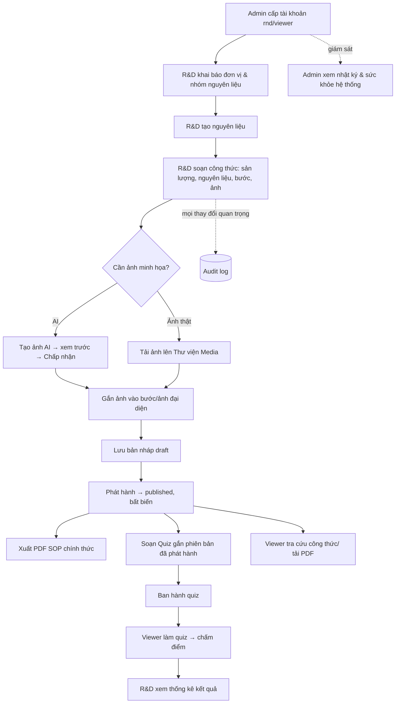
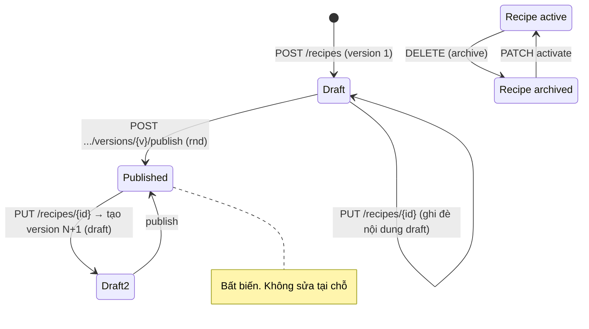
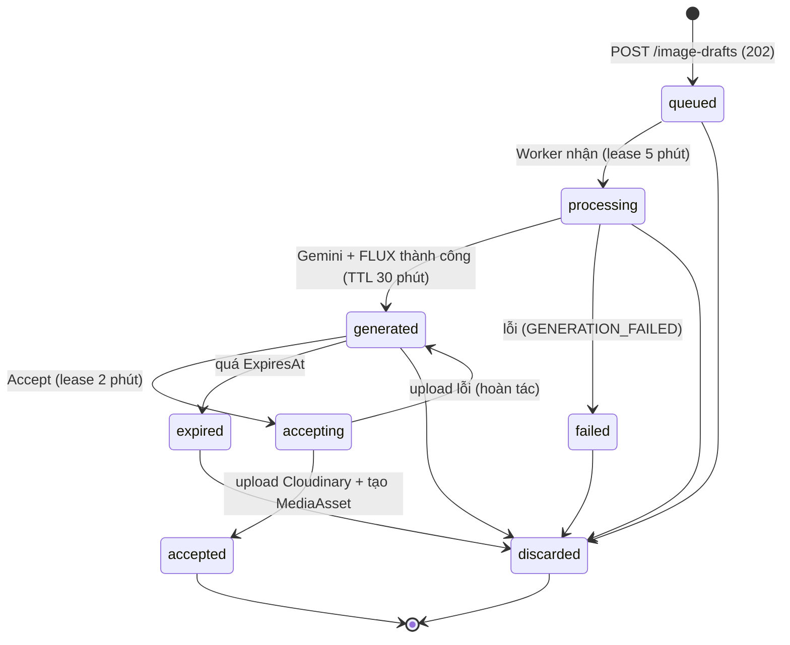
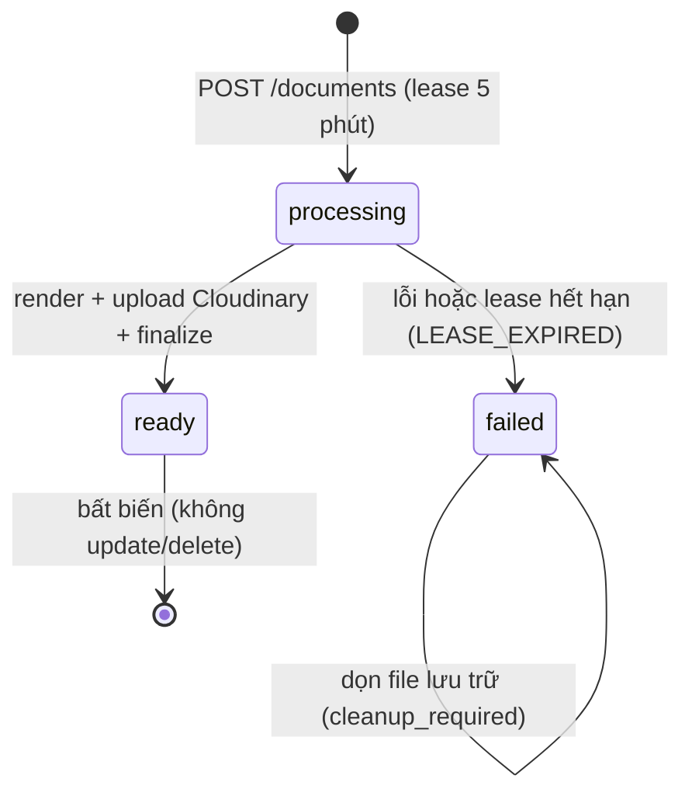
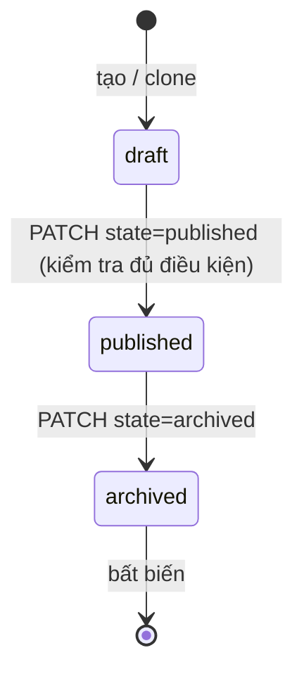
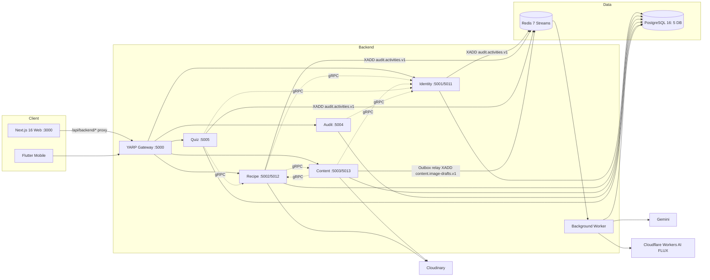
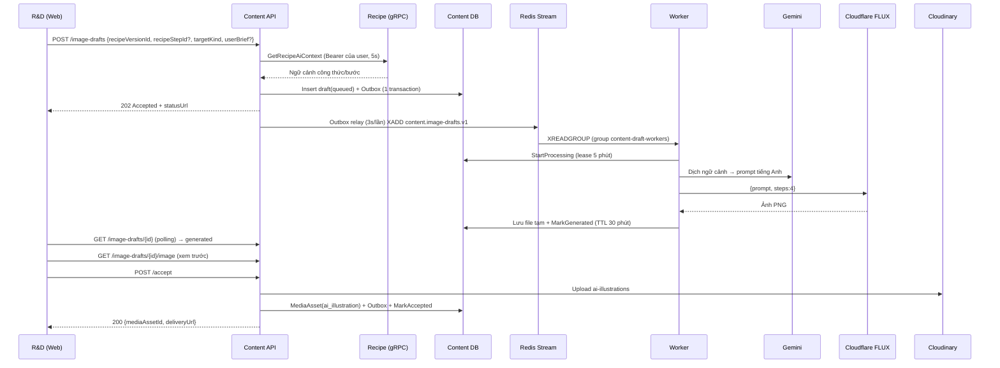
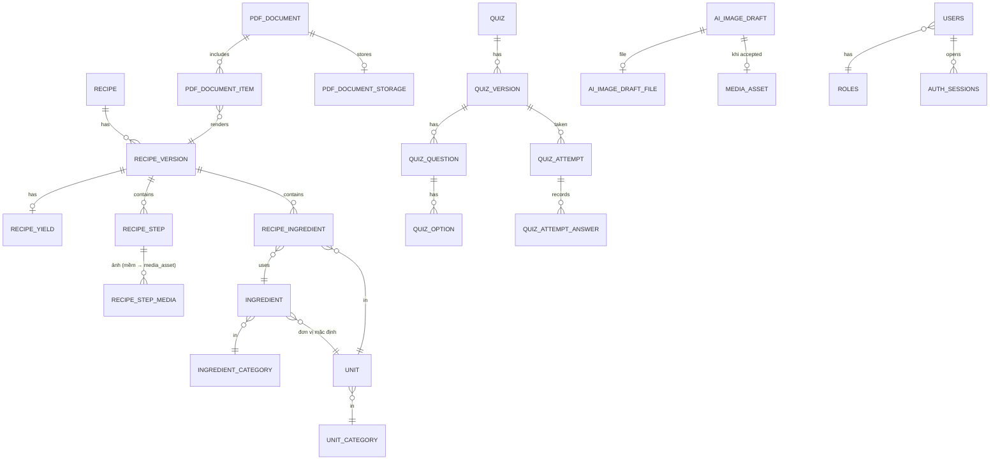

# ĐẶC TẢ YÊU CẦU PHẦN MỀM (SRS)

## Hệ thống quản lý công thức R&D đồ uống — RecipeHub

| Thông tin | Nội dung |
|---|---|
| Tên hệ thống | RecipeHub — Coffee & Beverage R&D Formula Management System |
| Phiên bản tài liệu | 1.0 (bản dựng ngược từ mã nguồn — *as-built*) |
| Ngày | 10/11/2026 |
| Nhóm thực hiện | Nhóm đồ án PRN232 / PRM393 — FPT University, Semester 8 |
| Đối tượng đọc | Giảng viên hướng dẫn, đại diện bộ phận R&D, nhóm phát triển, kiểm thử |
| Tiêu chuẩn tham chiếu | IEEE Std 830-1998, ISO/IEC/IEEE 29148:2018 (cấu trúc, tính chất yêu cầu), ISO/IEC 25010 (mô hình chất lượng), OWASP ASVS (bảo mật), RFC 7807 (Problem Details), RFC 2119 (từ khóa MUST/SHOULD) |
| Trạng thái | Dự thảo để rà soát |

> **Quy ước nguồn gốc dữ liệu.** Mọi yêu cầu trong tài liệu này được trích từ **mã nguồn, SQL schema và tài liệu kỹ thuật trong repository** tại thời điểm 10/11/2026 (Backend `src/backend`, Frontend `src/frontend`, Mobile `src/mobile`, DB `docs/database-schema`, hạ tầng `infra`). Tài liệu mô tả **hệ thống đang có (as-built)**, không phải mong muốn. Chỗ nào code khác với tài liệu thiết kế/SRS cũ (`docs/materials/PRN232.SRS.md`) thì ghi rõ tại **Mục 15 – Sai khác & hạn chế đã biết**. Mã `[INFERENCE]` nghĩa là suy luận từ code, chưa kiểm chứng khi chạy thật.

### Lịch sử phiên bản

| Phiên bản | Ngày | Nội dung |
|---|---|---|
| 0.1 | 23/09/2026 | SRS MVP đầu tiên (ASP.NET MVC monolith, bản dự thảo cho giảng viên) |
| 0.2 | 25/09/2026 | Bổ sung Cloudinary, Cloudflare FLUX, Thư viện Media (monolith) |
| 1.0 | 10/11/2026 | Viết lại theo kiến trúc **microservices .NET 8 + Next.js 16 + Flutter**, dựa 100% vào source hiện hành; thêm Quiz SOP, Audit, PDF server-side, Admin, Mobile |

### Mục lục

1. Giới thiệu
2. Mô tả tổng quan (bối cảnh, vấn đề, mục tiêu, người dùng, ràng buộc)
3. Quy trình nghiệp vụ và máy trạng thái
4. Kiến trúc hệ thống
5. Yêu cầu chức năng — Backend / Dịch vụ
   - 5.1 Xác thực & phiên (Identity)
   - 5.2 Quản lý người dùng (Identity)
   - 5.3 Danh mục đơn vị đo & nhóm nguyên liệu (Recipe)
   - 5.4 Quản lý nguyên liệu (Recipe)
   - 5.5 Quản lý công thức & phiên bản (Recipe)
   - 5.6 Tính toán công thức (Recipe)
   - 5.7 Tài liệu PDF SOP (Recipe)
   - 5.8 Thư viện Media (Content)
   - 5.9 Tạo ảnh AI (Content + Worker)
   - 5.10 Quiz — soạn đề (Quiz)
   - 5.11 Quiz — làm bài & chấm điểm (Quiz)
   - 5.12 Kết quả quiz (Quiz)
   - 5.13 Nhật ký hoạt động (Audit)
   - 5.14 Gateway, Worker và giám sát
6. Yêu cầu chức năng — Frontend Web
7. Yêu cầu chức năng — Mobile
8. Ca sử dụng chi tiết
9. Yêu cầu dữ liệu (DB)
10. Giao diện bên ngoài & tích hợp (API, gRPC, Redis Streams, dịch vụ bên thứ ba)
11. Yêu cầu phi chức năng
12. Quy tắc nghiệp vụ tổng hợp
13. Danh mục lỗi & thông điệp
14. Tiêu chí nghiệm thu & ma trận truy vết
15. Sai khác giữa code và thiết kế, hạn chế đã biết, rủi ro
16. Phạm vi ngoài hệ thống (Out of scope)
17. Điểm cần xác nhận
Phụ lục A — Bản đồ API đầy đủ · Phụ lục B — Cấu hình & biến môi trường · Phụ lục C — Chạy hệ thống

---

# 1. Giới thiệu

## 1.1 Mục đích

Tài liệu mô tả đầy đủ **hệ thống phải làm gì** (chức năng, dữ liệu, giao diện, quy tắc nghiệp vụ, phi chức năng) của RecipeHub để: (1) giảng viên và đại diện bộ phận R&D xác nhận phạm vi; (2) nhóm phát triển có đặc tả thống nhất cho Frontend, Backend, DB, Mobile; (3) kiểm thử viên viết kịch bản kiểm thử và nghiệm thu dựa trên mã yêu cầu có thể truy vết.

## 1.2 Phạm vi sản phẩm

RecipeHub là nền tảng **quản lý công thức đồ uống (cà phê, trà, đồ uống pha chế) dành cho bộ phận R&D** của một chuỗi cửa hàng (ngữ cảnh mẫu: bộ công thức Phê La), cho phép:

- Chuẩn hóa dữ liệu nền: nhóm nguyên liệu, nguyên liệu, đại lượng đo, đơn vị đo và quy đổi.
- Soạn công thức có **phiên bản** (bản nháp → phát hành), định lượng theo nguyên liệu, sản lượng chuẩn, quy trình theo từng bước kèm ảnh.
- Tạo **ảnh minh họa bằng AI** (Gemini + FLUX.1 Schnell) theo quy trình ứng viên: sinh → xem trước → chấp nhận/tạo lại/bỏ.
- Quản lý **thư viện ảnh** tập trung (ảnh thật và ảnh AI).
- Tính tỷ lệ (scale), tổng định lượng, quy đổi đơn vị.
- Xuất **tài liệu SOP dạng PDF** (A4 ngang) từ công thức đã phát hành, lưu trữ trên đám mây, tra cứu lịch sử.
- Tạo **bộ đề kiểm tra trắc nghiệm** gắn với công thức đã phát hành để kiểm tra nhân viên (barista) về SOP; chấm điểm tự động; thống kê kết quả.
- Phân quyền 3 vai trò **admin / rnd / viewer**, xác thực phiên, nhật ký hoạt động bất biến (audit), giám sát sức khỏe hệ thống.
- Ứng dụng di động Flutter cho **Viewer (Barista)** và **Admin (cửa hàng)**.

Ngoài phạm vi: xem Mục 16.

## 1.3 Định nghĩa, thuật ngữ, từ viết tắt

| Thuật ngữ | Định nghĩa |
|---|---|
| R&D | Research & Development — bộ phận nghiên cứu công thức |
| SOP | Standard Operating Procedure — quy trình pha chế chuẩn |
| Công thức (Recipe) | Thực thể định danh theo **mã** (`REC-001`); nội dung nằm trong các **phiên bản** |
| Phiên bản công thức (RecipeVersion) | Bản nội dung có số thứ tự, trạng thái `draft` hoặc `published` |
| Dòng nguyên liệu (RecipeIngredient) | Một nguyên liệu + định lượng + đơn vị + giai đoạn (stage) trong phiên bản |
| Bước (RecipeStep) | Một thao tác pha chế có thời lượng, nhiệt độ, dụng cụ, lưu ý an toàn, tiêu chí hoàn thành, ảnh |
| Snapshot nguyên liệu | Bản sao mã/tên/cảnh báo nguyên liệu tại thời điểm lưu vào công thức |
| Đơn vị cơ sở (base unit) | Đơn vị chuẩn của một đại lượng (g cho khối lượng, ml cho thể tích) |
| MediaAsset | Bản ghi ảnh đã lưu vĩnh viễn (Cloudinary); nguồn `real` hoặc `ai_illustration` |
| AiImageDraft | Bản nháp ảnh AI (ứng viên) có vòng đời riêng, sống tối đa 30 phút sau khi sinh |
| Outbox | Bảng bản ghi sự kiện ghi cùng transaction rồi relay sang Redis Streams |
| Quiz / QuizVersion | Bộ đề và phiên bản đề (draft / published / archived) |
| Attempt | Một lượt làm bài của viewer (in_progress / submitted) |
| DB First | Cấu trúc PostgreSQL do SQL có phiên bản quyết định; code ánh xạ theo; cấm EF Code First / migrations |
| YARP | Yet Another Reverse Proxy — API Gateway của hệ thống |
| gRPC | RPC đồng bộ giữa các service (HTTP/2, protobuf) |
| Redis Streams | Hàng đợi sự kiện bất đồng bộ (`XADD`, `XREADGROUP`, `XACK`) |
| JWT | JSON Web Token (HS256) |
| FLUX.1 Schnell | Mô hình tạo ảnh chạy trên Cloudflare Workers AI |

## 1.4 Tài liệu tham chiếu trong repository

| Tài liệu | Nội dung |
|---|---|
| `AGENTS.md` | Quy tắc dự án, ràng buộc kỹ thuật, DB First |
| `docs/systemmd/*` | Chuẩn kiến trúc FE/BE, RBAC, layout, gateway (SSOT) |
| `docs/systemmd/technical-inventory.md` | Kiểm kê: 89 REST action, 14 controller, 37 trang web, 27 bảng, 5 file proto gRPC (6 RPC) |
| `docs/database-schema/<svc>-db/*` | DBML + DDL PostgreSQL + migrations từng service |
| `docs/DESIGN.md` | Design system web |
| `docs/flux-schnell-prompt-engineering-guide.md` | Quy tắc prompt FLUX/Gemini |
| `docs/materials/PRN232.SRS.md` | SRS v0.2 (kiến trúc monolith cũ) |
| `src/mobile/README.md`, `DESIGN.md`, `flutter-handoff.md` | Tài liệu mobile |

## 1.5 Bố cục tài liệu

Mục 2–4 cho bối cảnh và kiến trúc. Mục 5–7 là đặc tả chức năng theo từng thành phần, mỗi yêu cầu có mã `FR-*` duy nhất, mức ưu tiên (**M**ust / **S**hould / **C**ould) và tiêu chí chấp nhận. Mục 8–14 bổ sung ca sử dụng, dữ liệu, giao diện, phi chức năng, quy tắc nghiệp vụ, lỗi, nghiệm thu. Mục 15 liệt kê những chỗ code chưa khớp thiết kế để nhóm quyết định.

---

# 2. Mô tả tổng quan

## 2.1 Bối cảnh nghiệp vụ

Chuỗi đồ uống có bộ phận R&D liên tục thử nghiệm công thức mới (cà phê muối, trà mãng cầu, rau má đậu xanh…). Quy trình truyền thống:

1. Công thức nằm rải rác trong file Excel/PDF/Zalo; định lượng nhập tay; mỗi lần đổi nguyên liệu phải sửa nhiều nơi.
2. Ảnh quy trình chụp thủ công, sắp xếp thủ công vào tài liệu hướng dẫn pha chế.
3. Phát hành SOP đến cửa hàng bằng file, khó biết **bản nào là bản đang hiệu lực**.
4. Không có cách kiểm tra barista đã nắm SOP chưa; không biết **ai sửa gì, khi nào**.

## 2.2 Vấn đề cần giải quyết

| # | Vấn đề | Hệ quả | Cách RecipeHub giải quyết |
|---|---|---|---|
| P1 | Dữ liệu nguyên liệu/đơn vị phân tán, không chuẩn | Sai định lượng, trùng lặp | Kho nguyên liệu + đơn vị dùng chung, mã tự sinh (`ING-TEA-001`) |
| P2 | Công thức không có phiên bản | Không biết bản nào đang dùng | Phiên bản `draft`→`published`, bản đã phát hành bất biến, sửa = tạo bản mới |
| P3 | Tính lại định lượng khi đổi mẻ | Sai số, mất thời gian | Tính scale/tổng/quy đổi đơn vị phía server |
| P4 | Làm ảnh minh họa tốn công | Tài liệu thiếu ảnh | AI tạo ảnh ứng viên, người dùng duyệt trước khi dùng |
| P5 | Làm PDF SOP thủ công | Trình bày không đồng nhất | Xuất PDF A4 ngang tự động từ công thức đã phát hành, có hash chống lệch |
| P6 | Không đo được mức nắm SOP | Chất lượng pha chế không đều | Quiz trắc nghiệm gắn công thức, chấm điểm và thống kê |
| P7 | Không truy vết thay đổi | Khó quy trách nhiệm | Nhật ký hoạt động bất biến, chỉ admin xem |
| P8 | Barista cần tra nhanh | Phải mở file | Viewer web + app mobile chỉ xem bản đã phát hành |

## 2.3 Mục tiêu sản phẩm

| Mã | Mục tiêu | Kết quả mong đợi | Đo bằng |
|---|---|---|---|
| OBJ-01 | Tập trung dữ liệu nền | Nguyên liệu/đơn vị khai báo một lần, tái sử dụng | AT-ING |
| OBJ-02 | Chuẩn hóa công thức | Cấu trúc thành phần/định lượng/bước thống nhất | AT-REC |
| OBJ-03 | Kiểm soát phát hành | Chỉ bản `published` đến tay viewer; bản đã phát hành bất biến | AT-VER, AT-RBAC |
| OBJ-04 | Giảm công làm tài liệu | PDF SOP sinh tự động, tải lại đúng bản đã xuất | AT-PDF |
| OBJ-05 | Hỗ trợ ảnh bằng AI có kiểm soát | AI chỉ tạo ứng viên; người dùng duyệt | AT-AI |
| OBJ-06 | Đánh giá nhân sự | Quiz, điểm, đạt/không đạt, lịch sử | AT-QUIZ |
| OBJ-07 | Truy vết & giám sát | Audit log, kiểm tra sức khỏe service/DB | AT-AUD, AT-SYS |
| OBJ-08 | Mở rộng được | Microservices, DB per service, gateway | Chuẩn `docs/systemmd` |

## 2.4 Lớp người dùng và đặc điểm

| Vai trò (code) | Tên hiển thị | Đối tượng | Route gốc Web | Mô tả quyền |
|---|---|---|---|---|
| `admin` | Quản trị hệ thống | IT, vận hành | `/admin` | Quản trị tài khoản; xem nhật ký; giám sát hệ thống. **Không** đọc/ghi công thức, nguyên liệu, media, PDF, quiz (API Recipe trả 403 cho admin) |
| `rnd` | Chuyên viên R&D | Đội công thức | `/rnd` | Toàn quyền công thức, nguyên liệu, đơn vị, media, ảnh AI, PDF, soạn/ban hành quiz, xem kết quả quiz |
| `viewer` | Barista Viewer | Barista, cửa hàng trưởng | `/viewer` | Xem công thức đã phát hành; tính toán; tải PDF chính thức; làm quiz và xem lịch sử |
| Hệ thống ngoài | Gemini, Cloudflare Workers AI, Cloudinary | Dịch vụ bên thứ ba | — | Sinh prompt, sinh ảnh, lưu ảnh/PDF |
| Hệ thống nội bộ | Background Worker | Tiến trình nền | — | Xử lý hàng đợi tạo ảnh, ghi audit, dọn file |

Mọi người dùng phải có **tài khoản do admin cấp** (không có đăng ký tự do). Giao diện và thông báo bằng **tiếng Việt**.

## 2.5 Môi trường vận hành

- **Web**: Next.js 16 (App Router, standalone), React 19, TypeScript 5, Tailwind 3. Trình duyệt Chrome/Edge/Firefox bản hỗ trợ; responsive (top-nav + drawer trên mobile).
- **Mobile**: Flutter (Dart `^3.13.2`), package `com.recipehub.mobile`, vai trò Viewer và Admin.
- **Backend**: .NET 8 (`net8.0`), ASP.NET Core, EF Core 8.0.11 + Npgsql, YARP 2.2.0, gRPC 2.66.0, StackExchange.Redis 2.8.16, QuestPDF 2024.12.1, Swashbuckle 6.6.2, prometheus-net.
- **Dữ liệu**: PostgreSQL 16 (5 database logic), Redis 7 (Streams).
- **Triển khai**: Docker Compose, 17 service: 10 service ứng dụng/dữ liệu (frontend, gateway, 5 API, worker, postgres, redis) và 7 service giám sát/công cụ (pgAdmin, Prometheus, cAdvisor, 3 exporter, Grafana).

## 2.6 Ràng buộc thiết kế và triển khai

| Mã | Ràng buộc | Nguồn |
|---|---|---|
| CON-01 | Clean Architecture 4 lớp: Domain không phụ thuộc gì; Application → Domain + BuildingBlocks; Infrastructure → Application + Domain; Api → tất cả | `AGENTS.md`, `systemmd/backend/01` |
| CON-02 | Database-per-service; **không FK xuyên database**; chỉ lưu ID logic | `systemmd/backend/02` |
| CON-03 | DB First: SQL có phiên bản là SSOT; cấm EF Migration/`EnsureCreated`/`Migrate` | `systemmd/backend/04` |
| CON-04 | Liên service đồng bộ = gRPC; bất đồng bộ = Redis Streams + `EventEnvelope<T>` | `systemmd/backend/03` |
| CON-05 | Mọi truy cập từ ngoài đi qua Gateway `/api/v1/{service}/*` | `systemmd/backend/05` |
| CON-06 | Mọi API service phải có Swagger (bật ở Development) | `AGENTS.md` |
| CON-07 | Web FE dùng duy nhất layout `WorkspaceShell`; tuân thủ `docs/DESIGN.md`; hỗ trợ `prefers-reduced-motion` | `systemmd/frontend` |
| CON-08 | UI không hiển thị UUID/hash kỹ thuật thô; chỉ hiển thị mã nghiệp vụ (REC-…, ING-…, QZ-…) | `AGENTS.md` |
| CON-09 | Prompt gửi FLUX không dùng từ phủ định (no/not/without/never); `steps=4` | `docs/flux-schnell-prompt-engineering-guide.md` |
| CON-10 | Tách tài khoản DDL (migrator) và runtime (chỉ quyền dữ liệu) | `systemmd/backend/04` |

## 2.7 Giả định và phụ thuộc

- Đơn vị sử dụng cung cấp khóa **Gemini**, **Cloudflare Workers AI**, **Cloudinary**; thiếu khóa thì Content/PDF chạy ở chế độ mô phỏng hoặc báo lỗi tùy thành phần (xem Mục 15).
- Cấu hình `Jwt:SigningKey` ≥ 32 byte ở môi trường thật.
- Thư mục tạm `temp-drafts` dùng chung giữa Content API và Worker (cùng volume).
- Kết nối Internet để gọi Gemini/Cloudflare/Cloudinary.
- Schema Identity/Recipe/Content áp bằng SQL tương ứng trước khi chạy (Compose chỉ tự áp Audit/Quiz theo `technical-inventory.md`).

---

# 3. Quy trình nghiệp vụ và máy trạng thái

## 3.1 Quy trình nghiệp vụ tổng thể



## 3.2 Quy trình vòng đời công thức



Hai tầng trạng thái độc lập:

| Tầng | Giá trị | Chuyển trạng thái |
|---|---|---|
| Recipe (`archived_at`) | `active`, `archived` | Archive (DELETE, idempotent) ⇄ Activate (PATCH). Recipe archived: không sửa, không publish, viewer không xem được |
| RecipeVersion (`status`) | `draft`, `published` | `draft → published` một chiều. Tối đa **1 draft / recipe** (unique index một phần). Sửa recipe khi version mới nhất đã `published` ⇒ tạo version `draft` mới (số +1) |

> **Lưu ý.** Hệ thống **không có** bước "gửi duyệt / người duyệt thứ hai / trả về". Chuyển `draft → published` do role `rnd` thực hiện trực tiếp. Xem Mục 15 (D-01).

## 3.3 Vòng đời ảnh AI



## 3.4 Vòng đời PDF



## 3.5 Vòng đời Quiz



Lượt làm bài: `in_progress → submitted` (một chiều). Mỗi (người dùng, phiên bản đề) chỉ có **1 lượt `in_progress`** tại một thời điểm; không giới hạn số lần làm lại sau khi nộp.

## 3.6 Vòng đời phiên đăng nhập

`Active → Revoked` (logout, rotate khi refresh, khóa user, đổi/đặt lại mật khẩu, cập nhật hồ sơ/vai trò làm vô hiệu session cũ) hoặc `Active → Expired` (8 giờ). Không có chuyển ngược.

---

# 4. Kiến trúc hệ thống

## 4.1 Sơ đồ tổng thể



## 4.2 Phân chia service

| Service | Trách nhiệm | DB (schema) | Cổng HTTP / gRPC | Không được làm |
|---|---|---|---|---|
| **Identity** | Người dùng, vai trò, phiên, JWT | `recipehub_identity` (`identity_db`: roles, users, auth_sessions) | 5001 / 5011 | Không quản công thức/quiz |
| **Recipe** | Danh mục đơn vị/nguyên liệu, công thức, phiên bản, tính toán, hồ sơ PDF | `recipehub_recipe` (`recipe_db`: 13 bảng) | 5002 / 5012 | Không lưu chấm điểm; không lưu binary ảnh/PDF trong DB |
| **Content** | Media, ảnh AI, tệp tạm, outbox | `recipehub_content` (`content_db`: 4 bảng) | 5003 / 5013 | Không lưu mật khẩu/nghiệp vụ công thức |
| **Audit** | Ghi/truy vấn nhật ký hoạt động | `recipehub_audit` (`audit_db`: audit_log) | 5004 | Không chứa logic sửa dữ liệu |
| **Quiz** | Đề, câu hỏi, lượt thi, điểm | `recipehub_quiz` (`quiz_db`: 6 bảng) | 5005 | Không sửa công thức, chỉ đọc qua gRPC |
| **Gateway** | Điểm vào duy nhất, định tuyến | — | 5000 | Không xác thực, không rate-limit, không CORS |
| **Worker** | Consumer Redis Streams, dọn file | Content DB + Audit DB | — | Không có HTTP |

## 4.3 Cơ chế xác thực liên dịch vụ

Mọi service (trừ Identity) dùng `AuthenticationHandler` scheme `Bearer` tùy chỉnh: lấy `Authorization: Bearer <JWT>` → gọi gRPC `IdentitySession.Validate` (deadline 5 giây) → nhận `valid, user_id, role, display_name` → dựng claims. **Phiên được kiểm tra stateful ở DB Identity trên mọi request**, vì vậy khóa tài khoản/đổi mật khẩu có hiệu lực ngay (không chờ token hết hạn).

## 4.4 Giao tiếp bất đồng bộ

| Stream | Nhóm consumer | Bên phát | Bên xử lý |
|---|---|---|---|
| `audit.activities.v1` | `recipehub-audit` | Identity, Recipe, Quiz (`RedisAuditActivityPublisher`, best-effort) | `AuditStreamConsumer` (Worker) → `audit_log` |
| `content.image-drafts.v1` | `content-draft-workers` | Content API Outbox relay (3 giây/lần, 50 bản/lần) | `ContentDraftProcessingWorker` |
| `platform.heartbeat.v1` | `recipehub-workers` | (demo) | `StreamConsumerWorker` |

## 4.5 Lưu trữ tệp

| Loại | Nơi lưu | Ghi chú |
|---|---|---|
| Ảnh thật (upload) | Cloudinary, folder `manual-uploads` | metadata ở `content_db.media_asset` |
| Ảnh AI đã chấp nhận | Cloudinary, folder `ai-illustrations` | metadata `media_asset`, `source_type = ai_illustration` |
| Ảnh AI ứng viên | Đĩa tạm `temp-drafts` (volume chung API+Worker) | xóa sau accept/discard/expire |
| PDF SOP | Cloudinary `raw`, `type=authenticated` (không công khai) | metadata `recipe_db.pdf_document_storage` |
| Binary trong DB | **Không** | chỉ lưu đường dẫn/ID/hash |

---

# 5. Yêu cầu chức năng — Backend / Dịch vụ

**Quy ước.** Ưu tiên: **M** = Must (bắt buộc), **S** = Should, **C** = Could. Cột *Trạng thái* ghi đối chiếu với code: **Có** = đã triển khai và khớp; **Một phần** = triển khai nhưng có giới hạn (chi tiết ở Mục 15). Mọi endpoint nêu theo đường dẫn **qua Gateway** `http://<gateway>:5000/api/v1/...`. Mọi lỗi trả về dạng RFC 7807 `ProblemDetails` (`application/problem+json`), thông điệp nghiệp vụ nằm ở `detail`.

Ký hiệu vai trò: **A** = admin, **R** = rnd, **V** = viewer, **Anon** = chưa đăng nhập, **Auth** = mọi vai trò đã đăng nhập.

## 5.1 Xác thực và phiên (Identity — `AuthController`)

**Mô tả.** Đăng nhập bằng email + mật khẩu; cấp cặp *access token (JWT HS256, 30 phút)* và *refresh token (ngẫu nhiên 48 byte, lưu băm SHA-256, phiên 8 giờ)*. Phiên lưu DB và kiểm tra ở mọi request.

### 5.1.1 Bảng endpoint

| Method | Route | Quyền | Rate limit | Request | Response |
|---|---|---|---|---|---|
| POST | `/identity/auth/login` | Anon | 20/phút/IP (`login`) | `{username, password}` (`username` = email) | 200 `{accessToken, refreshToken, expiresAt, user}`; 401; 403; 429 |
| POST | `/identity/auth/refresh` | Anon | 20/phút/IP | `{refreshToken}` | 200 như login; 401 |
| POST | `/identity/auth/logout` | Auth | — | — | 204 |
| GET | `/identity/auth/me` | Auth | — | — | 200 `UserResponse`; 404 |
| PUT | `/identity/auth/profile` | Auth | — | `{fullName}` | 200 `UserResponse` |
| PUT | `/identity/auth/password` | Auth | — | `{currentPassword, newPassword}` | 204; 400 |
| GET | `/identity/info` | Anon | — | — | 200 `{service, version, status, database, timestampUtc}` |

`UserResponse = {id, email, fullName, role, isActive, createdAt}`.

### 5.1.2 Yêu cầu

| Mã | Yêu cầu | Ưu tiên | Tiêu chí chấp nhận | Trạng thái |
|---|---|---|---|---|
| FR-AUTH-01 | Hệ thống cho phép đăng nhập bằng email + mật khẩu của tài khoản do admin cấp | M | Thông tin đúng và tài khoản hoạt động → 200 kèm token và thông tin người dùng | Có |
| FR-AUTH-02 | Email được chuẩn hóa `trim + lowercase` trước khi so khớp; email > 254 ký tự, mật khẩu rỗng hoặc > 128 ký tự bị từ chối như sai thông tin | M | Cùng một email viết hoa/thường đăng nhập được; input vượt giới hạn → 401 | Có |
| FR-AUTH-03 | Chống dò tài khoản: email không tồn tại và mật khẩu sai trả **cùng một** thông điệp "Email hoặc mật khẩu không chính xác." (401) | M | Không phân biệt được hai trường hợp qua nội dung phản hồi | Có |
| FR-AUTH-04 | Tài khoản bị khóa (`is_active=false`) không đăng nhập được; kiểm tra **sau** khi mật khẩu đúng → 403 "Tài khoản đã bị khóa." | M | Mật khẩu đúng + khóa → 403; không tạo session | Có |
| FR-AUTH-05 | Giới hạn tốc độ đăng nhập/refresh: 20 lượt/phút/IP; vượt → 429 | S | Lượt thứ 21 trong 1 phút bị 429 (body rỗng) | Một phần* |
| FR-AUTH-06 | Access token JWT HS256, TTL **30 phút**, `ClockSkew = 0`, claims `sub` (userId), `jti` (sessionId), `role`; `iss = RecipeHub.Identity`, `aud = RecipeHub` (cấu hình được) | M | Token quá hạn/sai chữ ký/độ dài > 8192 bị coi không hợp lệ | Có |
| FR-AUTH-07 | Khóa ký `Jwt:SigningKey` ≥ 32 byte; thiếu/ngắn ở môi trường thật → dịch vụ không khởi động. Development không cấu hình thì sinh khóa ngẫu nhiên 48 byte mỗi lần chạy | M | Cấu hình khóa ngắn → lỗi `Jwt:SigningKey phải có ít nhất 32 bytes…` | Có |
| FR-AUTH-08 | Refresh token 48 byte ngẫu nhiên (Base64), **chỉ lưu SHA-256 hex (64 ký tự)** trong DB | M | DB không chứa refresh token gốc | Có |
| FR-AUTH-09 | Phiên có hiệu lực **8 giờ** kể từ lúc tạo; mỗi lần refresh tạo phiên mới (8 giờ mới) | M | `expires_at = created_at + 8h` | Có |
| FR-AUTH-10 | Refresh theo cơ chế **xoay vòng (rotation)**: phiên cũ bị thu hồi và phiên mới tạo trong cùng một transaction; refresh token đã dùng không dùng lại được | M | Dùng lại refresh token cũ → 401 "Session đã hết hạn hoặc bị thu hồi." | Có |
| FR-AUTH-11 | Refresh bị từ chối khi: token rỗng/> 256 ký tự, không tìm thấy, đã thu hồi, hết hạn, user bị khóa, hoặc `session.created_at < user.updated_at` | M | Mỗi trường hợp → 401 | Có |
| FR-AUTH-12 | Mỗi request có Bearer được kiểm tra stateful: JWT hợp lệ + session tồn tại + khớp user + chưa thu hồi + chưa hết hạn + user active + `session.created_at ≥ user.updated_at` | M | Admin khóa user → request kế tiếp của user bị 401 ngay | Có |
| FR-AUTH-13 | Đăng xuất thu hồi **phiên hiện tại**; nếu phiên không tồn tại vẫn trả 204 (idempotent) | M | `revoked_at` được set; gọi lại không lỗi | Có |
| FR-AUTH-14 | Người dùng xem hồ sơ của mình (`/me`) | M | Trả đúng email, họ tên, vai trò, trạng thái | Có |
| FR-AUTH-15 | Người dùng đổi họ tên (1–200 ký tự sau trim). Thao tác bump `updated_at` nên **vô hiệu mọi phiên cũ kể cả phiên hiện tại** (phải đăng nhập lại) | M | Đổi tên xong, access token cũ bị 401 | Có |
| FR-AUTH-16 | Người dùng tự đổi mật khẩu: mật khẩu hiện tại đúng (sai → 400), mật khẩu mới theo FR-USR-05; thành công thu hồi **tất cả** phiên của user | M | Sau đổi, mọi token cũ bị 401 | Có |
| FR-AUTH-17 | Băm mật khẩu bằng `PasswordHasher<IdentityUser>` (PBKDF2 có salt) | M | DB không chứa mật khẩu rõ | Có |
| FR-AUTH-18 | Các service khác xác thực qua gRPC `IdentitySession.Validate` (deadline 5 giây). Identity không phản hồi → service gọi trả **503** (fail-closed), không trả 401 giả | M | Tắt Identity → Content/Audit trả 503 | Có |

\* Sau YARP, `RemoteIpAddress` thường là IP của Gateway; vì Gateway không cấu hình `ForwardedHeaders` nên `[INFERENCE]` mọi client dùng chung một bucket. Xem R-07.

**Không có trong hệ thống** (đã kiểm chứng bằng tìm kiếm mã nguồn): đăng ký tự do, quên mật khẩu/đặt lại qua email, OTP/2FA, đăng nhập Google/OAuth ở backend, khóa tạm do sai mật khẩu nhiều lần.

## 5.2 Quản lý người dùng (Identity — `UsersController`)

Toàn controller yêu cầu role `admin` (401 chưa đăng nhập, 403 sai vai trò).

| Method | Route | Request | Response | Sự kiện audit |
|---|---|---|---|---|
| GET | `/identity/users?search=&role=&state=&page=1&pageSize=20` | query | 200 `{items, totalCount, page, pageSize}` | — |
| GET | `/identity/users/{id}` | — | 200 `UserResponse`; 404 | — |
| POST | `/identity/users` | `{email, fullName, role, password}` | 201 `UserResponse`; 400; 409 | `user.created` |
| PUT | `/identity/users/{id}` | `{fullName, role}` | 200; 404; 409 | `user.role_changed` hoặc `user.updated` |
| PUT | `/identity/users/{id}/status` | `{isActive}` | 200; 409 | `user.locked` / `user.unlocked` |
| PUT | `/identity/users/{id}/password` | `{newPassword}` | 204 | `user.password_reset` |

| Mã | Yêu cầu | Ưu tiên | Tiêu chí chấp nhận | Trạng thái |
|---|---|---|---|---|
| FR-USR-01 | Admin liệt kê người dùng có phân trang (`page ≥ 1`, `pageSize 1–100`, mặc định 1/20), sắp xếp theo email tăng dần | M | Ngoài khoảng → 400 "Page/pageSize không hợp lệ (pageSize 1–100)." | Có |
| FR-USR-02 | Lọc theo `search` (chứa, không phân biệt hoa thường trên email **hoặc** họ tên), `role` ∈ {admin, rnd, viewer}, `state` ∈ {all, active, inactive} | M | `role`/`state` sai → 400 | Có |
| FR-USR-03 | Admin tạo tài khoản với email, họ tên, vai trò, mật khẩu. Thứ tự kiểm tra: định dạng email → trùng email → mật khẩu → vai trò → họ tên | M | Email không hợp lệ → 400; trùng → 409 "Email đã tồn tại." | Có |
| FR-USR-04 | Email: trim + lowercase, ≤ 254 ký tự, phải là địa chỉ hợp lệ (`MailAddress`) và `address == email`; duy nhất theo `lower(btrim(email))` (ràng buộc ở cả app và DB) | M | Vi phạm → 400/409 | Có |
| FR-USR-05 | Mật khẩu 8–128 ký tự, có ≥ 1 chữ hoa, ≥ 1 chữ thường, ≥ 1 chữ số (không bắt ký tự đặc biệt) | M | Không đạt → 400 "Mật khẩu cần 8–128 ký tự, gồm chữ hoa, chữ thường và số." | Có |
| FR-USR-06 | Họ tên 1–200 ký tự sau trim | M | → 400 "Họ tên phải có 1–200 ký tự." | Có |
| FR-USR-07 | Vai trò hợp lệ: `admin`, `rnd`, `viewer` (phân biệt hoa thường) và phải tồn tại trong bảng `roles` | M | Sai → 400 "Role phải là admin, rnd hoặc viewer." / "Vai trò chưa được cấu hình." | Có |
| FR-USR-08 | Admin đổi họ tên/vai trò người khác; **không được tự hạ vai trò admin của chính mình** | M | Tự hạ → 409 "Không thể tự hạ vai trò Admin đang đăng nhập." | Có |
| FR-USR-09 | Admin khóa/mở khóa tài khoản; khóa thu hồi mọi phiên đang hoạt động; **không được tự khóa chính mình**; mở khóa không tạo lại phiên | M | Tự khóa → 409 "Không thể tự khóa tài khoản đang đăng nhập." | Có |
| FR-USR-10 | Admin đặt lại mật khẩu cho user (theo FR-USR-05); thu hồi mọi phiên của user đó | M | Sau reset, user phải đăng nhập lại | Có |
| FR-USR-11 | Mọi cập nhật user bump `updated_at` ⇒ vô hiệu phiên cũ của user đó (kể cả refresh) | M | Đổi vai trò xong user buộc đăng nhập lại | Có |
| FR-USR-12 | Không có xóa cứng user/session; "xóa" = khóa | M | Không có endpoint DELETE user | Có |
| FR-USR-13 | Mỗi thao tác quản trị phát sự kiện audit (`user.created`, `user.updated`, `user.role_changed`, `user.locked`, `user.unlocked`, `user.password_reset`); tự đổi tên phát `user.profile_updated` chỉ khi tên thực sự đổi; **không** ghi audit cho login/logout/refresh/đổi mật khẩu tự phục vụ | S | Sự kiện xuất hiện ở `/audit/logs`; không phát nếu không có thay đổi | Có |
| FR-USR-14 | Phát audit theo kiểu *best-effort*: lỗi Redis/timeout không làm hỏng thao tác chính | S | Tắt Redis, tạo user vẫn 201 | Có |
| FR-USR-15 | Ở Development và khi `Identity:SeedDemoUsers=true`, seed 3 tài khoản demo (`admin@recipehub.demo`, `rd@recipehub.demo`, `viewer@recipehub.demo`, mật khẩu `Demo@1234`), không ghi đè user có sẵn; **Production không seed** | S | Compose Development có 3 user demo | Có |

**Vai trò mặc định trong DB** (`identity_db.roles`): `1 admin – Quản trị hệ thống`, `2 rnd – Chuyên viên R&D`, `3 viewer – Barista Viewer`.

## 5.3 Danh mục đơn vị đo và nhóm nguyên liệu (Recipe — `CatalogsController`)

Gồm 3 danh mục: **Nhóm đơn vị (đại lượng đo)** `unit_category`, **Đơn vị đo** `unit`, **Nhóm nguyên liệu** `ingredient_category`. Quyền: `rnd` đọc/ghi; `viewer` chỉ GET; `admin` bị 403.

### 5.3.1 Endpoint

| Method | Route (`/recipes/...`) | Ghi chú |
|---|---|---|
| GET / GET{id} / POST / PUT{id} / DELETE{id} / PATCH{id}/activate | `/unit-categories` | `{code, name, description}`; DELETE = vô hiệu (soft) |
| GET / GET{id} / POST / PUT{id} / DELETE{id} / PATCH{id}/activate | `/ingredient-categories` | như trên |
| GET (`/units`, `/catalogs/units`) / GET{id} / POST / PUT{id} / DELETE{id} / PATCH{id}/activate | `/units` | `{code, name, categoryId, decimalPlaces}` |
| PUT | `/units/{id}/conversion` | `{isBase, factorToBase, offsetToBase}` |

`{id}` là `publicId` (UUID công khai), không phải khóa bigint nội bộ.

### 5.3.2 Yêu cầu

| Mã | Yêu cầu | Ưu tiên | Tiêu chí chấp nhận | Trạng thái |
|---|---|---|---|---|
| FR-CAT-01 | R&D tạo/sửa/vô hiệu hóa/kích hoạt lại nhóm đơn vị và nhóm nguyên liệu; `code` và `name` bắt buộc | M | Thiếu → 400 | Có |
| FR-CAT-02 | Mã và tên danh mục duy nhất theo dạng chuẩn hóa (`UPPER`) | M | Trùng → 409 "… code '…' already exists." | Có |
| FR-CAT-03 | Xóa danh mục = **vô hiệu hóa mềm** (`state = inactive`); kích hoạt lại bằng PATCH. Danh mục mới tạo ở trạng thái `active` | M | DELETE trả 204 và bản ghi còn trong DB | Có |
| FR-CAT-04 | Tạo đơn vị: `code`, `name` bắt buộc; `categoryId` bắt buộc, nhóm đơn vị phải tồn tại và `active`; `decimalPlaces` ∈ [0, 6]; mã đơn vị duy nhất | M | Sai → 400/404/409 theo thông điệp | Có |
| FR-CAT-05 | Đơn vị mới mặc định **chưa cấu hình quy đổi** (`is_base=false`, `factor=1`, `offset=0`) | M | Giá trị khởi tạo đúng | Có |
| FR-CAT-06 | Cấu hình quy đổi: `factorToBase > 0`; đơn vị cơ sở bắt buộc `factor=1, offset=0`; mỗi nhóm đơn vị có **tối đa 1** đơn vị cơ sở. Công thức: `giá_trị_cơ_sở = giá_trị × factor + offset` | M | Vi phạm → 400/409 (cũng có CHECK và unique index một phần ở DB) | Có |
| FR-CAT-07 | Đơn vị **đã được dùng** (đơn vị mặc định nguyên liệu, dòng nguyên liệu công thức, sản lượng) không được đổi `code` hoặc nhóm; không đổi hệ số quy đổi nếu đã cấu hình khác mặc định (cho phép cấu hình lần đầu) | M | → 409 "A used unit cannot change code or category…" | Có |
| FR-CAT-08 | Danh sách đơn vị trả kèm `categoryName`, `isBase`, `factorToBase`, `offsetToBase`, `decimalPlaces`, `state` | M | Response đủ trường | Có |
| FR-CAT-09 | Dữ liệu gốc (seed): nhóm nguyên liệu `TEA, COFFEE, DAIRY, SWEETENER, TOPPING, OTHER`; nhóm đơn vị `mass, volume, count`; đơn vị `mg, g, kg, ml, cl, dl, l, serving`; cơ sở `g`, `ml`, `serving` | S | Sau bootstrap có đủ danh mục | Có |

## 5.4 Quản lý nguyên liệu (Recipe — `IngredientsController`)

| Method | Route (`/recipes/...`) | Request / Query | Response |
|---|---|---|---|
| GET | `/ingredients?query=&state=&categoryId=` | `query` khớp `ILIKE %term%` trên mã **hoặc** tên | 200 danh sách (tối đa **200**, sắp theo tên) |
| GET | `/ingredients/{id}` | — | 200; 404 |
| POST | `/ingredients/generate-code` | `{categoryId}` | 200 `{code}` dạng `ING-<NHÓM>-001` |
| POST | `/ingredients` | `{code, name, categoryId, defaultUnitId, description, warning, note, imageAssetRef?}` | 201 |
| PUT | `/ingredients/{id}` | như trên | 200 |
| DELETE | `/ingredients/{id}` | — | 204 (vô hiệu mềm) |
| PATCH | `/ingredients/{id}/activate` | — | 200 |

| Mã | Yêu cầu | Ưu tiên | Tiêu chí chấp nhận | Trạng thái |
|---|---|---|---|---|
| FR-ING-01 | R&D tạo nguyên liệu: mã, tên, nhóm, đơn vị mặc định, mô tả, cảnh báo, ghi chú, ảnh (tham chiếu MediaAsset) | M | Lưu thành công, `state=active` | Có |
| FR-ING-02 | Mã nguyên liệu duy nhất (chuẩn hóa `UPPER`); **tên không bắt buộc duy nhất** | M | Trùng mã → 409 | Có |
| FR-ING-03 | Nhóm và đơn vị mặc định phải tồn tại và còn `active` | M | Sai → 404 hoặc 400 "The selected … is inactive." | Có |
| FR-ING-04 | Tự sinh mã `ING-<MÃ NHÓM>-NNN` (số lớn nhất hiện có + 1, định dạng 3 chữ số; lặp tăng đến khi chưa tồn tại) | S | Ví dụ `ING-TEA-001`; nhóm inactive → 400 | Có |
| FR-ING-05 | Tìm kiếm theo mã/tên, lọc theo trạng thái và nhóm; kết quả tối đa 200, sắp theo tên | M | Kết quả đúng bộ lọc | Có |
| FR-ING-06 | Vô hiệu hóa nguyên liệu (xóa mềm); kích hoạt lại phải kiểm tra nhóm và đơn vị còn `active` | M | DELETE → 204, bản ghi vẫn có | Có |
| FR-ING-07 | Nguyên liệu vô hiệu **không chọn được** cho dòng công thức mới, nhưng công thức cũ giữ **snapshot** mã/tên/cảnh báo | M | Lưu công thức dùng nguyên liệu inactive → 400 "Ingredient '…' is inactive and cannot be selected." | Có |
| FR-ING-08 | Nguyên liệu lưu người tạo/cập nhật và thời điểm (`created_by_user_ref`, `updated_by_user_ref`, `created_at`, `updated_at`) | S | Trường có trong DB | Có (DB) |
| FR-ING-09 | `imageAssetRef` là UUID MediaAsset của Content; Recipe **không** kiểm tra tồn tại (không FK xuyên DB) | S | Ghi nhận ở Mục 15 | Một phần |
| FR-ING-10 | Cảnh báo (`warning`) của nguyên liệu được hiển thị cùng dòng nguyên liệu trong công thức và PDF | S | Xuất hiện trong chi tiết công thức / PDF | Có |

> Việc "xóa nguyên liệu đang được công thức dùng" **không bị chặn**; vì là xóa mềm và công thức giữ snapshot nên dữ liệu lịch sử không hỏng.

## 5.5 Quản lý công thức và phiên bản (Recipe — `RecipesController`)

### 5.5.1 Endpoint

| Method | Route (`/recipes/...`) | Quyền | Mô tả |
|---|---|---|---|
| GET | `/recipes?query=&state=&versionStatus=&createdByUserId=&page=1&pageSize=20` | R, V | Tìm kiếm có phân trang → `{items, page, pageSize, totalCount}` |
| GET | `/recipes/{id}` | R, V | Chi tiết bản mới nhất (V: bản published mới nhất) |
| GET | `/recipes/{id}/versions` | R, V | Lịch sử phiên bản (V: chỉ `published`) |
| GET | `/recipes/{id}/versions/{versionId}` | R, V | Chi tiết một phiên bản |
| POST | `/recipes/generate-code` | R | Sinh mã `REC-NNN` |
| POST | `/recipes` | R | Tạo công thức + phiên bản 1 (`draft`) |
| PUT | `/recipes/{id}` | R | Cập nhật nội dung (xem 5.5.3) |
| DELETE | `/recipes/{id}` | R | Lưu trữ (archive), idempotent |
| PATCH | `/recipes/{id}/activate` | R | Bỏ lưu trữ |
| POST | `/recipes/{id}/copy` | R | Nhân bản thành công thức mới |
| POST | `/recipes/{id}/versions/{versionId}/publish` | R | Phát hành bản nháp |

### 5.5.2 Cấu trúc dữ liệu công thức (request tạo/sửa)

```
{ code, name, description, primaryMediaAssetRef?,
  yieldQuantity?, yieldUnitId?, yieldNote,
  ingredients: [ {ingredientId, unitId, quantity, stageName, note} ],
  steps: [ {id?, title, description, durationSeconds?, temperatureCelsius?,
            equipment, safetyNote, completionCriteria,
            media: [ {mediaAssetRef, isPrimary, caption} ]} ] }
```

### 5.5.3 Yêu cầu

| Mã | Yêu cầu | Ưu tiên | Tiêu chí chấp nhận | Trạng thái |
|---|---|---|---|---|
| FR-REC-01 | R&D tạo công thức: mã + tên bắt buộc; mã duy nhất (chuẩn hóa UPPER); hệ thống tạo **Recipe + Version 1 ở trạng thái `draft`** | M | 201, `versionNumber=1`, `versionStatus=draft` | Có |
| FR-REC-02 | Tự sinh mã `REC-NNN` | S | `POST /recipes/generate-code` → `{code}` | Có |
| FR-REC-03 | Sản lượng chuẩn: `yieldQuantity` và `yieldUnitId` **phải đi cùng nhau**, `yieldQuantity > 0`, đơn vị phải `active` | M | Lệch cặp → 400 "Yield quantity and yield unit must be provided together." | Có |
| FR-REC-04 | Dòng nguyên liệu: nguyên liệu và đơn vị tồn tại + `active`; `quantity > 0`; thứ tự `sortOrder` do **server** gán theo vị trí mảng (1..n); lưu snapshot mã/tên/cảnh báo nguyên liệu. Cho phép **cùng nguyên liệu xuất hiện nhiều dòng** (phân biệt theo `stageName`) | M | Quantity ≤ 0 → 400 "Ingredient quantity must be greater than zero." | Có |
| FR-REC-05 | Bước quy trình: tiêu đề, mô tả, thời lượng (giây, ≥ 0), nhiệt độ (°C), dụng cụ, lưu ý an toàn, tiêu chí hoàn thành; thứ tự do server gán theo vị trí mảng | M | `durationSeconds < 0` → 400 "Step duration cannot be negative." | Có |
| FR-REC-06 | Mỗi bước có thể gắn nhiều ảnh (`mediaAssetRef`), **tối đa 1 ảnh chính** (`isPrimary`), không lặp cùng ảnh, có chú thích | M | Vi phạm → 400 | Có |
| FR-REC-07 | Công thức có **ảnh đại diện** (`primaryMediaAssetRef`), UUID hợp lệ khác rỗng | S | Rỗng-GUID → 400 | Có |
| FR-REC-08 | **Bản nháp được phép chưa đầy đủ**: thiếu sản lượng/nguyên liệu/bước, tiêu đề/mô tả bước rỗng vẫn lưu được | M | Lưu draft rỗng thành công | Có |
| FR-REC-09 | Cập nhật khi bản mới nhất là `draft`: **ghi đè** nội dung bản nháp (nguyên liệu thay toàn bộ; bước giữ theo `id`, bước không có trong request bị xóa, `id` lạ → 404) | M | Draft giữ số phiên bản | Có |
| FR-REC-10 | Cập nhật khi bản mới nhất là `published`: **tạo phiên bản mới** `draft` với số phiên bản + 1, nội dung theo request; bản đã phát hành không đổi | M | `versionNumber` tăng 1; bản cũ nguyên vẹn | Có |
| FR-REC-11 | Mỗi công thức chỉ có **tối đa 1 bản `draft`** (unique index một phần) | M | DB từ chối bản draft thứ hai | Có |
| FR-REC-12 | Đổi **mã** công thức chỉ được khi chưa phát hành lần nào và còn ở phiên bản 1; khác → 409 "Recipe code cannot be changed after the first publication. Create a copy with a new code instead." | M | Đổi mã sau phát hành → 409 | Có |
| FR-REC-13 | Phát hành: chỉ bản `draft` (khác → 409 "Only a draft can be published…"); công thức phải `active`; ghi `published_at`, `published_by_user_ref` | M | Sau publish `versionStatus=published` | Có |
| FR-REC-14 | Điều kiện phát hành: **có sản lượng**, ≥ 1 nguyên liệu, ≥ 1 bước, **mọi bước có tiêu đề và mô tả** | M | Thiếu → 400 "A yield is required before publication." / thông điệp tương ứng | Có |
| FR-REC-15 | Bản `published` là **bất biến**; không có endpoint sửa tại chỗ | M | PUT tạo version mới thay vì sửa | Có |
| FR-REC-16 | Lưu trữ công thức (DELETE) set `archived_at`; idempotent; công thức lưu trữ **không sửa** (409 "An archived recipe cannot be changed.") và **không phát hành** | M | Archive hai lần đều 204 | Có |
| FR-REC-17 | Kích hoạt lại công thức đã lưu trữ (PATCH) bỏ `archived_at` | M | State chuyển về `active` | Có |
| FR-REC-18 | Nhân bản công thức: tạo công thức mới (mã mới bắt buộc, tên mặc định = tên nguồn) sao chép mô tả, ảnh đại diện, sản lượng, nguyên liệu, bước + ảnh (bước nhận ID mới) từ **bản mới nhất**; kết quả là version 1 `draft` | M | 201, nguồn không đổi | Có |
| FR-REC-19 | Tìm kiếm: `query` khớp mã **hoặc** tên (ILIKE); lọc `state` (active/archived), `versionStatus` (draft/published), `createdByUserId`; `page ≥ 1`, `pageSize 1–100`; sắp theo `updatedAt` giảm dần | M | `state`/`versionStatus` sai → 400; `page<1` → 400; `pageSize` ngoài khoảng → 400 | Có |
| FR-REC-20 | Mỗi công thức trong danh sách trả **bản mới nhất** (nếu lọc `published` thì bản published mới nhất) kèm `ingredientCount`, `stepCount`, `primaryMediaAssetRef` | M | Danh sách đủ trường | Có |
| FR-REC-21 | Lịch sử phiên bản: số phiên bản, trạng thái, tên, người tạo, thời điểm tạo/cập nhật/phát hành, giảm dần theo số phiên bản; mở bản cũ chỉ đọc | M | 404 nếu công thức không có phiên bản | Có |
| FR-REC-22 | Chi tiết công thức trả sản lượng, nguyên liệu (mã/tên/số lượng/đơn vị/giai đoạn/ghi chú/cảnh báo), các bước và ảnh bước | M | Đủ trường theo `RecipeDetailResponse` | Có |
| FR-REC-23 | **Quyền xem của Viewer**: danh sách bị ép `state=active` + `versionStatus=published`; chi tiết lấy bản published mới nhất; chưa phát hành → 403 "Công thức chưa được phát hành."; đã lưu trữ → 403 "Công thức đã được lưu trữ."; lịch sử chỉ trả bản published | M | Viewer không thấy bản draft/archived qua mọi endpoint | Có |
| FR-REC-24 | **Admin bị chặn** mọi API `/recipes/*` (403), trừ `/recipes/info` và health | M | Admin gọi bất kỳ API công thức → 403 | Có |
| FR-REC-25 | Chỉ `rnd` thực hiện ghi (POST/PUT/PATCH/DELETE) trên Recipe, ngoại lệ các API tính toán (`/calculate/*`, `/units/convert`) cho cả `viewer` | M | Viewer gọi PUT → 403 | Có |
| FR-REC-26 | Phát audit: `recipe.created`, `recipe.version_created`, `recipe.updated` (chỉ khi có thay đổi ngữ nghĩa: tên, mô tả, sản lượng, nguyên liệu, tiêu đề/thời lượng bước), `recipe.published`, `recipe.archived`, `recipe.activated`; không ghi audit cho thay đổi danh mục (đơn vị/nguyên liệu/nhóm) | S | Sự kiện xuất hiện ở audit log | Có |
| FR-REC-27 | Tham chiếu ảnh (`primaryMediaAssetRef`, `mediaAssetRef`) là UUID MediaAsset của Content; Recipe không kiểm tra tồn tại; Content hỏi ngược Recipe qua gRPC `GetMediaAssetUsages` | S | Xem 5.8 | Một phần |

## 5.6 Tính toán công thức (Recipe — `CalculationsController`)

Cho phép `rnd` và `viewer`. **Không ghi DB**, client gửi các dòng nguyên liệu trực tiếp.

| Method | Route | Request | Response |
|---|---|---|---|
| POST | `/recipes/calculate/scale` | `{ingredients:[{ingredientId, quantity, unit, order, notes?, stageNote?}], standardYield, targetYield}` | `{standardYield, targetYield, multiplier, ingredients[]}` |
| POST | `/recipes/calculate/totals` | `{ingredients[]}` | `{totals:[{unit, quantity}]}` |
| POST | `/recipes/units/convert` | `{value, sourceUnit, targetUnit}` (mã đơn vị) | `{value, sourceUnit, targetUnit, convertedValue}` |

| Mã | Yêu cầu | Ưu tiên | Tiêu chí chấp nhận | Trạng thái |
|---|---|---|---|---|
| FR-CAL-01 | **Scale**: `multiplier = targetYield / standardYield`; số lượng mới = `round(quantity × multiplier, 6, AwayFromZero)`; đơn vị giữ nguyên | M | Ví dụ 100 g, chuẩn 1, mục tiêu 5 → 500 g | Có |
| FR-CAL-02 | **Tổng định lượng**: gom theo đơn vị cơ sở metric (khối lượng → g, thể tích → ml); đơn vị khác nhóm giữ mã riêng; làm tròn 6 chữ số | M | `1 kg + 500 g` → `1500 g` | Có |
| FR-CAL-03 | **Quy đổi** chỉ giữa đơn vị metric cùng nhóm và cùng đại lượng: khối lượng `mg/g/kg`, thể tích `ml/cl/dl/l` (hệ số cố định: mg=0.001, g=1, kg=1000; ml=1, cl=10, dl=100, l=1000). Không quy đổi khối lượng ↔ thể tích, không cup/shot | M | Khác nhóm → 400 "Chỉ quy đổi giữa các đơn vị metric cùng nhóm…" | Có |
| FR-CAL-04 | Giới hạn: 1–1000 dòng; số dương trong `[0.000001, 999,999,999,999]`; giá trị quy đổi `[0, 999,999,999,999]`; kết quả > giới hạn hoặc bằng 0 khi đầu vào > 0 → 400 | M | Vượt → 400 "… vượt giới hạn." | Có |
| FR-CAL-05 | Đơn vị được tra theo `code` (không phân biệt hoa thường) trong catalog; không có → 400 "Đơn vị '…' không tồn tại trong catalog." | M | — | Có |
| FR-CAL-06 | Không tự cộng hoặc quy đổi giữa các đơn vị không tương thích (BR-08) | M | Tổng giữ riêng từng đơn vị | Có |

> **Chú ý (D-05).** Hệ số quy đổi `convert` **cố định trong code**, không đọc `factor_to_base` đã cấu hình trong DB ở mục 5.3.

## 5.7 Tài liệu PDF SOP (Recipe — `PdfDocumentsController` + `QuestPDF` + Cloudinary)

### 5.7.1 Endpoint

| Method | Route (`/recipes/...`) | Quyền | Mô tả |
|---|---|---|---|
| GET | `/documents/capabilities` | R (và Auth theo tài liệu thiết kế) | Hằng số giới hạn của bộ xuất PDF |
| POST | `/documents/preview` | R | Render PDF xem trước, trả `application/pdf`, header `X-Pdf-Snapshot-Hash` |
| POST | `/documents` | R | Xuất chính thức → 201 `PdfDocumentResponse` |
| GET | `/documents?search=&documentType=&exportScope=&state=&recipeVersionId=&createdByUserId=&fromDate=&toDate=&page=1&pageSize=20` | R | Lịch sử tài liệu (phân trang) |
| GET | `/documents/{documentId}` | R | Chi tiết hồ sơ (404 nếu không có) |
| GET | `/documents/{documentId}/file?disposition=inline\|attachment` | R, V | Tải tệp |
| GET | `/recipes/{versionId}/published-document` | R, V | Tra cứu PDF chính thức mới nhất của một phiên bản |

Body xem trước/xuất: `{documentType: draft|published, title, subtitle?, items:[{recipeId, recipeVersionId, titleOverride?, coverMediaAssetId?, steps:[{stepId, media:[{assetId, caption?}]}]}]}`; xuất kèm `expectedSnapshotHash`.

### 5.7.2 Yêu cầu

| Mã | Yêu cầu | Ưu tiên | Tiêu chí chấp nhận | Trạng thái |
|---|---|---|---|---|
| FR-PDF-01 | R&D xem trước PDF từ **phiên bản đã phát hành** của một hoặc nhiều công thức | M | Trả PDF + hash snapshot | Có |
| FR-PDF-02 | Tiêu đề bắt buộc 1–200 ký tự; 1–**50** mục; không trùng `recipeVersionId` trong một tài liệu; mỗi phiên bản phải thuộc đúng công thức, ở trạng thái `published` và công thức chưa lưu trữ (**cả xem trước bản "draft" cũng cần nguồn published**; `documentType=draft` chỉ gắn watermark) | M | Vi phạm → lỗi ArgumentException/InvalidOperation (xem D-07) | Một phần |
| FR-PDF-03 | Loại tài liệu `published` (chính thức) hoặc `draft` (nháp, có watermark); mọi giá trị khác coi là `draft` | M | — | Có |
| FR-PDF-04 | Phạm vi xuất `single` (1 mục) hoặc `collection` (nhiều mục) | M | DB trigger bắt buộc `single` = đúng 1, `collection` ≥ 2 | Có |
| FR-PDF-05 | **Hash snapshot chống lệch**: hash SHA-256 của dữ liệu đã đóng băng (công thức, nguyên liệu, bước, ảnh đã chọn + checksum ảnh). Xuất chính thức bắt buộc gửi `expectedSnapshotHash` từ lần xem trước; khác → **409 `PdfSourceChanged`** "Vui lòng xem trước lại." | M | Sửa công thức giữa preview và export → 409 | Có |
| FR-PDF-06 | Xuất tạo hồ sơ `processing` với **lease 5 phút**, dựng PDF (QuestPDF), tải lên Cloudinary (`raw`, `authenticated`), rồi finalize `ready`; tổng thời gian tối đa **120 giây** | M | Hồ sơ `ready` có hash SHA-256, kích thước, tên tệp | Có |
| FR-PDF-07 | Khổ **A4 ngang**, lề 36; bố cục: Bìa (không chân trang) → Mục lục (khi nhiều công thức) → với mỗi công thức: Trang tổng quan, các trang Bước, trang Hoàn thành (nếu có tiêu chí hoàn thành). Chân trang có số trang; bản `draft` có watermark | M | Mở được bằng trình đọc PDF thông dụng | Có |
| FR-PDF-08 | Tên tệp `{tiêu đề đã làm sạch}-{yyyyMMdd}-{docId}.pdf`; đường dẫn lưu `pdf_documents/{docId}.pdf` | S | — | Có |
| FR-PDF-09 | Ảnh trong PDF được lấy qua gRPC `ContentPdfMediaQuery.GetPdfMediaBatch`, tải HTTPS từ allowlist `*.cloudinary.com` (chặn localhost/IP nội bộ, tối đa 3 redirect, 15 giây/ảnh, ≤ 10 MiB/ảnh); ảnh lỗi **bị bỏ qua** không làm hỏng xuất | M | Một ảnh hỏng, PDF vẫn tạo | Có |
| FR-PDF-10 | **Tự phục hồi**: dịch vụ nền quét mỗi **1 phút**, tối đa 20 hồ sơ `processing` quá hạn lease → `failed`, `error_code=LEASE_EXPIRED`, `cleanup_required=true`, xóa tệp trên Cloudinary; thử dọn lại các hồ sơ `failed` cần dọn | M | Kill dịch vụ giữa chừng → hồ sơ không kẹt `processing` | Có |
| FR-PDF-11 | Hồ sơ `ready` **bất biến**: DB trigger chặn UPDATE/DELETE hồ sơ, mục, storage (storage finalize đúng một lần) | M | DB từ chối sửa hồ sơ ready | Có |
| FR-PDF-12 | Tải tệp chỉ khi `ready`; `processing` → 409 "đang được xử lý"; `failed` → 409 "chưa sẵn sàng hoặc đã xuất thất bại"; tệp mất trên kho → 404; header `Cache-Control: private, no-store` | M | Các mã trạng thái đúng | Có |
| FR-PDF-13 | **Viewer chỉ tải được PDF chính thức** (`documentType=published`, `exportScope=single`, 1 mục) có nguồn còn published và chưa lưu trữ | M | Viewer tải bản nháp/collection → bị từ chối | Có |
| FR-PDF-14 | Lịch sử tài liệu lọc theo từ khóa (tiêu đề/tên tệp), loại, phạm vi, trạng thái, phiên bản, người tạo, khoảng ngày; sắp theo thời điểm tạo giảm dần | M | — | Có |
| FR-PDF-15 | Lỗi kho lưu trữ ánh xạ: không cấu hình/429/503 → 503; timeout → 504; lỗi khác → 502 | S | Mã trạng thái đúng | Có |
| FR-PDF-16 | Giới hạn khai báo (`capabilities`): MaxItems 50, MaxPdfBytes 50 MiB, MaxMediaBytes 10 MiB, MaxMediaPixels 16.000.000, MaxConcurrentExports 2, MaxTitleLength 200, MaxSubtitleLength 300, MaxCaptionLength 1000 | S | **Chỉ title ≤ 200, items ≤ 50, ảnh ≤ 10 MiB được thực thi**; các giá trị còn lại mới là khai báo (D-08) | Một phần |
| FR-PDF-17 | Frontend có công cụ dựng/preview A4 ngang phía trình duyệt (`pdf-lib` + `fontkit`) | C | Xem Mục 6 | Có |

## 5.8 Thư viện Media (Content — `MediaAssetsController`)

Thư viện lưu **ảnh thật** (`real`, upload tay) và **ảnh AI đã chấp nhận** (`ai_illustration`). Ảnh lưu ở Cloudinary; DB chỉ lưu metadata.

| Method | Route (`/content/...`) | Quyền | Mô tả |
|---|---|---|---|
| POST | `/media-assets` | R | Upload `multipart/form-data` (`File`, `OriginalFileName?`) → 201 |
| GET | `/media-assets?sourceType=&state=active&search=&page=1&pageSize=24` | R | Danh sách (tìm `ILIKE` theo tên tệp gốc) |
| GET | `/media-assets/{assetId}` | R, V | Chi tiết (V có điều kiện) |
| GET | `/media-assets/{assetId}/usages` | R | Nơi ảnh đang được dùng (lấy từ Recipe qua gRPC) |
| DELETE | `/media-assets/{assetId}` | R | **501 "Operation Deferred"** (xóa ảnh chưa triển khai) |
| GET | `/info` | Auth | Thông tin service |

| Mã | Yêu cầu | Ưu tiên | Tiêu chí chấp nhận | Trạng thái |
|---|---|---|---|---|
| FR-MED-01 | R&D tải ảnh lên thư viện: tệp không rỗng, **≤ 10 MiB**, MIME ∈ {`image/jpeg`, `image/png`, `image/webp`} | M | Sai định dạng/dung lượng → 400 | Có |
| FR-MED-02 | Tên tệp được làm sạch bằng `Path.GetFileName`; lưu Cloudinary thư mục `manual-uploads`; `source_type=real`, `state=active`; nếu nhà cung cấp không trả kích thước ảnh thì mặc định 1920×1080 | M | MediaAsset có `deliveryUrl`, `mimeType`, `byteSize`, `width`, `height` | Có |
| FR-MED-03 | Ảnh AI đã chấp nhận (xem 5.9) có `source_type=ai_illustration` và `ai_image_draft_id` khác null; ảnh thật phải có `ai_image_draft_id = null` (CHECK DB) | M | Phân biệt được nguồn ảnh qua `sourceType` | Có |
| FR-MED-04 | Danh sách phân trang: `pageSize` mặc định 24, tối đa 100; lọc `sourceType`, `state`, `search` | M | — | Có |
| FR-MED-05 | **Quy tắc xem của Viewer**: chỉ xem metadata ảnh khi (a) ảnh có ≥ 1 vị trí sử dụng trong Recipe **và** (b) có ≥ 1 phiên bản công thức liên quan đủ điều kiện (`published`, chưa lưu trữ, kiểm tra tối đa 100 phiên bản); không thỏa → 403 "Viewer không có quyền truy cập media asset này."; Viewer **không thấy** `aiDraftId` | M | Viewer không đọc được ảnh nháp/ảnh chưa dùng | Có |
| FR-MED-06 | Tra cứu vị trí dùng ảnh: `recipeId, recipeVersionId, recipeTitle, recipeStepId?, stepOrder?, usageKind, linkedAt` | S | Trả `totalCount` | Có |
| FR-MED-07 | Mỗi lần upload ghi một Outbox `Content.MediaAssetUploaded` trong cùng transaction với MediaAsset | S | Có dòng `outbox_message` | Có |
| FR-MED-08 | Xóa ảnh **chưa hỗ trợ** (cần giao thức khóa phân tán trước khi xóa); endpoint trả 501 | C | Ghi nhận ở D-09 | Hoãn |
| FR-MED-09 | Nếu thiếu khóa Cloudinary thì dịch vụ **mô phỏng** URL `res.cloudinary.com/recipehub-dev/...` thay vì báo lỗi (cần siết lại khi chạy thật, xem R-05) | — | — | Một phần |

## 5.9 Tạo ảnh AI (Content + Background Worker)

### 5.9.1 Luồng



### 5.9.2 Endpoint (`ImageDraftsController`, quyền `rnd`)

| Method | Route (`/content/image-drafts...`) | Mô tả |
|---|---|---|
| POST | `` | Tạo bản nháp → 202 + `Location` |
| GET | `/{draftId}` | Trạng thái chi tiết |
| GET | `/{draftId}/image` | Tải ảnh xem trước (`Cache-Control: private, no-store, max-age=0`) |
| GET | `` (`recipeVersionId?, recipeStepId?, state?, page, pageSize`) | Danh sách (mới nhất trước) |
| POST | `/{draftId}/regenerate` | Tạo lại (bản nháp mới với brief cũ hoặc brief mới) |
| POST | `/{draftId}/accept` | Chấp nhận → MediaAsset |
| POST | `/{draftId}/discard` | Bỏ |

### 5.9.3 Yêu cầu

| Mã | Yêu cầu | Ưu tiên | Tiêu chí chấp nhận | Trạng thái |
|---|---|---|---|---|
| FR-AI-01 | R&D yêu cầu tạo ảnh cho **thành phẩm** (`final_product`, không có `recipeStepId`) hoặc **một bước** (`step_instruction`, bắt buộc `recipeStepId`) | M | Sai ràng buộc → 400 | Có |
| FR-AI-02 | `userBrief` tùy chọn, ≤ **500** ký tự; body có thuộc tính lạ bị từ chối | M | Brief 501 ký tự → 400 | Có |
| FR-AI-03 | Tạo bản nháp trả **202 Accepted** ngay (trạng thái `queued`), không chờ sinh ảnh; kèm `statusUrl` để polling | M | Phản hồi tức thì (NFR-AI-01) | Có |
| FR-AI-04 | Content lấy ngữ cảnh qua gRPC Recipe (tên, mô tả, nhóm, nguyên liệu, nội dung bước). Mã lỗi: `NOT_FOUND`/`STEP_NOT_FOUND` → 404, `FORBIDDEN` → 403, `VERSION_LOCKED` → 409, khác → 400 | M | — | Có |
| FR-AI-05 | Không cho tạo song song: nếu bản nháp mới nhất của cùng (phiên bản, bước) ở `queued`/`processing` → 409 "An image generation job is already in progress for this recipe target." (**Regenerate không bị kiểm tra này**) | M | — | Có |
| FR-AI-06 | **Transactional Outbox**: bản nháp và message `Content.ImageDraftQueued` ghi chung một transaction; relay mỗi 3 giây (≤ 50 bản), `XADD` vào `content.image-drafts.v1`, lỗi thì tăng `retry_count` và thử lại ở chu kỳ sau | M | Redis tắt rồi bật lại, bản nháp vẫn được xử lý | Có |
| FR-AI-07 | Worker dùng consumer group `content-draft-workers`, đọc tối đa 2 message/lượt, xử lý song song; luôn `XACK` kể cả lỗi | M | — | Có |
| FR-AI-08 | Worker: `StartProcessing` (lease 5 phút, `attempt_count++`) → Gemini sinh prompt → FLUX sinh ảnh → lưu tệp tạm (`.png`/`.jpg`) → `generated` với TTL **30 phút**; mọi lỗi → `failed`, `error_code=GENERATION_FAILED` | M | Bản nháp `failed` kèm `errorMessage` | Có |
| FR-AI-09 | Gemini (`gemini-2.5-flash`): xoay vòng tối đa **10** khóa API, gặp 429/lỗi thì sang khóa kế; hết khóa → lỗi; prompt đầu ra > 2048 ký tự → từ chối (không cắt) | M | — | Có |
| FR-AI-10 | FLUX (`@cf/black-forest-labs/flux-1-schnell`): payload `{prompt, steps:4}`, **không có negative prompt**; ảnh trả về 1024×1024 | M | — | Có |
| FR-AI-11 | Người dùng **chấp nhận** ảnh: tải lên Cloudinary (`ai-illustrations`), tạo MediaAsset `ai_illustration`, Outbox `Content.MediaAssetAccepted`, đánh dấu `accepted` trong một transaction; **idempotent** nếu đã accepted | M | Accept lần 2 trả cùng MediaAsset | Có |
| FR-AI-12 | Accept dùng lease 2 phút (`accepting`); upload lỗi → hoàn về `generated` để thử lại | M | — | Có |
| FR-AI-13 | Quá hạn xem trước (30 phút) → ảnh/accept trả **410 Gone**; trạng thái chuyển `expired` | M | — | Có |
| FR-AI-14 | **Từ chối/bỏ** (discard) bất kỳ trạng thái trừ `accepted`; xóa tệp tạm | M | Discard bản đã accepted → 409 | Có |
| FR-AI-15 | **Tạo lại** (regenerate) tạo bản nháp **mới** (ID mới) cùng phiên bản/bước/targetKind, brief mới hoặc brief cũ | S | — | Có |
| FR-AI-16 | Dọn dẹp tự động mỗi 30 giây: xóa tệp tạm + dòng `ai_image_draft_file` của bản `accepted/discarded/expired` (và `generated` đã hết hạn → `expired`), tối đa 50 bản/lượt | M | Thư mục `temp-drafts` không phình | Có |
| FR-AI-17 | Chấp nhận ảnh AI **không tự gắn** vào công thức; người dùng gắn `mediaAssetRef` vào bước/ảnh đại diện khi lưu công thức (liên kết nằm trong Recipe DB) | M | Ảnh chưa gắn không xuất hiện trong công thức | Có |
| FR-AI-18 | Ảnh AI được đánh dấu bằng `sourceType = ai_illustration` ở mọi API trả metadata (hiển thị nhãn do FE) | M | Xem 6.x | Có |
| FR-AI-19 | `GET image-drafts/{id}` lazily đưa `generated` quá hạn về `expired`; `previewUrl` chỉ có khi `generated` và chưa hết hạn | S | — | Có |
| FR-AI-20 | **Không** có: viết lại mô tả/bước bằng AI (text), tóm tắt công thức bằng AI, bảng cấu hình/bật-tắt AI, ghi nhật ký token/chi phí AI. Đây là mong muốn của SRS cũ nhưng **chưa có trong code** | — | D-02 | Chưa có |

> **Khuyến cáo FLUX** (CON-09, `docs/flux-schnell-prompt-engineering-guide.md`): (1) không dùng từ phủ định; (2) chỉ mô tả nguyên liệu nhìn thấy được (lát quả, bọt, tầng màu), lọc nguyên liệu hòa tan (đường, muối, siro); (3) quy đổi món Việt sang thuộc tính thị giác phổ quát; (4) `steps=4`, 300–600 ký tự, Gemini `temperature` 0.1–0.2. **Code hiện tại chưa tuân thủ đầy đủ**: Gemini `temperature=0.7`, `maxOutputTokens=500`, hệ prompt cố định khác bản hướng dẫn (D-03).

## 5.10 Quiz — soạn đề (Quiz — `QuizManagementController`, quyền `rnd`)

### 5.10.1 Endpoint (`/quiz/management/quizzes`)

| Method | Route | Mô tả |
|---|---|---|
| GET | `/?code=&title=&state=&page=1&pageSize=10` | Danh sách bộ đề (`state` khớp **bất kỳ** phiên bản) |
| POST | `/` | Tạo bộ đề + phiên bản 1 (`draft`) → 201 |
| GET | `/{quizId}?version=N` | Chi tiết 1 phiên bản (có đáp án đúng, giải thích) |
| PATCH | `/{quizId}?version=N` | Sửa nội dung **hoặc** đổi trạng thái |
| DELETE | `/{quizId}` | Xóa cả bộ đề |
| DELETE | `/{quizId}/questions?version=N` | Xóa một **phiên bản nháp** (tên route gây hiểu nhầm) |
| POST | `/{quizId}/clone` | Nhân bản `{sourceVersion}` → phiên bản nháp mới |

### 5.10.2 Yêu cầu

| Mã | Yêu cầu | Ưu tiên | Tiêu chí chấp nhận | Trạng thái |
|---|---|---|---|---|
| FR-QZM-01 | R&D tạo bộ đề: `code`, `title` bắt buộc; `recipeVersionId` bắt buộc; `passingScore` ∈ (0, 100], mặc định **80** | M | Sai → 400 | Có |
| FR-QZM-02 | Mã bộ đề duy nhất (so khớp chính xác sau trim, phân biệt hoa/thường) | M | Trùng → 409 "Quiz code '…' already exists." | Có |
| FR-QZM-03 | Phiên bản công thức nguồn phải **đủ điều kiện** (`published` và chưa lưu trữ) — kiểm tra qua gRPC Recipe lúc tạo, lúc đổi, lúc ban hành | M | Không đủ → 409 | Có |
| FR-QZM-04 | Câu hỏi **một đáp án đúng** (single-choice): mỗi bộ ≤ **100** câu; mỗi câu **2–6** lựa chọn, **đúng 1** lựa chọn đúng; nội dung không rỗng; `sortOrder > 0` và không trùng trong phạm vi | M | Sai → 400 | Có |
| FR-QZM-05 | Mỗi câu có thể kèm **giải thích** (hiện cho người học sau khi nộp) | S | — | Có |
| FR-QZM-06 | PATCH chỉ nhận `title, description, recipeVersionId, passingScore, questions, state`; thuộc tính lạ → 400; **không trộn `state` với trường nội dung**; patch rỗng → 400; `questions` thay thế toàn bộ | M | — | Có |
| FR-QZM-07 | Chỉ sửa nội dung khi `draft`; `published`/`archived` bất biến → muốn sửa phải **clone** | M | Sửa bản published → 409 | Có |
| FR-QZM-08 | Chuyển trạng thái: `draft→published` (cần ≥ 1 câu; mỗi câu 2–6 lựa chọn, đúng 1 đáp án; recipe còn đủ điều kiện; set `published_at`), `published→archived`; `archived` kết thúc (409 nếu thao tác tiếp) | M | — | Có |
| FR-QZM-09 | Xóa bộ đề chỉ khi **mọi phiên bản đều `draft` và chưa có lượt làm bài** | M | Vi phạm → 409 | Có |
| FR-QZM-10 | Xóa phiên bản nháp chỉ khi bộ đề còn > 1 phiên bản, phiên bản là `draft` và chưa có lượt làm bài | M | — | Có |
| FR-QZM-11 | Clone từ phiên bản bất kỳ → phiên bản `draft` mới (số = `next_version_number`), sao chép công thức nguồn, điểm đạt, toàn bộ câu hỏi/lựa chọn với ID mới | M | — | Có |
| FR-QZM-12 | `title` và `description` thuộc cấp **bộ đề** (dùng chung mọi phiên bản); `passingScore` và `recipeVersionId` thuộc cấp phiên bản | M | — | Có |
| FR-QZM-13 | Khóa bi quan `SELECT … FOR UPDATE` (bộ đề rồi phiên bản) trong transaction để tránh chạy đua | S | — | Có |
| FR-QZM-14 | Mọi `rnd` thấy **mọi** bộ đề (không lọc theo người tạo) | M | — | Có |
| FR-QZM-15 | Phát audit `quiz.created / updated / published / archived / deleted / version_cloned / version_deleted` (best-effort, timeout 3 giây) | S | — | Có |
| FR-QZM-16 | `version` trên query phải là số nguyên dương, đơn trị | M | Sai → 400 | Có |

## 5.11 Quiz — làm bài và chấm điểm (Quiz — `QuizzesController`, `AttemptsController`, quyền `viewer`)

| Method | Route (`/quiz/...`) | Mô tả |
|---|---|---|
| GET | `/quizzes?page&pageSize` | Danh sách đề đang mở (`published` + recipe còn đủ điều kiện) |
| GET | `/quizzes/{quizId}?version=N` | Xem trước đề (không có đáp án đúng) |
| POST | `/quizzes/{quizId}/attempts?version=N` | Bắt đầu / tiếp tục lượt làm → 201 |
| GET | `/attempts/{attemptId}` | Mở lại lượt làm dở (câu hỏi + đáp án đã lưu) |
| PUT | `/attempts/{attemptId}/answers` | Lưu nháp đáp án (autosave) → 204 |
| POST | `/attempts/{attemptId}/submit` | Nộp và chấm điểm |
| GET | `/attempts/{attemptId}/result` | Xem kết quả chi tiết |
| GET | `/me/attempts?quizId&version&state&page&pageSize` | Lịch sử của tôi |

| Mã | Yêu cầu | Ưu tiên | Tiêu chí chấp nhận | Trạng thái |
|---|---|---|---|---|
| FR-QZT-01 | Viewer thấy danh sách bộ đề **đã ban hành** có phiên bản công thức vẫn đủ điều kiện (kiểm tra gRPC theo lô 100); sắp theo `published_at` giảm dần; phân trang (`pageSize` mặc định 10, tối đa 100) | M | Đề có recipe bị lưu trữ biến mất khỏi danh sách | Có |
| FR-QZT-02 | Xem trước đề **không** lộ `isCorrect` và `explanation` | M | Response không chứa 2 trường này | Có |
| FR-QZT-03 | Bắt đầu làm bài **idempotent**: nếu đã có lượt `in_progress` của (user, version) thì trả lại lượt đó; ngược lại tạo mới (kiểm tra recipe còn đủ điều kiện + bản đề còn `published`, có khóa dòng) | M | Gọi 2 lần trả cùng `attemptId` | Có |
| FR-QZT-04 | DB đảm bảo **tối đa 1 lượt `in_progress`** cho mỗi (người dùng, phiên bản đề) bằng unique index một phần | M | Race condition không tạo 2 lượt | Có |
| FR-QZT-05 | Lưu nháp đáp án: không trùng `questionId`; câu hỏi thuộc phiên bản; lựa chọn thuộc câu hỏi; câu chưa chọn = `null`; chỉ khi `in_progress` | M | Lượt đã nộp → 409 | Có |
| FR-QZT-06 | Nộp bài: đồng bộ đáp án rồi **chấm tại server**: `score = round(đúng / tổng_câu × 100, 2)`; câu bỏ trống = sai; `isPassed = score ≥ passingScore`; set `submitted`, `submittedAt` | M | Ví dụ 4/5 câu → 80.00 → đạt (ngưỡng 80) | Có |
| FR-QZT-07 | Nộp bài **idempotent**: nộp lại trả kết quả đã lưu | M | — | Có |
| FR-QZT-08 | Đáp án đúng và giải thích **chỉ hiển thị sau khi nộp**; xem kết quả khi còn `in_progress` → 409 | M | — | Có |
| FR-QZT-09 | Chỉ chủ lượt làm bài mới được mở/lưu/nộp/xem (khác → 403) | M | — | Có |
| FR-QZT-10 | Cho phép làm lại **không giới hạn** sau khi nộp (mỗi lần là lượt mới) | M | — | Có |
| FR-QZT-11 | Lịch sử của tôi: lọc `quizId`, `version`, `state`; sắp theo `startedAt` giảm dần | M | — | Có |
| FR-QZT-12 | Audit `quiz.attempt_submitted` kèm điểm và Đạt/Không đạt | S | — | Có |
| FR-QZT-13 | Chỉ role `viewer` dùng các API làm bài; `rnd` **không** làm bài qua endpoint này | M | rnd → 403 | Có |
| FR-QZT-14 | **Không có**: giới hạn thời gian, giới hạn số lần thi, xáo trộn câu hỏi/lựa chọn, ngân hàng câu hỏi, câu nhiều đáp án / đúng-sai / tự luận | — | D-10 | Chưa có |

## 5.12 Kết quả quiz (Quiz — `QuizResultsManagementController`, quyền `rnd`)

| Method | Route | Mô tả |
|---|---|---|
| GET | `/quiz/management/results?userRef=&quizId=&version=&page=1&pageSize=10` | Danh sách kết quả mọi người học |
| GET | `/quiz/management/results/{attemptId}` | Chi tiết từng câu |

| Mã | Yêu cầu | Ưu tiên | Tiêu chí chấp nhận | Trạng thái |
|---|---|---|---|---|
| FR-QZR-01 | R&D xem kết quả của mọi người học, lọc theo người dùng, bộ đề, phiên bản; sắp theo `COALESCE(submittedAt, startedAt)` giảm dần | M | — | Có |
| FR-QZR-02 | Mỗi dòng gồm mã/tên bộ đề, số phiên bản, người làm, trạng thái, điểm, đạt/không đạt, điểm đạt, thời điểm bắt đầu/nộp | M | — | Có |
| FR-QZR-03 | Chi tiết kết quả gồm từng câu: nội dung, đáp án đã chọn, đáp án đúng, đúng/sai, giải thích | M | — | Có |
| FR-QZR-04 | Người không phải `rnd` → 403 | M | — | Có |

## 5.13 Nhật ký hoạt động (Audit — `AuditLogsController`)

| Method | Route | Quyền |
|---|---|---|
| GET | `/audit/logs?page&pageSize&actorQuery&actorId&action&targetType&targetId&from&to` | **admin** |
| GET | `/audit/info` | Anon |

| Mã | Yêu cầu | Ưu tiên | Tiêu chí chấp nhận | Trạng thái |
|---|---|---|---|---|
| FR-AUD-01 | Chỉ admin xem nhật ký; **chỉ đọc**, không có API tạo/sửa/xóa | M | Non-admin → 403 | Có |
| FR-AUD-02 | Nhật ký **bất biến**: tài khoản runtime `audit_user` chỉ có `SELECT, INSERT` trên `audit_log` (không UPDATE/DELETE/TRUNCATE) | M | Cấp quyền ở DB | Có |
| FR-AUD-03 | Lọc: `actorQuery` (chứa, không phân biệt hoa thường, ≤ 200 ký tự), `actorId`, `action`, `targetType`, `targetId`, khoảng `[from, to)` (UTC) | M | `from ≥ to` → 400 "Thời điểm bắt đầu (from) phải nhỏ hơn thời điểm kết thúc (to)." | Có |
| FR-AUD-04 | Phân trang: `page ≥ 1` (ngoài khoảng chuẩn hóa về 1), `pageSize` 1–100 (mặc định 20; > 100 → 100); sắp `occurred_at DESC, id DESC` | M | — | Có |
| FR-AUD-05 | Bản ghi gồm `actorId, actorName, actorRole, source, action, targetType, targetId, summary (tiếng Việt), occurredAt` | M | — | Có |
| FR-AUD-06 | Ghi nhật ký **bất đồng bộ**: dịch vụ nghiệp vụ `XADD audit.activities.v1` (best-effort); `AuditStreamConsumer` (Worker) ghi vào DB; **idempotent** theo `EventId` (trùng khóa → ACK bỏ qua); dữ liệu hỏng → ACK bỏ qua (poison); lỗi tạm → không ACK, nhận lại bằng XCLAIM sau 30 giây | M | Không mất, không trùng | Có |
| FR-AUD-07 | `source` ∈ {`identity`, `recipe`, `content`, `quiz`}; `actor_role` ∈ {`admin`, `rnd`, `viewer`} (CHECK DB). Hiện **chưa có** sự kiện `content.*` | M | D-04 | Một phần |
| FR-AUD-08 | Hành động đã ghi: `user.created, user.updated, user.profile_updated, user.role_changed, user.locked, user.unlocked, user.password_reset`; `recipe.created, recipe.updated, recipe.version_created, recipe.published, recipe.activated, recipe.archived`; `quiz.created, quiz.updated, quiz.published, quiz.archived, quiz.deleted, quiz.version_cloned, quiz.version_deleted, quiz.attempt_submitted` | M | — | Có |
| FR-AUD-09 | **Không** ghi: đăng nhập/đăng xuất, xuất PDF, upload ảnh, yêu cầu AI, thay đổi danh mục nguyên liệu/đơn vị | — | D-04 | Chưa có |

## 5.14 Gateway, Worker và giám sát

| Mã | Yêu cầu | Ưu tiên | Trạng thái |
|---|---|---|---|
| FR-GW-01 | Gateway YARP là điểm vào duy nhất. Route `/api/v1/identity/*`, `/recipes/*`, `/content/*`, `/audit/*`, `/quiz/*` chuyển tới service tương ứng (`/api/v1` giữ nguyên) | M | Có |
| FR-GW-02 | Gateway tổng hợp `GET /health/ready` đến các service để biết hệ thống sẵn sàng | S | Có |
| FR-GW-03 | Gateway **không** xác thực, **không** rate-limit, **không** CORS; việc đó do từng service/Frontend proxy đảm nhiệm | — | Có (ghi nhận) |
| FR-GW-04 | Frontend gọi API qua proxy Next.js `/api/backend/*` (giấu địa chỉ backend, tránh CORS) | M | Có |
| FR-SYS-01 | Mỗi service có `/` (info), `/health/live`, `/health/ready` (kiểm tra DB), `/metrics` (Prometheus) | M | Có |
| FR-SYS-02 | Admin xem trạng thái hệ thống trên web (`/admin/system`): trạng thái service, kết nối DB, liên kết Prometheus/Grafana/pgAdmin | S | Có |
| FR-SYS-03 | Worker chạy 5 tiến trình nền: `ContentDraftProcessingWorker`, `ContentDraftCleanupWorker`, `AuditStreamConsumer`, `StreamConsumerWorker` (demo heartbeat) và (trong Recipe) `PdfProcessingRecoveryService` | M | Có |
| FR-SYS-04 | Hằng số `EventEnvelope<T>{EventId, EventType, OccurredAtUtc, CorrelationId, Source, SchemaVersion, Payload}` là hợp đồng sự kiện chung | M | Có |

---

# 6. Yêu cầu chức năng — Frontend Web (Next.js 16)

## 6.1 Kiến trúc và quy ước chung

| Mã | Yêu cầu | Ưu tiên | Trạng thái |
|---|---|---|---|
| FR-FE-01 | Web gồm **37 trang** (`page.tsx`) thuộc 3 nhóm: ngoài platform (landing `/`, `/login`, `/forbidden`), platform chung (`/platform`, `/profile`, `/settings`, `/help`), và 3 không gian theo vai trò `/admin` (4 trang), `/rnd` (18 trang), `/viewer` (8 trang) | M | Có |
| FR-FE-02 | Mọi trang trong `(platform)` dùng duy nhất `WorkspaceShell` (top-nav desktop ≥ 768 px, drawer trên mobile, `data-role` để áp skin màu) | M | Có |
| FR-FE-03 | Frontend gọi backend **chỉ qua BFF proxy** `/api/backend/[...path]` → `GATEWAY_INTERNAL_URL`. Proxy có **allow-list tiền tố** `api/v1/identity|recipes|content|quiz|audit`; đường dẫn khác → 404 `{message:"Backend route is not allowed."}`; Gateway không kết nối được → 502 "Gateway unavailable" | M | Có |
| FR-FE-04 | API client gắn `Authorization: Bearer <accessToken>`; lỗi ProblemDetails hiển thị theo ưu tiên `errors` > `detail` > `message` > `title`; 401 trên `identity/auth/*` xóa phiên | M | Có |
| FR-FE-05 | Phiên lưu `sessionStorage` (mất khi đóng tab): hết hạn khi `expiresAt` qua hoặc **không hoạt động > 30 phút** (client); poll `GET /auth/me` mỗi 30 giây để đồng bộ vai trò/tên và thoát khi 401 | M | Có |
| FR-FE-06 | **Route guard phía client** (`isPathAllowedForUser`): chưa đăng nhập → `/login?next=…`; `/rnd*` chỉ `rnd`, `/viewer*` chỉ `viewer`, `/admin*` chỉ `admin`, khác → `/forbidden`. Quyền thật do backend quyết định (không có `middleware.ts`) | M | Có |
| FR-FE-07 | Redirect sau đăng nhập chỉ chấp nhận `next` là đường dẫn nội bộ (bắt đầu `/`, không `//`, không `\`) và vai trò được phép; ngược lại về trang mặc định: rnd `/rnd/recipes`, viewer `/viewer/recipes`, admin `/admin/users` | M | Có |
| FR-FE-08 | Toàn bộ chuỗi giao diện bằng **tiếng Việt** (không dùng thư viện i18n), ngày giờ `vi-VN`, `<html lang="vi">` | M | Có |
| FR-FE-09 | Không hiển thị UUID/hash thô; thiếu dữ liệu dùng fallback "Không xác định" / "Chưa cập nhật" | M | Có |
| FR-FE-10 | Phân trang phía client: công thức 8/trang, nguyên liệu 10, kho PDF 10, bộ đề 12, kết quả quiz 10, danh mục đề viewer 12, lịch sử viewer 10, người dùng 10, nhật ký 20 | S | Có |
| FR-FE-11 | Toast: success/info tự đóng 5 giây, error/loading giữ lại; mọi form có thông báo lỗi cụ thể bằng tiếng Việt | S | Có |
| FR-FE-12 | Truy cập bàn phím, `aria-label`, focus ring và `prefers-reduced-motion` theo `docs/DESIGN.md` | S | Có |
| FR-FE-13 | Cache trong bộ nhớ theo tab cho danh mục, nguyên liệu, media, công thức theo truy vấn; polling (`usePolling`) tạm dừng khi tab ẩn | C | Có |

### Menu theo vai trò (`nav-config.ts`)

| Vai trò | Mục menu |
|---|---|
| **rnd** | Tổng quan R&D · Công thức đồ uống · Kho nguyên liệu · Đại lượng & Đơn vị đo · Tư liệu hình ảnh · Tài liệu PDF · Bộ Quiz · Kết quả làm bài |
| **viewer** | Tra cứu SOP đồ uống · Bài kiểm tra · Lịch sử làm bài |
| **admin** | Tổng quan Admin · Tài khoản & Quyền · Giám sát hệ thống · Nhật ký hoạt động |
| Menu tài khoản (mọi vai trò) | Hồ sơ cá nhân · Trợ giúp & Hướng dẫn · Đăng xuất (`/settings` bị ẩn) |

## 6.2 Trang dùng chung

| Route | Chức năng | Yêu cầu chi tiết |
|---|---|---|
| `/` | Landing công khai giới thiệu Phê La, hero, danh mục, cuộn khung hình | Không cần đăng nhập |
| `/login` | Đăng nhập | FR-FE-20: form Email + Mật khẩu (nút ẩn/hiện), thông báo lỗi từ API; không có đăng ký, quên mật khẩu, SSO. Thông điệp "Gặp sự cố? Liên hệ quản trị viên hệ thống." |
| `/forbidden` | Báo không đủ quyền | Nút "Về khu vực làm việc" và "Đăng nhập tài khoản khác" |
| `/platform` | Hub chọn không gian R&D / Viewer / Admin + trạng thái Gateway | Hiển thị `Connected (Healthy)`/`Degraded`/`Unavailable` từ `/health/live` |
| `/profile` | Xem hồ sơ, đổi họ tên (2–100 ký tự), đổi mật khẩu | FR-FE-21: đổi mật khẩu cần mật khẩu hiện tại, mật khẩu mới 8–128 ký tự có hoa/thường/số, xác nhận khớp; thành công → thu hồi mọi phiên → về `/login` kèm toast |
| `/help` | Cẩm nang theo vai trò (accordion) | Admin 3 mục; vai trò còn lại 4 mục |
| `/settings` | Giao diện cài đặt tĩnh, **không lưu**, ẩn khỏi menu | Xem D-11 |

## 6.3 Không gian Admin

| Route | Mã | Yêu cầu |
|---|---|---|
| `/admin` | FR-FE-30 | Thẻ tổng quan: số người dùng, số sự kiện nhật ký; liên kết Grafana (`:3001`), pgAdmin (`:5050`) |
| `/admin/users` | FR-FE-31 | Danh sách phân trang phía server (10/trang), tìm theo tên/email (debounce 250 ms), lọc vai trò và trạng thái; cột người dùng, vai trò, phạm vi truy cập, trạng thái |
| | FR-FE-32 | Tạo tài khoản (email, mật khẩu ban đầu, họ tên, vai trò mặc định rnd) |
| | FR-FE-33 | Sửa họ tên/vai trò; khóa/mở khóa (khóa thu hồi mọi phiên); đặt lại mật khẩu; **nút tự khóa và tự đổi mật khẩu bị vô hiệu** với chính mình |
| `/admin/logs` | FR-FE-34 | Nhật ký chỉ đọc: tìm theo người thực hiện (300 ms), lọc thao tác, đối tượng, từ ngày/đến ngày; huy hiệu màu theo loại thao tác (xanh = tạo/phát hành, đỏ = khóa/xóa/lưu trữ, lam = cập nhật, vàng = nhân bản/nộp bài); 20 dòng/trang; tự làm mới (silent polling); nhãn tiếng Việt cho từng mã `action` |
| `/admin/system` | FR-FE-35 | Gọi `/info` của 5 service: trạng thái Sẵn sàng/Suy giảm/Mất kết nối, độ trễ (ms), kết nối DB, thời điểm kiểm tra; thống kê "Dịch vụ sẵn sàng x/5", "Độ trễ trung bình"; tự làm mới |

## 6.4 Không gian R&D — công thức

| Route | Mã | Yêu cầu |
|---|---|---|
| `/rnd` | FR-FE-40 | Tổng quan: 3 thẻ số liệu (công thức, nguyên liệu, ảnh), danh sách "Đang phát triển" (≤ 5 bản nháp) và "Đã phát hành" (≤ 5), nút nhanh Tạo công thức/Kho nguyên liệu/Thư viện ảnh |
| `/rnd/recipes` | FR-FE-41 | Lưới thẻ công thức (ảnh bìa 4:3, mã, phiên bản, trạng thái, người tạo, số nguyên liệu/bước); tìm theo mã/tên/mô tả; lọc trạng thái (Bản nháp/Đã phát hành/Lưu trữ) và người tạo; `?status=` đặt bộ lọc ban đầu; tải 100 bản ghi đầu và lọc/phân trang phía client (8/trang) |
| | FR-FE-42 | Chọn nhiều thẻ → "Xuất PDF bộ (N)" chuyển sang trang tạo tài liệu |
| `/rnd/recipes/new` | FR-FE-43 | Form 3 phần (Thông tin cơ bản · Thành phần & định lượng · Quy trình SOP): mã (nút sinh `REC-NNN`, tự viết hoa), tên, sản lượng + đơn vị, mô tả; dòng nguyên liệu (chỉ nguyên liệu `active`, định lượng > 0, giai đoạn/ghi chú, đổi nguyên liệu thì đặt lại đơn vị mặc định); bước (tên, hướng dẫn bắt buộc, thời gian, nhiệt độ, dụng cụ, tiêu chí, lên/xuống/xóa); lưu → **Draft v1**, chuyển tới trang chi tiết |
| `/rnd/recipes/[id]` | FR-FE-44 | Chi tiết: ảnh bìa, breadcrumb, huy hiệu trạng thái, chọn phiên bản + "Lịch sử (N)" (drawer timeline, chỉ đọc) |
| | FR-FE-45 | Nút theo trạng thái: *Chỉnh sửa* (≠ Lưu trữ), *Phát hành* (chỉ Draft), *Sao chép* (hộp thoại mã mới mặc định `<mã>-COPY`, tên "… (Bản sao)"), *Xuất bản PDF*, *Lưu trữ* (xác nhận) / *Khôi phục* |
| | FR-FE-46 | **Kiểm tra phát hành phía client** trước khi gọi API: có sản lượng + đơn vị; ≥ 1 nguyên liệu và ≥ 1 bước; mỗi bước có tên và hướng dẫn |
| | FR-FE-47 | **Tính quy mô mẻ** (RecipeBatchScaler): nhập sản lượng mong muốn hoặc preset Mẻ chuẩn/2×/5×/10× (debounce 300 ms) → gọi `calculate/scale` và `calculate/totals`; ghi chú "Scale chỉ dùng để pha chế, không lưu vào công thức chuẩn"; mở modal **Quy đổi đơn vị** |
| | FR-FE-48 | Bảng định lượng nguyên liệu (STT, mã & tên, nhóm, định lượng đã scale, đơn vị, ghi chú), danh sách bước SOP với thời gian/nhiệt độ/dụng cụ/tiêu chí/ảnh; cảnh báo nhẹ khi ảnh không tải được |
| `/rnd/recipes/[id]/edit` | FR-FE-49 | Trình biên tập 3 tab. **Nếu mở bản `Published` thì tự tạo bản nháp mới** (`PUT recipes/{id}`) kèm toast giải thích; có chống tạo trùng; mã công thức khóa khi đã phát hành hoặc phiên bản > 1 |
| | FR-FE-50 | Ảnh thành phẩm và ảnh từng bước: **Chọn từ thư viện** hoặc **Tạo bằng AI**, **Gỡ ảnh**; thứ tự bước lên/xuống |
| | FR-FE-51 | **Luồng AI trong trình biên tập**: bước phải đã lưu (có ID) mới tạo AI, nếu chưa → hướng dẫn bấm "Lưu Bản Nháp"; hệ thống gợi ý sẵn prompt (thành phẩm: tên + mô tả + ≤ 3 nguyên liệu; bước: tiêu đề + 100 ký tự hướng dẫn); người dùng sửa "Gợi ý chi tiết thêm"; gửi `POST content/image-drafts`, **polling mỗi 1 giây tối đa 100 lần**; xem trước, **Chấp nhận / Tạo lại / Bỏ**; ứng viên cache `localStorage` tối đa 30 phút, xóa khi đăng xuất |
| | FR-FE-52 | Cảnh báo/xác nhận khi rời trang có thay đổi chưa lưu |
| `/rnd/recipes/[id]/document` | FR-FE-53 | Chuyển hướng sang `/rnd/documents/new?recipeId=&versionId=` |

## 6.5 Không gian R&D — nguyên liệu, danh mục, media

| Route | Mã | Yêu cầu |
|---|---|---|
| `/rnd/ingredients` | FR-FE-60 | Hai tab: **Nguyên liệu** (lưới thẻ có ảnh, mã, nhóm, đơn vị mặc định, công tắc Đang dùng/Tạm khóa; tìm mã/tên/ghi chú; lọc nhóm và trạng thái; 10/trang; **không xóa cứng**) và **Loại nguyên liệu** (bảng CRUD + bật/tắt, đếm số nguyên liệu) |
| `/rnd/ingredients/new`, `/[id]/edit` | FR-FE-61 | Form nguyên liệu: mã (nút sinh mã theo nhóm, báo trùng), tên, nhóm, đại lượng đo → đơn vị mặc định (chọn theo tầng), trạng thái, ghi chú NCC/bảo quản, ảnh (chọn từ thư viện), **xem trước thẻ nguyên liệu** theo thời gian thực |
| `/rnd/catalogue` | FR-FE-62 | Lưới đại lượng đo → chi tiết đại lượng với bảng đơn vị (quy đổi về gốc, số lẻ, trạng thái); tìm, lọc trạng thái; thêm/sửa đại lượng và đơn vị; hộp thoại đơn vị: mã, tên, đại lượng, "Là đơn vị gốc" (mỗi đại lượng một đơn vị gốc), hệ số quy đổi > 0 kèm xem trước, số chữ số lẻ 0–6 |
| `/rnd/media` | FR-FE-63 | Thư viện ảnh: kéo thả/chọn tệp; lọc nguồn (Tất cả/Ảnh thật/Ảnh AI) và trạng thái; lưới 2–5 cột; hộp thoại chi tiết (tên, dung lượng, định dạng, người tải, ngày) kèm **"Ràng buộc tham chiếu"** (công thức đang dùng ảnh); huy hiệu nguồn (ảnh AI nhận nhãn riêng) |
| | FR-FE-64 | FE giới hạn tải lên **5 MB**, MIME jpeg/png/webp/svg; ô nguồn "Concept AI" bị từ chối ("Ảnh AI phải được tạo bằng Image Draft"); xóa ảnh không có (D-09) |
| Hộp thoại chọn ảnh (picker) | FR-FE-65 | Dùng chung ở trình biên tập công thức và form nguyên liệu |

## 6.6 Không gian R&D — PDF

| Route | Mã | Yêu cầu |
|---|---|---|
| `/rnd/documents` | FR-FE-70 | Kho tài liệu: tìm theo tên, lọc loại (Chính thức/Bản nháp) và trạng thái; thẻ hiển thị trạng thái Sẵn sàng/Thất bại/Đang xử lý, "Công thức đơn"/"Bộ sưu tập (N món)", dung lượng; **Tải PDF**/xem trực tiếp khi `ready` |
| `/rnd/documents/new` | FR-FE-71 | Trình tạo ấn phẩm: bước 1 chọn công thức **Published** (tìm, phân trang, chọn phiên bản, sắp thứ tự, bỏ chọn tất cả); bước 2 thiết lập Tiêu đề (bắt buộc), Phụ đề, ảnh bìa, ảnh và chú thích từng bước |
| | FR-FE-72 | **Xem trước** (iframe A4 ngang) gọi `POST documents/preview`, lưu `X-Pdf-Snapshot-Hash`; mọi chỉnh sửa → trạng thái *cũ* (stale), phải xem trước lại |
| | FR-FE-73 | Hai nút xuất: *Xuất bản nháp* (watermark) và *Xuất chính thức* (vô hiệu khi stale); tự xem trước lại nếu chưa có hash; vượt `maxItems` → thông báo giới hạn |

## 6.7 Không gian R&D — Quiz

| Route | Mã | Yêu cầu |
|---|---|---|
| `/rnd/quizzes` | FR-FE-80 | Danh sách bộ đề (12/trang) với thống kê "Bộ đề đã ban hành", "Lượt làm bài", "Tỉ lệ đạt", "Điểm trung bình" (tính trên 100 lượt gần nhất); lọc trạng thái (Tất cả/Đã ban hành/Bản nháp/Lưu trữ); thẻ có công thức liên quan, số câu, điểm đạt, tỉ lệ đạt |
| `/rnd/quizzes/new` | FR-FE-81 | Tên (≤ 200), mã (≤ 50, "không đổi sau khi tạo"), điểm đạt (0.01–100, mặc định 80), mô tả, chọn **công thức đã phát hành**; checklist; tạo xong chuyển sang trình soạn |
| `/rnd/quizzes/[quizId]?version=n` | FR-FE-82 | Trình soạn bắt buộc `?version`; chọn phiên bản; chỉ `draft` sửa được; cảnh báo thay đổi chưa lưu; thao tác: Lưu bản nháp, Nhân bản phiên bản, Kết quả, **Xem thử** (chấm thử phía client, không tạo lượt), Ban hành, Lưu trữ, Xóa phiên bản, Xóa toàn bộ bộ đề (xác nhận) |
| | FR-FE-83 | Hộp thoại câu hỏi: nội dung, **2–6 đáp án A–F, đúng 1 đáp án đúng**, giải thích; tối đa **100 câu**; thêm/sửa/nhân bản/xóa/lên/xuống; `sortOrder` đánh lại 1..n khi lưu |
| `/rnd/quizzes/results` | FR-FE-84 | Lọc theo bộ đề, phiên bản, nhân viên; 10/trang; mỗi dòng: tên nhân viên, bộ đề/phiên bản, điểm %, ngưỡng đạt, đạt/chưa đạt hoặc "Đang thực hiện" |
| `/rnd/quizzes/results/[attemptId]` | FR-FE-85 | Đối chiếu từng câu: đáp án đã chọn, đáp án đúng, giải thích |

## 6.8 Không gian Viewer

| Route | Mã | Yêu cầu |
|---|---|---|
| `/viewer`, `/viewer/recipes` | FR-FE-90 | "Sổ tay cửa hàng": lời chào theo tên, tìm theo tên/mã (server-side, 100 kết quả), thẻ công thức đã phát hành với mã, phiên bản, số nguyên liệu/bước, định lượng |
| `/viewer/recipes/[id]` | FR-FE-91 | SOP chi tiết: thông số (định mức, phiên bản, ngày phát hành), **tính quy mô mẻ** và quy đổi đơn vị, bảng nguyên liệu, từng bước (hướng dẫn, thời gian/nhiệt độ/dụng cụ, lưu ý quan trọng, tiêu chí, ảnh); nút **Tải bản PDF chính thức** (nếu chưa có → thông báo "Chưa có PDF chính thức"); 403 → "Truy cập bị từ chối"; 404 → "Không tìm thấy công thức" |
| `/viewer/quizzes` | FR-FE-92 | Danh sách bộ đề đã ban hành (12/trang) và nút "Lịch sử làm bài" |
| `/viewer/quizzes/[id]?version=n` | FR-FE-93 | Giới thiệu bộ đề, "Bắt đầu làm bài"/"Tiếp tục" (chống bấm đúp), "Các lần làm gần đây" |
| `/viewer/quizzes/attempts/[attemptId]` | FR-FE-94 | Làm bài mỗi lần một câu "CÂU i / N"; **tự lưu mỗi lần chọn** (tuần tự), trạng thái lưu hiển thị; Câu trước/sau; cờ **Xem lại** (chỉ phía client); bản đồ câu (đã trả lời/chưa/cờ); thanh tiến độ; "Lưu & thoát"; hộp xác nhận nộp bài nêu số câu chưa trả lời; "Không giới hạn thời gian"; khi lưu gặp 409 (đã nộp) → chuyển sang kết quả; khi mở lại tiếp tục tại câu chưa trả lời đầu tiên |
| `/viewer/quizzes/attempts/[attemptId]/result` | FR-FE-95 | Điểm %, Đạt/Chưa đạt, ngưỡng, thời điểm nộp; xem lại từng câu (chọn/đúng/giải thích) kèm bản đồ kết quả; lượt chưa nộp → quay lại trang làm bài |
| `/viewer/quizzes/history` | FR-FE-96 | Lịch sử các lượt (lọc Tất cả/Đang làm/Đã nộp; 10/trang), lượt dở → tiếp tục, lượt đã nộp → xem kết quả |
| Thông báo lỗi quiz | FR-FE-97 | 401 "Phiên đăng nhập đã hết hạn…", 403 "Bạn không có quyền truy cập bài kiểm tra này.", 404 "Không tìm thấy bài kiểm tra hoặc phiên bản không còn khả dụng.", 409 "Dữ liệu đã thay đổi…" |

---

# 7. Yêu cầu chức năng — Mobile (Flutter, Viewer/Admin)

> **Quan trọng.** Ứng dụng di động hiện **xác thực qua Firebase** (Google Sign-In, đăng nhập khách ẩn danh) và đọc công thức từ **Firestore** (mặc định) hoặc từ Gateway .NET (`--dart-define=RECIPE_SOURCE=gateway`). Nhiều màn (SOP, việc học, tiến độ, phản hồi, quiz, đánh giá) đang chạy trên **dữ liệu mô phỏng cục bộ**, chưa có API backend tương ứng. Xem D-12.

## 7.1 Phạm vi và kiến trúc

| Mã | Yêu cầu | Trạng thái |
|---|---|---|
| FR-MOB-01 | Hai vai trò: **Barista (Viewer)** và **Store Admin (Admin)**. Soạn/duyệt công thức, quản lý nguyên liệu, quản trị người dùng, xuất PDF **không có** trên mobile | Có |
| FR-MOB-02 | Kiến trúc MVVM + Provider: View → ViewModel (`ChangeNotifier`) → Service interface → triển khai Firebase hoặc Mock; composition root `AppServices` | Có |
| FR-MOB-03 | Vai trò thật lấy từ **custom claim `role`** (admin/viewer) trong ID token do Cloud Function cấp; lựa chọn vai trò trên màn đăng nhập chỉ là *yêu cầu*, server quyết định; khách luôn là Barista | Có |
| FR-MOB-04 | Admin bị khóa (`disabled`) bị đăng xuất ngay (theo dõi `users/{uid}`); snapshot cache offline bị bỏ qua để tránh đăng xuất nhầm | Có |
| FR-MOB-05 | `AdminGuard` chặn màn quản lý với tài khoản không phải admin ("Chỉ dành cho Store Admin"); Admin có thể "xem như Barista" | Có |
| FR-MOB-06 | Cấu hình từ xa (Remote Config): `max_lookup_results` (mặc định 50), `enable_ai_assist` (false), `show_crash_demo`; đổi cấu hình không cần build lại, tăng giới hạn thì tải lại ngầm | Có |
| FR-MOB-07 | Thông báo đẩy FCM (chủ đề `all_staff`), lịch sử cục bộ, deep link tới món/SOP/việc học/phản hồi/thông báo; xin quyền thông báo Android 13+ | Có |
| FR-MOB-08 | Phân tích và ổn định: 8 sự kiện Analytics (`login`, `logout`, `view_recipe`, `start_brew_timer`, `complete_brew_timer`, `submit_feedback`, `export_report_pdf`, `trigger_test_crash`) không chứa PII; Crashlytics fatal/non-fatal | Có |
| FR-MOB-09 | **Không hỗ trợ offline đầy đủ**; có bộ nhớ đệm Firestore: rỗng và không mạng → "Không có kết nối mạng và chưa có dữ liệu công thức lưu sẵn. Bật Wi-Fi rồi thử lại." | Một phần |

## 7.2 Danh mục màn hình (M-01 … M-17, A-01)

| Mã | Màn hình | Vai trò | Nguồn dữ liệu hiện tại | Trạng thái |
|---|---|---|---|---|
| M-01 | Đăng nhập (Google, khách; chọn vai trò) | Chung | Firebase Auth | Có |
| M-02 | Tra cứu tại quầy (tìm món, lọc danh mục, lối tắt SOP) | Chung | Firestore `recipes` hoặc Gateway | Có |
| M-03 | Chi tiết món theo size (S/M/L mặc định M, định lượng, các bước) | Chung | `RecipeItem`; Gateway chỉ có 1 size chuẩn | Một phần |
| M-04 | Hướng dẫn từng bước (video chuẩn, mốc, thông số) | Chung | Từ `RecipeItem`; chưa phát video thật | Một phần |
| M-05 / M-06 | Thư viện SOP / Chi tiết SOP | Chung | Mock cục bộ | Mô phỏng |
| M-07 / M-08 | Việc học của tôi / Chi tiết nhiệm vụ | Barista | Mock | Mô phỏng |
| M-09 | Tiến độ cá nhân | Barista | Mock | Mô phỏng |
| M-10 | Thông báo | Chung | FCM + `shared_preferences` | Có |
| M-11 / M-12 | Tạo phản hồi (đính ảnh ≤ 5 MB lên Firebase Storage) / Phản hồi của tôi | Chung | Lưu cục bộ; ảnh → Storage | Một phần |
| M-13 | Tài khoản (thông tin, đăng xuất, đổi vai trò xem) | Chung | `AuthViewModel` | Có |
| M-14 | Tự luyện và bộ đếm giờ | Barista | `PracticeHistoryViewModel` (cục bộ) | Có |
| M-15 | Lịch sử tự luyện (tối đa 200 bản ghi) + **xuất báo cáo PDF** lên Storage | Barista | `SharedPreferences` + Storage | Có |
| M-16 | Quiz (làm bài) | Barista | Mock — **chưa nối Quiz service** | Mô phỏng |
| M-17 | Đánh giá thực hành (checklist) | Barista xem / Admin chấm | Mock | Mô phỏng |
| A-01 | Đào tạo chi nhánh | Admin | Mock | Mô phỏng |

Điều hướng 4 tab: **Viewer** = Tra cứu · Việc học · Phản hồi · Tài khoản; **Admin** = Tra cứu · Đào tạo · Phản hồi · Tài khoản.

## 7.3 Yêu cầu chức năng cốt lõi đã có

| Mã | Yêu cầu | Tiêu chí chấp nhận |
|---|---|---|
| FR-MOB-10 | Đăng nhập Google: hủy → ở lại M-01 với thông báo lỗi, không tạo phiên; lỗi mạng/cấu hình/tài khoản bị khóa có thông điệp riêng | Test case hủy đăng nhập đạt |
| FR-MOB-11 | Tra cứu: danh sách công thức `published`, lọc theo từ khóa đầu đã bỏ dấu, giới hạn `max_lookup_results` | ≤ giới hạn cấu hình |
| FR-MOB-12 | Tải công thức từ Gateway: danh sách + chi tiết từng món song song; món lỗi bị bỏ qua, chỉ báo lỗi khi không món nào tải được | — |
| FR-MOB-13 | Bộ đếm giờ tự luyện ghi `actual_seconds`, độ lệch, "trong dung sai"; lưu lịch sử theo người dùng | Dữ liệu còn sau khi mở lại app |
| FR-MOB-14 | Upload ảnh phản hồi: chỉ chủ UID đọc/ghi, ≤ 5 MB, MIME ảnh (png, webp, heic, jpg/jpeg); có tiến độ và hủy | Quy tắc `storage.rules` |
| FR-MOB-15 | Gateway client (Dio): timeout kết nối 10 s, nhận 15 s, `Idempotency-Key` cho POST/PUT/PATCH/DELETE; không dùng mock fallback | — |

---

# 8. Ca sử dụng chi tiết

## 8.1 Danh sách tác nhân và ca sử dụng

| UC | Tên | Tác nhân chính | Yêu cầu liên quan |
|---|---|---|---|
| UC-01 | Đăng nhập / đăng xuất / làm mới phiên | Mọi người dùng | FR-AUTH-01..13 |
| UC-02 | Quản lý tài khoản người dùng | Admin | FR-USR-01..15 |
| UC-03 | Cấu hình danh mục đơn vị và nhóm nguyên liệu | R&D | FR-CAT-01..09 |
| UC-04 | Quản lý nguyên liệu | R&D | FR-ING-01..10 |
| UC-05 | Soạn công thức (tạo/sửa nháp) | R&D | FR-REC-01..12 |
| UC-06 | Phát hành, lưu trữ, nhân bản công thức | R&D | FR-REC-13..18 |
| UC-07 | Tạo ảnh minh họa bằng AI | R&D | FR-AI-01..19 |
| UC-08 | Quản lý thư viện media | R&D | FR-MED-01..09 |
| UC-09 | Tính tỷ lệ mẻ và quy đổi đơn vị | R&D, Viewer | FR-CAL-01..06 |
| UC-10 | Xuất và tải tài liệu PDF SOP | R&D (xuất), Viewer (tải chính thức) | FR-PDF-01..17 |
| UC-11 | Tra cứu công thức đã phát hành | Viewer | FR-REC-23, FR-FE-90..91 |
| UC-12 | Soạn và ban hành bộ đề Quiz | R&D | FR-QZM-01..16 |
| UC-13 | Làm bài và xem kết quả | Viewer | FR-QZT-01..13 |
| UC-14 | Theo dõi kết quả quiz | R&D | FR-QZR-01..04 |
| UC-15 | Xem nhật ký hoạt động | Admin | FR-AUD-01..09 |
| UC-16 | Giám sát hệ thống | Admin | FR-SYS-01..02, FR-FE-35 |

## 8.2 UC-01 Đăng nhập

| Thuộc tính | Nội dung |
|---|---|
| Tác nhân | Người dùng đã được admin cấp tài khoản |
| Tiền điều kiện | Tài khoản `is_active = true` |
| Luồng chính | 1. Mở `/login`. 2. Nhập email + mật khẩu. 3. Hệ thống gọi `POST /identity/auth/login`. 4. Nhận `accessToken`, `refreshToken`, `user`; lưu vào `sessionStorage`. 5. Chuyển tới trang mặc định theo vai trò (hoặc `next` hợp lệ) |
| Luồng thay thế A | Sai email/mật khẩu → 401 thông báo chung, ở lại trang login |
| Luồng thay thế B | Tài khoản bị khóa → 403 "Tài khoản đã bị khóa." |
| Luồng thay thế C | Vượt 20 lượt/phút/IP → 429 |
| Ngoại lệ | Gateway/Identity không chạy → 502/503 hiển thị thông báo kết nối |
| Hậu điều kiện | Có phiên 8 giờ trong DB; mọi request sau kiểm tra phiên stateful |
| Lưu ý | FE **không** tự gọi `/auth/refresh`; hết hạn token → đăng nhập lại (D-06) |

## 8.3 UC-05/06 Soạn và phát hành công thức

| Thuộc tính | Nội dung |
|---|---|
| Tác nhân | R&D |
| Tiền điều kiện | Đã có ít nhất 1 đơn vị và 1 nguyên liệu `active` |
| Luồng chính | 1. Chọn "Tạo công thức". 2. Nhập mã (hoặc sinh `REC-NNN`), tên, sản lượng + đơn vị, mô tả. 3. Thêm dòng nguyên liệu (nguyên liệu, đơn vị, định lượng, giai đoạn). 4. Thêm bước (tên, hướng dẫn, thời gian, nhiệt độ, dụng cụ, lưu ý, tiêu chí). 5. Lưu → `POST /recipes` → Draft v1. 6. Mở chi tiết, chọn **Phát hành** → kiểm tra điều kiện → `POST …/publish`. 7. Công thức `published`, viewer thấy được |
| Luồng thay thế | Sửa bản đã phát hành → hệ thống **tự tạo Draft v(N+1)**; bản đã phát hành vẫn hiển thị cho viewer cho tới khi phát hành bản mới |
| Ngoại lệ | Thiếu sản lượng/nguyên liệu/bước/tiêu đề-mô tả bước → 400 với thông điệp cụ thể; mã trùng → 409; nguyên liệu inactive → 400 |
| Hậu điều kiện | Audit `recipe.created` / `recipe.version_created` / `recipe.published` |

## 8.4 UC-07 Tạo ảnh AI cho bước công thức

| Thuộc tính | Nội dung |
|---|---|
| Tác nhân | R&D; hệ thống ngoài Gemini, Cloudflare, Cloudinary |
| Tiền điều kiện | Công thức/bước đã lưu (có ID); Worker và Redis chạy; khóa AI được cấu hình |
| Luồng chính | 1. Trong trình biên tập chọn **Tạo bằng AI**. 2. Xem/chỉnh gợi ý. 3. Gửi → 202, trạng thái `queued`. 4. FE polling mỗi giây. 5. Worker sinh prompt (Gemini) rồi ảnh (FLUX) → `generated`. 6. Người dùng xem trước. 7. **Chấp nhận** → ảnh lưu Cloudinary + MediaAsset `ai_illustration`. 8. Gắn ảnh vào bước và lưu bản nháp |
| Luồng thay thế | **Tạo lại** → bản nháp mới; **Bỏ** → `discarded`, xóa tệp tạm |
| Ngoại lệ | `failed` (lỗi nhà cung cấp) → hiển thị lỗi, cho tạo lại; **quá 30 phút** → 410, tạo lại; đang có job → 409; công thức bị khóa → 409 |
| Hậu điều kiện | Chỉ ảnh được chấp nhận mới có MediaAsset; ảnh AI luôn có `sourceType = ai_illustration` |

## 8.5 UC-10 Xuất PDF SOP chính thức

| Thuộc tính | Nội dung |
|---|---|
| Tác nhân | R&D (xuất); Viewer (tải bản chính thức) |
| Tiền điều kiện | Các công thức đã chọn ở trạng thái `published` và chưa lưu trữ |
| Luồng chính | 1. Mở `/rnd/documents/new`. 2. Chọn công thức/phiên bản, sắp thứ tự. 3. Đặt tiêu đề, phụ đề, ảnh bìa, ảnh bước + chú thích. 4. **Xem trước** → nhận PDF + `X-Pdf-Snapshot-Hash`. 5. **Xuất chính thức** gửi kèm `expectedSnapshotHash`. 6. Server tạo hồ sơ `processing` (lease 5 phút), dựng PDF, tải lên Cloudinary, finalize `ready`. 7. Tải lại từ kho PDF |
| Luồng thay thế | Dữ liệu nguồn đổi giữa xem trước và xuất → 409 `PdfSourceChanged` → xem trước lại. Xuất **bản nháp** → có watermark |
| Ngoại lệ | Lỗi dựng PDF → `failed/RENDER_FAILED`; lỗi upload → `failed/UPLOAD_FAILED` (dọn tệp); mất lease → `LEASE_EXPIRED`; kho lưu trữ không sẵn sàng → 502/503/504 |
| Hậu điều kiện | Hồ sơ `ready` bất biến, có SHA-256 và kích thước; truy được theo phiên bản công thức |

## 8.6 UC-12/13 Quiz

| Thuộc tính | Nội dung |
|---|---|
| Luồng soạn (R&D) | 1. Tạo bộ đề (mã, tên, điểm đạt, công thức đã phát hành) → v1 `draft`. 2. Thêm tới 100 câu, mỗi câu 2–6 đáp án, 1 đúng, giải thích. 3. Lưu nháp. 4. **Ban hành** (≥ 1 câu; recipe còn hợp lệ). 5. Sửa nội dung → **nhân bản** thành phiên bản nháp mới; **lưu trữ** bản cũ |
| Luồng làm bài (Viewer) | 1. Chọn bộ đề đã ban hành. 2. **Bắt đầu** (idempotent). 3. Chọn đáp án, hệ thống tự lưu. 4. **Nộp** → chấm tại server → điểm, đạt/chưa đạt, đáp án + giải thích. 5. Xem lịch sử, làm lại không giới hạn |
| Ngoại lệ | Công thức bị lưu trữ → bộ đề biến mất khỏi danh sách và không bắt đầu được (409); nộp lại → trả kết quả cũ; lưu đáp án sau khi nộp → 409 |

---

# 9. Yêu cầu dữ liệu (Cơ sở dữ liệu)

## 9.1 Nguyên tắc

- **DB First**: nguồn sự thật là `docs/database-schema/<svc>-db/RecipeHub.<Svc>.postgres` (DDL khởi tạo DB trống) + `migrations/*.sql` (nâng cấp tăng dần). Code ánh xạ thủ công trong `Infrastructure/Data`. Cấm EF Migrations / `EnsureCreated` / `Migrate`.
- **Database-per-service**: 5 database logic `recipehub_identity|recipe|content|audit|quiz`; mỗi service có tài khoản migrator (DDL) và tài khoản runtime (chỉ DML) riêng. **Không FK xuyên database**; tham chiếu giữa service là UUID mềm (`*_ref`).
- Khóa kép: `id bigint identity` (nội bộ) + `public_id uuid UNIQUE` (lộ ra API) ở Recipe/Content/Quiz; Identity/Audit dùng `uuid` làm khóa chính. Thời gian lưu `timestamptz` (UTC).
- Xóa mềm (`state`/`archived_at`/`is_active`) cho dữ liệu nghiệp vụ; không DELETE cứng công thức, phiên bản, nguyên liệu, user.

## 9.2 Sơ đồ quan hệ chính



## 9.3 Identity DB (`identity_db`)

| Bảng | Cột chính | Ràng buộc |
|---|---|---|
| `roles` | `id`, `code` (`admin`/`rnd`/`viewer`), `name` | `code` UNIQUE. Seed 3 dòng |
| `users` | `id uuid`, `email`, `password_hash`, `full_name`, `role_id`, `is_active`, `created_at`, `updated_at` | UNIQUE `lower(btrim(email))`; FK `role_id → roles` |
| `auth_sessions` | `id uuid` (= `jti`), `user_id`, `refresh_token_hash` (SHA-256 hex 64), `created_at`, `expires_at`, `revoked_at` | UNIQUE `refresh_token_hash`; FK `user_id` |

## 9.4 Recipe DB (`recipe_db`, 13 bảng)

| Bảng | Nội dung | Ràng buộc đáng chú ý |
|---|---|---|
| `unit_category` | Nhóm đơn vị (mass, volume, count) | `normalized_code`, `normalized_name` UNIQUE; `state ∈ {active, inactive}` |
| `unit` | Đơn vị đo | FK nhóm (RESTRICT); `factor_to_base numeric(18,8) > 0`; `offset_to_base`; `decimal_places 0..6`; CHECK `is_base=false OR (factor=1 AND offset=0)`; UNIQUE một phần **1 đơn vị gốc/nhóm** |
| `ingredient_category` | Nhóm nguyên liệu | như `unit_category` |
| `ingredient` | Nguyên liệu | `normalized_code` UNIQUE; FK nhóm, đơn vị mặc định (RESTRICT); `image_asset_ref uuid` (mềm); `warning`, `note` |
| `recipe` | Định danh công thức | `normalized_code` UNIQUE; `archived_at` (lưu trữ); không xóa cứng |
| `recipe_version` | Phiên bản nội dung | `status ∈ {draft, published}`; `version_number > 0`; UNIQUE `(recipe_id, version_number)`; UNIQUE một phần **1 draft/recipe**; CHECK published ⇒ có `published_at` & `published_by_user_ref`; `primary_media_asset_ref` |
| `recipe_yield` | Sản lượng chuẩn (1–1 với version) | `quantity numeric(18,6) > 0`; FK đơn vị |
| `recipe_ingredient` | Dòng nguyên liệu | `quantity > 0`; `sort_order > 0`; snapshot `ingredient_code/name/warning`; không UNIQUE (cho phép lặp nguyên liệu theo giai đoạn); FK version CASCADE |
| `recipe_step` | Bước | `title`, `description` NOT NULL; `duration_seconds` NULL hoặc ≥ 0; `temperature_celsius numeric(8,2)`; `equipment`, `safety_note`, `completion_criteria` |
| `recipe_step_media` | Ảnh của bước | `media_asset_ref uuid` (mềm); UNIQUE `(step, media)`; UNIQUE một phần **1 ảnh chính/bước** |
| `pdf_document` | Hồ sơ PDF | `document_type ∈ {draft, published}`; `export_scope ∈ {single, collection}`; `state ∈ {processing, ready, failed}`; CHECK trạng thái ↔ lease/`completed_at`/`error_code` |
| `pdf_document_item` | Mục trong PDF | UNIQUE `(doc, sort_order)` và `(doc, recipe_version)`; FK RESTRICT |
| `pdf_document_storage` | Metadata Cloudinary | `storage_public_id` UNIQUE; `file_sha256 ~ ^[0-9a-f]{64}$`; `byte_size > 0`; `cleanup_required` |

Trigger DB cho PDF: *cardinality* (single = đúng 1 mục; collection ≥ 2; `sort_order` liên tục 1..n; kiểm tra hoãn) và *bất biến* (tài liệu `ready` không UPDATE/DELETE; storage finalize đúng một lần).
Migrations: `20261017…20261107` (public id, đơn giản hóa domain, seed danh mục, PDF, đơn vị gốc/quy đổi).

## 9.5 Content DB (`content_db`, 4 bảng)

| Bảng | Nội dung | Ràng buộc |
|---|---|---|
| `media_asset` | Ảnh đã lưu | `source_type ∈ {real, ai_illustration}`; `state`; CHECK ảnh thật không có `ai_image_draft_id`; kích thước/MIME/`delivery_url`/`provider_public_id`; `created_by_user_ref` |
| `ai_image_draft` | Ứng viên ảnh AI | `target_kind ∈ {final_product, step_instruction}` (final ⇒ không có step); `state` 8 giá trị (`queued, processing, generated, accepting, accepted, discarded, expired, failed`); `geometry_mode = 'native'`; `provider` mặc định `CloudflareSchnell`; `model` mặc định `@cf/black-forest-labs/flux-1-schnell`; `input_snapshot jsonb`; `prompt_snapshot`; `attempt_count`; lease; `generated_at`/`expires_at`; CHECK quyết định (accepted/discarded ⇒ `decided_at`, `decided_by_user_ref`) |
| `ai_image_draft_file` | Tệp tạm của ứng viên | liên kết 1–1 với draft; xóa khi dọn |
| `outbox_message` | Hàng đợi sự kiện | `event_type`, `payload`, `processed_at`, `retry_count`, `error` |

## 9.6 Audit DB (`audit_db`, 1 bảng)

`audit_log(id uuid PK, actor_id, actor_name ≤200, actor_role ≤30, source ≤30, action ≤100, target_type ≤50, target_id, summary text, occurred_at timestamptz)`. CHECK: UUID ≠ rỗng, chuỗi không trống, `actor_role ∈ {admin, rnd, viewer}`, `source ∈ {identity, recipe, content, quiz}`. Index `(occurred_at DESC, id DESC)`, `(actor_id, occurred_at …)`, `(target_type, target_id, occurred_at …)`. Quyền runtime chỉ `SELECT, INSERT`.

## 9.7 Quiz DB (`quiz_db`, 6 bảng)

| Bảng | Nội dung | Ràng buộc |
|---|---|---|
| `quiz` | Bộ đề | `code` UNIQUE; `title`; `next_version_number > 0` |
| `quiz_version` | Phiên bản đề | `recipe_version_ref` (mềm); `passing_score numeric(5,2)` ∈ (0,100], mặc định 80; `state ∈ {draft, published, archived}`; CHECK draft ⇒ `published_at` NULL; UNIQUE `(quiz_id, version_number)` |
| `quiz_question` | Câu hỏi | `sort_order > 0`; `content` không trống; `explanation` |
| `quiz_option` | Lựa chọn | `sort_order > 0`, `content` không trống, `is_correct`; "đúng 1 đáp án/câu" do **tầng ứng dụng** kiểm tra, DB không ràng buộc |
| `quiz_attempt` | Lượt làm | `user_ref`; `state ∈ {in_progress, submitted}`; `score`, `is_passed`, `started_at`, `submitted_at`; UNIQUE một phần **1 `in_progress` / (user, version)** |
| `quiz_attempt_answer` | Đáp án đã chọn | `question_id`, `selected_option_id` (NULL = bỏ trống) |

Migration: `20261031120000_quiz_integrity.sql` bổ sung ràng buộc toàn vẹn.

## 9.8 Chính sách dữ liệu

| Chủ đề | Quy định |
|---|---|
| Xóa | Mềm với danh mục, nguyên liệu, công thức, user; cứng chỉ cho tệp tạm AI, bộ đề/phiên bản quiz **chưa có lượt làm bài** |
| Bất biến | Phiên bản công thức `published`, PDF `ready`, `audit_log`, phiên bản quiz `published/archived` |
| Snapshot | Dòng nguyên liệu công thức lưu snapshot mã/tên/cảnh báo; PDF lưu hash snapshot nguồn |
| Lưu giữ | Chưa có chính sách thời hạn lưu cho audit, ảnh, PDF (xem Mục 17) |
| Sao lưu | Chưa có script sao lưu trong repo; AGENTS.md yêu cầu backup + thử restore trước mọi chuyển đổi DB có dữ liệu |
| Bí mật | Mật khẩu băm PBKDF2; refresh token chỉ lưu băm; khóa AI chỉ ở biến môi trường |

---

# 10. Giao diện bên ngoài và tích hợp

## 10.1 Giao diện người dùng

Xem Mục 6 (Web) và Mục 7 (Mobile). Design system: `docs/DESIGN.md` (token ngữ nghĩa, skin màu theo vai trò, reduced-motion).

## 10.2 Giao diện API (REST qua Gateway)

- Tiền tố `/api/v1/{identity|recipes|content|audit|quiz}`; JSON UTF-8; lỗi `application/problem+json` (RFC 7807).
- Xác thực `Authorization: Bearer <JWT>`; JSON `camelCase`.
- Phân trang `page`/`pageSize` (giới hạn 1–100, riêng media mặc định 24) trả `{items, page, pageSize, totalCount}`.
- Swagger UI bật ở Development cho cả 5 API.
- Header đặc biệt: `X-Pdf-Snapshot-Hash` (preview), `Cache-Control: private, no-store` (ảnh nháp, PDF).
- Phụ lục A liệt kê đầy đủ.

## 10.3 gRPC nội bộ (5 file proto, 6 RPC, `RecipeHub.GrpcContracts`)

| Hợp đồng | Server | Client | Mục đích | Cổng |
|---|---|---|---|---|
| `IdentitySession.Validate` | Identity | Recipe, Content, Audit, Quiz | Xác thực phiên (deadline 5 s) | 5011 |
| `QuizRecipeQuery.GetQuizRecipeVersions` | Recipe | Quiz | Kiểm tra phiên bản `published` & chưa lưu trữ, theo lô ≤ 100 | 5012 |
| `RecipeAiContextQuery.GetRecipeAiContext` | Recipe | Content | Ngữ cảnh công thức/bước cho AI; mã lỗi `NOT_FOUND/STEP_NOT_FOUND/FORBIDDEN/VERSION_LOCKED` | 5012 |
| `RecipeAiContextQuery.GetMediaAssetUsages` | Recipe | Content | Nơi ảnh được dùng; quy tắc viewer xem ảnh | 5012 |
| `ContentPdfMediaQuery.GetPdfMediaBatch` | Content | Recipe | Metadata + URL ảnh cho PDF (chỉ `rnd`, Bearer) | 5013 |
| `ServiceProbe.Ping` | Content | Smoke test | Probe sức khỏe gRPC | — |

> Hợp đồng nằm ở `Contracts/RecipeHub.GrpcContracts/Protos/*.proto` (5 file).

## 10.4 Redis Streams

| Stream | Tác nhân phát | Nhóm xử lý | Phần tải | Độ tin cậy |
|---|---|---|---|---|
| `audit.activities.v1` | Identity, Recipe, Quiz | `recipehub-audit` (Worker) | `EventEnvelope<AuditActivity>`: `actor{id,name,role}`, `action`, `target{type,id}`, `summary`, `occurredAt` | Phát best-effort; xử lý at-least-once + idempotent theo `EventId`; XCLAIM sau 30 s; poison → ACK bỏ |
| `content.image-drafts.v1` | Content (Outbox relay) | `content-draft-workers` | `draftId`, `eventId`, `eventType`, `payload` | Outbox đảm bảo không mất sự kiện; Worker không tự thử lại lần sinh ảnh |
| `platform.heartbeat.v1` | (smoke test) | `recipehub-workers` | `EventEnvelope` | Demo |

## 10.5 Dịch vụ bên thứ ba

| Dịch vụ | Dùng để | Giao thức | Cấu hình | Hành vi khi thiếu/lỗi |
|---|---|---|---|---|
| Google Gemini (`gemini-2.5-flash`) | Dịch ngữ cảnh → prompt ảnh tiếng Anh | REST `generateContent` | `GEMINI_API_KEYS` (tối đa 10, xoay vòng khi 429/lỗi) | Hết khóa → bản nháp `failed` |
| Cloudflare Workers AI (`flux-1-schnell`) | Sinh ảnh 1024×1024, `steps=4` | REST `ai/run/{model}` | `CLOUDFLARE_ACCOUNT_ID`, `CLOUDFLARE_API_TOKEN` | Thiếu thông tin → **trả ảnh giả 1×1** (mô phỏng); lỗi → `failed` |
| Cloudinary | Lưu ảnh (`image`) và PDF (`raw`, `authenticated`) | REST signed upload (SHA-1) | `CLOUDINARY_CLOUD_NAME/API_KEY/API_SECRET` | Content: **mô phỏng URL**; PDF: báo 503 |
| Firebase (Mobile) | Auth, Firestore, Storage, FCM, Remote Config, Crashlytics, Analytics | SDK | `google-services.json`, SHA-1 | Xem Mục 7 |
| Prometheus/Grafana/pgAdmin | Giám sát, quản trị DB | HTTP | Compose | Chỉ liên kết từ trang Admin |

---

# 11. Yêu cầu phi chức năng

Ghi chú: các yêu cầu có đánh dấu **[Chưa đo]** là mục tiêu thiết kế, chưa có bằng chứng đo thực nghiệm trong repo.

| Mã | Nhóm | Yêu cầu | Căn cứ / trạng thái |
|---|---|---|---|
| NFR-PERF-01 | Hiệu năng | 95 % request đọc/ghi thông thường (không tính sinh ảnh AI và xuất PDF) hoàn tất ≤ 2 giây | **[Chưa đo]** |
| NFR-PERF-02 | Hiệu năng | Mọi danh sách phân trang (`pageSize ≤ 100`); danh sách ảnh dùng `deliveryUrl` Cloudinary; công thức tối đa 200 nguyên liệu tìm trả về | Có |
| NFR-PERF-03 | Hiệu năng | Tạo ảnh AI trả 202 ngay; Outbox 3 s, Worker xử lý song song 2 message; FE polling 1 s ≤ 100 lần | Có |
| NFR-PERF-04 | Hiệu năng | Xuất PDF hoàn tất ≤ **120 giây** (timeout cứng), lease 5 phút | Có |
| NFR-SEC-01 | Bảo mật | Mọi API nghiệp vụ yêu cầu xác thực; quyền kiểm tra ở **server** theo role; FE guard chỉ là UX | Có |
| NFR-SEC-02 | Bảo mật | Phiên stateful, thu hồi tức thời khi khóa/đổi mật khẩu/đổi vai trò; access token 30 phút, ClockSkew 0 | Có |
| NFR-SEC-03 | Bảo mật | Mật khẩu PBKDF2 (ASP.NET Identity); chống dò tài khoản; rate limit đăng nhập 20/phút/IP | Có (xem R-07) |
| NFR-SEC-04 | Bảo mật | Khóa AI/Cloudinary/JWT chỉ ở biến môi trường phía server, không trả ra client hay log; FE proxy giấu địa chỉ backend | Có |
| NFR-SEC-05 | Bảo mật | SSRF: tải ảnh cho PDF chỉ từ `*.cloudinary.com` qua HTTPS, chặn localhost/IP nội bộ, ≤ 3 redirect | Có |
| NFR-SEC-06 | Bảo mật | Path traversal: tệp tạm lấy `GetFileName`; tên tệp upload làm sạch | Có |
| NFR-SEC-07 | Bảo mật | Giới hạn upload: ảnh ≤ 10 MiB (server), FE ≤ 5 MB; MIME allowlist; PDF ≤ 50 MiB (khai báo) | Một phần |
| NFR-SEC-08 | Bảo mật | HTTPS: Compose chạy HTTP nội bộ; yêu cầu TLS ở lớp reverse proxy khi triển khai thật | **[Chưa có]** |
| NFR-SEC-09 | Bảo mật | Truy cập PDF Cloudinary `authenticated`, tải qua API có kiểm quyền | Có |
| NFR-REL-01 | Tin cậy | Lỗi AI/PDF không làm mất dữ liệu công thức (không cùng transaction) | Có |
| NFR-REL-02 | Tin cậy | Transactional Outbox cho sự kiện Content; idempotent Audit; session rotation atomic; `SELECT FOR UPDATE` cho quiz | Có |
| NFR-REL-03 | Tin cậy | Tự phục hồi PDF `processing` quá lease (quét 1 phút); dọn tệp lưu trữ mồ côi | Có |
| NFR-REL-04 | Tin cậy | Draft ảnh AI kẹt `processing` quá lease **chưa** được phục hồi tự động | **Hạn chế D-13** |
| NFR-REL-05 | Tin cậy | Health: `/health/live`, `/health/ready` (kiểm tra DB); Compose healthcheck + `depends_on` | Có |
| NFR-OBS-01 | Quan sát | Metrics Prometheus mỗi service; dashboard Grafana (container, Postgres, Redis, probe) | Có |
| NFR-OBS-02 | Quan sát | Audit trail cho thao tác quản trị/công thức/quiz | Có (một phần) |
| NFR-USE-01 | Khả dụng | Giao diện tiếng Việt, thông báo lỗi có hành động tiếp theo, xác nhận cho thao tác nguy hiểm, cảnh báo thay đổi chưa lưu | Có |
| NFR-ACC-01 | Tiếp cận | Hỗ trợ bàn phím, `aria-label`, focus ring, độ tương phản theo DESIGN.md, reduced-motion | Có |
| NFR-COMP-01 | Tương thích | Chrome và Edge hai bản chính gần nhất (mục tiêu); responsive ≥ 360 px | **[Chưa đo]** |
| NFR-COMP-02 | Tương thích | Mobile Android (Dart ≥ 3.13.2); iOS chưa xác nhận | **[Chưa xác nhận]** |
| NFR-MAIN-01 | Bảo trì | Clean Architecture 4 lớp; DB First; Swagger cập nhật theo endpoint; chuẩn kiến trúc `docs/systemmd` là SSOT | Có |
| NFR-MAIN-02 | Bảo trì | Lớp AI nằm sau `IPromptTranslator`, `IImageGenerator`, `IMediaStorage` để đổi nhà cung cấp | Có |
| NFR-SCAL-01 | Mở rộng | Service stateless (phiên ở DB), Worker dùng consumer group có thể nhân bản; **ngoại lệ**: thư mục tạm AI cần volume chia sẻ | Có |
| NFR-PORT-01 | Triển khai | Toàn hệ thống chạy bằng `docker compose -f infra/compose.yaml up -d --build` | Có |
| NFR-TEST-01 | Kiểm thử | Smoke test fail-fast (`tests/smoke/smoke-test.sh`) kiểm Gateway, DB, Redis Streams, gRPC probe, Grafana, pgAdmin, FE `/api/health` | Có |
| NFR-LOC-01 | Địa phương hóa | Chỉ tiếng Việt; ngày giờ `vi-VN` | Có |

---

# 12. Quy tắc nghiệp vụ tổng hợp

| Mã | Quy tắc | Nơi thực thi |
|---|---|---|
| BR-01 | Chỉ **admin** tạo/khóa tài khoản; không đăng ký tự do; không xóa cứng user | Identity |
| BR-02 | Admin **không tự khóa** và **không tự hạ quyền** chính mình | Identity |
| BR-03 | Admin **không truy cập** dữ liệu công thức/quiz/media/PDF (tách biệt quản trị khỏi nghiệp vụ) | Recipe, Content, Quiz |
| BR-04 | Mọi thay đổi hồ sơ/vai trò/mật khẩu vô hiệu phiên cũ của người dùng đó | Identity |
| BR-05 | Mã nguyên liệu, mã công thức, mã bộ đề là **duy nhất toàn hệ thống** (chuẩn hóa UPPER ở Recipe) | Recipe, Quiz |
| BR-06 | Mỗi công thức có ≥ 1 phiên bản; **tối đa 1 bản nháp** tại một thời điểm | Recipe + DB |
| BR-07 | Bản `draft` được phép dở dang; **phát hành** yêu cầu có sản lượng, ≥ 1 nguyên liệu, ≥ 1 bước, mỗi bước có tiêu đề và mô tả | Recipe, FE |
| BR-08 | Bản `published` **bất biến**; sửa = tạo bản nháp mới số +1; mã công thức chỉ đổi được khi chưa phát hành lần đầu | Recipe |
| BR-09 | Công thức đã lưu trữ không sửa, không phát hành; viewer không xem được | Recipe |
| BR-10 | Viewer chỉ thấy bản **published** mới nhất của công thức **active** | Recipe |
| BR-11 | Nguyên liệu/đơn vị/nhóm inactive không chọn được cho dữ liệu mới nhưng giữ nguyên ở dữ liệu lịch sử (snapshot) | Recipe |
| BR-12 | Mỗi nhóm đơn vị có đúng ≤ 1 đơn vị gốc; đơn vị gốc có hệ số 1 và offset 0; đơn vị đã dùng không đổi mã/nhóm | Recipe + DB |
| BR-13 | Định lượng nguyên liệu và sản lượng phải **> 0**; thời lượng bước ≥ 0 | Recipe + DB |
| BR-14 | Quy đổi/cộng gộp **chỉ** giữa đơn vị metric cùng đại lượng; không cộng khác loại | Recipe |
| BR-15 | Scale chỉ phục vụ pha chế, **không ghi** vào công thức chuẩn | Recipe, FE |
| BR-16 | Ảnh AI chỉ là **ứng viên**; chỉ khi người dùng **chấp nhận** mới tạo MediaAsset; ứng viên hết hạn sau **30 phút** | Content |
| BR-17 | Ảnh AI luôn có `sourceType = ai_illustration`; ảnh thật `real`; không lẫn lộn (CHECK DB) | Content + DB |
| BR-18 | Không chạy song song hai lần sinh ảnh cho cùng (phiên bản, bước) | Content |
| BR-19 | Prompt FLUX dùng mô tả **khẳng định**, không từ phủ định; chỉ nguyên liệu nhìn thấy được; `steps = 4` | Content (hướng dẫn kỹ thuật) |
| BR-20 | Viewer chỉ thấy media đang được dùng trong công thức **published** còn hiệu lực | Content |
| BR-21 | PDF chính thức chỉ tạo từ phiên bản **published**; xuất chính thức bắt buộc khớp `snapshotHash` của lần xem trước | Recipe |
| BR-22 | PDF `ready` bất biến; viewer chỉ tải PDF **chính thức, công thức đơn** | Recipe + DB |
| BR-23 | Bộ đề gắn với **một phiên bản công thức đã phát hành**; mất điều kiện (lưu trữ) → bộ đề ngừng hiển thị và không bắt đầu được | Quiz |
| BR-24 | Câu hỏi 1 đáp án đúng, 2–6 lựa chọn, ≤ 100 câu/bộ; ban hành cần ≥ 1 câu | Quiz |
| BR-25 | Phiên bản quiz `published/archived` bất biến; sửa = clone phiên bản mới | Quiz |
| BR-26 | Điểm = `đúng / tổng × 100` (2 chữ số lẻ); câu bỏ trống tính sai; đạt khi `score ≥ passingScore` (mặc định 80) | Quiz |
| BR-27 | Đáp án đúng/giải thích chỉ hiện **sau khi nộp**; chỉ chủ lượt thi xem được | Quiz |
| BR-28 | Viewer làm bài không giới hạn số lần; mỗi (user, phiên bản) chỉ 1 lượt đang làm | Quiz + DB |
| BR-29 | Chỉ xóa bộ đề/phiên bản quiz khi chưa có lượt làm và là bản nháp | Quiz |
| BR-30 | Nhật ký hoạt động bất biến, chỉ admin đọc; ghi nhật ký không được làm hỏng thao tác chính | Audit |
| BR-31 | Giao diện không hiển thị ID kỹ thuật; chỉ hiển thị mã nghiệp vụ (`REC-…`, `ING-…`, mã bộ đề) | Frontend |
| BR-32 | Kết quả AI **không** tự cập nhật định lượng hay thông số công thức | Toàn hệ thống |

---

# 13. Danh mục lỗi và thông điệp

| HTTP | Ý nghĩa | Ví dụ thông điệp |
|---|---|---|
| 400 | Dữ liệu không hợp lệ | "Email không hợp lệ.", "Ingredient quantity must be greater than zero.", "Chỉ quy đổi giữa các đơn vị metric cùng nhóm…" |
| 401 | Chưa đăng nhập/phiên hết hạn/sai thông tin | "Email hoặc mật khẩu không chính xác.", "Session đã hết hạn hoặc bị thu hồi." |
| 403 | Không đủ quyền | "Tài khoản đã bị khóa.", "Công thức chưa được phát hành.", "Viewer không có quyền truy cập media asset này." |
| 404 | Không tìm thấy | Công thức, nguyên liệu, bộ đề, tài liệu, bước |
| 409 | Xung đột trạng thái | "Email đã tồn tại.", "Only a draft can be published…", "An archived recipe cannot be changed.", mã `PdfSourceChanged`, "An image generation job is already in progress…" |
| 410 | Hết hạn | Ảnh AI quá 30 phút |
| 429 | Vượt giới hạn tần suất | Đăng nhập/refresh |
| 501 | Chưa triển khai | Xóa media |
| 502/503/504 | Phụ thuộc ngoài lỗi | Gateway không tới được, Identity/Cloudinary không sẵn sàng, timeout |

Mã lỗi nghiệp vụ trong tài liệu/tác vụ: `GENERATION_FAILED`, `LEASE_EXPIRED`, `RENDER_FAILED`, `UPLOAD_FAILED`, `PdfSourceChanged`, `VERSION_LOCKED`, `STEP_NOT_FOUND`.

---

# 14. Tiêu chí nghiệm thu và ma trận truy vết

## 14.1 Kịch bản nghiệm thu

| Mã | Kịch bản | Kết quả mong đợi | Yêu cầu |
|---|---|---|---|
| AT-01 | Đăng nhập đúng/sai/tài khoản khóa | 200 / 401 cùng thông điệp / 403 | FR-AUTH-01..04 |
| AT-02 | Admin khóa user đang đăng nhập | Request kế tiếp của user bị 401; user không tự khóa được mình | FR-AUTH-12, FR-USR-08..09 |
| AT-03 | Đổi mật khẩu | Mọi token cũ bị 401; mật khẩu yếu bị 400 | FR-AUTH-16, FR-USR-05 |
| AT-04 | Tạo nhóm đơn vị, đơn vị, cấu hình gốc `g`, quy đổi `kg` | Từ chối đơn vị gốc thứ hai; từ chối hệ số ≤ 0 | FR-CAT-04..06 |
| AT-05 | Tạo nguyên liệu, sinh mã, tìm theo mã/tên, vô hiệu hóa | Trùng mã 409; nguyên liệu inactive không dùng được cho công thức mới | FR-ING-01..07 |
| AT-06 | Tạo công thức ≥ 3 nguyên liệu, ≥ 3 bước, lưu Draft v1, mở lại | Đúng thứ tự, định lượng, không mất dữ liệu | FR-REC-01..09 |
| AT-07 | Phát hành khi thiếu sản lượng/bước | 400 với thông điệp cụ thể; đủ → `published` | FR-REC-13..14 |
| AT-08 | Sửa bản đã phát hành | Tạo Draft v2; v1 vẫn nguyên; viewer vẫn thấy v1 | FR-REC-10, FR-REC-23 |
| AT-09 | Viewer gọi `PUT /recipes/{id}` hoặc truy cập bản draft | 403 | FR-REC-23..25 |
| AT-10 | Admin gọi API công thức | 403 | FR-REC-24 |
| AT-11 | Scale 100 g × 5; tổng 1 kg + 500 g; quy đổi g↔ml | 500 g; 1500 g; 400 | FR-CAL-01..03 |
| AT-12 | Tải ảnh thật; tải tệp > 10 MiB hoặc `gif` | Lưu thành công; từ chối | FR-MED-01 |
| AT-13 | Tạo ảnh AI cho bước → xem trước → chấp nhận | `202` → `generated` → `ai_illustration` | FR-AI-01..14 |
| AT-14 | Tạo AI khi đang có job; sau 30 phút; khi lỗi Gemini | 409; 410; `failed` có thông báo; công thức không mất | FR-AI-05, 13, 08 |
| AT-15 | Xem trước + xuất PDF; sửa công thức rồi xuất | PDF mở được, đủ nội dung; 409 `PdfSourceChanged` | FR-PDF-01..07 |
| AT-16 | Viewer tải PDF nháp hoặc bộ sưu tập | Bị từ chối; PDF chính thức đơn tải được | FR-PDF-13 |
| AT-17 | Tạo quiz 5 câu, ban hành, clone, lưu trữ | Trạng thái chuyển đúng; bản published không sửa được | FR-QZM-* |
| AT-18 | Viewer làm bài, thoát giữa chừng rồi vào lại, nộp 4/5 | Tiếp tục đúng chỗ; 80.00 → đạt; đáp án hiện sau nộp | FR-QZT-* |
| AT-19 | Lưu trữ công thức gắn quiz | Quiz biến mất khỏi danh sách viewer | FR-QZT-01, BR-23 |
| AT-20 | R&D xem kết quả mọi viewer | Lọc/xem chi tiết đúng | FR-QZR-* |
| AT-21 | Admin xem nhật ký lọc theo thời gian/hành động | Đúng dữ liệu; non-admin 403 | FR-AUD-* |
| AT-22 | Tắt Redis rồi tạo user/công thức | Thao tác chính thành công; audit có thể thiếu | FR-USR-14 |
| AT-23 | Tắt Identity | Service khác trả 503 (không 401) | FR-AUTH-18 |
| AT-24 | `smoke-test.sh` | Mọi bước fail-fast đạt | NFR-TEST-01 |

## 14.2 Ma trận truy vết (mục tiêu → yêu cầu → thành phần)

| Mục tiêu | Yêu cầu chính | Backend | Web | Mobile | DB |
|---|---|---|---|---|---|
| OBJ-01 Dữ liệu nền | FR-CAT, FR-ING | Recipe | `/rnd/catalogue`, `/rnd/ingredients` | — | `unit*`, `ingredient*` |
| OBJ-02 Công thức | FR-REC, FR-CAL | Recipe | `/rnd/recipes/*`, `/viewer/recipes/*` | M-02..M-04 | `recipe*` |
| OBJ-03 Kiểm soát phát hành | FR-REC-13..25, BR-06..10 | Recipe | Nút Phát hành/Lưu trữ | — | `recipe_version` |
| OBJ-04 Tài liệu | FR-PDF | Recipe + Content | `/rnd/documents/*` | M-15 (báo cáo riêng) | `pdf_*` |
| OBJ-05 AI ảnh | FR-AI, FR-MED | Content + Worker | Trình biên tập, `/rnd/media` | — | `ai_image_draft*`, `media_asset`, `outbox_message` |
| OBJ-06 Đánh giá | FR-QZ* | Quiz | `/rnd/quizzes/*`, `/viewer/quizzes/*` | M-16 (mô phỏng) | `quiz*` |
| OBJ-07 Truy vết & giám sát | FR-AUD, FR-SYS | Audit, tất cả | `/admin/logs`, `/admin/system` | — | `audit_log` |
| OBJ-08 Phân quyền | FR-AUTH, FR-USR | Identity | `/admin/users`, guard | M-01, M-13 | `users`, `roles`, `auth_sessions` |

---

# 15. Sai khác giữa code và thiết kế, hạn chế đã biết, rủi ro

## 15.1 Sai khác so với SRS cũ (`docs/materials/PRN232.SRS.md`, v0.2)

| Mã | Sai khác | Hiện trạng code |
|---|---|---|
| D-01 | SRS cũ có luồng **Gửi duyệt → Người duyệt → Trả về** (`pending_review`, `approved`) | **Không có.** Chỉ `draft → published` do `rnd` thực hiện; không role "người duyệt", không nhận xét duyệt |
| D-02 | AI viết lại mô tả/bước, tóm tắt, đề xuất bố cục, bật/tắt AI, nhật ký chi phí AI | **Chỉ có tạo ảnh AI.** Không có AI text, không cấu hình bật/tắt, không bảng nhật ký AI (`enable_ai_assist` trong Mobile mặc định `false`) |
| D-03 | Hướng dẫn FLUX yêu cầu Gemini `temperature=0.2`, `maxOutputTokens=300`, prompt 300–600 ký tự | Code dùng `temperature=0.7`, `maxOutputTokens=500`, giới hạn đầu ra 2048 ký tự |
| D-04 | Nhật ký cho xuất tài liệu, gọi AI, upload ảnh, đăng nhập | **Chưa ghi** các sự kiện này; `source = content` có trong CHECK nhưng chưa có publisher |
| D-05 | Quy đổi đơn vị cấu hình được | Hệ số quy đổi trong API `convert`/`totals` **hardcode** (mg/g/kg, ml/cl/dl/l), không đọc `factor_to_base` trong DB |
| D-06 | Vòng đời phiên liền mạch | Frontend **không gọi `/auth/refresh`**; hết access token (30 phút) hoặc idle 30 phút → đăng nhập lại |
| D-07 | PDF "bản nháp" từ công thức chưa phát hành | Mọi mục PDF kể cả `documentType=draft` **phải trỏ vào phiên bản `published`**; "draft" chỉ có nghĩa watermark |
| D-08 | `GET /documents/capabilities` khai báo nhiều giới hạn | Chỉ title ≤ 200, ≤ 50 mục, ảnh ≤ 10 MiB được thực thi; phụ đề/chú thích/pixel/50 MiB/2 xuất đồng thời **chưa chặn** |
| D-09 | Xóa/ẩn media, chặn xóa ảnh còn tham chiếu | `DELETE /media-assets/{id}` trả **501**; chưa có giao thức khóa |
| D-10 | Quiz nhiều dạng câu, thời gian, giới hạn lần | Chỉ 1 đáp án đúng; không thời gian, không giới hạn lần, không xáo trộn |
| D-11 | Trang Cài đặt | `/settings` là giao diện tĩnh, không lưu, ẩn khỏi menu |
| D-12 | Mobile dùng chung backend .NET | Mobile mặc định **Firebase/Firestore**; chỉ công thức đọc được từ Gateway khi bật `RECIPE_SOURCE=gateway`; nhiều màn dùng mock; JWT Identity chưa dùng ở Mobile |
| D-13 | Ảnh AI kẹt `processing` | Worker **không có phục hồi** lease hết hạn và **không tự thử lại**; bản nháp kẹt đến khi người dùng discard/regenerate |
| D-14 | Xác thực người duyệt/ngăn tự duyệt | Không tồn tại do D-01 |
| D-15 | SRS cũ: phân quyền Admin làm mọi thứ | Admin **không** truy cập dữ liệu nghiệp vụ (BR-03) |

## 15.2 Rủi ro kỹ thuật

| Mã | Rủi ro | Ảnh hưởng | Gợi ý giảm thiểu |
|---|---|---|---|
| R-01 | Mọi request nghiệp vụ gọi Identity gRPC 1 lần | Điểm nghẽn/độc điểm lỗi; Identity chết → 503 toàn hệ thống | Cache ngắn session hợp lệ hoặc JWT tự xác thực cộng thu hồi |
| R-02 | `RecipeAiContext` truyền Bearer của người dùng qua gRPC nội bộ | Cần bảo vệ kênh nội bộ | Mutual TLS / service token |
| R-03 | Audit best-effort | Có thể mất bản ghi khi Redis tắt | Outbox cho Identity/Recipe/Quiz |
| R-04 | Ảnh tạm trên volume chia sẻ | Không scale ngang API Content nhiều node | Object storage tạm |
| R-05 | Cloudflare/Cloudinary tự **mô phỏng** khi thiếu khóa | Ảnh giả bị chấp nhận như thật ở môi trường cấu hình sai | Fail-fast ngoài Development |
| R-06 | Gateway không có CORS/rate-limit/TLS | Phụ thuộc proxy FE và hạ tầng | Bổ sung ở triển khai |
| R-07 | Rate limit đăng nhập theo `RemoteIpAddress` sau proxy | Mọi người dùng chia chung một bucket, dễ khóa nhầm | Cấu hình `ForwardedHeaders` |
| R-08 | Tài khoản demo `Demo@1234`, `admin/admin123` (Grafana/pgAdmin) mặc định trong `.env.example`/Compose | Lộ nếu triển khai nguyên trạng | Bắt buộc đổi trước khi public |
| R-09 | `quiz_question` sửa theo kiểu thay toàn bộ | Với phiên bản `draft` chấp nhận được; không dùng cho phiên bản đã có lượt thi | Giữ quy tắc bất biến khi published |
| R-10 | `GET /recipes` tải 100 bản ghi rồi lọc phía client | Hạn chế quy mô > 100 công thức | Lọc phân trang phía server |
| R-11 | Compose chỉ tự áp schema Audit/Quiz | Cần áp tay SQL Identity/Recipe/Content | Thêm bước migrate vào Compose |
| R-12 | `Quiz` ghi audit và gRPC đồng bộ trong request | Tăng độ trễ khi Recipe chậm | Timeout đã đặt 3–5 s |
| R-13 | `tests/smoke/test_*` dùng cổng/header cũ (`X-User-Id`, 5256) | Script kiểm thử có thể sai lệch | Cập nhật hoặc loại bỏ |

---

# 16. Phạm vi ngoài hệ thống (Out of scope)

Theo `AGENTS.md` (Deferred Scope) và hiện trạng code:

1. Công thức tính toán phức tạp (chi phí, dinh dưỡng, hao hụt, giá vốn).
2. Đăng nhập liên kết OAuth2 / SSO cho Web (Firebase Google chỉ có ở Mobile).
3. Trợ lý AI thiết kế công thức (Gemini sinh nội dung công thức); pipeline tạo **ảnh** Content là có.
4. Lưu trữ Cloudflare R2 (hiện dùng Cloudinary).
5. Quy trình phê duyệt hai cấp, nhận xét duyệt.
6. Đăng ký tự phục vụ, quên mật khẩu qua email, 2FA.
7. Quản lý kho/nhập xuất tồn nguyên liệu, giá, nhà cung cấp.
8. Thanh toán, đơn hàng, POS.
9. Tích hợp ERP/kế toán.
10. Đa ngôn ngữ giao diện, đa đơn vị tổ chức (multi-tenant).
11. Soạn/duyệt công thức, quản trị người dùng và xuất PDF trên Mobile.

---

# 17. Điểm cần xác nhận với giảng viên / bên đặt hàng

1. Có cần **luồng gửi duyệt – phê duyệt** hay chấp nhận `rnd` tự phát hành? (D-01)
2. Có cần **AI viết lại văn bản** và bảng cấu hình/chi phí AI, hay chỉ tạo ảnh? (D-02)
3. Thời hạn lưu giữ audit, ảnh, PDF, ứng viên AI; có cần xóa vĩnh viễn?
4. Dữ liệu nào được phép gửi tới Gemini/Cloudflare (công thức bí mật)? Cần chế độ tắt AI theo công thức?
5. Mobile có phải chuyển sang dùng backend .NET (Identity JWT, Quiz, SOP) thay vì Firebase/mock? (D-12)
6. Mục tiêu hiệu năng (NFR-PERF-01), RTO/RPO sao lưu, và trình duyệt nghiệm thu chính thức.
7. Có cần quy đổi đơn vị cấu hình được từ DB (D-05) và các đơn vị bếp (cup, shot, muỗng)?
8. Có yêu cầu viewer xem bản đang soạn hay chỉ bản phát hành? (hiện chỉ bản phát hành)

---

# Phụ lục A — Bản đồ API (qua Gateway `/api/v1`)

| Service | Số action | Nhóm |
|---|---|---|
| Identity | 12 | `auth` (6: login, refresh, logout, me, profile, password) · `users` (6: list, get, create, update, status, password) + `info` |
| Recipe | (xem Mục 5) | Danh mục (3 nhóm × CRUD + activate + đơn vị `conversion`) · `ingredients` (+ generate-code) · `recipes` (11) · `calculate/*` (2) + `units/convert` · `documents` (7) |
| Content | (xem Mục 5) | `media-assets` (5) · `image-drafts` (7) · `info` |
| Audit | 2 | `logs`, `info` |
| Quiz | 22 | `management/quizzes` (7) · `management/results` (2) · viewer `quizzes` (3) · `attempts` (5) · `me/attempts` (1) + `info` |

Tổng theo kiểm kê kỹ thuật (`docs/systemmd/technical-inventory.md`): **89 REST action / 14 controller**. Chi tiết route, quyền và body nằm ở Mục 5; Swagger UI từng service là nguồn chính xác cuối cùng (`/swagger`, chỉ ở Development).

# Phụ lục B — Cấu hình và biến môi trường chính

| Biến / khóa | Dùng ở | Ghi chú |
|---|---|---|
| `JWT_SIGNING_KEY` → `Jwt__SigningKey` | Identity | ≥ 32 byte; thiếu = lỗi (Production) |
| `Jwt__Issuer`, `Jwt__Audience` | Identity | Mặc định `RecipeHub.Identity`, `RecipeHub` |
| `Identity__SeedDemoUsers` | Identity | `true` chỉ ở dev |
| `ConnectionStrings__Database|ContentDb|AuditDb|Redis` | Tất cả | Tài khoản runtime riêng từng DB |
| `Grpc__IdentityServiceUrl|RecipeServiceUrl|ContentServiceUrl` | Recipe, Content, Audit, Quiz, Worker | `http://<service>:5011/5012/5013` |
| `GEMINI_API_KEYS`, `GEMINI_MODEL` | Content, Worker | Tối đa 10 khóa, phân cách `, ; xuống dòng` |
| `CLOUDFLARE_ACCOUNT_ID`, `CLOUDFLARE_API_TOKEN`, `CLOUDFLARE_MODEL` | Content, Worker | Mặc định FLUX-1-schnell |
| `CLOUDINARY_CLOUD_NAME|API_KEY|API_SECRET` | Content, Recipe | Ảnh + PDF |
| `TemporaryStorage__BasePath` | Content, Worker | Volume `temp-drafts` dùng chung |
| `Redis:DraftsStream` | Content, Worker | Mặc định `content.image-drafts.v1` |
| `GATEWAY_INTERNAL_URL` | Frontend | `http://gateway:5000` |
| `POSTGRES_*`, `*_MIGRATOR_*`, `*_DB_*` | Postgres/Compose | DDL và runtime tách biệt |
| `GRAFANA_*`, `PGADMIN_*` | Giám sát | Đổi mật khẩu mặc định |

Cổng: Frontend 3000 · Gateway 5000 · Identity 5001/5011 · Recipe 5002/5012 · Content 5003/5013 · Audit 5004 · Quiz 5005 · Redis 6379 · pgAdmin 5050 · Grafana 3001.

# Phụ lục C — Chạy hệ thống

```bash
cp .env.example .env
docker compose -f infra/compose.yaml up -d --build
bash tests/smoke/smoke-test.sh          # smoke test fail-fast
# Local dev
dotnet build src/backend/RecipeHub.sln
cd src/frontend && npm ci && npm run build && npm start
```

Tài khoản demo (chỉ Development): `admin@recipehub.demo`, `rd@recipehub.demo`, `viewer@recipehub.demo` — mật khẩu `Demo@1234`.

# Phụ lục D — Danh mục mã yêu cầu

| Tiền tố | Phạm vi | Số lượng |
|---|---|---|
| FR-AUTH, FR-USR | Identity | 18 + 15 |
| FR-CAT, FR-ING, FR-REC, FR-CAL, FR-PDF | Recipe | 9 + 10 + 27 + 6 + 17 |
| FR-MED, FR-AI | Content | 9 + 20 |
| FR-QZM, FR-QZT, FR-QZR | Quiz | 16 + 14 + 4 |
| FR-AUD, FR-GW, FR-SYS | Audit/Hạ tầng | 9 + 4 + 4 |
| FR-FE | Web | theo dải mã: FR-FE-01..13, 20..21, 30..35, 40..53, 60..65, 70..73, 80..85, 90..97 |
| FR-MOB | Mobile | 15 |
| NFR | Phi chức năng | 29 |
| BR | Quy tắc nghiệp vụ | 32 |
| AT | Nghiệm thu | 24 |
