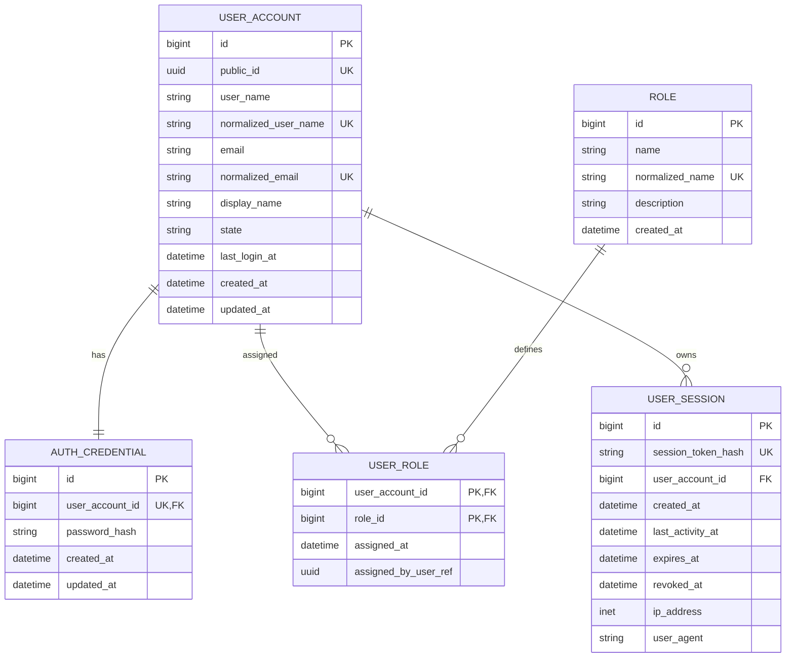
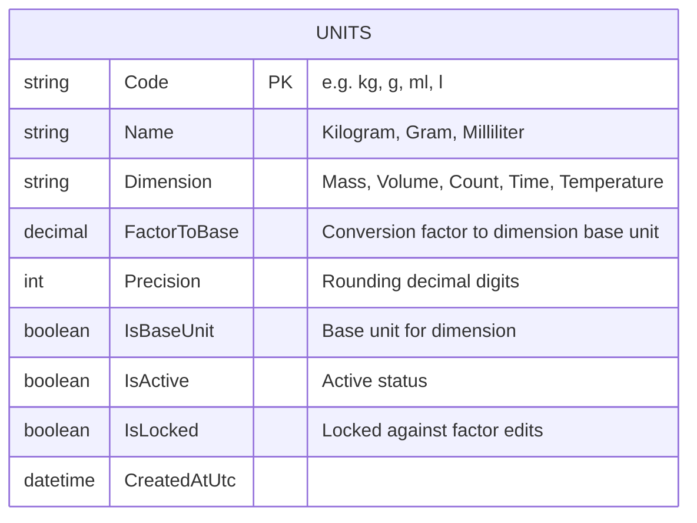
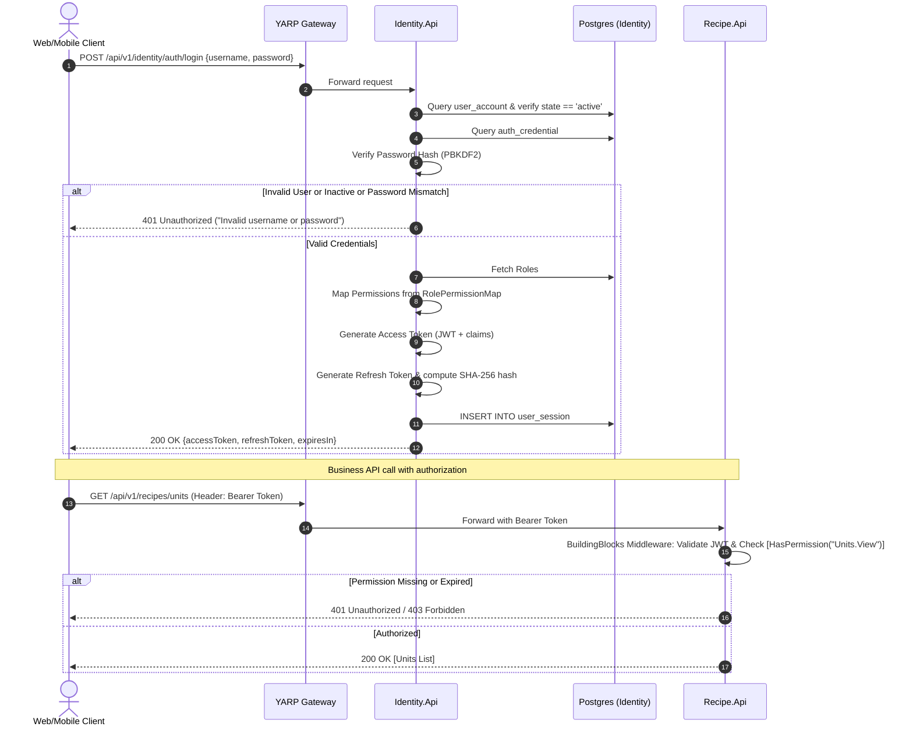

# SYSTEM REVIEW AND IMPLEMENTATION PLAN: 5 INITIAL TASKS (RECIPEHUB)
*Phase 1 Baseline Alignment Document (Task 1.1 to Task 1.5)*

---

## 1. System Review & Current Architecture Assessment

### 1.1. Project Context
- **Project**: **RecipeHub** — Coffee R&D Formula Management System (Course PRN232).
- **Objective**: Build a distributed microservices system managing R&D formulas for a coffee shop chain (benchmarked against Phê La), standardizing brewing SOP documents, integrating gRPC, Redis Streams, Background Workers, and Docker.
- **Architectural Pattern**: Distributed Microservices following **Clean Architecture** on **.NET 8** & **PostgreSQL** (Database-per-service), communicating through **YARP Gateway**, gRPC probes, and Redis message broker.

```
                    ┌──────────────────────────────┐
                    │ Next.js Web / Flutter Mobile │
                    └──────────────┬───────────────┘
                                   │ (HTTP / JSON)
                                   ▼
                    ┌──────────────────────────────┐
                    │    YARP Reverse Gateway      │ (Port 5000)
                    └──────┬───────────────┬───────┘
                           │               │
        ┌───────────────────┼───────────────┼───────────────────┐
        ▼                   ▼               ▼                   ▼
┌──────────────┐   ┌──────────────┐ ┌──────────────┐   ┌──────────────┐
│ Identity.Api │   │  Recipe.Api  │ │ Content.Api  │   │  Audit.Api   │
│ (Port 5001)  │   │ (Port 5002)  │ │ (Port 5003)  │   │ (Port 5004)  │
└──────┬───────┘   └──────┬───────┘ └──────┬───────┘   └──────┬───────┘
       │                  │                │                  │
       ▼                  ▼                ▼                  ▼
  [Postgres DB]      [Postgres DB]    [Postgres DB]      [Postgres DB]
 recipehub_identity recipehub_recipe recipehub_content  recipehub_audit
```

### 1.2. Codebase Gap Analysis
Direct codebase inspection in `RecipeHub/src/backend`:
- **Completed Foundation Skeleton**:
  - .NET 8 solution with 16 projects adhering to Clean Architecture (Domain, Application, Infrastructure, Api for 4 microservices).
  - YARP Gateway routing routes `/api/v1/{identity, recipes, content, audit}`.
  - Docker Compose setup connecting 4 logical PostgreSQL databases, Redis broker, and Background Worker.
  - Sample gRPC probe (`ProbeServiceImpl`) and Redis stream consumer functional.
- **Technical Gaps (Pending Business Domain Implementation)**:
  - Domain/Application/Infrastructure layers currently contain empty placeholder files (`Class1.cs`).
  - Entity Framework Core not yet integrated (no DbContext, Migrations, Repositories, or Entities).
  - NuGet packages pending installation: `Microsoft.AspNetCore.Authentication.JwtBearer`, `Npgsql.EntityFrameworkCore.PostgreSQL`.
  - Server-side security and authorization checks not yet enforced on API endpoints.

---

## 2. Detailed Breakdown of the Initial 5 Assigned Tasks

| Task | Task Name | Related SRS Code | Priority | Assignee |
|---|---|---|:---:|:---:|
| **Task 1.1** | [Identity] Login & JWT Token Issuance | FR-AUTH-01, NFR-SEC-02 | **Must** | VU DUC TUAN |
| **Task 1.2** | [Identity] Logout & Session Expiration | FR-AUTH-03 | **Must** | VU DUC TUAN |
| **Task 1.3** | [Identity] Role, Permission & Shared Auth Library | FR-AUTH-02, NFR-SEC-01 | **Must** | VU DUC TUAN |
| **Task 1.4** | [Identity] User Account Management | FR-AUTH-04 | **Should** | VU DUC TUAN |
| **Task 1.5** | [Recipe/Unit] Unit Catalog & Conversion Engine | FR-UNIT-01 to 06 | **Must** | VU DUC TUAN |

---

### Task 1.1: [Identity] Login & JWT Token Issuance (FR-AUTH-01, NFR-SEC-02)
* **Objective**: Authenticate users via username/email and hashed password. Issue JWT access tokens containing identity, roles, and granular permissions.
* **Definition of Done (DoD)**:
  1. Valid credentials return HTTP 200 with JWT access token (and refresh token).
  2. Invalid credentials return HTTP 401 with a generic error message (preventing enumeration: *"Invalid username or password"*).
  3. Passwords stored in DB must be hashed using a secure algorithm (standard ASP.NET Core Identity `IPasswordHasher<T>` - PBKDF2 with HMAC-SHA512). Never store plain text.
* **Implementation Subtasks**:
  - [ ] Design Entities aligned with schema: `UserAccount`, `AuthCredential`, `Role`, `UserRole`, `UserSession`.
  - [ ] Implement password hashing service (`IPasswordHasher<UserAccount>`).
  - [ ] Configure `IdentityDbContext` in `RecipeHub.Identity.Infrastructure` and generate initial migration.
  - [ ] Build `JwtTokenService` generating HMAC-SHA256 signed tokens with claims: `sub`, `email`, `role`, `permission`.
  - [ ] Implement API endpoint: `POST /api/v1/identity/auth/login`.
  - [ ] Implement automated DbSeeder creating 3 default test accounts on startup: `admin`, `rnd_staff`, `viewer`.

---

### Task 1.2: [Identity] Logout & Session Expiration (FR-AUTH-03)
* **Objective**: Ensure session security. Access tokens must be short-lived, while refresh tokens allow token renewal but can be immediately revoked upon logout or expiry.
* **Definition of Done (DoD)**:
  1. Access token has a short lifetime (15-30 minutes).
  2. Refresh tokens employ sliding expiration and revocation checks.
  3. After logout (`POST /api/v1/identity/auth/logout`), the session is marked as revoked (`revoked_at != null`) and cannot be used to refresh.
  4. Middleware rejects expired or invalid tokens immediately (HTTP 401).
* **Implementation Subtasks**:
  - [ ] Design session storage entity `UserSession` (storing SHA-256 token hash, user reference, expiration, revocation timestamp).
  - [ ] Configure strict `TokenValidationParameters` (`ValidateLifetime = true`, `ClockSkew = TimeSpan.Zero`).
  - [ ] Implement API `POST /api/v1/identity/auth/refresh` to exchange refresh token for a new access token (with token rotation).
  - [ ] Implement API `POST /api/v1/identity/auth/logout` to revoke user sessions.

---

### Task 1.3: [Identity] Role, Permission & Shared Auth Library (FR-AUTH-02, NFR-SEC-01)
* **Objective**: Build a Policy/Permission-based authorization solution independent of UI controls. Package into a Shared Library in `RecipeHub.BuildingBlocks` reusable by all 4 microservices (`Identity`, `Recipe`, `Content`, `Audit`) without code duplication.
* **Definition of Done (DoD)**:
  1. API calls exceeding user authority immediately receive HTTP 403 Forbidden with state unchanged.
  2. All 4 services can integrate this library via a single registration call: `builder.Services.AddRecipeHubAuth(configuration)`.
  3. Developer guide provided demonstrating `[HasPermission(...)]` attribute usage.
* **Standard Permissions Catalog (per SRS)**:
  - `Recipes.View`, `Recipes.Create`, `Recipes.Edit`, `Recipes.Approve`
  - `Ingredients.View`, `Ingredients.Manage`
  - `Units.View`, `Units.Manage`
  - `Users.Manage`
  - `Audit.View`
  - `AI.Manage`, `AI.Execute`
* **Implementation Subtasks**:
  - [ ] Define Permissions constants and Role-Permission mapping in `RecipeHub.BuildingBlocks`.
  - [ ] Build `PermissionAuthorizationRequirement` and `PermissionAuthorizationHandler` in `BuildingBlocks`.
  - [ ] Create custom attribute `[HasPermission(string permission)]`.
  - [ ] Write extension method `AddRecipeHubAuth(this IServiceCollection services, IConfiguration config)`.
  - [ ] Author documentation `AUTH_GUIDE.md` explaining attribute usage and authorization flow.

---

### Task 1.4: [Identity] User Account Management (FR-AUTH-04, Should)
* **Objective**: Provide Admin endpoints to manage personnel, granting or revoking system access.
* **Definition of Done (DoD)**:
  1. Admin successfully creates new accounts and assigns roles: `Admin`, `RndStaff`, `Viewer`.
  2. When an account is locked (`state = 'locked'`):
     - New login attempts are rejected (`HTTP 401 - Account has been locked`).
     - All active refresh sessions for this account are revoked immediately (`revoked_at = DateTime.UtcNow`).
* **Implementation Subtasks**:
  - [ ] Implement API `POST /api/v1/identity/users` (Admin user creation).
  - [ ] Implement API `GET /api/v1/identity/users` (Paginated user list with status/role filtering).
  - [ ] Implement API `PUT /api/v1/identity/users/{id}/status` (Lock/unlock user accounts).
  - [ ] Implement instant revocation logic across all active user sessions upon account lockout.

---

### Task 1.5: [Recipe/Unit] Unit Catalog & Conversion Engine (FR-UNIT-01 to 06)
* **Objective**: Build standard unit catalog and unit conversion engine in Recipe Service. Ensure exact arithmetic using `decimal`, prevent floating-point errors, and enforce immutability on in-use units.
* **Definition of Done (DoD)**:
  1. Seed complete standard measurement units:
     - Mass: `g` (base, factor=1), `kg` (factor=1000), `mg` (factor=0.001).
     - Volume: `ml` (base, factor=1), `l` (factor=1000).
     - Count: `cai` (base=1), `qua`, `tui`.
     - Time: `s` (base=1), `m` (factor=60), `h` (factor=3600).
     - Temperature: `degC`.
  2. Accurate same-dimension conversions: `1 kg -> 1000 g`, `500 ml -> 0.5 l`.
  3. Reject cross-dimension conversions (e.g. `g -> ml`) with HTTP 400 Bad Request.
  4. Use `decimal` arithmetic with configurable rounding (`MidpointRounding.AwayFromZero`).
  5. Prevent modifying `FactorToBase` or deleting units if already referenced by recipes/ingredients (`IsLocked = true`).
* **Implementation Subtasks**:
  - [ ] Design Entity `Unit` in `RecipeHub.Recipe.Domain` (Code, Name, Dimension, FactorToBase, Precision, IsActive, IsBaseUnit, IsLocked).
  - [ ] Configure `RecipeDbContext` in `RecipeHub.Recipe.Infrastructure` and create PostgreSQL migration.
  - [ ] Implement Seeder initializing standard units according to SRS.
  - [ ] Implement interface and service `IUnitConversionService` handling conversion formula:
    $$\text{TargetValue} = \frac{\text{SourceValue} \times \text{SourceFactor}}{\text{TargetFactor}}$$
    Validating dimension matching and rounding to `Precision`.
  - [ ] Implement CRUD APIs:
    - `GET /api/v1/recipes/units`
    - `GET /api/v1/recipes/units/{code}`
    - `POST /api/v1/recipes/units`
    - `PUT /api/v1/recipes/units/{code}` (block factor modification if in use)
    - `POST /api/v1/recipes/units/convert` (conversion testing endpoint)

---

## 3. Technical Architecture & Data Design

### 3.1. Entity Relationship Diagram (ERD) - Identity Service



### 3.2. Entity Relationship Diagram (ERD) - Recipe Service (Unit Engine)



### 3.3. Authentication & Authorization Flow (JWT Flow)



---

## 4. Phased Roadmap (5 Tasks)

### Phase 1: Data Foundations & Identity Core (Task 1.1)
1. Install EF Core & JWT Bearer NuGet packages.
2. Build entities `UserAccount`, `AuthCredential`, `Role`, `UserRole`, `UserSession`.
3. Configure `IdentityDbContext`, create initial PostgreSQL migration, and write DbSeeder.
4. Implement `POST /api/v1/identity/auth/login`.

### Phase 2: Session Management & User Administration (Task 1.2 & 1.4)
1. Implement token sliding expiration, rotation, and logout endpoint.
2. Configure authentication middleware with `ClockSkew = TimeSpan.Zero`.
3. Implement Admin user management APIs (creation, locking, instant session revocation).

### Phase 3: Shared Authorization Library in BuildingBlocks (Task 1.3)
1. Package policy-based authorization, `[HasPermission]` attribute, and middleware into `RecipeHub.BuildingBlocks`.
2. Apply across microservices and author `AUTH_GUIDE.md`.

### Phase 4: Unit Catalog & Conversion Engine in Recipe Service (Task 1.5)
1. Design Entity `Unit`, `RecipeDbContext`, and migrations in Recipe Service.
2. Seed standard measurement units per SRS.
3. Implement `IUnitConversionService` and CRUD APIs `/api/v1/recipes/units`.
