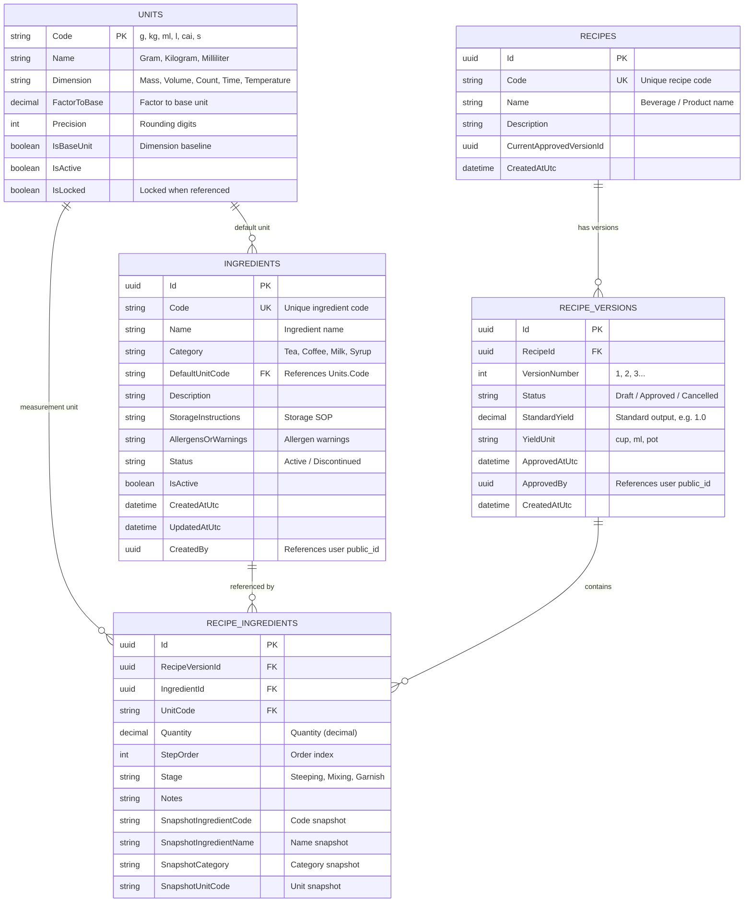

# EXPANSION REPORT & SUPPLEMENTAL PLAN: TASKS 1.6 TO 1.8 (RECIPEHUB)
*Phase 2 Alignment Document: Ingredient Catalog, Yield Scaling & Snapshot Drift Detection*

---

## 1. Introduction & Supplemental Business Context

Following the initial 5 foundational tasks covering Authentication and Unit of Measurement, the next 3 tasks (**Task 1.6, Task 1.7, Task 1.8**) complete the core R&D recipe domain within **Recipe Service**:
1. **Standardized Ingredient Catalog (Task 1.6)**: Centralizes reusable ingredient master data across the coffee chain and enforces controlled deprecation.
2. **Yield Scaling & Dimension-based Totals (Task 1.7)**: Guarantees accurate proportional arithmetic when changing target yield and safely aggregates component totals strictly by measurement dimension.
3. **Snapshot & Drift Detection Mechanism (Task 1.8)**: Preserves approved recipe version immutability and alerts users whenever master ingredients in the warehouse deviate from historical recipe snapshots.

---

## 2. Detailed Breakdown of the 3 Supplemental Tasks (Tasks 1.6, 1.7, 1.8)

### Task 1.6: [Recipe/Ingredient] Ingredient Catalog & Soft-Delete (FR-ING-01 to 06)
* **Business Description**: Centralizes ingredient master data reused across the chain. Declared once and reused under strict governance. Referenced ingredients must never be hard-deleted to preserve historical integrity.
* **Definition of Done (DoD)**:
  1. Ingredient Code (`Code`) is unique system-wide (e.g. `ING-CF-ROB`, `ING-MILK-COND`).
  2. Search (by code, name, category) and pagination (`pageIndex`, `pageSize`) function accurately.
  3. When deleting an in-use ingredient, the system changes its status to `Discontinued` instead of physically removing it from the database.
  4. Discontinued ingredients are hidden from candidate selection dropdowns when authoring new recipes, while historical recipe versions continue displaying them without error.
* **Implementation Subtasks**:
  - [ ] Design Entity `Ingredient` in `RecipeHub.Recipe.Domain`:
    - `Id` (Guid PK), `Code` (string unique), `Name` (string), `Category` (string), `DefaultUnitCode` (string FK to `Unit`), `Description` (string), `StorageInstructions` (string), `AllergensOrWarnings` (string), `IsActive` (bool), `Status` (enum: Active, Discontinued), `CreatedAtUtc`, `UpdatedAtUtc`, `CreatedBy` (Guid public_id).
  - [ ] Implement CRUD APIs in `RecipeHub.Recipe.Api`:
    - `GET /api/v1/recipes/ingredients` (supports: `search`, `category`, `status`, `pageIndex`, `pageSize`).
    - `GET /api/v1/recipes/ingredients/{id}`.
    - `POST /api/v1/recipes/ingredients` (validates unique code, existing default unit).
    - `PUT /api/v1/recipes/ingredients/{id}`.
    - `DELETE /api/v1/recipes/ingredients/{id}` (soft-delete: marks `Status = Discontinued`, `IsActive = false`).
  - [ ] Configure EF Core query filters / soft-delete handling in `RecipeDbContext`.

---

### Task 1.7: [Recipe/Calc] Yield Scaling & Dimension-based Totals (FR-REC-04, 05; UC-02)
* **Business Description**:
  - During test brewing, when users alter the "Target Yield" of a recipe (e.g., standard recipe designed for 1 cup of 350ml scaled up to a 5-liter batch), the system automatically recalculates quantities for all ingredients proportionally.
  - Total calculation: Converts all ingredients into dimension base units (e.g., grams for mass, milliliters for volume) before summing. Cross-dimension addition (e.g., `g + ml`) is strictly prohibited. AI must never interfere with these arithmetic calculations (per rule BR-10).
* **Definition of Done (DoD)**:
  1. Scaling formula:
     $$\text{Scaling Ratio } (R) = \frac{\text{TargetYield}}{\text{StandardYield}}$$
     $$\text{Scaled Quantity } (Q_{\text{scaled}}) = \text{decimal.Round}\left(Q_{\text{original}} \times R, \text{unit.Precision}, \text{MidpointRounding.AwayFromZero}\right)$$
  2. Dimension totals aggregation:
     - Automatically groups recipe ingredients by `Dimension` (Mass, Volume, Count, Time, Temperature).
     - Converts each component to its dimension base unit (e.g., `kg -> g`, `l -> ml`) prior to summing.
     - Cross-dimension summation is rejected, returning isolated totals per dimension.
  3. Comprehensive unit test suite covering rounding edge cases (`MidpointRounding`, small decimals, zero floating-point error).
* **Implementation Subtasks**:
  - [ ] Implement Domain Service `IRecipeCalculationService` in `RecipeHub.Recipe.Domain`:
    - `IEnumerable<ScaledIngredientDto> ScaleRecipe(IEnumerable<RecipeIngredientDto> ingredients, decimal standardYield, decimal targetYield)`
    - `DimensionTotalsSummaryDto CalculateTotals(IEnumerable<RecipeIngredientDto> ingredients, IUnitConversionService unitService)`
  - [ ] Ensure rounding precision uses unit configuration with `MidpointRounding.AwayFromZero`.
  - [ ] Implement calculation preview APIs: `POST /api/v1/recipes/calculate/scale` and `POST /api/v1/recipes/calculate/totals`.
  - [ ] Write unit tests verifying arithmetic consistency.

---

### Task 1.8: [Recipe/Snapshot] Ingredient Snapshot & Drift Detection (FR-SNAP-02, 04)
* **Business Description**:
  - To ensure approved R&D recipe immutability, each ingredient item in a recipe version (`RecipeIngredient`) stores an immutable data snapshot captured at the moment of addition/approval: `IngredientId`, `SnapshotIngredientCode`, `SnapshotIngredientName`, `SnapshotCategory`, `SnapshotUnitCode`.
  - If the master ingredient is subsequently renamed, updated, or reclassified in warehouse master data, approved recipe versions **must not automatically update** (preventing historical drift). Instead, the system detects deviations (drift) and displays a warning badge (*"Master ingredient has changed"*).
* **Definition of Done (DoD)**:
  1. Renaming master ingredient (e.g. from *"Star Condensed Milk"* to *"Southern Condensed Milk"*) leaves approved recipes displaying *"Star Condensed Milk"* (immutable snapshot).
  2. Recipe inspection API returns a drift indicator:
     - `hasDrift: true`
     - Detailed diffs: `{ field: "Name", snapshotValue: "Star Condensed Milk", currentMasterValue: "Southern Condensed Milk" }`
* **Implementation Subtasks**:
  - [ ] Configure Snapshot properties in `RecipeIngredient`:
    - `IngredientId` (Guid FK)
    - `SnapshotIngredientCode` (string)
    - `SnapshotIngredientName` (string)
    - `SnapshotCategory` (string)
    - `SnapshotUnitCode` (string)
    - `Quantity` (decimal)
  - [ ] Implement drift detection logic (`IIngredientDriftDetector`):
    - `DetectIngredientDrifts(RecipeVersion version, List<Ingredient> currentMasterIngredients)`
  - [ ] Return drift payload in recipe detail responses:
    ```json
    {
      "ingredientId": "3fa85f64-5717-4562-b3fc-2c963f66afa6",
      "hasDrift": true,
      "diffs": [
        {
          "field": "Name",
          "snapshotValue": "Star Condensed Milk",
          "currentMasterValue": "Southern Condensed Milk"
        }
      ]
    }
    ```

---

## 3. Entity Relationship Diagram (Recipe Core ERD)


