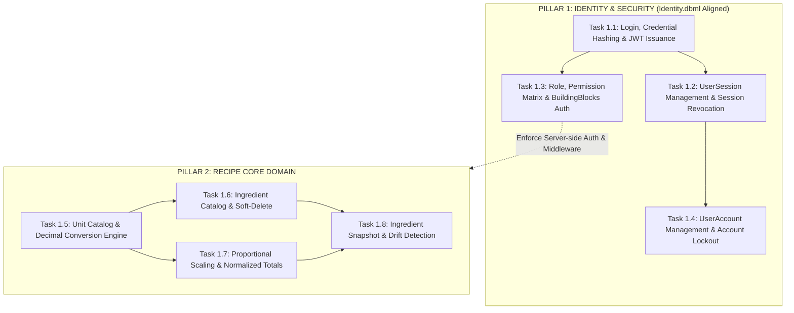
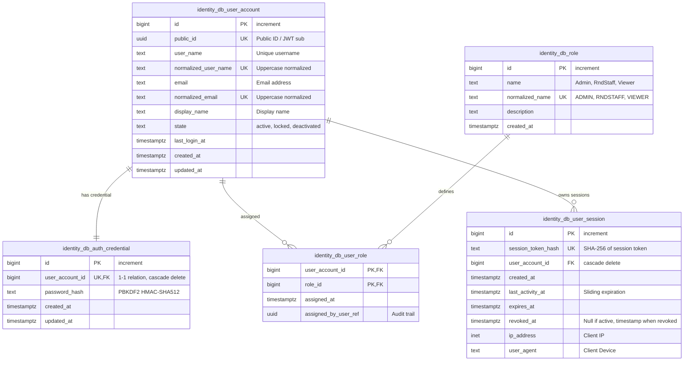
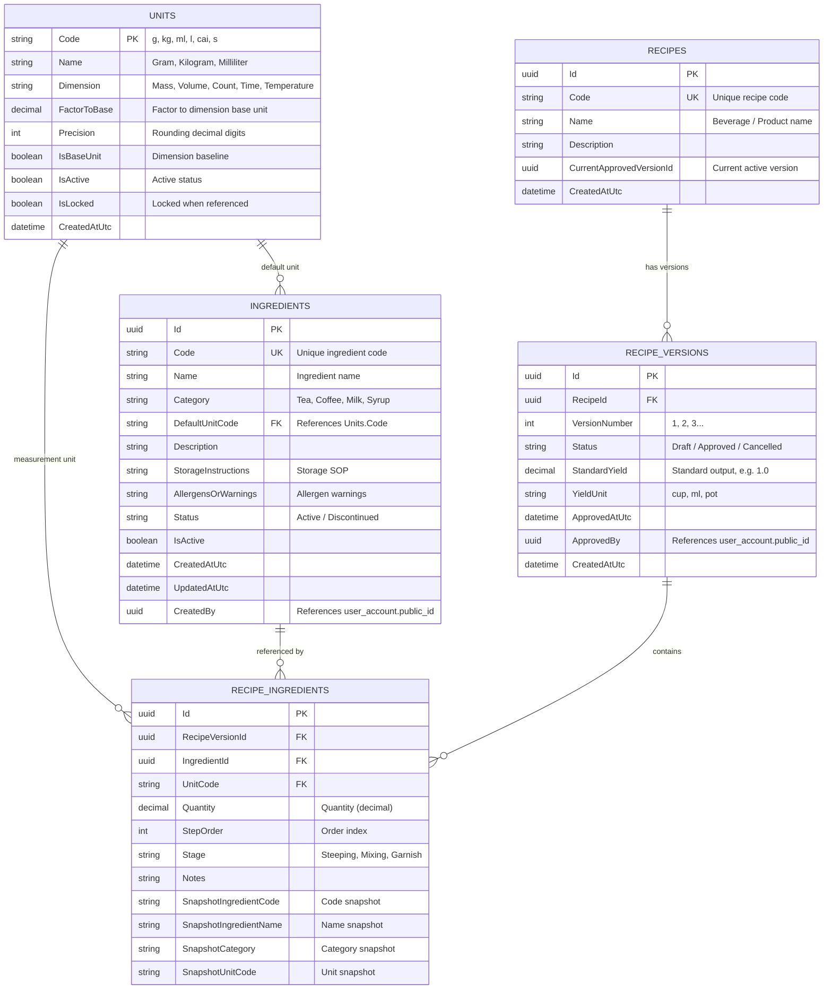
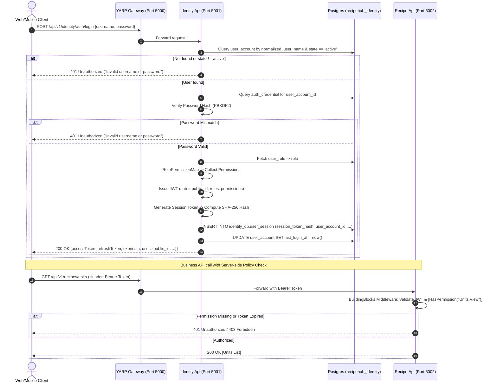

# MASTER PLAN DOCUMENT: SYSTEM REVIEW AND COMPREHENSIVE IMPLEMENTATION PLAN FOR 8 TASKS (RECIPEHUB)
*Master Plan Document — 100% Aligned with Identity.dbml and RecipeHub Clean Architecture*
*Stored at: RecipeHub/docs/plans/03-master-plan-recipehub-8-tasks.md*

---

## 1. System Review & Gap Analysis

### 1.1. Project Context
* **Project Name**: **RecipeHub** — Coffee R&D Formula Management System (Formula management and brewing SOP standardization for a coffee shop chain, benchmarked against real-world operations such as Phê La).
* **Goal**: Build a distributed microservices system managing R&D recipes, ingredient inventory, measurement unit catalog, multi-version brewing workflows, dynamic yield scaling, immutability of approved recipe versions, and automated SOP document generation (PDF/AI).
* **Overall Architecture**: Distributed Microservices adopting **Clean Architecture** on **.NET 8**, **PostgreSQL** database-per-service pattern, inter-service communication via **YARP Gateway**, **gRPC**, and **Redis Streams** message broker.

```
                         ┌────────────────────────────────┐
                         │   Next.js Web / Flutter Mobile │
                         └───────────────┬────────────────┘
                                         │ (HTTP / JSON)
                                         ▼
                         ┌────────────────────────────────┐
                         │      YARP Reverse Gateway      │ (Port 5000)
                         └───────┬────────────────┬───────┘
                                 │                │
            ┌────────────────────┼────────────────┼────────────────────┐
            ▼                    ▼                ▼                    ▼
     ┌──────────────┐     ┌──────────────┐ ┌──────────────┐     ┌──────────────┐
     │ Identity.Api │     │  Recipe.Api  │ │ Content.Api  │     │  Audit.Api   │
     │ (Port 5001)  │     │ (Port 5002)  │ │ (Port 5003)  │     │ (Port 5004)  │
     └──────┬───────┘     └──────┬───────┘ └──────┬───────┘     └──────┬───────┘
            │                    │                │                    │
            ▼                    ▼                ▼                    ▼
       [Postgres DB]        [Postgres DB]    [Postgres DB]        [Postgres DB]
      recipehub_identity   recipehub_recipe recipehub_content   recipehub_audit
```

### 1.2. Codebase Review (Gap Analysis)
Direct inspection of `RecipeHub/src/backend`:
* **Completed Foundation Skeleton (Build: 0 Errors, 0 Warnings)**:
  - 16-project .NET 8 solution following Clean Architecture (Domain -> Application -> Infrastructure -> Api across 4 microservices).
  - YARP Reverse Proxy routing routes `/api/v1/{identity, recipes, content, audit}`.
  - Docker Compose orchestrating 4 logical PostgreSQL databases, Redis broker, and Background Worker.
  - Operational sample gRPC probe (`ProbeServiceImpl`) and Redis stream consumer.
* **Technical Implementation Gaps**:
  - Domain, Application, and Infrastructure layers currently consist of empty placeholders (`Class1.cs`).
  - Entity Framework Core not yet integrated (lacks DbContext, Migrations, Repositories, and Entities).
  - NuGet dependencies to add: `Microsoft.AspNetCore.Authentication.JwtBearer`, `Npgsql.EntityFrameworkCore.PostgreSQL`.
  - Identity entities must strictly align with `Identity.dbml`.

---

## 2. In-Depth Alignment Analysis: `Identity.dbml` vs Architecture

The provided database design in `Identity.dbml` models enterprise-grade security and clean segregation of concerns. Below is the detailed architectural alignment:

| Aspect | Prior Plan Draft | Standardized Database (`Identity.dbml`) | Architectural Rationale & Implementation Strategy |
|---|---|---|---|
| **Database Schema** | Default `public` | `identity_db` | Enforce explicit schema `identity_db` in PostgreSQL via EF Core Fluent API: `modelBuilder.HasDefaultSchema("identity_db");`. |
| **User Entity** | `User`: PK `Guid Id`, `Username`, `Email`, `PasswordHash`, `FullName`, `IsActive` (bool) | `user_account`: PK `id bigint` [increment], `public_id uuid` [unique], `user_name text`, `normalized_user_name text` [unique], `email text`, `normalized_email text` [unique], `display_name text`, `state text` (default: 'active'), `last_login_at timestamptz`, `created_at`, `updated_at`. Index on `state`. | **Separation of Internal Surrogate vs Public External ID**: `id` (`bigint`) maximizes DB join and indexing efficiency; `public_id` (`uuid`) acts as immutable public identifier across APIs, JWT claims (`sub`), gRPC, and audit references. Cột `state` ('active', 'locked', 'deactivated') replaces boolean `IsActive`. `normalized_*` allows index-accelerated case-insensitive queries. |
| **Credential Storage** | `PasswordHash` stored directly inside `User` table | Dedicated table `auth_credential`: PK `id bigint`, `user_account_id bigint` [unique FK], `password_hash text`, `created_at`, `updated_at`. Cascade delete. | **Decoupling Identity & Credentials**: Separates user metadata from authentication secrets. Passwords hashed using PBKDF2 with HMAC-SHA512 via `IPasswordHasher<UserAccount>`. Strict 1-to-1 relationship. |
| **Role Entity** | `Role`: `Id Guid`, `Name`, `Description` | `role`: PK `id bigint`, `name text`, `normalized_name text` [unique], `description text`, `created_at`. | Transitioned `id` to `bigint`. `normalized_name` used for invariant role matching (e.g. `ADMIN`, `RNDSTAFF`, `VIEWER`). |
| **Role Assignment** | `UserRole`: `UserId Guid`, `RoleId Guid` | `user_role`: Composite PK `(user_account_id, role_id)`, `assigned_at timestamptz`, `assigned_by_user_ref uuid`. Index on `role_id`. | Integrated audit trail: `assigned_by_user_ref` records the `public_id` of the Admin who assigned the role. |
| **Session & Token Management** | Plaintext `RefreshToken` table | `user_session`: PK `id bigint`, `session_token_hash text` [unique], `user_account_id bigint` [FK], `created_at`, `last_activity_at timestamptz`, `expires_at timestamptz`, `revoked_at timestamptz`, `ip_address inet`, `user_agent text`. Indexes: `(user_account_id, expires_at)`, `expires_at`. | **Superior Security Posture**: Stores **SHA-256 hash of the session/refresh token** (`session_token_hash`) instead of raw tokens. Immediate session invalidation via `revoked_at != null`. Tracks client metadata (`ip_address`, `user_agent`) and sliding activity timestamp (`last_activity_at`). |
| **Permission Handling** | Proposed `Permission` table in DB | **No `permission` table in `Identity.dbml`** | **Code-based Granular Permissions**: Static domain permissions catalog defined in `RecipeHub.BuildingBlocks` (`Permissions` constants). Identity Service maps roles to permissions via `RolePermissionMap` in Application layer, injecting `permission` claims into JWT during login. Database strictly adheres **100% to `Identity.dbml`** without extraneous database tables. |

---

## 3. Assignment Map & 8-Task Matrix

Assignee (VU DUC TUAN) is responsible for the two foundational pillars of RecipeHub:
1. **Pillar 1: Identity, Authentication & Security** (Tasks 1.1 to 1.4)
2. **Pillar 2: Recipe Core Domain — Units, Ingredients, Scaling & Snapshots** (Tasks 1.5 to 1.8)



### Summary Matrix of 8 Tasks

| Task Code | Task Name & Module | Related SRS Requirement | Core Definition of Done (DoD) |
|---|---|---|---|
| **Task 1.1** | [Identity] Login & JWT Token Issuance | FR-AUTH-01, NFR-SEC-02 | Login via username/email; Password hashed via PBKDF2 stored in `auth_credential`; Issues JWT containing `public_id` and claims; Stores SHA-256 session hash in `user_session`; Invalid credentials return generic HTTP 401; Seeds 3 default accounts. |
| **Task 1.2** | [Identity] Logout & Session Expiration | FR-AUTH-03 | Short-lived access token (15m); `user_session` manages sliding expiration and token rotation; Logout sets `revoked_at = now()`; `ClockSkew = TimeSpan.Zero` rejects expired tokens instantly. |
| **Task 1.3** | [Identity] Role, Permission & Shared Auth | FR-AUTH-02, NFR-SEC-01 | Permission-based policy authorization; Packaged in `RecipeHub.BuildingBlocks` for all 4 microservices; `[HasPermission]` attribute; Unauthorized calls receive HTTP 403 Forbidden. |
| **Task 1.4** | [Identity] User Account Management | FR-AUTH-04 | Admin creates `user_account` + `auth_credential` + `user_role`; Lock account (`state = 'locked'`); Immediately revokes (`revoked_at = now()`) all active sessions in `user_session`. |
| **Task 1.5** | [Recipe] Unit Catalog & Conversion Engine | FR-UNIT-01 to 06 | Seed 11 standard units; Enforce `decimal` arithmetic; Exact same-dimension conversion; Block cross-dimension conversion; Block modifying factor or deleting units once referenced (`IsLocked`). |
| **Task 1.6** | [Recipe] Ingredient Catalog | FR-ING-01 to 06 | Unique ingredient code; CRUD + Filter + Pagination; Soft-delete (deprecating hides ingredient from new recipes while retaining historical recipe versions). |
| **Task 1.7** | [Recipe] Yield Scaling & Dimension-based Totals | FR-REC-04, 05; UC-02 | Proportional scaling based on target yield; Normalized base-unit summation isolated per dimension; Block cross-dimension addition (`g + ml`); Unit tests for rounding precision. |
| **Task 1.8** | [Recipe] Ingredient Snapshot & Drift Detection | FR-SNAP-02, 04 | Approved recipes store immutable ingredient snapshots; Master ingredient updates trigger a warning drift badge (with old vs new diffs); Approved recipe snapshot text remains untouched. |

---

## 4. Detailed Technical Analysis per Task

---

### Task 1.1: [Identity] Login & JWT Token Issuance (FR-AUTH-01, NFR-SEC-02)
* **Objective**: Authenticate users using `user_name` or `email` and password. Issue JWT tokens containing public identity (`public_id`), roles, and granular permissions.
* **Definition of Done (DoD)**:
  1. Valid credentials: Returns HTTP 200 with JWT Access Token and Refresh Token.
  2. Invalid credentials (unmatched username, wrong password, or `state != 'active'`): Returns HTTP 401 with generic error: `{"error": "Invalid username or password"}` (prevents username enumeration).
  3. Passwords stored in `identity_db.auth_credential`, hashed with ASP.NET Core `IPasswordHasher<UserAccount>` (PBKDF2 with HMAC-SHA512). Plain text strictly forbidden.
  4. Creates record in `identity_db.user_session` storing `session_token_hash = SHA256(refreshToken)`, recording `ip_address` and `user_agent`.
  5. Updates `last_login_at` on `user_account`.
  6. Automatically seeds 3 default accounts upon startup:
     - `admin` (Role: Admin)
     - `rnd_staff` (Role: RndStaff)
     - `viewer` (Role: Viewer)
* **Implementation Subtasks**:
  - [ ] Implement Entities in `RecipeHub.Identity.Domain` matching `Identity.dbml`: `UserAccount`, `AuthCredential`, `Role`, `UserRole`, `UserSession`.
  - [ ] Configure `IdentityDbContext` in `RecipeHub.Identity.Infrastructure`:
    - Enforce schema `identity_db`.
    - Fluent API configurations (indexes, constraints, foreign keys with cascade delete).
  - [ ] Implement `IdentityDbSeeder` generating 3 roles and 3 default test accounts.
  - [ ] Build `JwtTokenService`:
    - Generate Access Token (15 min) with claims: `sub = public_id.ToString()`, `name = user_name`, `email`, `display_name`, `role`, and custom `permission` claims.
    - Generate 64-byte secure random Refresh Token, compute SHA-256 hash for `user_session`.
  - [ ] Implement API endpoint: `POST /api/v1/identity/auth/login`.

---

### Task 1.2: [Identity] Logout & Session Expiration with UserSession (FR-AUTH-03)
* **Objective**: Ensure session security. Access token has a short lifetime, while refresh token provides token renewal through secure rotation and complete revocation via `user_session`.
* **Definition of Done (DoD)**:
  1. Access token expires after 15 minutes.
  2. Middleware configured with `ClockSkew = TimeSpan.Zero` to reject expired tokens immediately (HTTP 401).
  3. Token Refresh (`POST /api/v1/identity/auth/refresh`):
     - Compute SHA-256 hash of incoming refresh token, look up in `user_session`.
     - Validates: Session exists, `revoked_at == null`, `expires_at > DateTime.UtcNow`, and `user_account.state == 'active'`.
     - Token Rotation: Mark old session `revoked_at = DateTime.UtcNow`, issue new session record with new hash and new tokens.
  4. Logout (`POST /api/v1/identity/auth/logout`):
     - Sets `revoked_at = DateTime.UtcNow` on the target session.
     - Once logged out, the token cannot be used again.
* **Implementation Subtasks**:
  - [ ] Configure `TokenValidationParameters` in `Identity.Api`: `ValidateLifetime = true`, `ClockSkew = TimeSpan.Zero`.
  - [ ] Implement API `POST /api/v1/identity/auth/refresh` with rotation logic.
  - [ ] Implement API `POST /api/v1/identity/auth/logout`.
  - [ ] Reject requests referencing revoked sessions.

---

### Task 1.3: [Identity] Role, Permission & Shared Auth Library in BuildingBlocks (FR-AUTH-02, NFR-SEC-01)
* **Objective**: Build server-side policy/permission-based authorization packaged into `RecipeHub.BuildingBlocks` for all 4 microservices (`Identity`, `Recipe`, `Content`, `Audit`) via a single setup line.
* **Definition of Done (DoD)**:
  1. API calls exceeding user authority return HTTP 403 Forbidden without modifying data.
  2. Services integrate via one extension call:
     `builder.Services.AddRecipeHubAuth(builder.Configuration);`
  3. Standardized Role-to-Permission Matrix:
     - `Admin`: Full system authority.
     - `RndStaff`: `Recipes.*`, `Ingredients.*`, `Units.*`, `AI.*`.
     - `Viewer`: `Recipes.View`, `Ingredients.View`, `Units.View`.
  4. Developer documentation `RecipeHub/docs/AUTH_GUIDE.md` provided.
* **Permissions Catalog (per SRS)**:
  - `Recipes.View`, `Recipes.Create`, `Recipes.Edit`, `Recipes.Approve`
  - `Ingredients.View`, `Ingredients.Manage`
  - `Units.View`, `Units.Manage`
  - `Users.Manage`
  - `Audit.View`
  - `AI.Manage`, `AI.Execute`
* **Implementation Subtasks**:
  - [ ] Define `Permissions` constants and `RolePermissionMap` in `RecipeHub.BuildingBlocks`.
  - [ ] Implement `PermissionAuthorizationRequirement` and `PermissionAuthorizationHandler`.
  - [ ] Implement attribute `[HasPermission(string permission)]`.
  - [ ] Implement extension method `AddRecipeHubAuth`.
  - [ ] Integrate into `Identity.Api` and `Recipe.Api`.
  - [ ] Author `AUTH_GUIDE.md`.

---

### Task 1.4: [Identity] User Account Management (FR-AUTH-04, Should)
* **Objective**: Admin endpoints to provision user accounts, assign roles, and lock accounts. Locking an account must immediately terminate all active sessions.
* **Definition of Done (DoD)**:
  1. Endpoints protected by `[HasPermission(Permissions.Users.Manage)]` (Admin only).
  2. Admin User Creation (`POST /api/v1/identity/users`):
     - Validates unique `user_name` and `email`.
     - Generates `public_id = Guid.NewGuid()`.
     - Hashes password and persists in `auth_credential`.
     - Assigns role in `user_role` with `assigned_by_user_ref = currentAdmin.PublicId`.
  3. User List API (`GET /api/v1/identity/users`): Paginated, filterable by `state` and `role`. Never exposes `password_hash`.
  4. User Status API (`PUT /api/v1/identity/users/{publicId}/status`):
     - Sets `state = 'locked'` or `'deactivated'`.
     - **Security Invariant**: Immediately sets `revoked_at = DateTime.UtcNow` across ALL active sessions in `user_session` for this user.
     - Locked users cannot refresh tokens or log in (HTTP 401 - *"Account has been locked"*).
* **Implementation Subtasks**:
  - [ ] Author DTOs: `CreateUserRequest`, `UserResponse`, `UpdateUserStatusRequest`.
  - [ ] Implement CRUD and pagination endpoints.
  - [ ] Implement instant revocation logic across `user_session` upon user deactivation.

---

### Task 1.5: [Recipe/Unit] Unit Catalog & Conversion Engine (FR-UNIT-01 to 06)
* **Objective**: Standard unit catalog and conversion arithmetic in Recipe Service. Strictly use `decimal` to eliminate floating-point drift and protect in-use units from modification.
* **Definition of Done (DoD)**:
  1. Seed 11 standard measurement units per SRS:
     - Mass: `g` (base, factor=1), `kg` (factor=1000), `mg` (factor=0.001).
     - Volume: `ml` (base, factor=1), `l` (factor=1000).
     - Count: `cai` (base, factor=1), `qua`, `tui`.
     - Time: `s` (base, factor=1), `m` (factor=60), `h` (factor=3600).
     - Temperature: `degC` (base, factor=1).
  2. Accurate same-dimension conversion formula:
     $$\text{TargetValue} = \frac{\text{SourceValue} \times \text{SourceUnit.FactorToBase}}{\text{TargetUnit.FactorToBase}}$$
  3. Reject cross-dimension conversion (e.g. `500 g -> ml` returns HTTP 400 Bad Request).
  4. Precision rounding using target unit's `Precision` (`MidpointRounding.AwayFromZero`).
  5. Prevent modifying `FactorToBase` or deleting units if already in use (`IsLocked = true`).
* **Implementation Subtasks**:
  - [ ] Design Entity `Unit` in `RecipeHub.Recipe.Domain`:
    - `Code` (PK, string), `Name`, `Dimension`, `FactorToBase` (decimal), `Precision` (int), `IsBaseUnit` (bool), `IsActive` (bool), `IsLocked` (bool), `CreatedAtUtc`.
  - [ ] Configure `RecipeDbContext` in `RecipeHub.Recipe.Infrastructure` and generate migration for `recipehub_recipe`.
  - [ ] Implement Seeder for 11 standard units.
  - [ ] Implement `IUnitConversionService` handling conversion arithmetic.
  - [ ] Implement CRUD APIs:
    - `GET /api/v1/recipes/units`
    - `GET /api/v1/recipes/units/{code}`
    - `POST /api/v1/recipes/units`
    - `PUT /api/v1/recipes/units/{code}` (block factor edit if `IsLocked`)
    - `POST /api/v1/recipes/units/convert` (test endpoint)
  - [ ] Write unit tests for conversion logic.

---

### Task 1.6: [Recipe/Ingredient] Ingredient Catalog & Soft-Delete (FR-ING-01 to 06)
* **Objective**: Centralized master ingredient warehouse across the coffee chain. Declared once and reused under governance. Never hard-delete ingredients referenced in historical recipes.
* **Definition of Done (DoD)**:
  1. Ingredient Code (`Code`) is unique system-wide (e.g. `ING-CF-ROB`, `ING-MILK-COND`).
  2. Search (code, name, category) and pagination function accurately.
  3. Soft-Delete: When deleting an in-use ingredient, mark `Status = Discontinued` and `IsActive = false` instead of physical deletion.
  4. Discontinued ingredients are hidden from candidate dropdowns when authoring new recipes, while historical recipes continue displaying them.
* **Implementation Subtasks**:
  - [ ] Design Entity `Ingredient` in `RecipeHub.Recipe.Domain`:
    - `Id` (Guid PK), `Code` (unique), `Name`, `Category`, `DefaultUnitCode` (FK Unit), `Description`, `StorageInstructions`, `AllergensOrWarnings`, `Status` (Active/Discontinued), `IsActive` (bool), `CreatedAtUtc`, `UpdatedAtUtc`, `CreatedBy` (Guid public_id).
  - [ ] Configure relationships and migration in `RecipeDbContext`.
  - [ ] Implement CRUD APIs:
    - `GET /api/v1/recipes/ingredients` (supports: `search`, `category`, `status`, `pageIndex`, `pageSize`).
    - `GET /api/v1/recipes/ingredients/{id}`.
    - `POST /api/v1/recipes/ingredients` (validates unique code, existing default unit).
    - `PUT /api/v1/recipes/ingredients/{id}`.
    - `DELETE /api/v1/recipes/ingredients/{id}` (soft-delete).

---

### Task 1.7: [Recipe/Calc] Yield Scaling & Dimension-based Totals (FR-REC-04, 05; UC-02)
* **Objective**: Automatically recalculate all ingredient quantities when users change "Target Yield". Aggregate component totals by dimension after converting to base units. AI must never perform numerical arithmetic (per rule BR-10).
* **Definition of Done (DoD)**:
  1. Proportional scaling and quantity calculation:
     $$R = \frac{\text{TargetYield}}{\text{StandardYield}}$$
     $$Q_{\text{scaled}} = \text{decimal.Round}\left(Q_{\text{original}} \times R, \text{unit.Precision}, \text{MidpointRounding.AwayFromZero}\right)$$
  2. Dimension totals aggregation:
     - Groups ingredients by `Dimension` (Mass, Volume, Count...).
     - Converts each component to dimension base unit (`g` for Mass, `ml` for Volume) before summing.
     - Rejects cross-dimension summation (`g + ml`), returning isolated totals:
       ```json
       {
         "totals": [
           { "dimension": "Mass", "totalBaseQuantity": 450.0, "baseUnit": "g" },
           { "dimension": "Volume", "totalBaseQuantity": 320.0, "baseUnit": "ml" }
         ]
       }
       ```
  3. Unit tests verifying rounding accuracy on fractional scale factors (0.33x, 2.5x, 5x).
* **Implementation Subtasks**:
  - [ ] Implement Domain Service `IRecipeCalculationService` in `RecipeHub.Recipe.Domain`:
    - `ScaleIngredients(IEnumerable<RecipeIngredientDto> ingredients, decimal standardYield, decimal targetYield)`
    - `CalculateDimensionTotals(IEnumerable<RecipeIngredientDto> ingredients, IUnitConversionService unitConversionService)`
  - [ ] Implement preview endpoints:
    - `POST /api/v1/recipes/calculate/scale`
    - `POST /api/v1/recipes/calculate/totals`
  - [ ] Write unit test suite verifying mathematical consistency.

---

### Task 1.8: [Recipe/Snapshot] Ingredient Snapshot & Drift Detection (FR-SNAP-02, 04)
* **Objective**: Ensure immutability of approved recipes. Capture ingredient snapshot at approval time, automatically detect drift, and display warning badges when master warehouse ingredients change.
* **Definition of Done (DoD)**:
  1. When ingredients are added or a version is approved, store an immutable snapshot in `RecipeIngredient`:
     - `SnapshotIngredientCode`, `SnapshotIngredientName`, `SnapshotCategory`, `SnapshotUnitCode`.
  2. Approved version immutability (FR-VER-02): If `RecipeVersion.Status == Approved`, direct modifications are blocked.
  3. Drift Detection Mechanism:
     - When inspecting an approved version (`GET /api/v1/recipes/{id}/versions/{versionId}`), compare snapshots with current master records in `Ingredient`.
     - If discrepancies exist (renamed, reclassified...), API returns `hasDrift: true` with detailed diffs:
       ```json
       {
         "ingredientId": "b1b72e92-5717-4562-b3fc-2c963f66afa6",
         "hasDrift": true,
         "diffs": [
           {
             "field": "Name",
             "snapshotValue": "Star Condensed Milk",
             "currentMasterValue": "Southern Condensed Milk"
           }
         ]
       }
       ```
     - Recipe content displays the original snapshot name ("Star Condensed Milk").
* **Implementation Subtasks**:
  - [ ] Configure Snapshot columns in Entity `RecipeIngredient`.
  - [ ] Implement `IIngredientDriftDetector` in Application layer.
  - [ ] Integrate drift detection into recipe version detail API.
  - [ ] Write unit tests verifying drift alerts when master ingredient names change.

---

## 5. Comprehensive Data Architecture & ERDs

### 5.1. Entity Relationship Diagram (ERD) - Identity Service (100% Aligned with Identity.dbml)



### 5.2. Entity Relationship Diagram (ERD) - Recipe Core Service



### 5.3. Sequence Diagram - Authentication & Inter-Service Policy Enforcement



---

## 6. Phased Implementation Roadmap (6 Technical Phases)

### 🚀 Phase 1: Data Foundations & Identity Core (Task 1.1)
1. **Install NuGet Packages** in `RecipeHub.Identity.Infrastructure`:
   - `Microsoft.EntityFrameworkCore` (8.0.x)
   - `Npgsql.EntityFrameworkCore.PostgreSQL` (8.0.x)
   - `Microsoft.EntityFrameworkCore.Design` (8.0.x)
   - `Microsoft.AspNetCore.Authentication.JwtBearer` (8.0.x)
2. **Build Entities**:
   - `UserAccount`, `AuthCredential`, `Role`, `UserRole`, `UserSession`.
3. **Configure `IdentityDbContext`**:
   - Apply schema `identity_db`.
   - Configure Fluent API (unique indexes for `normalized_user_name`, `normalized_email`, `session_token_hash`).
   - Seeder initializing 3 roles (`Admin`, `RndStaff`, `Viewer`) and 3 default test accounts.
4. **Implement `JwtTokenService` & Login Endpoint**:
   - `IPasswordHasher<UserAccount>` implementation.
   - Issue JWT Access Token and SHA-256 hashed session token.
   - Endpoint `POST /api/v1/identity/auth/login`.

### 🚀 Phase 2: Session Management & User Administration (Task 1.2 & Task 1.4)
1. **Refresh Token & Logout via `user_session`**:
   - Endpoint `POST /api/v1/identity/auth/refresh` (rotation, sliding window).
   - Endpoint `POST /api/v1/identity/auth/logout` (session revocation: `revoked_at = now()`).
   - Configure `ClockSkew = TimeSpan.Zero` in `TokenValidationParameters`.
2. **User Administration (Admin)**:
   - Endpoint `POST /api/v1/identity/users` (create user + credentials + roles).
   - Endpoint `GET /api/v1/identity/users` (paginated list, search, filter).
   - Endpoint `PUT /api/v1/identity/users/{publicId}/status` (lock user and revoke all active sessions in `user_session`).

### 🚀 Phase 3: Shared Authorization Library in BuildingBlocks (Task 1.3)
1. **Package Authorization Components**:
   - `Permissions` constants.
   - `RolePermissionMap` mapping.
   - `[HasPermission]` attribute.
   - `PermissionAuthorizationHandler`.
   - Extension method `services.AddRecipeHubAuth(configuration)`.
2. **Service Integration**:
   - Register in `Identity.Api` and `Recipe.Api`.
   - Write developer guide `RecipeHub/docs/AUTH_GUIDE.md`.

### 🚀 Phase 4: Unit Catalog & Conversion Engine (Task 1.5)
1. **Entity & DbContext**:
   - Entity `Unit` in `RecipeHub.Recipe.Domain`.
   - `RecipeDbContext` in `RecipeHub.Recipe.Infrastructure` for database `recipehub_recipe`.
   - Seeder for 11 standard units.
2. **Conversion Engine `IUnitConversionService`**:
   - Exact `decimal` arithmetic with `MidpointRounding.AwayFromZero`.
   - Cross-dimension conversion rejection.
   - Lock rule preventing factor modifications on in-use units (`IsLocked`).
3. **CRUD Endpoints**:
   - CRUD `/api/v1/recipes/units` and test conversion endpoint `/api/v1/recipes/units/convert`.

### 🚀 Phase 5: Ingredient Catalog & Soft-Delete (Task 1.6)
1. **Entity & Migration**:
   - Entity `Ingredient` in `RecipeHub.Recipe.Domain`.
   - Update DbContext and apply migrations.
2. **CRUD APIs & Soft-Delete**:
   - CRUD `/api/v1/recipes/ingredients` with search, category/status filters, and pagination.
   - Soft-delete: update status to `Discontinued` when referenced historically.

### 🚀 Phase 6: Yield Scaling & Snapshot Drift Detection (Task 1.7 & Task 1.8)
1. **Entities Recipe, Version & Ingredients**:
   - Implement `Recipe`, `RecipeVersion`, `RecipeIngredient` with snapshot fields.
2. **Calculation Service `IRecipeCalculationService`**:
   - Proportional ingredient scaling based on target yield (`TargetYield / StandardYield`).
   - Normalized base-unit summation per dimension.
3. **Drift Detection**:
   - Compare snapshots with current master records in warehouse.
   - Return `hasDrift: true` and detailed diffs.
4. **Unit Tests**:
   - Full test suite verifying mathematical scaling accuracy and rounding behavior.

---

## 7. Verification Matrix & Acceptance Criteria

| Task | Test Scenario | Input Data | Expected Result |
|---|---|---|---|
| **1.1** | Valid user login | `username: "admin"`, correct password | HTTP 200, returns JWT Access Token (with `public_id`, roles, permissions), Refresh Token; creates active record in `user_session` |
| **1.1** | Invalid password | `username: "admin"`, wrong password | HTTP 401 Unauthorized (`"Invalid username or password"`) |
| **1.1** | Locked account login | User with `state = 'locked'` | HTTP 401 Unauthorized (`"Invalid username or password"`) |
| **1.2** | Valid refresh token exchange | Valid unexpired refresh token | HTTP 200, returns new access & refresh tokens; revokes old session hash |
| **1.2** | Reuse revoked refresh token | Call logout, then call refresh | HTTP 401 Unauthorized (session already has `revoked_at != null`) |
| **1.3** | Unauthorized role calling admin API | `viewer` token calling `POST /api/v1/identity/users` | HTTP 403 Forbidden |
| **1.4** | Admin locks account | `PUT /api/v1/identity/users/{publicId}/status` with `state = 'locked'` | User cannot log in; all active sessions in `user_session` marked `revoked_at = now()` |
| **1.5** | Same-dimension conversion | `value: 1.5`, `source: "kg"`, `target: "g"` | Exactly `1500 g` (`decimal` precision, zero floating-point loss) |
| **1.5** | Cross-dimension conversion | `value: 500`, `source: "g"`, `target: "ml"` | HTTP 400 Bad Request explaining cross-dimension conversion is prohibited |
| **1.6** | Paginated ingredient search | `search: "Tea"`, `pageIndex: 1`, `pageSize: 10` | Returns matching items with pagination metadata |
| **1.6** | Delete referenced ingredient | Call `DELETE /api/v1/recipes/ingredients/{id}` | Not deleted physically; updated to `Status = Discontinued`, `IsActive = false` |
| **1.7** | Scale recipe from 1 to 5 cups | Standard: 1, Target: 5, ingredient: `original 20g` | Scaled ingredient: `100g`, rounded to unit's precision |
| **1.7** | Dimension totals on mixed items | Recipe has 30g coffee + 100ml milk | Separate totals returned: Mass = 30g, Volume = 100ml; never summed into single number |
| **1.8** | Master ingredient renamed in warehouse | Master renamed from "Star Milk" to "Southern Milk" | Approved recipe version displays "Star Milk", API returns `hasDrift: true` with field diffs |
