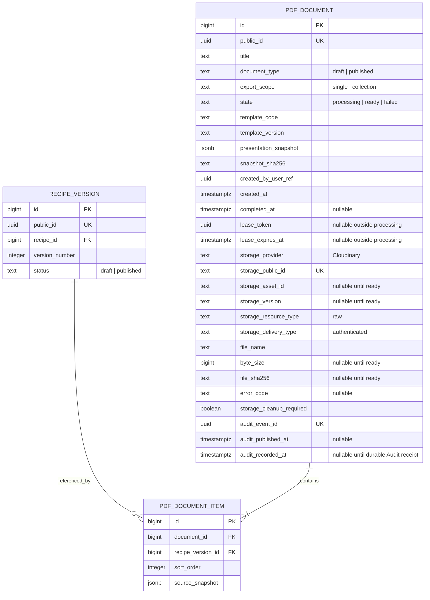

# ERD và vòng đời PDF — đề xuất DB First

## Vị trí và phạm vi

Hai bảng nghiệp vụ mới thuộc `recipehub_recipe`, schema `recipe_db`. Recipe sở hữu artifact và liên kết RecipeVersion; file bytes nằm Cloudinary. Không nhét PDF vào `content_db.media_asset` vốn dành cho ảnh. Audit lưu sự kiện trong DB Audit riêng, không FK xuyên database. Chưa chạy SQL hoặc xác minh database nguồn.

## Ý nghĩa và kiểu dữ liệu

- bigint PK identity theo convention hiện có; public_id UUID sinh phía server, không lộ bigint ra API.
- `pdf_document` một lần xuất; `pdf_document_item` một version trong lần xuất, thứ tự 1..N. Single N=1; collection N>=2. Giới hạn bảo vệ đề xuất 50, cấu hình server và FE đọc capability; không tự coi đây là số người dùng đã yêu cầu.
- document_type=published chỉ khi mọi version nguồn `published` và recipe active ở thời điểm chụp nguồn. Không tạo/approve version tự động khi xuất. draft có watermark trên mọi trang kể cả bìa/mục lục, kể cả nếu nguồn đã published.
- source_snapshot là dữ liệu renderer thực sự sử dụng: mã/tên recipe, version/status, sản lượng có sẵn, snapshot ingredient code/name/warning, số lượng/đơn vị/note/order, steps/parameters/safety/ảnh đã chọn. Không sao chép account/token/API key hoặc toàn bộ media library. Draft snapshot bắt buộc vì nội dung draft còn sửa được.
- presentation_snapshot giữ override title/subtitle/caption/asset UUID, template version và cover asset checksum; không lưu file bytes, access token, signed URLs hoặc URL client gửi.
- selected media snapshot giữ asset UUID/provider version/source label/checksum của bytes đã tải. Ảnh đã nhúng nằm trong PDF nên tải lịch sử không cần media còn tồn tại. Preview digest kiểm tra version/checksum nguồn ảnh trước lần xuất.
- timestamps timestamptz UTC; size bigint >0; hash text 64 ký tự hex SHA-256 lowercase; JSONB object bắt buộc. error_code là mã lọc bí mật, không log provider response nhạy cảm.
- ready có đủ storage metadata/size/hash/completed_at; processing chưa có completed_at/error; failed có completed_at/error_code, không có file tải qua API.
- lease token và expiry phục vụ fencing giữa request xuất và recovery, không phải Recipe row_version. processing có lease; ready/failed xóa lease hoặc để NULL (DDL/ERD final phải thống nhất nullable hai cột này).
- storage_public_id tạo trước upload, duy nhất, deterministic theo public_id và bao gồm .pdf với raw. Mỗi lần xuất ID mới, overwrite=false; không có API update artifact.
- audit_event_id UUID ổn định tạo khi reserve; relay chỉ gửi ready. audit_published_at ghi lần publish gần nhất, audit_recorded_at chỉ set khi receipt xác nhận Audit DB đã commit. Hai trường giao nhận được phép cập nhật; không thay artifact. Redis ACK không đồng nghĩa event đã bền vững.

## Constraints và index phải ghi vào DBML/Postgres/SQL

1. FK `pdf_document_item.document_id -> pdf_document.id ON DELETE RESTRICT`; FK `recipe_version_id -> recipe_version.id ON DELETE RESTRICT`. Không cascade xóa lịch sử.
2. Unique public_id, storage_public_id, audit_event_id.
3. Unique `(document_id, sort_order)`; unique `(document_id, recipe_version_id)`; CHECK sort_order>0.
4. CHECK document_type/export_scope/state allowlists, template fields nonblank, JSON objects, hash format, size>0 nếu có; ready storage metadata hợp lệ; failed error_code bắt buộc.
5. Deferred constraint trigger trên parent/items kiểm tra mỗi parent ít nhất một item; single đúng một, collection 2..Max theo application (DB chỉ enforce >=2), thứ tự liên tục từ 1; kiểm tra cả thay đổi parent và item. Insert parent+items trong cùng transaction.
6. Ready parent chỉ cho cập nhật audit_published_at/audit_recorded_at; trigger chặn thay trường khác và DELETE. Item của ready parent không UPDATE/DELETE/INSERT; trigger SELECT parent FOR UPDATE serialize với finalization. Ready snapshot+file bất biến. Failed history không được repurpose thành bản xuất mới.
7. Index `(created_at DESC, id DESC)` cho history; `(created_by_user_ref, created_at DESC)` filter actor; partial index processing/lease expiry; partial index ready/audit_recorded_at IS NULL cho relay, có audit_published_at để throttle. FK recipe_version_id có index lọc history theo version.
8. Chỉ chuyển `processing -> ready` hoặc `processing -> failed`; không resurrect, không đổi type sau reserve. Runtime role DML cần thiết, không DDL; trigger owner không dùng PUBLIC grant hoặc superuser để né quyền.

## Chụp nguồn và preview nhất quán

- Đọc đầy đủ tất cả aggregate theo ordered version UUID trong một transaction PostgreSQL REPEATABLE READ ngắn; materialize dữ liệu cần thiết rồi đóng transaction trước gọi network/render.
- Không đọc ingredient master thay snapshot ingredient. Không thêm size giả khi schema chưa có size; chỉ render dữ liệu thực đang hỗ trợ.
- Media IDs được lấy từ recipe snapshot hoặc lựa chọn đã kiểm tra qua Content RPC. Lấy metadata/bytes có deadline, ghi nguồn ảnh/checksum vào frozen render model.
- Snapshot hash chuẩn hóa thứ tự/decimal/null và presentation/template/cover/media checksum; không dùng raw JSON property order hoặc thời điểm render làm hash. POST preview trả hash cùng PDF.
- POST export phải gửi hash preview đã xem. Server chụp lại nguồn rồi so hash; khác thì 409 `PdfSourceChanged`, yêu cầu preview lại. Không render silently từ dữ liệu khác preview. Sau khi reserve, render chỉ dùng model đã chụp; draft sửa trong lúc render không đổi artifact này.

## File và DB không có distributed transaction

1. Authenticate+authorize; validate input, source và expectedSnapshotHash; không tin actor/status/blob từ FE.
2. Transaction reserve parent processing + items + snapshots + deterministic storage ID; commit. Không giữ DB lock lúc tải ảnh/upload.
3. Render một file tạm có giới hạn trong request; tính file SHA-256; upload raw/authenticated với overwrite=false, timeout riêng.
4. Revalidate session trước khi finalization; cập nhật ready trong transaction với điều kiện state processing + lease_token còn đúng + chưa hết hạn. Ghi provider identity,size/hash,time trong một lần commit.
5. Chỉ trả 201 khi ready commit thành công. Mất response sau commit: history vẫn có đúng file; FE reload history trước khi quyết định xuất lại. Không tự động retry POST.
6. Lỗi render/upload/finalize: transaction conditional `processing -> failed` cùng row lock/fence với finalization. Chỉ destroy khi failed transition đã COMMIT và confirmed đúng object/prefix. Nếu ready thắng, giữ file; nếu COMMIT outcome hoặc DB unavailable chưa rõ, không xóa mà defer recovery. Một SELECT thấy processing không đủ vì finalization transaction có thể còn commit muộn. Ghi cleanup_required và không báo success khi failed.
7. Crash/expired lease: recovery trong Recipe đánh failed bằng fenced update; không có writer cũ nào được finalize. Upload có thể hoàn tất muộn, nên giữ storage key và reconciliation procedure cho mọi failed record; retry cleanup sau provider timeout/quiescence. Chỉ xóa object thuộc PDF prefix và confirmed non-ready. Không xóa file ready để làm sạch orphan.
8. API không trả signed Cloudinary URL/credentials. Server lấy file bằng private download URL ngắn hạn rồi stream, Cache-Control private,no-store; lỗi provider trả lỗi, không render lại file.

## Audit PDF tối thiểu

- Hai bảng trên là hai PDF business tables, không phải tuyên bố toàn hệ thống chỉ thêm hai bảng.
- Audit service hiện shell; phase integration bổ sung `audit_db.audit_log` từ SQL chính thức, event_id unique, actor/action/document UUID/time/payload tối thiểu. Không FK Recipe/Identity, không chứa recipe text/token/signed URL.
- PDF ready row đóng vai trò nguồn durable relay cho đúng một sự kiện xuất (`pdf.draft.exported.v1` hoặc `pdf.published.exported.v1`); event envelope identity cố định audit_event_id. Không thêm bảng outbox thứ ba trong Recipe chỉ cho PDF.
- Stream xuất cố định `recipe.pdf.exports.v1`; EventType `pdf.draft.exported.v1` hoặc `pdf.published.exported.v1`, Source=recipe-service, EventId=audit_event_id, OccurredAtUtc=completed_at giữ nguyên khi replay. Audit group `audit-pdf-v1` tạo tại `0-0` với MKSTREAM, đọc mới bằng `>`; không `$` vì sẽ bỏ backlog trước lần startup đầu.
- Recipe relay publish rồi ghi audit_published_at nhưng vẫn retry cùng EventId theo backoff/batch khi audit_recorded_at NULL. Audit insert idempotent event_id, COMMIT trước XACK. Sau commit, kể cả insert duplicate, phát receipt `pdf.audit-recorded.v1` trên stream `audit.pdf.receipts.v1` chứa document public UUID + original event UUID. Receipt chỉ phát sau DB đã bền vững, không dựa Redis XADD ACK.
- Recipe receipt group `recipe-pdf-receipts-v1` cũng tạo `0-0`; kiểm source/schema/document/event identity, transaction set audit_recorded_at rồi XACK. Reclaim pending ở cả hai groups. Receipt/event mất do Redis restart sẽ được replay từ ready row chưa recorded; Audit duplicate vẫn phát receipt lại. Redis chỉ internal trusted producers, không public write access.
- Redis/Audit down không hủy file ready; không đánh mất pending intent trong Recipe. Test lần Audit chưa bao giờ start, Redis mất event sau publish, mất receipt, duplicate/reclaim; cuối cùng đúng một Audit log/event và recorded_at, không chỉ console. Retry event không retry render/upload.

## Không làm trong lượt planning

Không sửa schema chuẩn đang deploy, không tạo migration thực thi, không scaffold, không mở connection DB nguồn, không upload tài khoản Cloudinary. Thiết kế trên phải được chuyển vào DBML/DDL và kiểm chứng trên clone trước code mapping ở phase 2.
