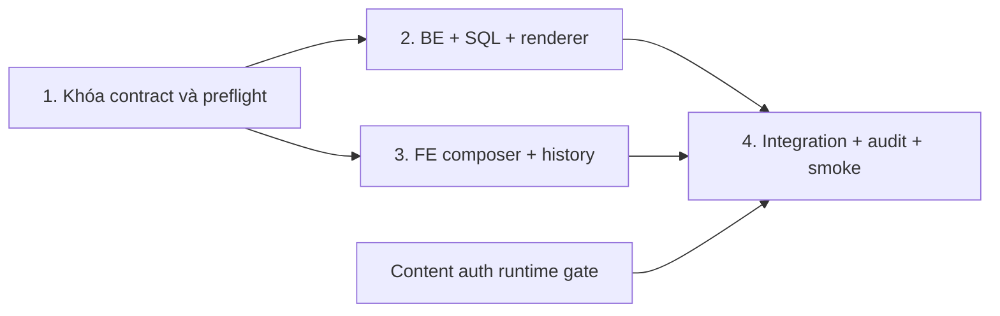

# Recipe PDF — kế hoạch full stack

## Overview

Reachable code implementation for Backend (Phase 2) and Frontend (Phase 3) is **complete** and verified via static builds/unit tests (`dotnet build`, `dotnet test` 76/76 passed, Next.js 34/34 pages compiled 0 errors, CodeReviewer 9.0/10). Mode **parallel**, giữ phạm vi người dùng đã chốt. Integration/rollout runtime verification **blocked** do thiếu Cloudinary credentials trong `.env`, chưa có PostgreSQL live instance/clone migration, và phụ thuộc Content authentication cutover (`20261101-content-authentication`).

- Admin+rnd xuất một version hoặc bộ version có thứ tự; A4 ngang mọi trang, chi tiết đầy đủ.
- Preview đúng version/ảnh/chú thích; draft watermark; official chỉ từ version `published`, không tự approve.
- Recipe sở hữu `pdf_document` + `pdf_document_item`; Cloudinary giữ raw PDF protected, backend kiểm quyền và stream file.
- Hai tab đề xuất trong Tài liệu PDF: Xuất PDF / Lịch sử. Lịch sử đọc bản xuất, không bảng history riêng.
- Một template ngang chi tiết có version; bỏ ba template demo giả. FR-DOC-07 hai template là Should chưa đạt, không gọi full SRS compliance.
- Không thêm portrait, R2, AI layout, drag-drop, Viewer PDF management, mutable editor persistence hay sửa PDF cũ.

## Phases

| Phase | Name | Status |
|---|---|---|
| 1 | [Hợp đồng và preflight](phase-01-contracts-and-preflight.md) | Contracts Frozen (Preflight Blocked) |
| 2 | [Backend, SQL và renderer](phase-02-backend-and-database.md) | Code Complete (Runtime Blocked) |
| 3 | [Frontend xuất và lịch sử](phase-03-frontend.md) | Code Complete (Runtime Blocked) |
| 4 | [Tích hợp, audit và nghiệm thu](phase-04-integration-and-verification.md) | Implementation Complete (Rollout Blocked) |
```
## Tài liệu triển khai

[ERD và lifecycle](erd-and-lifecycle.md) · [API contract](api-contract.md) · [UI/ấn phẩm](ui-and-document-design.md) · [Khảo sát/phụ thuộc](research-and-dependencies.md) · [Phản biện](reports/red-team-review.md)

## Execution strategy / ownership



| Owner | Exclusive scope |
|---|---|
| Phase 1 lead | systemmd/DESIGN + contract/ERD freeze, header-aware binary client helper, artwork decision |
| Phase 2 BE | Recipe entities/Application/Infrastructure/controller/schema, Content RPC impl/proto, PDF assets/backend tests |
| Phase 3 FE | PDF routes/components/typed module, recipe entry/selection, demo document cutover |
| Phase 4 integration lead | shell/permissions/proxy/package locks, host/auth registrations, Gateway/compose/env, durable Audit/receipts, README/acceptance; client helper chỉ kiểm tích hợp |

Không hai agents cùng sửa file. Shared host Program.cs/DI cần registration bàn giao lead; merge source hiện tại trước mọi edit. Không build/test/format giữa lúc agents sửa; chạy một lần sau tích hợp, rồi runtime smoke thật.

## Cross-plan dependencies

- `blockedBy: 20261101-content-authentication`: dùng authenticated Content media, cần Gateway/browser proof chưa xong; cập nhật `blocks` hai chiều.
- DB First cutover cũ blocked: không chờ toàn hệ thống, nhưng Recipe clone backup/restore/schema parity là hard gate trước SQL mới.
- Warm Editorial/Quiz UI chung shell/client/permissions: serialize với lead, không phụ thuộc kết quả Quiz.
- Frontend role-flows demo: phần PDF local được plan này thay thế; không chờ hoàn thành plan demo, không xóa scope khác.

## Completion criteria / gates

Cả single+collection, snapshot/order, draft/official, cover/TOC/pagination, protected Cloudinary và exact history hash phải được exercised. SQL theo DB First có clone parity/constraints; Admin+rnd được tạo/quản lý, anonymous denied; Viewer chỉ giữ official-single read-only, không management/draft/collection. PDF audit eventually persisted trong Audit. Builds BE/FE + regression và browser/container/PDF visual evidence theo phase4. Thiếu storage credentials/license/DB deploy access là blocker, không fake fallback.

## Red team review

Ba reviewer độc lập: 8 findings (1 Critical, 6 High, 1 Medium), đã áp 8 sửa vào plan; chưa kiểm chứng runtime. [Chi tiết và adjudication](reports/red-team-review.md).

## Validation log

Đã kế thừa quyết định user: Admin+rnd; đơn+bộ; ngang; full-detail; history; Cloudinary; Recipe DB. Shared history scope và cover artwork cuối là mặc định đề xuất ghi rõ trong UI/contract, không giả đã duyệt. Chưa chạy interview riêng; phase1 khóa các quyết định còn lại trước code song song. Không triển khai ngay từ yêu cầu lập plan.
