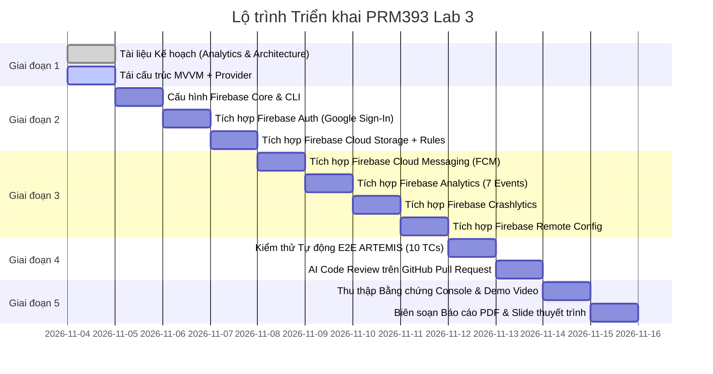

# Kế Hoạch Triển Khai Toàn Diện PRM393 Lab 3: Flutter & Firebase

> **Thư mục kế hoạch:** `docs/plans/261104-lab3-deep-scan-and-execution-plan/`  
> **Tài liệu tham chiếu:** `docs/materials/PRM393_Lab3_Preparation_Guide_v5_ToiUu.pdf`  
> **Thời gian:** 04/11/2026  
> **Mục tiêu:** Nâng cấp `src/mobile/` từ Mock sang kiến trúc MVVM kết nối 6 dịch vụ Firebase, thiết lập kiểm thử E2E ARTEMIS, thực hiện AI Code Review và đóng gói đầy đủ hồ sơ nộp bài.

---

## BẢNG LỘ TRÌNH TỔNG QUAN (ROADMAP)



---

## GIAI ĐOẠN 1: THIẾT LẬP TÀI LIỆU TIÊN QUYẾT & KIẾN TRÚC MVVM

### Bước 1.1: Soạn thảo Kế hoạch Analytics (`docs/analytics-plan.md`)
- **Mục tiêu:** Định nghĩa rõ ràng 7 sự kiện bắt buộc theo tài liệu Lab 3 trước khi lập trình.
- **Quy chuẩn:** Tên sự kiện dạng `snake_case`, không lưu trữ bất kỳ PII nào (email, họ tên, số điện thoại).
- **Danh sách sự kiện:**
  1. `login`: Ghi nhận đăng nhập thành công (params: `method: google`, `role: viewer/admin`).
  2. `logout`: Ghi nhận khi người dùng đăng xuất.
  3. `view_recipe`: Khi Barista mở chi tiết công thức (params: `recipe_id`, `recipe_name`, `size`).
  4. `start_brew_timer`: Khi bấm nút bắt đầu tự luyện pha chế tại quầy (params: `recipe_id`, `target_seconds`).
  5. `complete_brew_timer`: Khi hoàn thành phiên tự luyện (params: `recipe_id`, `actual_seconds`, `deviation_seconds`).
  6. `submit_feedback`: Khi gửi ý kiến/thắc mắc về công thức hoặc SOP (params: `feedback_type`, `recipe_id`, `has_attachment`).
  7. `export_report_pdf`: Khi xuất và tải báo cáo thực hành quầy bar lên Storage (params: `report_type`, `file_size_kb`).

### Bước 1.2: Soạn thảo Tài liệu Kiến trúc Hệ thống (`architecture.md`)
- **Mục tiêu:** Ranh giới rõ ràng giữa View, ViewModel, Service và Firebase SDK.
- **Cấu trúc:**
  ```text
  [Flutter UI / View] 
         │ (lắng nghe trạng thái qua ChangeNotifier / Consumer)
         ▼
  [ViewModel Layer] (AuthViewModel, RecipeViewModel, StorageViewModel, NotificationViewModel)
         │ (gọi nghiệp vụ trừu tượng)
         ▼
  [Service Interface] (IAuthService, IStorageService, INotificationService, etc.)
     ├──> [Mock Implementation] (Dùng cho Flutter Unit/Widget Tests và Offline Mode)
     └──> [Firebase Implementation] (Dùng cho Production & Máy ảo có mạng)
  ```

### Bước 1.3: Nâng cấp `pubspec.yaml` & Cấu trúc Thư mục Mã nguồn
- **Các gói phụ thuộc cần thêm vào `src/mobile/pubspec.yaml`:**
  - `provider: ^6.1.2` (Quản trị trạng thái MVVM chuẩn hóa)
  - `firebase_core: ^3.6.0`
  - `firebase_auth: ^5.3.1`
  - `google_sign_in: ^6.2.1`
  - `firebase_storage: ^12.3.2`
  - `firebase_messaging: ^15.1.3`
  - `firebase_analytics: ^11.3.3`
  - `firebase_crashlytics: ^4.1.3`
  - `firebase_remote_config: ^5.1.3`
- **Cấu trúc mới trong `src/mobile/lib/`:**
  - `lib/core/services/interfaces/`: Các interface chuẩn (`i_auth_service.dart`, `i_storage_service.dart`, etc.).
  - `lib/core/services/firebase/`: Các implementation gọi Firebase SDK thật.
  - `lib/core/viewmodels/`: Các ChangeNotifier quản lý trạng thái (`auth_viewmodel.dart`, `recipe_viewmodel.dart`, `notification_viewmodel.dart`, etc.).

---

## GIAI ĐOẠN 2: THIẾT LẬP DỰ ÁN FIREBASE, AUTH & STORAGE

### Bước 2.1: Cấu hình Dự án Firebase trên Google Cloud / Firebase Console
- Đăng ký ứng dụng Android với applicationId: `com.recipehub.mobile`.
- Lấy mã băm dấu vân tay SHA-1 và SHA-256 từ `keytool` hoặc `./gradlew signingReport` đưa vào Firebase Project Settings.
- Kích hoạt dịch vụ **Google Sign-In** trong tab *Authentication -> Sign-in method*.
- Tải file `google-services.json` đặt vào `src/mobile/android/app/google-services.json`.
- Cấu hình plugin Google Services trong `android/build.gradle.kts` và `android/app/build.gradle.kts`.

### Bước 2.2: Hiện thực hóa `AuthService` & `AuthViewModel`
- Tích hợp đăng nhập Google:
  - Gọi `GoogleSignIn.signIn()` -> lấy token xác thực -> `FirebaseAuth.instance.signInWithCredential()`.
  - Lắng nghe `authStateChanges` để tự động điều hướng: Người dùng chưa đăng nhập -> `LoginPage`, đã đăng nhập -> `MainAppShell`.
  - Đăng xuất: Gọi `signOut()` trên cả Firebase và GoogleSignIn, xóa sạch cache vai trò cục bộ.
  - Xử lý các tình huống lỗi: Người dùng nhấn "Hủy" hộp thoại Google, mất kết nối mạng.

### Bước 2.3: Hiện thực hóa `StorageService` & `StorageViewModel`
- Xây dựng chức năng tải tệp báo cáo ca thực hành quầy bar / file PDF lên Storage:
  - Cấu trúc thư mục: `reports/{uid}/{timestamp}_report.pdf`.
  - Lắng nghe stream tiến độ `snapshotEvents` để hiển thị `LinearProgressIndicator` từ 0% đến 100%.
  - Lấy `downloadUrl` lưu lại để hiển thị và chia sẻ.
- **Soạn thảo và đẩy lên GitHub file `firebase/storage.rules`:**
  ```javascript
  rules_version = '2';
  service firebase.storage {
    match /b/{bucket}/o {
      match /reports/{userId}/{allPaths=**} {
        allow read, write: if request.auth != null && request.auth.uid == userId;
      }
    }
  }
  ```
  *(Tuyệt đối không dùng `allow read, write: if true`)*.

---

## GIAI ĐOẠN 3: TÍCH HỢP FCM, ANALYTICS, CRASHLYTICS & REMOTE CONFIG

### Bước 3.1: Hiện thực hóa `NotificationService` (FCM)
- Xin quyền trên Android 13+ qua `FirebaseMessaging.instance.requestPermission()`.
- Lấy FCM Device Registration Token ghi log phục vụ kiểm chứng.
- Xử lý 3 trạng thái nhận tin nhắn:
  1. **Foreground (App đang mở):** Lắng nghe `FirebaseMessaging.onMessage`, hiển thị Custom In-app Banner hoặc SnackBar thông báo, đồng thời đẩy vào danh sách `NotificationsPage`.
  2. **Background (App chạy nền):** Bắt sự kiện người dùng bấm vào notification ngoài hệ điều hành (`FirebaseMessaging.onMessageOpenedApp`), trích xuất payload và điều hướng đến đúng màn hình chi tiết món (`M-03`) hoặc SOP (`M-06`).
  3. **Terminated (App đã đóng):** Kiểm tra `FirebaseMessaging.instance.getInitialMessage()` khi khởi động và điều hướng ngay khi app mở xong.

### Bước 3.2: Hiện thực hóa `AnalyticsService`
- Khởi tạo `FirebaseAnalytics.instance`.
- Triển khai đầy đủ 7 sự kiện từ `docs/analytics-plan.md`.
- Gắn User ID ngay khi đăng nhập: `FirebaseAnalytics.instance.setUserId(id: user.uid)`.
- Bật cờ kiểm thử DebugView qua ADB:
  ```bash
  adb shell setprop debug.firebase.analytics.app com.recipehub.mobile
  ```

### Bước 3.3: Hiện thực hóa `CrashlyticsService` & Error Boundary
- Cấu hình bắt lỗi toàn cục trong `main.dart`:
  ```dart
  FlutterError.onError = FirebaseCrashlytics.instance.recordFlutterFatalError;
  PlatformDispatcher.instance.onError = (error, stack) {
    FirebaseCrashlytics.instance.recordError(error, stack, fatal: false);
    return true;
  };
  ```
- Ghi nhận lỗi không gây dừng app (non-fatal error) khi gọi API/Storage thất bại qua `recordError`, gắn kèm Custom Keys (`store_branch: Landmark 81`, `current_role: Barista`).
- Bổ sung nút bấm ẩn "Gây crash thử nghiệm (Demo Crashlytics)" trong màn hình `AccountProfilePage` để kiểm chứng.

### Bước 3.4: Hiện thực hóa `RemoteConfigService`
- Khởi tạo với 2 tham số quan sát được trên UI:
  - `enable_ai_assist`: `false` (mặc định) -> khi bật `true`, hiển thị chip "Trợ lý AI công thức" trên màn hình Tra cứu.
  - `max_lookup_results`: `10` (mặc định) -> khi đổi thành `5` hoặc `20`, danh sách công thức tại quầy bar lập tức thay đổi giới hạn hiển thị.
- Thiết lập `setDefaults` và gọi `fetchAndActivate()` khi app khởi động.
- Cơ chế fallback an toàn: Khi mất mạng, app vẫn chạy trơn tru với các giá trị mặc định đã khai báo.

---

## GIAI ĐOẠN 4: KIỂM THỬ E2E TỰ ĐỘNG ARTEMIS & AI CODE REVIEW

### Bước 4.1: Soạn Kịch bản 10 Ca Kiểm Thử ARTEMIS
Lập tài liệu `docs/plans/261104-lab3-firebase-integration/artemis-test-plan.md` với 10 ca kiểm thử chi tiết:
- **TC-01:** Đăng nhập Google thành công, kiểm tra hiển thị đúng thông tin Barista trên AppBar.
- **TC-02:** Hủy đăng nhập Google tại bước chọn tài khoản, xác nhận hiển thị SnackBar thông báo hủy an toàn.
- **TC-03:** Tra cứu công thức, kiểm tra số lượng món hiển thị khớp với `max_lookup_results` của Remote Config.
- **TC-04:** Thay đổi tham số Remote Config trên Console, gọi cập nhật và kiểm chứng UI thay đổi không cần cài lại app.
- **TC-05:** Tải lên tệp báo cáo PDF ca làm việc lên Storage, quan sát thanh tiến độ chạy từ 0-100% và nhận URL.
- **TC-06:** Thử tải tệp khi tắt mạng thiết bị, kiểm tra bắt lỗi và giao diện `ErrorRecoveryPage` hiển thị nút Thử lại.
- **TC-07:** Gửi thông báo FCM khi app đang mở, xác minh tin nhắn xuất hiện trong `NotificationsPage`.
- **TC-08:** Chạm vào thông báo FCM từ thanh thông báo hệ thống Android, xác nhận mở đúng màn hình chi tiết món `M-03`.
- **TC-09:** Kích hoạt nút lỗi có chủ đích, xác minh app không bị đơ và dữ liệu lỗi gửi thành công lên Crashlytics Dashboard.
- **TC-10:** Kiểm tra hộp thoại xin quyền thông báo gốc của Android 13 (`POST_NOTIFICATIONS`) khi lần đầu mở app.

### Bước 4.2: Thực thi ARTEMIS & Phiên Kiểm Thử Khám Phá
- Chạy tự động lặp lại 3 lần cho mỗi ca kiểm thử trên máy ảo `Picket_QA_35`.
- Ghi nhận nhật ký thực thi (logs) và tính toán tỷ lệ Đạt (Pass rate đạt 100%).
- Thực hiện phiên Exploratory Testing kéo dài 20 phút rà soát toàn bộ các góc cạnh trải nghiệm người dùng.

### Bước 4.3: Quy trình AI Code Review trên GitHub Pull Request
- Đẩy nhánh `feature/firebase-integration` lên GitHub và mở Pull Request vào nhánh `dev`.
- Sử dụng Copilot / CodeRabbit thực hiện rà soát tự động.
- Lập tài liệu `docs/plans/261104-lab3-firebase-integration/ai-code-review-log.md` ghi nhận:
  - 5 phát hiện cụ thể kèm số dòng code (thuộc ít nhất 2 nhóm: Security, Error Handling, Memory/Performance).
  - Đánh giá chấp nhận, điều chỉnh hoặc từ chối kèm phân tích kỹ thuật.
  - Tạo 3 commits khắc phục riêng biệt để minh chứng khả năng truy vết (`fix(security): ...`, `fix(storage): ...`, `fix(analytics): ...`).

---

## GIAI ĐOẠN 5: ĐÓNG GÓI BẰNG CHỨNG, BÁO CÁO & VIDEO DEMO

### Bước 5.1: Chụp Ảnh Bằng Chứng Firebase Console (Evidence Screenshots)
1. **Auth Console:** Danh sách người dùng đã đăng nhập kèm UID và Provider Google.
2. **Storage Console:** Cấu trúc tệp tin `reports/{uid}/...` và file `firebase/storage.rules`.
3. **FCM Console:** Báo cáo chiến dịch gửi tin nhắn test thành công.
4. **Analytics DebugView:** Dòng sự kiện thời gian thực (realtime event stream) của 7 sự kiện.
5. **Crashlytics Dashboard:** Bản ghi crash test và danh sách non-fatal errors kèm Custom Keys.
6. **Remote Config Console:** Bảng tham số cấu hình và các phiên bản đã publish.

### Bước 5.2: Soạn thảo Báo Cáo Kỹ Thuật PDF (8–12 Trang)
- Mục 1: Giới thiệu ứng dụng RecipeHub Mobile và kết quả chuyển tiếp từ Lab 2.
- Mục 2: Thiết kế Kiến trúc MVVM & State Management.
- Mục 3: Chi tiết triển khai 6 Dịch vụ Firebase & Cấu hình bảo mật.
- Mục 4: Bằng chứng xác minh tích hợp (Console screenshots).
- Mục 5: Báo cáo kết quả kiểm thử tự động ARTEMIS & Exploratory testing.
- Mục 6: Nhật ký quyết định AI Code Review và các bản vá.
- Mục 7: Kết luận & Đánh giá mức độ hoàn thiện.

### Bước 5.3: Soạn Slide Thuyết Trình PDF (12–15 Trang)
- Thiết kế súc tích, trực quan, làm nổi bật kiến trúc MVVM, 6 dịch vụ Firebase và video demo.

### Bước 5.4: Quay Video Trình Diễn (5–10 Phút)
- Kịch bản ghi hình liền mạch:
  1. Đăng nhập Google Sign-In -> Vào màn hình Tra cứu tại quầy.
  2. Trình diễn Remote Config thay đổi số lượng món trên quầy bar.
  3. Xuất và tải báo cáo thực hành lên Storage (thấy rõ progress bar).
  4. Bắn thông báo FCM từ Console -> Click mở chi tiết món.
  5. Xem DebugView trên Firebase Console xác minh các sự kiện Analytics.
  6. Kích hoạt nút Test Crash -> Xem lỗi cập nhật trên Crashlytics.


## Cập nhật trạng thái 05/11/2026

- Package đúng là `com.recipehub.mobile`; lệnh DebugView dùng `adb shell setprop debug.firebase.analytics.app com.recipehub.mobile` (không phải package cũ).
- Đã xong: MVVM + 6 dịch vụ Firebase; Storage rules và Remote Config deploy bằng Firebase CLI (`src/mobile/firebase.json`); kiểm thử trên Redmi 7 với Gateway thật; ARTEMIS 10 ca × 3 lượt (`src/mobile/docs/artemis-test-plan.md`); kiểm thử khám phá; `analytics-plan.md`, `architecture.md`, `design-traceability.md`.
- Slide thuyết trình bản tiếng Anh và tiếng Việt (15 trang mỗi bản) đã dựng; còn chỗ trống cho ảnh Console và AI Code Review.
- Còn lại: AI Code Review trên PR; chụp ảnh Console còn thiếu; báo cáo PDF; video demo.
- Hạ tầng local: đã sửa `infra/compose.yaml` (healthcheck không cần curl), `init-databases.sh` về LF và thêm `.gitattributes`; image `worker` vẫn build lỗi (thiếu reference `RecipeHub.Content`), không ảnh hưởng mobile.
