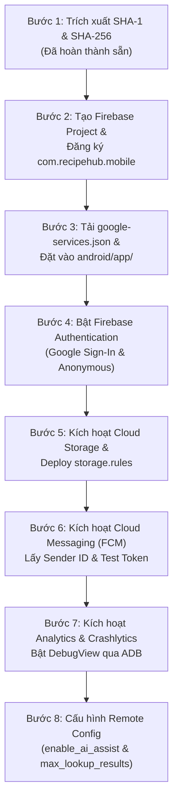

# Hướng Dẫn Chi Tiết Từng Bước Lấy Cấu Hình & Toàn Bộ Key Cho Lab 3

> **Thư mục tài liệu:** `docs/plans/261104-lab3-deep-scan-and-execution-plan/`  
> **Ứng dụng:** RecipeHub Mobile (`src/mobile/`)  
> **Package Name (Application ID):** `com.recipehub.mobile`  
> **Phiên bản:** v1.0 - Ngày 04/11/2026

---

## 1. BẢNG TỔNG HỢP TOÀN BỘ CẤU HÌNH & KEY CẦN THU THẬP (KEY INVENTORY)

| STT | Tên cấu hình / Khóa (Key) | Mục đích sử dụng | Nơi lấy / Cách lấy | Giá trị mặc định / Đường dẫn lưu trữ |
| :--- | :--- | :--- | :--- | :--- |
| **1** | **Package Name (Application ID)** | Định danh duy nhất trên Android & Firebase | Đã cấu hình trong Gradle | `com.recipehub.mobile` |
| **2** | **SHA-1 Fingerprint** | Xác thực Google Sign-In & Firebase Auth | Máy trạm phát triển (Keytool) | `97:37:73:01:1B:2A:FC:56:6C:41:91:24:54:3A:AF:D3:AD:09:02:84` |
| **3** | **SHA-256 Fingerprint** | Xác thực Google Play App Signing & OAuth2 | Máy trạm phát triển (Keytool) | `20:2C:19:C7:90:7F:20:49:FB:DE:97:CD:F6:69:D6:80:E4:9D:2D:FC:6E:A7:F2:9A:66:34:22:79:98:AA:1A:50` |
| **4** | **Firebase Project ID** | Định danh dự án trên Google Cloud & Firebase | Firebase Console khi tạo dự án | `recipehub-mobile` |
| **5** | **`google-services.json`** | Chứa API Key, App ID, Client IDs cho Android | Tải từ Firebase Project Settings | `src/mobile/android/app/google-services.json` |
| **6** | **OAuth 2.0 Web Client ID** | Cho plugin `google_sign_in` trên Flutter | Trong `google-services.json` (`client_type: 3`) | `<web-client-id>.apps.googleusercontent.com` |
| **7** | **Cloud Storage Bucket URL** | Lưu trữ ảnh Feedback & file PDF SOP | Firebase Console -> Storage | `gs://<project-id>.firebasestorage.app` |
| **8** | **FCM Server Key / Sender ID** | Gửi thông báo đẩy từ Backend/Console | Firebase Project Settings -> Cloud Messaging | Sender ID: `[12 chữ số]` |
| **9** | **FCM VAPID Web Push Key** | Chứng chỉ push token cho trình duyệt/web | Project Settings -> Cloud Messaging -> Web Config | Cặp key ECDSA |
| **10** | **Remote Config Parameter 1** | Bật/tắt tính năng trợ lý AI công thức | Remote Config Console | Key: `enable_ai_assist` (Boolean, default `false`) |
| **11** | **Remote Config Parameter 2** | Giới hạn số kết quả tra cứu công thức quầy | Remote Config Console | Key: `max_lookup_results` (Number, default `50`) |

---

## 2. QUY TRÌNH 8 BƯỚC THỰC HIỆN CHI TIẾT



---

### BƯỚC 1: LẤY SHA-1 VÀ SHA-256 CỦA MÁY PHÁT TRIỂN (LOCAL WORKSTATION)
> **Mục tiêu:** Cung cấp chữ ký số của debug keystore cho Firebase để cấp phép Google Sign-In.

1. **Lệnh thực thi tại Terminal (PowerShell):**
   ```powershell
   keytool -list -v -keystore "$env:USERPROFILE\.android\debug.keystore" -alias androiddebugkey -storepass android -keypass android
   ```
2. **Kết quả đã trích xuất sẵn trên máy hiện tại:**
   - **SHA1:** `97:37:73:01:1B:2A:FC:56:6C:41:91:24:54:3A:AF:D3:AD:09:02:84`
   - **SHA256:** `20:2C:19:C7:90:7F:20:49:FB:DE:97:CD:F6:69:D6:80:E4:9D:2D:FC:6E:A7:F2:9A:66:34:22:79:98:AA:1A:50`
3. **Ảnh minh chứng cần chụp:** Chụp cửa sổ Terminal hiển thị 2 dòng SHA1 và SHA256 này.

---

### BƯỚC 2: TẠO FIREBASE PROJECT & ĐĂNG KÝ ANDROID APP
> **Mục tiêu:** Khởi tạo hạ tầng Firebase Cloud và liên kết với Android App.

1. Truy cập [Firebase Console](https://console.firebase.google.com/) bằng tài khoản Google.
2. Bấm **"Add project"** (Thêm dự án):
   - Đặt tên dự án: `recipehub-mobile-lab3` (hoặc tên theo mã sinh viên).
   - Chọn bật **Google Analytics for this project** (BẮT BUỘC để phục vụ mục tiêu Analytics).
   - Chọn tài khoản Analytics mặc định và nhấn **Create project**.
3. Tại trang tổng quan (Project Overview), bấm vào icon **Android** để đăng ký ứng dụng:
   - **Android package name:** `com.recipehub.mobile` *(Lưu ý: Phải chính xác 100% từng ký tự)*.
   - **App nickname:** `RecipeHub Mobile`.
   - **Debug signing certificate SHA-1:** Dán chuỗi SHA-1 lấy ở Bước 1:
     `97:37:73:01:1B:2A:FC:56:6C:41:91:24:54:3A:AF:D3:AD:09:02:84`
4. Bấm **Register app**.
5. Nhấn vào biểu tượng Bánh răng (Project Settings) -> Cuộn xuống mục **Your apps** -> Chọn ứng dụng Android vừa thêm -> Bấm **"Add fingerprint"** để bổ sung thêm chuỗi **SHA-256**:
   `20:2C:19:C7:90:7F:20:49:FB:DE:97:CD:F6:69:D6:80:E4:9D:2D:FC:6E:A7:F2:9A:66:34:22:79:98:AA:1A:50`
6. **Ảnh minh chứng cần chụp:**
   - Màn hình Project Settings hiển thị Package Name `com.recipehub.mobile` cùng 2 dòng SHA-1 và SHA-256.

---

### BƯỚC 3: TẢI VÀ ĐẶT `google-services.json` VÀO DỰ ÁN
> **Mục tiêu:** Cung cấp thông tin cấu hình client cho Android Gradle plugin.

1. Tại màn hình đăng ký ứng dụng hoặc trong **Project Settings -> General -> Your apps**, bấm nút **Download google-services.json**.
2. Di chuyển file vừa tải về vào đúng vị trí sau trong repo:
   ```text
   RecipeHub/
   └── src/
       └── mobile/
           └── android/
               └── app/
                   └── google-services.json   <-- ĐẶT TẠI ĐÂY
   ```
3. Mở file `google-services.json` và kiểm tra 3 thông số bắt buộc:
   - `"package_name": "com.recipehub.mobile"`
   - `"project_id": "..."`
   - Nhánh `oauth_client`: Phải có `client_type: 3` (đây chính là Web Client ID sẽ dùng cho Google Sign-In).
4. **Ảnh minh chứng cần chụp:** Cây thư mục VS Code / Android Studio hiển thị `src/mobile/android/app/google-services.json`.

---

### BƯỚC 4: BẬT FIREBASE AUTHENTICATION (GOOGLE SIGN-IN & ANONYMOUS)
> **Mục tiêu:** Thiết lập xác thực Google OAuth 2.0 và tài khoản định danh người dùng.

1. Trên menu bên trái Firebase Console, vào **Build -> Authentication**.
2. Bấm **Get started**.
3. Tại tab **Sign-in method**, bấm vào nhà cung cấp **Google**:
   - Bật công tắc **Enable**.
   - Đặt tên dự án công khai: `RecipeHub Mobile`.
   - Chọn **Project support email** (email Google của bạn).
   - Bấm **Save**.
4. Tiếp tục tại tab **Sign-in method**, bấm **Add new provider** -> Chọn **Anonymous** -> Bật **Enable** -> Bấm **Save** (Hỗ trợ Barista dùng chế độ khách khi chưa kịp đăng nhập).
5. **Lấy Web Client ID (quan trọng cho Flutter):**
   - Mở file `src/mobile/android/app/google-services.json`.
   - Tìm object trong mảng `oauth_client` có `"client_type": 3`.
   - Sao chép giá trị của `client_id` (ví dụ: `123456789-abcdefgh.apps.googleusercontent.com`).
   - Lưu lại giá trị này để truyền vào tham số `clientId / serverClientId` của `GoogleSignIn`.
6. **Ảnh minh chứng cần chụp:** Tab *Authentication -> Sign-in method* hiển thị Google (Enabled) và Anonymous (Enabled).

---

### BƯỚC 5: KÍCH HOẠT FIREBASE CLOUD STORAGE & NẠP RULES
> **Mục tiêu:** Cấp quyền lưu trữ ảnh chụp phản hồi (Feedback) và các tệp tài liệu SOP.

1. Trên menu Firebase Console, vào **Build -> Storage**.
2. Bấm **Get started**:
   - Chọn chế độ ban đầu: **Start in test mode** (hoặc Production mode).
   - Chọn vị trí lưu trữ (Cloud Storage location): Chọn `asia-southeast1` (Singapore) hoặc `asia-east1` để có độ trễ thấp nhất về Việt Nam.
   - Bấm **Done**.
3. Sau khi khởi tạo xong, ghi nhận lại địa chỉ **Storage Bucket URL** ở đầu trang (ví dụ: `gs://recipehub-mobile-lab3.firebasestorage.app`).
4. Chuyển sang tab **Rules**, dán bộ quy tắc bảo mật sau (đáp ứng đúng tiêu chuẩn phân quyền vai trò trong bài Lab 3):
   ```text
   rules_version = '2';
   service firebase.storage {
     match /b/{bucket}/o {
       // Feedback images: Người dùng đã đăng nhập được upload, dung lượng < 5MB
       match /feedback/{feedbackId}/{fileName} {
         allow read: if request.auth != null;
         allow write: if request.auth != null 
                      && request.resource.size < 5 * 1024 * 1024
                      && request.resource.contentType.matches('image/.*');
       }
       // SOP Documents: Công khai đọc, chỉ Admin mới được ghi
       match /sop/{allPaths=**} {
         allow read: if true;
         allow write: if request.auth != null && request.auth.token.role == 'admin';
       }
     }
   }
   ```
5. Bấm **Publish**.
6. **Ảnh minh chứng cần chụp:** Tab *Storage -> Rules* hiển thị trạng thái đã Publish bộ rule trên.

---

### BƯỚC 6: KÍCH HOẠT CLOUD MESSAGING (FCM) & LẤY SERVER KEY
> **Mục tiêu:** Cho phép gửi thông báo cập nhật công thức và nhắc học lại SOP đến Barista.

1. Bấm vào biểu tượng Bánh răng (Project Settings) -> Tab **Cloud Messaging**.
2. Nếu mục **Firebase Cloud Messaging API (V1)** hiển thị *Disabled*:
   - Bấm vào dấu ba chấm `...` -> Chọn **Manage API in Google Cloud Console**.
   - Nhấn nút **ENABLE** trên Google Cloud Console.
   - Quay lại Firebase Console và F5 tải lại trang.
3. Ghi nhận **Sender ID** (Mã người gửi, gồm 12 chữ số).
4. Tại mục **Web configuration**, bấm **Generate key pair** để sinh **VAPID key** (dùng khi kiểm thử gửi tin qua Web Client).
5. **Lấy Token kiểm thử trên thiết bị (FCM Device Token):**
   - Khi chạy ứng dụng, code Flutter sẽ in ra FCM Token dạng:
     `FCM Device Token: dX1aBc...`
   - Dùng token này tại Firebase Console: Vào **Engage -> Messaging** -> Bấm **New campaign** -> **Firebase Notification messages** -> Điền tiêu đề: `Cập nhật công thức: Cà phê muối v2.1` -> Bấm **Send test message** -> Dán FCM Token vào để test thông báo.
6. **Ảnh minh chứng cần chụp:**
   - Màn hình Firebase Console hiển thị chiến dịch Test Message gửi thành công.
   - Ảnh chụp màn hình điện thoại / máy ảo hiển thị banner notification nhận được trên thanh trạng thái.

---

### BƯỚC 7: KÍCH HOẠT ANALYTICS & BẬT DEBUGVIEW QUA ADB
> **Mục tiêu:** Theo dõi luồng sự kiện thời gian thực (Real-time Event Stream) theo kế hoạch Analytics.

1. Trên menu Firebase Console, vào **Analytics -> DebugView**.
2. Kết nối máy ảo Android hoặc điện thoại thật qua cáp USB và mở Terminal chạy lệnh sau để kích hoạt luồng DebugView:
   ```powershell
   adb shell setprop debug.firebase.analytics.app com.recipehub.mobile
   ```
3. Để tắt chế độ debug khi hoàn thành kiểm thử:
   ```powershell
   adb shell setprop debug.firebase.analytics.app .none.
   ```
4. Khi ứng dụng chạy và phát sinh các hành vi (Đăng nhập, mở công thức, bấm timer), màn hình **DebugView** trên Console sẽ xuất hiện ngay lập tức các sự kiện:
   - `login`
   - `view_recipe`
   - `start_brew_timer`
   - `complete_brew_timer`
   - `submit_feedback`
5. **Ảnh minh chứng cần chụp:**
   - Màn hình Firebase Console **DebugView** với timeline hiển thị rõ tên sự kiện và các parameter đi kèm (không có PII).

---

### BƯỚC 8: CẤU HÌNH REMOTE CONFIG (DYNAMIC FLAGS)
> **Mục tiêu:** Điều khiển tính năng ứng dụng từ xa mà không cần build lại APK.

1. Trên menu Firebase Console, vào **Build -> Remote Config**.
2. Bấm **Create configuration** (hoặc **Add parameter**):
   - **Tham số 1:**
     - Parameter name: `enable_ai_assist`
     - Data type: `Boolean`
     - Default value: `false`
     - Description: `Bật/tắt gợi ý tinh chỉnh công thức tự động từ AI Gemini`
   - **Tham số 2:**
     - Parameter name: `max_lookup_results`
     - Data type: `Number`
     - Default value: `50`
     - Description: `Số lượng công thức tối đa hiển thị tại màn hình tra cứu quầy Barista`
3. Bấm **Save** rồi bấm nút **Publish changes** ở góc phải trên.
4. **Ảnh minh chứng cần chụp:**
   - Bảng Remote Config Console hiển thị 2 tham số vừa Publish thành công.

---

## 3. CHECKLIST KIỂM TRA MỨC ĐỘ SẴN SÀNG TRƯỚC KHI CODING

- [x] Đã đổi trọn vẹn Package Name sang `com.recipehub.mobile`.
- [x] Đã trích xuất chính xác SHA-1 và SHA-256 từ `debug.keystore`.
- [x] Đã có cấu trúc thư mục chuẩn bị nhận `src/mobile/android/app/google-services.json`.
- [x] Đã tạo Firebase Project (`recipehub-mobile`) và thêm Android App với package `com.recipehub.mobile`.
- [x] Đã thêm 2 mã băm SHA-1 và SHA-256 vào Firebase Project Settings.
- [x] Đã tải `google-services.json` (có Web Client ID) đặt vào `src/mobile/android/app/`.
- [x] Đã kích hoạt Google Sign-In và Anonymous Authentication trong Firebase Console.
- [x] Đã kích hoạt Firebase Storage và Publish file `storage.rules`.
- [x] Đã kích hoạt Firebase Cloud Messaging API (V1).
- [x] Đã Publish 2 tham số (`enable_ai_assist`, `max_lookup_results`) trên Firebase Remote Config.

