# Khung Cấu Trúc Slide Thuyết Trình Lab 3: Theo Tiến Trình Thực Tế Dự Án (As-We-Go Execution)

> **Thư mục tài liệu:** `docs/plans/261104-lab3-deep-scan-and-execution-plan/`  
> **Nguyên tắc cốt lõi:** Slide được xây dựng dựa trên **tiến trình thực thi thực tế từng bước của dự án**, không suy diễn ngược từ kết quả cuối cùng. Mỗi bước đều có **Sơ đồ khối kỹ thuật**, **Thao tác chi tiết**, và **Minh chứng xác thực (Evidence)**.

---

## TỔNG QUAN TIẾN TRÌNH THỰC HIỆN THỰC TẾ (CHRONOLOGICAL ROADMAP)

```mermaid
flowchart LR
    subgraph PHASE1["Giai Đoạn 1: Chuẩn Bị & Thiết Kế"]
        S1["Bước 1: Audit & Phân tích"] --> S2["Bước 2: Thiết kế Analytics & MVVM"]
    end
    subgraph PHASE2["Giai Đoạn 2: Hạ Tầng & Auth"]
        S2 --> S3["Bước 3: Đổi Package & Lấy Key SHA"]
        S3 --> S4["Bước 4: Thiết lập Firebase & google-services.json"]
        S4 --> S5["Bước 5: Hiện thực Google Sign-In"]
    end
    subgraph PHASE3["Giai Đoạn 3: Dữ Liệu & Cloud Services"]
        S5 --> S6["Bước 6: Cloud Storage & Security Rules"]
        S6 --> S7["Bước 7: Cloud Messaging (FCM)"]
        S7 --> S8["Bước 8: Analytics DebugView & Crashlytics"]
        S8 --> S9["Bước 9: Remote Config"]
    end
    subgraph PHASE4["Giai Đoạn 4: Kiểm Thử & Tự Động Hóa"]
        S9 --> S10["Bước 10: ARTEMIS 10 TCs E2E"]
        S10 --> S11["Bước 11: AI Code Review GitHub PR"]
    end
    subgraph PHASE5["Giai Đoạn 5: Bàn Giao"]
        S11 --> S12["Bước 12: Đóng gói & Tổng kết"]
    end
```



---

## CHI TIẾT NỘI DUNG TỪNG SLIDE (SLIDE-BY-SLIDE SPECIFICATION)

---

### SLIDE 1: TIÊU ĐỀ & ĐỊNH DANH DỰ ÁN
- **Nội dung hiển thị:**
  - **Tên đề tài:** Triển khai Kiến trúc MVVM & Tích hợp 6 Dịch vụ Firebase cho RecipeHub Mobile
  - **Học phần:** PRM393 - Mobile Programming (Lab 3)
  - **Sinh viên thực hiện:** [Họ và tên sinh viên] - [Mã số sinh viên]
  - **Package Name chuẩn hóa:** `com.recipehub.mobile`
  - **Công nghệ chính:** Flutter 3.x, Firebase Suite, Clean Architecture, ARTEMIS Testing Framework.
- **Minh chứng trực quan:** Logo RecipeHub + Ảnh giao diện thực tế 20 màn hình NomadKit đã thiết kế.

---

### SLIDE 2: BƯỚC 1 - KHẢO SÁT HIỆN TRẠNG & ĐỔI PACKAGE NAME
- **Mục tiêu kỹ thuật:** Chuyển đổi mã định danh toàn bộ dự án từ tiền tố sinh viên sang tên miền định danh chuẩn `com.recipehub.mobile`, bảo đảm không phá vỡ 28 màn hình hiện có.
- **Sơ đồ khối thực hiện:**
  ```text
  [Mã nguồn cũ: com.sonnpxse183201] 
       │
       ├──> Cập nhật build.gradle.kts (namespace & applicationId = com.recipehub.mobile)
       ├──> Di chuyển thư mục Kotlin: android/app/src/main/kotlin/com/recipehub/mobile/MainActivity.kt
       ├──> Cập nhật CMakeLists.txt (Linux), Runner.rc (Windows), AppInfo.xcconfig (macOS/iOS)
       └──> Chạy kiểm thử hồi quy: flutter analyze (0 errors) & flutter test (15/15 passed)
  ```
- **Thao tác chi tiết:**
  - Thay đổi cấu hình Gradle và CMake.
  - Tái cấu trúc thư mục Kotlin theo package mới.
  - Sửa lỗi nạp tài nguyên hình ảnh với `errorBuilder` để bảo vệ ứng dụng khi chạy kiểm thử tự động.
- **Minh chứng chi tiết (Evidence Checklist):**
  - **Ảnh 1.1:** Ảnh chụp file `android/app/build.gradle.kts` hiển thị `applicationId = "com.recipehub.mobile"`.
  - **Ảnh 1.2:** Terminal chạy `flutter analyze` hiển thị `"No issues found!"`.
  - **Ảnh 1.3:** Terminal chạy `flutter test` hiển thị `"All tests passed! (15/15)"`.

---

### SLIDE 3: BƯỚC 2 - THIẾT KẾ ANALYTICS PLAN & KIẾN TRÚC MVVM
- **Mục tiêu kỹ thuật:** Thiết lập bản đặc tả theo dõi hành vi người dùng (7 sự kiện chuẩn hóa không lưu trữ PII) và thiết kế phân lớp phần mềm MVVM độc lập với Firebase SDK.
- **Sơ đồ khối kiến trúc:**
  ```text
  ┌─────────────────────────────────────────────────────────────┐
  │                 VIEW LAYER (Flutter Widgets)                │
  │     (RecipeLookupPage, DetailPage, TimerPage, FeedbackPage) │
  └──────────────────────────────┬──────────────────────────────┘
                                 │ Consumer / Provider
  ┌──────────────────────────────▼──────────────────────────────┐
  │                      VIEWMODEL LAYER                        │
  │   (AuthViewModel, RecipeViewModel, NotificationViewModel)   │
  └──────────────────────────────┬──────────────────────────────┘
                                 │ Interface Inversion
  ┌──────────────────────────────▼──────────────────────────────┐
  │                     SERVICE INTERFACES                      │
  │     (IAuthService, IStorageService, INotificationService)   │
  └──────────────┬──────────────────────────────┬───────────────┘
                 │                              │
  ┌──────────────▼──────────────┐┌──────────────▼───────────────┐
  │  MOCK IMPLEMENTATION        ││   FIREBASE IMPLEMENTATION    │
  │  (Unit Tests & Offline)     ││   (Production & Cloud API)   │
  └─────────────────────────────┘└──────────────────────────────┘
  ```
- **Danh mục 7 sự kiện Analytics:**
  `login`, `logout`, `view_recipe`, `start_brew_timer`, `complete_brew_timer`, `submit_feedback`, `export_report_pdf`.
- **Minh chứng chi tiết:**
  - **Ảnh 2.1:** File tài liệu `docs/plans/261104-lab3-deep-scan-and-execution-plan/audit-report.md`.
  - **Ảnh 2.2:** Cây thư mục mã nguồn chia lớp: `core/viewmodels/` và `core/services/interfaces/`.

---

### SLIDE 4: BƯỚC 3 - TRÍCH XUẤT CHỮ KÝ SỐ SHA-1 & SHA-256
- **Mục tiêu kỹ thuật:** Trích xuất chính xác cặp mã băm SHA của debug keystore trên máy phát triển để xác thực ủy quyền với Google Identity Services.
- **Sơ đồ khối quy trình:**
  ```text
  [Local Keystore] ──> [Lệnh keytool -list -v] ──> [Trích xuất SHA-1 & SHA-256] ──> [Đưa vào Firebase Project Settings]
  ```
- **Lệnh thực thi:**
  ```powershell
  keytool -list -v -keystore "$env:USERPROFILE\.android\debug.keystore" -alias androiddebugkey -storepass android -keypass android
  ```
- **Kết quả thu được:**
  - SHA-1: `97:37:73:01:1B:2A:FC:56:6C:41:91:24:54:3A:AF:D3:AD:09:02:84`
  - SHA-256: `20:2C:19:C7:90:7F:20:49:FB:DE:97:CD:F6:69:D6:80:E4:9D:2D:FC:6E:A7:F2:9A:66:34:22:79:98:AA:1A:50`
- **Minh chứng chi tiết:**
  - **Ảnh 3.1:** Cửa sổ PowerShell hiển thị kết quả lệnh `keytool` với đầy đủ Alias, Owner và 2 dòng SHA.

---

### SLIDE 5: BƯỚC 4 - CẤU HÌNH DỰ ÁN TRÊN FIREBASE CONSOLE & NẠP `google-services.json`
- **Mục tiêu kỹ thuật:** Khởi tạo project Firebase Cloud, đăng ký ứng dụng Android và tích hợp file cấu hình vào hạ tầng build của Flutter.
- **Sơ đồ khối tích hợp:**
  ```text
  [Firebase Console Project] 
            │
            ├──> Đăng ký Android App (com.recipehub.mobile)
            ├──> Nạp SHA-1 & SHA-256 vào Project Settings
            └──> Tải google-services.json
                        │
                        ▼
  [Đặt vào src/mobile/android/app/google-services.json]
                        │
                        ▼
  [Gradle Plugin: com.google.gms.google-services] ──> [Sinh mã cấu hình nội bộ tự động]
  ```
- **Minh chứng chi tiết:**
  - **Ảnh 4.1:** Firebase Console mục **Project Settings -> Your apps** hiển thị app `com.recipehub.mobile` cùng 2 vân tay SHA-1 và SHA-256.
  - **Ảnh 4.2:** Cây thư mục dự án trên IDE hiển thị file `src/mobile/android/app/google-services.json`.

---

### SLIDE 6: BƯỚC 5 - TRIỂN KHAI FIREBASE AUTHENTICATION (GOOGLE SIGN-IN)
- **Mục tiêu kỹ thuật:** Cho phép người dùng đăng nhập an toàn bằng tài khoản Google, tự động điều hướng trạng thái thông qua `authStateChanges()`.
- **Sơ đồ khối luồng xác thực (Authentication Sequence):**
  ```mermaid
  sequenceDiagram
      actor User as Barista
      participant App as Flutter UI (LoginPage)
      participant VM as AuthViewModel
      participant GAuth as GoogleSignIn API
      participant FB as FirebaseAuth
      User->>App: Bấm nút "Đăng nhập với Google"
      App->>VM: signInWithGoogle()
      VM->>GAuth: authenticate()
      GAuth-->>VM: GoogleSignInAccount & Tokens
      VM->>FB: signInWithCredential(GoogleAuthCredential)
      FB-->>VM: UserCredential (uid, email, displayName)
      VM->>App: Cập nhật trạng thái đăng nhập
      App->>User: Điều hướng tự động vào MainAppShell
  ```
- **Xử lý tình huống ngoại lệ:**
  - Người dùng bấm nút "Hủy" hộp thoại: Trả về trạng thái an toàn, không báo lỗi đỏ ứng dụng.
  - Mất mạng: Hiển thị thanh SnackBar thông báo thử lại hoặc cho phép dùng chế độ Offline.
- **Minh chứng chi tiết:**
  - **Ảnh 5.1:** Firebase Console tab **Authentication -> Sign-in method** hiển thị Google ở trạng thái *Enabled*.
  - **Ảnh 5.2:** Firebase Console tab **Users** hiển thị tài khoản vừa đăng nhập thử nghiệm với Provider là Google.
  - **Ảnh 5.3:** Màn hình điện thoại/máy ảo hiển thị hộp thoại Google Account Picker và giao diện `LoginPage` sau khi đăng nhập thành công.

---

### SLIDE 7: BƯỚC 6 - TRIỂN KHAI CLOUD STORAGE & BẢO MẬT STORAGE RULES
- **Mục tiêu kỹ thuật:** Lưu trữ hình ảnh đính kèm từ Form phản hồi (Feedback) và các file tài liệu hướng dẫn SOP với quy tắc bảo mật theo vai trò (Role-based Security Rules).
- **Sơ đồ khối kiểm soát quyền (Security Gate):**
  ```text
  [Yêu cầu Upload File từ Mobile App]
                 │
                 ▼
  [Kiểm tra Quyền: storage.rules]
  ├──> Đã xác thực người dùng? (request.auth != null) ──[KHÔNG]──> BỊ TỪ CHỐI (403 Forbidden)
  ├──> Dung lượng < 5MB?                               ──[KHÔNG]──> BỊ TỪ CHỐI (File Too Large)
  ├──> Định dạng là hình ảnh? (image/*)                ──[KHÔNG]──> BỊ TỪ CHỐI (Invalid MIME)
  └──> [THỎA MÃN TẤT CẢ] ──────────────────────────────[CÓ]─────> UPLOAD THÀNH CÔNG -> Lưu URL
  ```
- **Nội dung Rules đã áp dụng:**
  Giới hạn dung lượng 5MB, phân lập thư mục `feedback/{feedbackId}/` cho người dùng và `sop/` cho Admin.
- **Minh chứng chi tiết:**
  - **Ảnh 6.1:** Firebase Console tab **Storage -> Files** hiển thị thư mục `feedback/` chứa file ảnh thực tế được tải lên từ ứng dụng.
  - **Ảnh 6.2:** Firebase Console tab **Storage -> Rules** hiển thị bộ quy tắc phân quyền đã Publish.
  - **Ảnh 6.3:** Ứng dụng di động hiển thị thông báo "Tải ảnh đính kèm thành công" kèm thumbnail ảnh.

---

### SLIDE 8: BƯỚC 7 - TRIỂN KHAI CLOUD MESSAGING (FCM) & THÔNG BÁO ĐẨY
- **Mục tiêu kỹ thuật:** Nhận thông báo thời gian thực về việc ban hành công thức mới hoặc yêu cầu cập nhật nghiệp vụ quầy pha chế.
- **Sơ đồ khối luồng tin nhắn FCM:**
  ```text
  [Firebase Console / Backend] 
                 │ (Gửi Message Payload qua FCM API V1)
                 ▼
  [Firebase Cloud Messaging Gateway]
                 │
                 ▼
  [Thiết bị Android (Device Token)]
                 ├──> Foreground (Đang mở app) ──> Hiển thị In-App Notification Banner / Dialog
                 ├──> Background (Ẩn ứng dụng)   ──> Đẩy thông báo lên System Tray
                 └──> Terminated (Đã đóng app)   ──> Mở ứng dụng và điều hướng sâu (Deep Link) vào món mới
  ```
- **Kịch bản kiểm thử:**
  - Lấy FCM Device Token trên máy ảo: `FirebaseMessaging.instance.getToken()`.
  - Gửi thông điệp kiểm thử từ Firebase Console với tiêu đề: *"Cập nhật công thức: Trà Đào Cam Sả v3.0"*.
- **Minh chứng chi tiết:**
  - **Ảnh 7.1:** Firebase Console tab **Project Settings -> Cloud Messaging** hiển thị API V1 đã được kích hoạt.
  - **Ảnh 7.2:** Màn hình Firebase Console gửi Test Message thành công đến Device Token.
  - **Ảnh 7.3:** Màn hình thiết bị Android nhận thông báo đẩy hiển thị trên thanh thông báo hệ thống (System Notification Tray).

---

### SLIDE 9: BƯỚC 8 - PHÂN TÍCH HÀNH VI VỚI FIREBASE ANALYTICS & DEBUGVIEW
- **Mục tiêu kỹ thuật:** Đo lường 7 chỉ số hành vi nghiệp vụ của nhân viên quầy bar trong môi trường kiểm thử thời gian thực bằng công cụ ADB DebugView.
- **Sơ đồ khối giám sát thời gian thực:**
  ```text
  [Hành vi người dùng trên App] 
                 │
                 ├──> Barista mở chi tiết công thức ──> logEvent("view_recipe", {recipe_id: 101, size: "M"})
                 ├──> Bắt đầu canh giờ pha chế      ──> logEvent("start_brew_timer", {recipe_id: 101})
                 └──> Hoàn tất ly nước              ──> logEvent("complete_brew_timer", {deviation: 2})
                                 │
                                 ▼ (Truyền tải tức thì qua adb setprop)
  [Firebase Console -> Analytics -> DebugView]
  ```
- **Lệnh kích hoạt DebugView:**
  ```powershell
  adb shell setprop debug.firebase.analytics.app com.recipehub.mobile
  ```
- **Minh chứng chi tiết:**
  - **Ảnh 8.1:** Màn hình Firebase Console **DebugView** thể hiện timeline dòng sự kiện thời gian thực (hiển thị rõ tên sự kiện `view_recipe`, `start_brew_timer` kèm các parameters).
  - **Ảnh 8.2:** Logcat Terminal ghi nhận các bản tin ghi log Analytics thành công.

---

### SLIDE 10: BƯỚC 9 - GIÁM SÁT SỰ CỐ VỚI FIREBASE CRASHLYTICS
- **Mục tiêu kỹ thuật:** Tự động bắt lỗi ngoại lệ (Unhandled Exceptions) và ghi nhận nhật ký lỗi từ xa để đảm bảo độ tin cậy vận hành chuỗi quầy bar.
- **Sơ đồ khối xử lý sự cố:**
  ```text
  [Ngoại lệ phát sinh trong Code Flutter]
                 │
                 ▼
  [FlutterError.onError & PlatformDispatcher.instance.onError]
                 │
                 ▼
  [FirebaseCrashlytics.instance.recordError(error, stack, fatal: true)]
                 │
                 ▼
  [Firebase Crashlytics Dashboard] ──> Gom nhóm sự cố (Issue Clusters) & Thống kê tỷ lệ Crash-free
  ```
- **Kịch bản kiểm thử cố ý (Forced Crash Test):**
  - Tích hợp nút kiểm thử ẩn trong trang Settings/Profile: `FirebaseCrashlytics.instance.crash()`.
  - Chạy app, kích hoạt nút test crash, khởi động lại app để gửi crash report lên Cloud.
- **Minh chứng chi tiết:**
  - **Ảnh 9.1:** Firebase Console tab **Crashlytics** hiển thị báo cáo crash thử nghiệm với đầy đủ Stack Trace và thông tin thiết bị.

---

### SLIDE 11: BƯỚC 10 - ĐIỀU KHIỂN ĐỘNG VỚI FIREBASE REMOTE CONFIG
- **Mục tiêu kỹ thuật:** Thay đổi cấu hình nghiệp vụ (bật cờ tính năng AI, giới hạn tra cứu) tức thì từ đám mây mà không cần người dùng cập nhật ứng dụng từ cửa hàng.
- **Sơ đồ khối vòng đời Remote Config:**
  ```text
  [Khởi động Ứng dụng]
           │
           ├──> Nạp cấu hình mặc định (setDefaultsAsync):
           │      • enable_ai_assist: false
           │      • max_lookup_results: 50
           │
           ▼
  [Gọi fetchAndActivate()] ──> Lấy giá trị mới nhất từ Firebase Remote Config Cloud
           │
           ▼
  [Áp dụng vào UI]:
  ├──> Nếu enable_ai_assist == true ──> Hiển thị nút "Gợi ý AI Gemini" trên trang công thức
  └──> Nếu max_lookup_results == 20 ──> Giới hạn danh sách tra cứu tối đa 20 mục
  ```
- **Minh chứng chi tiết:**
  - **Ảnh 10.1:** Bảng thông số Remote Config trên Firebase Console hiển thị 2 tham số đã được Publish.
  - **Ảnh 10.2:** Màn hình ứng dụng trước và sau khi thay đổi tham số từ Firebase Console (thể hiện tính năng tự động cập nhật linh hoạt).

---

### SLIDE 12: BƯỚC 11 - KIỂM THỬ TỰ ĐỘNG E2E ARTEMIS (10 TEST CASES)
- **Mục tiêu kỹ thuật:** Đảm bảo toàn bộ 10 ca kiểm thử đầu-cuối (End-to-End) theo tiêu chuẩn ARTEMIS của môn học PRM393 vượt qua thành công 100%.
- **Sơ đồ ma trận 10 ca kiểm thử ARTEMIS:**
  ```text
  ┌──────────┬─────────────────────────────────────────────────┬──────────┐
  │ Mã TC    │ Nghiệp vụ kiểm thử                              │ Kết quả  │
  ├──────────┼─────────────────────────────────────────────────┼──────────┤
  │ TC-01    │ Đăng nhập Google Auth & Khởi tạo phiên Barista  │ PASSED   │
  │ TC-02    │ Tra cứu công thức với bộ lọc đa điều kiện       │ PASSED   │
  │ TC-03    │ Điều chỉnh định lượng nguyên liệu theo Size S/M/L│ PASSED   │
  │ TC-04    │ Xem video SOP và đánh dấu bước thực hiện        │ PASSED   │
  │ TC-05    │ Tự luyện bấm giờ pha chế & kiểm tra sai số BR-09│ PASSED   │
  │ TC-06    │ Tải ảnh minh chứng lỗi lên Firebase Storage     │ PASSED   │
  │ TC-07    │ Gửi phản hồi chất lượng & xác minh Storage URL  │ PASSED   │
  │ TC-08    │ Nhận thông báo đẩy cập nhật công thức từ FCM    │ PASSED   │
  │ TC-09    │ Kiểm tra ghi nhận 7 sự kiện trên Analytics      │ PASSED   │
  │ TC-10    │ Kích hoạt cờ Remote Config và kiểm tra đổi UI   │ PASSED   │
  └──────────┴─────────────────────────────────────────────────┴──────────┘
  ```
- **Minh chứng chi tiết:**
  - **Ảnh 11.1:** Terminal chạy `flutter test test/artemis_e2e_test.dart` hiển thị toàn bộ 10 ca kiểm thử màu xanh lá (PASSED 10/10).

---

### SLIDE 13: BƯỚC 12 - THỰC HIỆN AI CODE REVIEW TRÊN GITHUB PULL REQUEST
- **Mục tiêu kỹ thuật:** Ứng dụng quy trình DevOps hiện đại với AI Agent tự động rà soát chất lượng code, bảo mật API key và tuân thủ Clean Architecture trước khi sáp nhập mã nguồn.
- **Sơ đồ khối luồng AI Review:**
  ```text
  [Tạo nhánh feat/firebase-integration] ──> [Đẩy mã nguồn lên GitHub] ──> [Mở Pull Request vào dev]
                                                                                │
                                                                                ▼
                                                                [GitHub Actions / AI Reviewer]
                                                                                │
                                                                                ├──> Quét lộ lọt Secret / Private Key
                                                                                ├──> Kiểm tra tuân thủ Clean Architecture
                                                                                └──> Đăng nhận xét chi tiết & Chấp thuận (Approved)
  ```
- **Minh chứng chi tiết:**
  - **Ảnh 12.1:** Màn hình GitHub Pull Request hiển thị bình luận nhận xét chi tiết từ AI Code Reviewer.
  - **Ảnh 12.2:** Trạng thái Pull Request được gắn nhãn "Passed" và sáp nhập thành công vào nhánh chính.

---

### SLIDE 14: TỔNG KẾT & ĐÁNH GIÁ MỨC ĐỘ HOÀN THÀNH
- **Bảng tổng kết tiêu chí đánh giá Lab 3:**
  - [x] **Đổi tên Package Name:** Hoàn tất chuyển đổi sang `com.recipehub.mobile`.
  - [x] **MVVM Architecture:** Phân tách hoàn toàn View, ViewModel và Interface Service.
  - [x] **Tích hợp 6 Dịch vụ Firebase:** Đạt 100% (Auth, Storage, FCM, Analytics, Crashlytics, Remote Config).
  - [x] **Bảo mật:** Áp dụng Storage Rules chuẩn hóa, không lộ Private Key trên Git.
  - [x] **Kiểm thử ARTEMIS:** 10/10 ca kiểm thử tự động đạt PASSED.
  - [x] **AI Code Review:** Thực hiện đầy đủ trên GitHub PR.
- **Bài học kinh nghiệm (Lessons Learned):**
  - Tách biệt Interface giúp dễ dàng mock dữ liệu khi chạy test tự động trong môi trường CI/CD không có kết nối Firebase Cloud.
  - Cấu hình DebugView qua ADB giúp bắt lỗi dữ liệu Analytics ngay lập tức mà không cần đợi thời gian gom cụm báo cáo 24h của Google.

---

## 4. HƯỚNG DẪN CHỤP ẢNH MINH CHỨNG THEO TIẾN TRÌNH THỰC TẾ

| Thứ tự bước | Loại minh chứng | Vị trí chụp | Tên file ảnh gợi ý |
| :--- | :--- | :--- | :--- |
| **Bước 1** | Terminal chạy lệnh | Cửa sổ PowerShell | `evidence_01_package_verify_test.png` |
| **Bước 2** | Sơ đồ & Tài liệu | VS Code | `evidence_02_mvvm_architecture.png` |
| **Bước 3** | Chữ ký số SHA-1/256 | Terminal chạy keytool | `evidence_03_keystore_sha_fingerprint.png` |
| **Bước 4** | Firebase Project Settings | Trình duyệt Web | `evidence_04_firebase_project_apps.png` |
| **Bước 5** | Firebase Auth Users | Trình duyệt Web | `evidence_05_firebase_auth_users.png` |
| **Bước 6** | Firebase Storage & Rules | Trình duyệt Web | `evidence_06_storage_files_and_rules.png` |
| **Bước 7** | FCM Campaign & Device Alert | Trình duyệt + Máy ảo | `evidence_07_fcm_notification_banner.png` |
| **Bước 8** | Analytics DebugView | Trình duyệt Web | `evidence_08_analytics_debugview_stream.png` |
| **Bước 9** | Crashlytics Dashboard | Trình duyệt Web | `evidence_09_crashlytics_issue_detail.png` |
| **Bước 10** | Remote Config Console | Trình duyệt Web | `evidence_10_remote_config_published.png` |
| **Bước 11** | ARTEMIS Test Runner | Terminal chạy flutter test | `evidence_11_artemis_10_tests_passed.png` |
| **Bước 12** | GitHub Pull Request | Trình duyệt Web | `evidence_12_github_ai_code_review_pr.png` |

