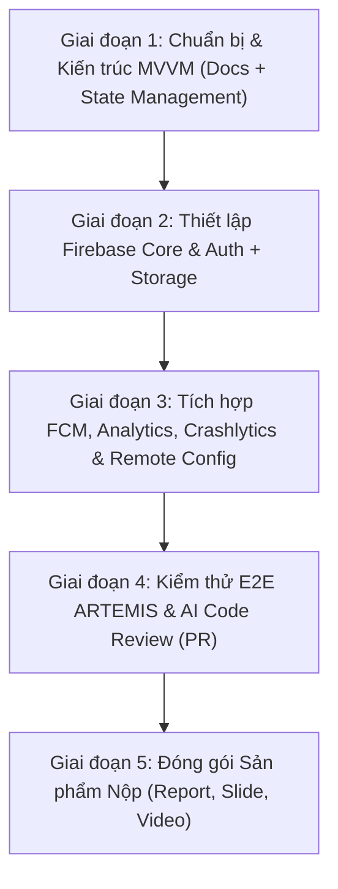

# Kế hoạch Thực hiện Toàn diện PRM393 - Lab 3: Flutter & Firebase Integration

> **Kế hoạch thực thi trên base hiện tại:** `docs/plans/261105-lab3-implementation-on-current-base/plan.md`  
> **Tài liệu tham chiếu:** `docs/materials/PRM393_Lab3_Preparation_Guide_v5_ToiUu.pdf`  
> **Thời gian tạo:** 04/11/2026  
> **Mục tiêu:** Chuyển đổi toàn bộ UI/UX prototype Lab 2 sang ứng dụng Flutter kết nối đám mây, tích hợp chuẩn 6 dịch vụ Firebase theo kiến trúc MVVM, đảm bảo kiểm thử tự động ARTEMIS và AI Code Review.

---

## PHẦN I: PHÂN TÍCH YÊU CẦU LAB 3 TỪ TÀI LIỆU HƯỚNG DẪN

### 1. Mục tiêu cốt lõi
- **Kết nối Cloud thực tế:** Hiện thực hóa các màn hình và 3 luồng người dùng từ Lab 2 (Viewer, Admin) thành ứng dụng Flutter hoàn chỉnh có xử lý lỗi, trạng thái mạng, phản hồi UI.
- **Tích hợp trọn vẹn 6 dịch vụ Firebase:**
  1. `Firebase Authentication` (Đăng nhập Google, authStateChanges, bảo vệ route, xóa session khi logout).
  2. `Firebase Cloud Storage` (Upload tệp báo cáo/PDF theo cấu trúc `reports/{uid}/...`, thanh tiến độ, bảo mật `storage.rules`).
  3. `Firebase Cloud Messaging - FCM` (Thông báo đẩy 3 trạng thái: foreground, background, terminated; Android 13+ permission; lưu lịch sử; điều hướng khi tap).
  4. `Google Analytics for Firebase` (Đo lường tối thiểu 7 sự kiện, tài liệu `docs/analytics-plan.md`, DebugView, không chứa PII).
  5. `Firebase Crashlytics` (Ghi nhận crash có chủ đích & non-fatal errors, gắn User ID & custom diagnostic key).
  6. `Firebase Remote Config` (Tối thiểu 2 tham số quan sát được trên UI, service tải/kích hoạt, fallback offline).
- **Kiến trúc MVVM phân lớp nghiêm ngặt:** Giao diện (`View`) tuyệt đối KHÔNG gọi trực tiếp Firebase SDK; toàn bộ phải đi qua `ViewModel` (State Management bằng `Provider` hoặc `Riverpod`) và các lớp `Service` độc lập. Có Fake/Mock Service phục vụ unit testing mà không phụ thuộc cloud.
- **Kiểm thử tự động & Bằng chứng xác minh:**
  - ARTEMIS E2E testing: Ít nhất 10 ca kiểm thử, chạy 3 lần, kiểm tra giá trị quan sát được, 1 phiên exploratory testing (15–30 phút).
  - AI Code Review: Rà soát PR, 5 phát hiện (findings) thuộc 2 nhóm, sửa ít nhất 3 phát hiện có commit truy vết.
  - Deliverables: GitHub repository, Báo cáo PDF 8–12 trang, Slide PDF 12–15 trang, Video demo 5–10 phút.

---

### 2. Ma trận 6 Dịch vụ Firebase & Ranh giới Kỹ thuật

| Dịch vụ | Yêu cầu Kỹ thuật cụ thể | Luồng nghiệp vụ trong RecipeHub | Cách thức Kiểm chứng (Evidence) |
| :--- | :--- | :--- | :--- |
| **01. Authentication** | - Google Sign-In<br>- `authStateChanges`<br>- SHA-1 / SHA-256 Android<br>- Xóa trạng thái phiên khi logout<br>- Guard route | Đăng nhập Barista (Viewer) hoặc Quản lý chi nhánh (Admin). Chặn truy cập trái phép vào các màn hình nghiệp vụ nếu chưa đăng nhập. | - Firebase Console `Users`<br>- Ảnh chụp màn hình trước/sau login<br>- Test hủy login và mất kết nối |
| **02. Cloud Storage** | - Upload tệp báo cáo `reports/{uid}/...`<br>- Progress indicator<br>- Download URL<br>- `firebase/storage.rules` (chỉ UID chủ sở hữu đọc/ghi) | Xuất báo cáo ca làm việc, file SOP PDF, hoặc ảnh feedback thực tế tại quầy của Barista lên Firebase Storage. | - Storage Console thấy file đúng path<br>- File `firebase/storage.rules` trên GitHub<br>- Test từ chối khi không có quyền/mất mạng |
| **03. Cloud Messaging (FCM)** | - Quyền Android 13+ `POST_NOTIFICATIONS`<br>- 3 trạng thái (Foreground, Background, Terminated)<br>- Lưu vào Notification Center trong app<br>- Deep link khi click | Thông báo cập nhật công thức mới, SOP thay đổi, nhắc lịch kiểm tra Quiz/Đào tạo. Chạm vào thông báo mở thẳng màn hình SOP/Recipe tương ứng. | - Gửi test message từ Firebase Console<br>- Token thiết bị trong log<br>- Video/Ảnh chụp nhận notif trong cả 3 trạng thái<br>- Test từ chối cấp quyền |
| **04. Analytics** | - Viết `docs/analytics-plan.md`<br>- Tối thiểu 7 sự kiện (`snake_case` hoặc recommended)<br>- Set User ID<br>- Không lọt PII (email, họ tên) | Track: `login`, `logout`, `view_recipe_detail`, `start_practice_timer`, `complete_practice_timer`, `submit_feedback`, `export_report`. | - Firebase Console `DebugView`<br>- Ảnh chụp từng event khớp plan<br>- Liên kết sự kiện với luồng thành công của Lab 2 |
| **05. Crashlytics** | - Khởi tạo `FlutterError.onError`, `PlatformDispatcher`<br>- Gửi lỗi đã xử lý (non-fatal error)<br>- Gắn User ID + Custom Key<br>- Nút Test Crash trong demo/settings | Bắt lỗi parse dữ liệu recipe, lỗi network khi gọi API/Storage đưa vào non-fatal. Thêm nút "Gây crash thử nghiệm" ẩn trong Account Profile. | - Crashlytics Dashboard hiển thị crash test + non-fatal issue<br>- Ảnh chụp chi tiết Custom Key & User ID<br>- UI app vẫn hiển thị dialog/snackbar báo lỗi thân thiện |
| **06. Remote Config** | - Tối thiểu 2 tham số điều khiển UI<br>- Service tải `fetchAndActivate`<br>- Fallback mặc định khi offline | Tham số 1: `enable_ai_assist` (Bật/tắt tính năng gợi ý công thức AI)<br>Tham số 2: `max_lookup_results` (Số món hiển thị tối đa tại quầy bar: 5 vs 20 món). | - Thay đổi trên Console và kích hoạt trên app không cần build lại<br>- Ảnh chụp trước/sau khi đổi config<br>- Test khi ngắt mạng app vẫn chạy giá trị default |

---

### 3. Quy trình Đảm bảo Chất lượng (QA & Code Review)

1. **ARTEMIS Automated E2E Testing:**
   - 10 Test Cases rõ ràng: Preconditions, Steps, Expected Results.
   - Bao phủ: Luồng đăng nhập, luồng tra cứu công thức, luồng tự luyện/timer, luồng nộp feedback, luồng phân quyền admin, nhánh mất mạng/lỗi quyền storage, 1 tương tác Android gốc (ví dụ: permission popup notification).
   - Chạy lặp lại 3 lần mỗi ca, lập bảng thống kê Pass Rate (100%), ghi log chi tiết.
   - 1 phiên Exploratory Testing (15–30 phút) ghi nhận lỗi tiềm ẩn và các góc cạnh UX.

2. **AI Code Review:**
   - Tạo 1 Pull Request trên GitHub cho nhánh tính năng Firebase (`feature/firebase-integration`).
   - Sử dụng Copilot / CodeRabbit hoặc trợ lý AI để review toàn bộ diff.
   - Thu thập ít nhất 5 phát hiện (Security, Performance, Error Handling, Memory Leaks, Code Smell) gắn liền số dòng code.
   - Quyết định kỹ thuật: Accept / Modify / Reject kèm lý do phân tích.
   - Sửa ít nhất 3 phát hiện được chấp nhận và commit riêng biệt để truy vết (`fix(security): ...`, `fix(perf): ...`).

---

## PHẦN II: QUY TRÌNH THỰC HIỆN TỪNG BƯỚC (STEP-BY-STEP EXECUTION PLAN)

Kế hoạch được chia thành 5 giai đoạn liên hoàn (Phases):



---

### GIAI ĐOẠN 1: Chuẩn bị Hạ tầng, Kiến trúc MVVM & Tài liệu Kỹ thuật
**Mục tiêu:** Thiết lập cấu trúc mã nguồn theo MVVM + Provider/Riverpod, viết trước các tài liệu bắt buộc trước khi code.

- **Bước 1.1: Viết tài liệu Kế hoạch Analytics (`docs/analytics-plan.md`)**
  - Xác định danh sách 7+ sự kiện chuẩn.
  - Bảng ma trận: Event Name, Trigger Moment, Parameters (không chứa PII), Câu hỏi sản phẩm cần trả lời.
- **Bước 1.2: Viết tài liệu Kiến trúc (`architecture.md`)**
  - Vẽ sơ đồ luồng: `View -> ViewModel -> Service Interface -> [Firebase Service / Mock Service]`.
  - Quy định quản lý trạng thái: `Loading`, `Success(data)`, `Empty`, `Error(message)`.
- **Bước 1.3: Cập nhật `pubspec.yaml` với State Management & Utilities**
  - Thêm `provider` (hoặc `flutter_riverpod`).
  - Chuẩn bị sẵn abstraction interfaces cho 6 dịch vụ.

---

### GIAI ĐOẠN 2: Thiết lập Dự án Firebase & Tích hợp Nhóm Dịch vụ Cơ bản (Auth & Storage)
**Mục tiêu:** Kết nối Firebase vào Android, hoàn thành đăng nhập Google và tải báo cáo Storage.

- **Bước 2.1: Cấu hình Firebase Project & FlutterFire CLI**
  - Đăng ký package name Android (ví dụ: `com.prm393.recipehub`).
  - Thêm SHA-1 và SHA-256 vào Firebase Console.
  - Chạy `flutterfire configure` để sinh ra `firebase_options.dart`.
  - Cập nhật `android/app/build.gradle.kts` và `android/build.gradle.kts` (Google Services plugin).
- **Bước 2.2: Hiện thực `AuthService` & `AuthViewModel`**
  - Đăng nhập Google (`google_sign_in` + `firebase_auth`).
  - Lắng nghe `authStateChanges`.
  - Cập nhật UI `LoginPage` và guard navigation trong `MainAppShell`.
  - Xử lý các ca lỗi: Người dùng hủy đăng nhập, mất kết nối mạng.
- **Bước 2.3: Hiện thực `StorageService` & `StorageViewModel`**
  - Tải tệp lên đường dẫn `reports/{uid}/{timestamp}.pdf`.
  - Bắt stream tiến độ tải (`TaskSnapshot.bytesTransferred / totalBytes`).
  - Lấy Download URL và lưu metadata.
  - Soạn thảo và thêm `firebase/storage.rules` vào repo (chỉ cho phép user đã đăng nhập đọc/ghi đúng path của mình).

---

### GIAI ĐOẠN 3: Tích hợp Nhóm Dịch vụ Vận hành (FCM, Analytics, Crashlytics, Remote Config)
**Mục tiêu:** Đưa toàn bộ các công cụ thông báo, phân tích, giám sát lỗi và cấu hình từ xa vào app.

- **Bước 3.1: Hiện thực `NotificationService` (FCM)**
  - Cấu hình quyền Android 13 (`requestPermission`).
  - Lấy FCM Token và log ra console.
  - Lắng nghe tin nhắn trong 3 trạng thái: `FirebaseMessaging.onMessage` (Foreground), `onMessageOpenedApp` (Background), `getInitialMessage` (Terminated).
  - Tích hợp vào `NotificationsPage` (Notification Center) và điều hướng đúng màn hình chi tiết khi chạm.
- **Bước 3.2: Hiện thực `AnalyticsService`**
  - Khởi tạo `FirebaseAnalytics.instance`.
  - Tạo hàm log cho 7 sự kiện định nghĩa trong `docs/analytics-plan.md`.
  - Gọi `setUserId` ngay sau khi đăng nhập thành công.
  - Kiểm tra qua `adb shell setprop debug.firebase.analytics.app <package_name>` để quan sát trên Firebase DebugView.
- **Bước 3.3: Hiện thực `CrashlyticsService` & Error Handling**
  - Cấu hình Crashlytics trong `main.dart`:
    ```dart
    FlutterError.onError = FirebaseCrashlytics.instance.recordFlutterFatalError;
    PlatformDispatcher.instance.onError = (error, stack) {
      FirebaseCrashlytics.instance.recordError(error, stack, fatal: false);
      return true;
    };
    ```
  - Bắt non-fatal errors trong các khối `try-catch` của service và gửi kèm Custom Keys (`store_id`, `role`, `action_name`).
  - Thêm nút ẩn "Thử nghiệm Crash (Demo Crashlytics)" trong màn hình `AccountProfilePage` để kích hoạt crash có kiểm soát.
- **Bước 3.4: Hiện thực `RemoteConfigService`**
  - Cài đặt `setDefaults` trong app với 2 tham số:
    - `enable_ai_assist`: `false` (mặc định)
    - `max_lookup_results`: `10` (mặc định)
  - Cài đặt `fetchAndActivate` với `fetchTimeout` và `minimumFetchInterval`.
  - Ánh xạ 2 tham số này trực tiếp lên giao diện Tra cứu công thức và thanh gợi ý quầy bar.

---

### GIAI ĐOẠN 4: Kiểm thử Tự động ARTEMIS & AI Code Review (PR)
**Mục tiêu:** Thực hiện kiểm thử toàn diện, thu thập bằng chứng xác minh và hoàn thiện chất lượng code qua AI Review.

- **Bước 4.1: Xây dựng Kịch bản Kiểm thử ARTEMIS (10 Test Cases)**
  - TC01: Đăng nhập Google thành công & chuyển vào Shell.
  - TC02: Hủy đăng nhập Google & hiển thị thông báo lỗi thân thiện.
  - TC03: Tra cứu công thức & hiển thị danh sách theo tham số Remote Config.
  - TC04: Thay đổi tham số Remote Config trên Console & kích hoạt trên UI.
  - TC05: Tải lên báo cáo thực hành quầy bar lên Storage có progress bar.
  - TC06: Thử tải tệp khi mất mạng & bắt lỗi hiển thị retry.
  - TC07: Nhận thông báo FCM khi app đang mở và thêm vào danh sách thông báo.
  - TC08: Chạm thông báo FCM khi app chạy nền mở đúng màn hình chi tiết món.
  - TC09: Bắt non-fatal error khi dữ liệu lỗi và gửi Crashlytics thành công.
  - TC10: Kiểm tra quyền Android gốc (Notification permission dialog).
- **Bước 4.2: Thực thi ARTEMIS & Thu thập Logs/Pass Rate**
  - Chạy lặp lại 3 lần cho mỗi ca kiểm thử.
  - Chụp ảnh màn hình từng bước và xuất nhật ký thực thi (logs).
  - Ghi nhận phiên Exploratory Testing 20 phút.
- **Bước 4.3: Thực hiện AI Code Review trên Pull Request**
  - Tạo PR từ nhánh `feature/firebase-integration` vào `dev`.
  - Chạy bot rà soát AI (Copilot/CodeRabbit).
  - Lập bảng 5 phát hiện: File & Line, Mô tả lỗi, Đánh giá (Accept/Modify/Reject), Lý do.
  - Triển khai ít nhất 3 bản vá (fixes) có commit rõ ràng.

---

### GIAI ĐOẠN 5: Đóng gói Bằng chứng & Soạn thảo Sản phẩm Nộp
**Mục tiêu:** Hoàn thiện toàn bộ bộ hồ sơ nộp bài theo đúng tiêu chuẩn Lab 3.

- **Bước 5.1: Thu thập Bộ ảnh chụp Bằng chứng Firebase Console**
  - Ảnh 1: Authentication -> Tab Users hiển thị tài khoản đã đăng nhập.
  - Ảnh 2: Cloud Storage -> Thư mục `reports/{uid}/` chứa file uploaded.
  - Ảnh 3: Cloud Messaging -> Lịch sử gửi chiến dịch test message.
  - Ảnh 4: Analytics -> DebugView hiển thị dòng sự kiện realtime.
  - Ảnh 5: Crashlytics -> Dashboard hiển thị crash test và non-fatal issue kèm custom keys.
  - Ảnh 6: Remote Config -> Bảng thông số và giá trị cấu hình.
- **Bước 5.2: Soạn Báo cáo PDF (8–12 trang)**
  - Cấu trúc: Giới thiệu dự án, Kiến trúc MVVM, Chi tiết tích hợp 6 dịch vụ Firebase, Bằng chứng kiểm chứng, Kết quả ARTEMIS, Quyết định AI Code Review, Kết luận.
- **Bước 5.3: Soạn Slide thuyết trình PDF (12–15 trang)**
  - Tóm tắt trực quan các màn hình, sơ đồ kiến trúc, điểm nổi bật về bảo mật và kiểm thử.
- **Bước 5.4: Ghi hình Video Demo (5–10 phút)**
  - Kịch bản quay: Đăng nhập Google -> Tra cứu công thức với Remote Config -> Upload file lên Storage -> Nhận thông báo FCM -> Kích hoạt crash & xem log Crashlytics -> Xem DebugView Analytics.

---

## PHẦN III: DANH MỤC TÀI LIỆU CẦN TẠO TRONG REPO

1. `architecture.md` (Gốc repository): Tài liệu kiến trúc MVVM và ranh giới Firebase.
2. `docs/analytics-plan.md`: Kế hoạch chi tiết 7+ sự kiện Google Analytics.
3. `firebase/storage.rules`: Quy tắc bảo mật Firebase Storage.
4. `docs/journals/261104-lab3-preparation-analysis.md`: Nhật ký khảo sát & phân tích Lab 3.
5. `docs/plans/261104-lab3-firebase-integration/artemis-test-plan.md`: Chi tiết 10 ca kiểm thử ARTEMIS.
6. `docs/plans/261104-lab3-firebase-integration/ai-code-review-log.md`: Nhật ký rà soát mã nguồn bằng AI.

