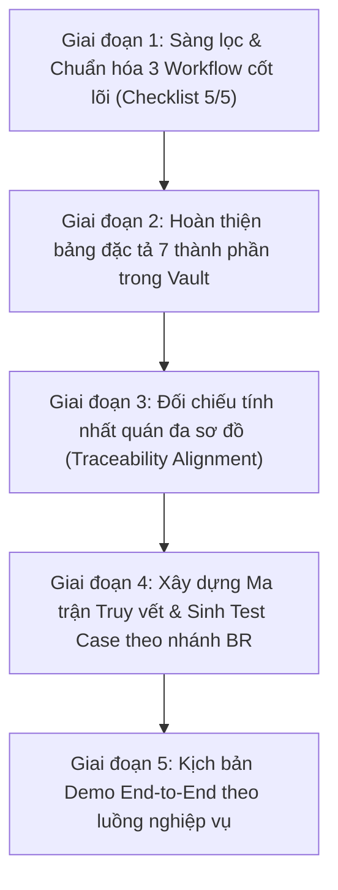

# Kế Hoạch Thực Hành Chuẩn Đặc Tả Workflow (Workflow Specification Standard)

> **Mục tiêu:** Áp dụng 100% quy chuẩn từ `Workflow_Specification_Standard.md` vào toàn bộ thiết kế, sơ đồ kỹ thuật, tài liệu Obsidian Vault, mã nguồn và kịch bản demo/kiểm thử của hệ thống **RecipeHub**.

---

## I. TỔNG QUAN CÁC GIAI ĐOẠN (ROADMAP)

---

## II. CHI TIẾT CÁC GIAI ĐOẠN THỰC HÀNH

### Giai đoạn 1: Sàng lọc & Chuẩn hóa 3 Workflow Cốt Lõi (Checklist 5/5)
* **Mục tiêu:** Loại bỏ hoàn toàn tư duy "mô tả giao diện" hoặc "thao tác CRUD"; cố định 3 Workflow lõi giải quyết đúng 3 Pain Point lớn của đồ án.
* **Quy tắc cỡ:** Hệ thống chọn đúng 3 Workflow lõi (mỗi WF từ 3–7 bước):
  1. `WF-01 · Phát hành công thức pha chế mới` *(Pain Point: R&D thử nghiệm thất thoát công thức, không kiểm soát chất lượng chuẩn SOP trước khi ra chuỗi)*.
  2. `WF-02 · Cải tiến công thức đã xuất bản` *(Pain Point: Thay đổi tỷ lệ nguyên liệu làm mất công thức gốc, không truy vết được lịch sử hương vị qua các mùa)*.
  3. `WF-03 · Tra cứu công thức & Báo cáo sự cố định lượng` *(Pain Point: Barista pha lệch vị tại quầy do nguyên liệu biến chất nhưng không có kênh phản hồi về R&D)*.
* **Tiêu chí nghiệm thu (Checklist 5/5):**
  * [x] Trigger rõ ràng (Actor gửi / Sự cố phát sinh).
  * [x] Kết thúc bằng kết quả nghiệp vụ có giá trị (Công thức lên `PUBLISHED`, Bản fork `v(N+1)` ra đời, Incident report được tiếp nhận).
  * [x] Có thay đổi dữ liệu / trạng thái đối tượng (`RecipeVersion`, `IncidentReport`).
  * [x] Có điểm rẽ nhánh theo Business Rule (`[BR-01]`, `[BR-04]`, `[BR-05]`, `[BR-07]`).
  * [x] Đặt tên chuẩn: `[Động từ]` + `[Đối tượng nghiệp vụ]`.

---

### Giai đoạn 2: Hoàn thiện Bảng Đặc Tả 7 Thành Phần trong Vault
* **Mục tiêu:** Cập nhật trực tiếp vào note `D:\02_Academy\04_Project\RecipeHub.md` bảng đặc tả chuẩn 7 thành phần cho từng workflow.
* **Nội dung hoàn thiện cho từng WF:**
  * **Trường 1 (Mã & Tên):** `WF-01`, `WF-02`, `WF-03`.
  * **Trường 2 (Actor):** Phân định rạch ròi vai trò (R&D Specialist, R&D Manager, Barista, Hệ thống/Worker).
  * **Trường 3 (Trigger):** Sự kiện kích hoạt nghiệp vụ.
  * **Trường 4 (Precondition):** Trạng thái ban đầu và mã `BR` ràng buộc.
  * **Trường 5 (Happy Path):** 3–7 bước nghiệp vụ tuần tự, ghi rõ actor thực hiện từng bước.
  * **Trường 6 (Điểm quyết định & BR):** Các hình thoi rẽ nhánh (Decision Gateways) và mã `BR-01..BR-07`.
  * **Trường 7 (Exception & Postcondition):** Nhánh sai thì thông báo gì, rollback dữ liệu ra sao; trạng thái cuối cùng đạt được.

---

### Giai đoạn 3: Đối Chiếu Tính Nhất Quán Đa Sơ Đồ (Multi-Diagram Alignment)
* **Mục tiêu:** Đảm bảo "sợi chỉ đỏ" nối thông suốt từ Workflow sang toàn bộ các sơ đồ kỹ thuật đã vẽ trong đồ án:
  1. **Activity / BPMN (Slide 7 — `business-flow.drawio`):**
     * Kiểm tra 4 swimlanes: R&D, Hệ thống, Quản lý, Barista.
     * Kiểm tra các hình thoi rẽ nhánh: Phải có mã `BR-01` (Kiểm tra SOP), `BR-04` (Khóa bản published).
     * Kiểm tra đường mũi tên nét đứt cho nhánh Exception quay đầu.
  2. **State Machine (Slide 8 — `recipe-version-state-machine.drawio`):**
     * Đối tượng: `RecipeVersion`.
     * Khớp cú pháp: `Transition = Event [Guard] / Action`.
     * Nhận diện Forbidden Transitions: Cấm `DRAFT -> PUBLISHED` khi vi phạm `BR-01`, cấm sửa in-place `PUBLISHED -> DRAFT` (`BR-04`).
  3. **Sequence Diagram (Slide 12 — `sequence-diagram-publish-recipe.drawio`):**
     * Lifelines khớp đúng tên class thật: `:RecipesController`, `:RecipeService`, `:RecipeRepository`, `:PostgreSQL`, `:RedisStreams`.
     * Khối `alt` xử lý rẽ nhánh Exception khớp với điểm quyết định trong WF-01.
  4. **Class Design (Slide 13 — `class-design.drawio`):**
     * Đảm bảo Business Rule đặt đúng chỗ: Controller xử lý `[BR-05]` (phân quyền), Service xử lý `[BR-01, BR-07]` (thẩm định use case), Domain Entity xử lý `[BR-04]` (tính bất biến).

---

### Giai đoạn 4: Ma Trận Truy Vết & Sinh Test Case theo Nhánh Rẽ (Slide 22)
* **Mục tiêu:** Mỗi nhánh rẽ của hình thoi Business Rule trong Workflow bắt buộc sinh ra ít nhất 1 Test Case tương ứng.
* **Bảng Ma trận Truy vết mẫu:**

| Mã WF | Bước thực hiện | Trạng thái chuyển đổi | Mã Business Rule | Mã Test Case tương ứng |
| :--- | :--- | :--- | :--- | :--- |
| **WF-01** | R&D gửi yêu cầu xuất bản | `DRAFT → PENDING` | — | `TC-WF01-01` (Gửi duyệt hợp lệ) |
| **WF-01** | Hệ thống thẩm định SOP | Giữ `DRAFT` | `[BR-01]` (≥1 NL, ≥1 SOP, Yield) | `TC-WF01-02` (Thiếu nguyên liệu → 400) `TC-WF01-03` (Thiếu bước SOP → 400) |
| **WF-01** | Kiểm tra danh mục nguyên liệu | Giữ `DRAFT` | `[BR-07]` (Nguyên liệu Active) | `TC-WF01-04` (Nguyên liệu Inactive → Báo lỗi) |
| **WF-01** | Manager duyệt công thức | `PENDING → PUBLISHED` | `[BR-03]` (Thẩm quyền duyệt) | `TC-WF01-05` (Manager duyệt thành công) `TC-WF01-06` (Barista duyệt lậu → 403 Forbidden) |
| **WF-02** | R&D sửa công thức Published | Bị chặn (Giữ nguyên) | `[BR-04]` (Tính bất biến) | `TC-WF02-01` (Sửa trực tiếp bản Published → 409 Conflict) |
| **WF-02** | R&D Fork bản cải tiến | Sinh version mới `DRAFT` | `[BR-04]` | `TC-WF02-02` (Fork thành công sang version N+1) |

---

### Giai đoạn 5: Xây Dựng Kịch Bản Demo End-to-End theo Workflow (Slide 21)
* **Mục tiêu:** Chuẩn bị kịch bản demo hội đồng bảo vệ kể câu chuyện liền mạch xuyên suốt theo `WF-01` và `WF-02`.
* **Kịch bản Demo:**
  * **Cảnh 1 (Actor: R&D):** Đăng nhập vào hệ thống → Mở giao diện công thức → Thử xuất bản khi thiếu bước pha chế → Hệ thống chặn theo `[BR-01]`.
  * **Cảnh 2 (Actor: R&D):** Bổ sung đủ nguyên liệu, thêm bước SOP có ảnh minh họa → Gửi duyệt thành công.
  * **Cảnh 3 (Actor: Manager):** Đăng nhập quyền Quản lý → Xem chi tiết bản nháp → Nhấn "Phê duyệt" → Công thức chuyển sang `PUBLISHED`.
  * **Cảnh 4 (Actor: Barista):** Mở app Barista → Công thức lập tức xuất hiện trong danh mục tra cứu SOP chuẩn.
  * **Cảnh 5 (Actor: R&D):** Muốn đổi công thức → Hệ thống khóa ô nhập liệu → Bấm "Tạo phiên bản mới (Fork)" → Hệ thống nhân bản sang `v2.0` ở trạng thái `DRAFT`.
