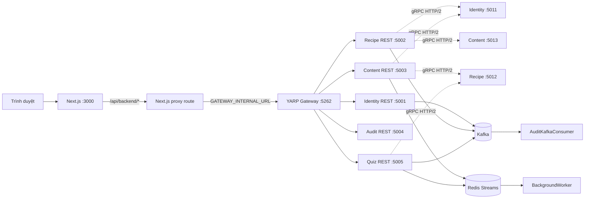
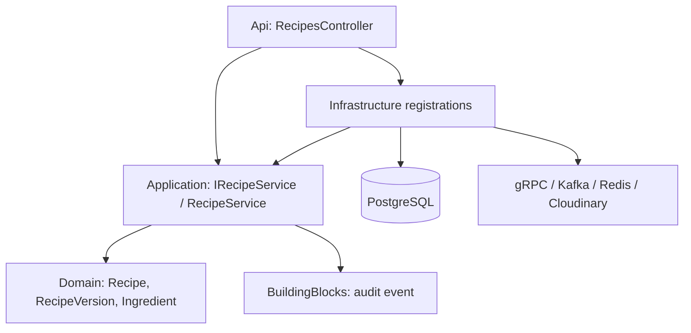
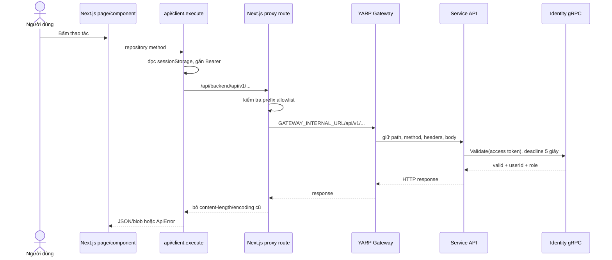
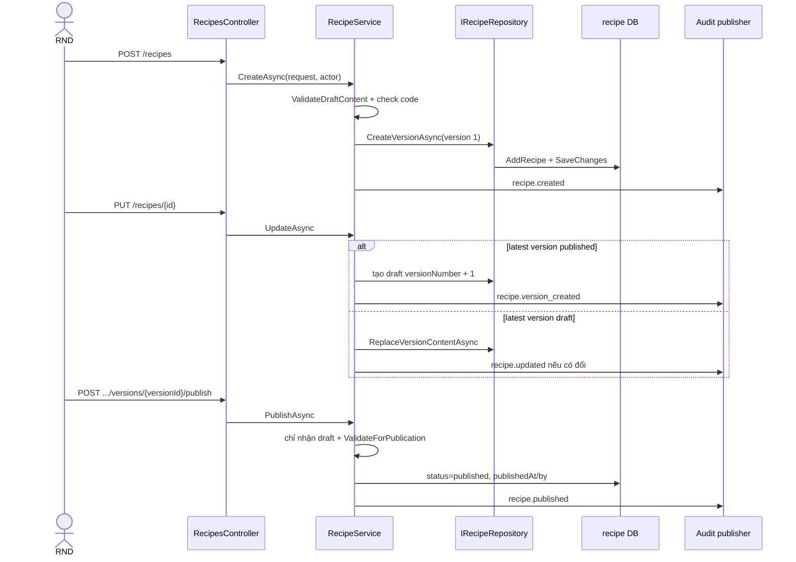
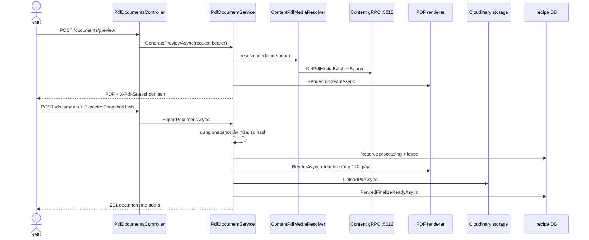
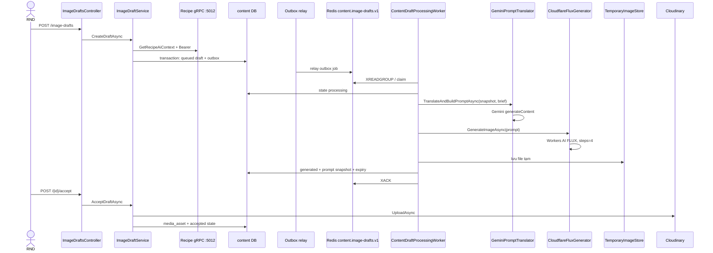
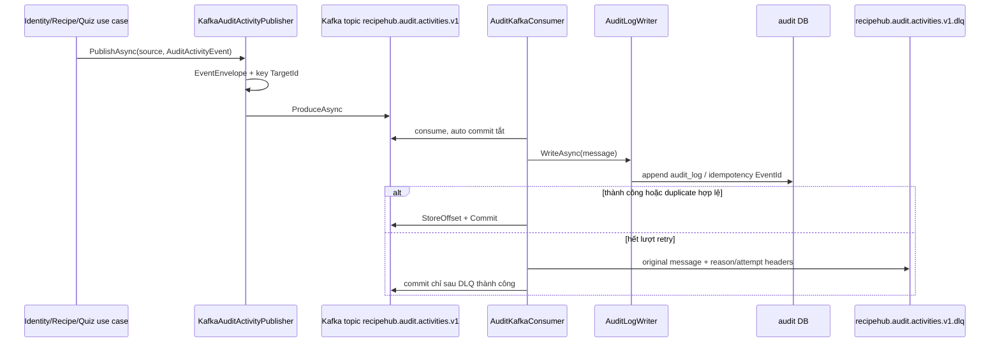
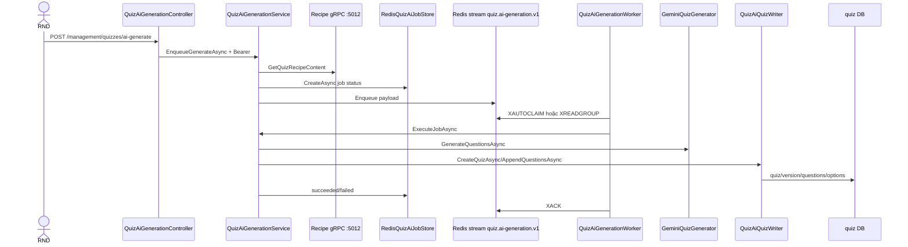

# 04. Luồng code toàn hệ thống web RecipeHub

> Phạm vi: backend .NET 8 và frontend Next.js. Không gồm mobile. Mọi dẫn chứng dùng dạng `đường-dẫn:dòng`. Tài liệu mô tả code đang có, kể cả điểm khác với cách gọi nghiệp vụ trong đề bài.

Quy ước đọc dẫn chứng: citation ghi đủ `src/...` là đường dẫn trực tiếp từ root repository. Để bảng không quá rộng, citation chỉ ghi basename được mở rộng như sau: `AuthController.cs` = `src/backend/Services/Identity/RecipeHub.Identity.Api/Controllers/AuthController.cs`; `UsersController.cs` = `src/backend/Services/Identity/RecipeHub.Identity.Api/Controllers/UsersController.cs`; `AuthService.cs` = `src/backend/Services/Identity/RecipeHub.Identity.Application/Services/AuthService.cs`; `RecipesController.cs`, `IngredientsController.cs`, `CatalogsController.cs`, `CalculationsController.cs` = các file cùng tên trong `src/backend/Services/Recipe/RecipeHub.Recipe.Api/Controllers/`; `RecipeService.cs`, `PdfDocumentService.cs` = các file cùng tên trong `src/backend/Services/Recipe/RecipeHub.Recipe.Application/Services/`; `ImageDraftsController.cs`, `MediaAssetsController.cs` = các file cùng tên trong `src/backend/Services/Content/RecipeHub.Content.Api/Controllers/`; `ImageDraftService.cs` = `src/backend/Services/Content/RecipeHub.Content.Application/Services/ImageDraftService.cs`; `GeminiPromptTranslator.cs`, `CloudflareFluxGenerator.cs` = các file cùng tên trong `src/backend/Services/Content/RecipeHub.Content.Infrastructure/Ai/`; các `Quiz*Controller.cs` = file cùng tên trong `src/backend/Services/Quiz/RecipeHub.Quiz.Api/Controllers/`; `QuizAiGenerationService.cs` = `src/backend/Services/Quiz/RecipeHub.Quiz.Application/Services/QuizAiGenerationService.cs`; `QuizAiGenerationWorker.cs`, `ContentDraftProcessingWorker.cs` = file cùng tên trong `src/backend/Workers/RecipeHub.BackgroundWorker/`; `AuditKafkaConsumer.cs` = `src/backend/Services/Audit/RecipeHub.Audit.Infrastructure/Messaging/AuditKafkaConsumer.cs`; `AuditLogsController.cs` = `src/backend/Services/Audit/RecipeHub.Audit.Api/Controllers/AuditLogsController.cs`; `ServiceOptions.cs` = `src/backend/BuildingBlocks/RecipeHub.BuildingBlocks/Configuration/ServiceOptions.cs`; các `.proto` = file cùng tên trong `src/backend/Contracts/RecipeHub.GrpcContracts/Protos/`; `route.ts` = `src/frontend/src/app/api/backend/[...path]/route.ts`; `permissions.ts` = `src/frontend/src/lib/demo/permissions.ts`; `backend-repository.ts` = `src/frontend/src/lib/api/backend-repository.ts`.

## 0. Bản đồ để người mới bắt đầu

- **Frontend** là giao diện chạy trong trình duyệt. RecipeHub dùng Next.js App Router; mỗi `page.tsx` tạo một trang, còn `route.ts` tạo endpoint phía Next.js (`src/frontend/src/app/api/backend/[...path]/route.ts:1-67`).
- **Backend** là các chương trình xử lý nghiệp vụ. Hệ thống chia thành Identity, Recipe, Content, Audit và Quiz; Gateway đứng trước các service (`src/backend/Gateway/RecipeHub.Gateway/appsettings.json:10-95`).
- **API** là giao diện để hai chương trình gọi nhau. REST dùng HTTP method và URL; gRPC dùng hợp đồng `.proto`; Kafka và Redis Streams chuyển message bất đồng bộ.
- **JWT** (JSON Web Token) là access token mang định danh phiên. Service không tin token một mình: Recipe và Content gọi Identity gRPC để xác minh session còn hiệu lực (`src/backend/Services/Recipe/RecipeHub.Recipe.Api/RecipeAuthenticationHandler.cs:13-35`, `src/backend/Services/Content/RecipeHub.Content.Api/ContentAuthenticationHandler.cs:37-76`).
- **Database-per-service** nghĩa là mỗi service sở hữu dữ liệu của nó. Code thể hiện từng service đăng ký `DbContext`/Infrastructure riêng; worker nạp Content, Audit và Quiz Infrastructure thay vì một DB dùng chung (`src/backend/Workers/RecipeHub.BackgroundWorker/Program.cs:8-21`).



Các cổng REST/destination do YARP cấu hình tại `src/backend/Gateway/RecipeHub.Gateway/appsettings.json:58-93`; các cổng gRPC 5011, 5012, 5013 do từng `Program.cs` mở tại `src/backend/Services/Identity/RecipeHub.Identity.Api/Program.cs:17-20`, `src/backend/Services/Recipe/RecipeHub.Recipe.Api/Program.cs:18-24`, `src/backend/Services/Content/RecipeHub.Content.Api/Program.cs:18-24`.

## 1. Clean Architecture bốn tầng

### 1.1. Ý nghĩa và chiều phụ thuộc

Clean Architecture đặt nghiệp vụ ở trung tâm, kỹ thuật ở bên ngoài. Bốn project của mỗi service có trách nhiệm:

1. **Domain**: entity và quy tắc cốt lõi, không biết ASP.NET, EF Core hay Redis.
2. **Application**: use case, DTO và interface. Application gọi interface, không tự biết PostgreSQL hay Cloudinary.
3. **Infrastructure**: hiện thực interface bằng EF Core, gRPC, Kafka, Redis, Gemini, Cloudflare hoặc Cloudinary.
4. **Api**: controller, authentication, middleware, Swagger và composition root trong `Program.cs`.

Chiều đúng là `Api -> Infrastructure -> Application -> Domain`; dependency injection nối interface với implementation tại lúc khởi động. Ví dụ Recipe API đăng ký Application/Infrastructure trước khi map controller và gRPC server (`src/backend/Services/Recipe/RecipeHub.Recipe.Api/Program.cs:18-57`, `src/backend/Services/Recipe/RecipeHub.Recipe.Api/Program.cs:89-93`).



### 1.2. Minh họa bằng Recipe service

Luồng tạo công thức đi qua đúng bốn tầng:

1. `RecipesController.Create` nhận HTTP body, lấy actor từ claims rồi gọi `IRecipeService.CreateAsync` (`src/backend/Services/Recipe/RecipeHub.Recipe.Api/Controllers/RecipesController.cs:86-94`).
2. `RecipeService.CreateAsync` kiểm tra nội dung, kiểm tra code trùng, tạo `RecipeEntity` và version 1 (`src/backend/Services/Recipe/RecipeHub.Recipe.Application/Services/RecipeService.cs:75-94`).
3. Application gọi repository để thêm và `SaveChangesAsync`, sau đó phát `recipe.created` cho audit (`src/backend/Services/Recipe/RecipeHub.Recipe.Application/Services/RecipeService.cs:91-106`).
4. Repository/DbContext cụ thể thuộc Infrastructure; controller không truy cập EF trực tiếp. Interface của use case nằm tại `src/backend/Services/Recipe/RecipeHub.Recipe.Application/Interfaces/IRecipeService.cs:19-24`.

### 1.3. BuildingBlocks

`RecipeHub.BuildingBlocks` là thư viện hợp đồng dùng chung, không phải service chạy độc lập:

- `EventEnvelope<T>` chuẩn hóa `EventId`, `EventType`, thời điểm, correlation ID, source, schema version và payload; có serialize/deserialize JSON (`src/backend/BuildingBlocks/RecipeHub.BuildingBlocks/Events/EventEnvelope.cs:5-18`).
- `KafkaOptions` chứa topic audit, DLQ, consumer group, số lần giao tối đa và timeout producer (`src/backend/BuildingBlocks/RecipeHub.BuildingBlocks/Configuration/ServiceOptions.cs:11-21`).
- `RedisOptions` chứa connection, stream và consumer group; `GrpcOptions` chứa URL Recipe mặc định (`src/backend/BuildingBlocks/RecipeHub.BuildingBlocks/Configuration/ServiceOptions.cs:29-41`).
- Audit publisher tạo envelope rồi gửi Kafka; producer dùng key theo target và gọi `ProduceAsync` (`src/backend/BuildingBlocks/RecipeHub.BuildingBlocks/Audit/KafkaAuditActivityPublisher.cs:37-64`).

### 1.4. GrpcContracts

`RecipeHub.GrpcContracts` gom mọi hợp đồng Protobuf. `.proto` là schema trung lập ngôn ngữ; build sinh client/server C# từ cùng một nguồn, tránh hai service tự đoán JSON. Danh sách đầy đủ ở mục 7.

## 2. Gateway YARP và một request hoàn chỉnh

YARP (Yet Another Reverse Proxy) là reverse proxy .NET. Gateway chỉ nạp cấu hình và `MapReverseProxy`; nó không chứa controller nghiệp vụ (`src/backend/Gateway/RecipeHub.Gateway/Program.cs:3-6`, `src/backend/Gateway/RecipeHub.Gateway/Program.cs:31-33`).

| Prefix ngoài | Cluster | Destination container |
|---|---|---|
| `/api/v1/identity/*` | `identity-cluster` | `identity-service:5001` |
| `/api/v1/recipes/*` | `recipe-cluster` | `recipe-service:5002` |
| `/api/v1/content/*` | `content-cluster` | `content-service:5003` |
| `/api/v1/audit/*` | `audit-cluster` | `audit-service:5004` |
| `/api/v1/quiz/*` | `quiz-cluster` | `quiz-service:5005` |

Nguồn: `src/backend/Gateway/RecipeHub.Gateway/appsettings.json:12-56`, `src/backend/Gateway/RecipeHub.Gateway/appsettings.json:58-93`. Development thay destination bằng localhost 5001-5005 (`src/backend/Gateway/RecipeHub.Gateway/appsettings.Development.json:8-46`).

Gateway **không tự xác thực JWT**: `Program.cs` không đăng ký authentication/authorization, chỉ reverse proxy (`src/backend/Gateway/RecipeHub.Gateway/Program.cs:3-31`). Auth thuộc service đích: Identity tự kiểm session; Recipe/Content/Audit/Quiz dùng authentication handler và `[Authorize]`/role policy tương ứng.



Dẫn chứng từng chặng: client gắn Bearer và gọi `/api/backend` tại `src/frontend/src/lib/api/client.ts:21-49`; proxy kiểm allowlist, ghép `GATEWAY_INTERNAL_URL`, forward request tại `src/frontend/src/app/api/backend/[...path]/route.ts:1-41`; proxy chuyển response tại `src/frontend/src/app/api/backend/[...path]/route.ts:52-60`; Recipe xác minh token qua Identity gRPC tại `src/backend/Services/Recipe/RecipeHub.Recipe.Api/RecipeAuthenticationHandler.cs:15-30`.

## 3. Frontend Next.js App Router

### 3.1. Cấu trúc

- `src/app/(auth)` chứa login/forbidden. Dấu ngoặc là route group, không xuất hiện trong URL.
- `src/app/(platform)` chứa workspace sau đăng nhập. Layout bọc toàn bộ trang bằng `DemoProvider`, `ToastProvider`, `WorkspaceShell` (`src/frontend/src/app/(platform)/layout.tsx:1-20`).
- `src/app/api/backend/[...path]/route.ts` là catch-all Route Handler làm proxy server-side (`src/frontend/src/app/api/backend/[...path]/route.ts:12-20`, `src/frontend/src/app/api/backend/[...path]/route.ts:63-67`).
- `src/lib/api/client.ts` là HTTP client chung; `backend-repository.ts` ánh xạ API response sang model giao diện (`src/frontend/src/lib/api/client.ts:40-89`, `src/frontend/src/lib/api/backend-repository.ts:287-323`).
- `src/components/workspace` chứa shell/navigation; `nav-config.ts` khai menu theo role (`src/frontend/src/components/workspace/nav-config.ts:12-38`).

### 3.2. Proxy và `GATEWAY_INTERNAL_URL`

Trình duyệt không gọi Gateway trực tiếp. Nó gọi cùng origin `/api/backend/...`; Route Handler lấy `GATEWAY_INTERNAL_URL`, mặc định `http://localhost:5262`, loại slash cuối rồi nối path/query (`src/frontend/src/app/api/backend/[...path]/route.ts:3-5`, `src/frontend/src/app/api/backend/[...path]/route.ts:26-27`). Allowlist chỉ cho năm prefix nghiệp vụ, giảm nguy cơ biến proxy thành open proxy (`src/frontend/src/app/api/backend/[...path]/route.ts:1-10`, `src/frontend/src/app/api/backend/[...path]/route.ts:21-24`).

### 3.3. Token, session và refresh

Sau login, frontend lưu `accessToken`, `refreshToken`, `expiresAt` cùng user vào `window.sessionStorage` dưới key `recipehub_backend_session` (`src/frontend/src/lib/demo/session.ts:3-18`, `src/frontend/src/lib/demo/session.ts:54-57`). `sessionStorage` tách theo tab và mất khi đóng tab; code còn xóa session khi token hết hạn hoặc idle quá 30 phút (`src/frontend/src/lib/demo/session.ts:5-25`). HTTP client đọc token trước mỗi request và đặt `Authorization: Bearer ...` (`src/frontend/src/lib/api/client.ts:21-26`).

Điểm cần trả lời trung thực: backend có endpoint refresh và rotation (`src/backend/Services/Identity/RecipeHub.Identity.Api/Controllers/AuthController.cs:24-28`, `src/backend/Services/Identity/RecipeHub.Identity.Application/Services/AuthService.cs:49-59`), nhưng frontend hiện không có lời gọi `auth/refresh`; repository chỉ login/logout/me (`src/frontend/src/lib/api/backend-repository.ts:287-311`). Vì vậy khi access token hết hạn, UI không tự refresh; phiên bị xóa theo kiểm tra local hoặc phản hồi 401 auth.

### 3.4. Role guard và trang chính

Frontend guard giúp UX, không thay thế backend authorization. `isPathAllowedForUser` ép `/rnd`, `/viewer`, `/admin` theo role và chuyển người chưa có session về login (`src/frontend/src/lib/demo/permissions.ts:3-45`). `WorkspaceShell` chạy guard khi route/session đổi, chọn menu theo role và đặt `data-role` (`src/frontend/src/components/workspace/workspace-shell.tsx:22-56`).

| Role | Trang/menu chính | Dẫn chứng |
|---|---|---|
| `rnd` | tổng quan, công thức, nguyên liệu, đơn vị, media, PDF, quiz, kết quả | `src/frontend/src/components/workspace/nav-config.ts:13-26` |
| `viewer` | SOP, quiz, lịch sử làm bài | `src/frontend/src/components/workspace/nav-config.ts:27-31` |
| `admin` | người dùng/quyền, giám sát, audit log | `src/frontend/src/components/workspace/nav-config.ts:32-37` |

Dashboard mặc định lần lượt là `/rnd/recipes`, `/viewer/recipes`, `/admin/users` (`src/frontend/src/lib/demo/permissions.ts:48-58`). Login kiểm `next` là internal path và đúng quyền trước khi redirect, tránh open redirect (`src/frontend/src/app/(auth)/login/page.tsx:31-43`).

## 4. Identity service

### 4.1. Chức năng và endpoint chính

Identity quản lý tài khoản, password hash, access token, refresh token và auth session. Code **không có public register endpoint**. “Đăng ký” trong phạm vi hệ thống là Admin tạo user qua `POST /api/v1/identity/users`; toàn controller users yêu cầu role `admin` (`src/backend/Services/Identity/RecipeHub.Identity.Api/Controllers/UsersController.cs:10-11`, `src/backend/Services/Identity/RecipeHub.Identity.Api/Controllers/UsersController.cs:36-42`).

| Method + path qua Gateway | Role | Class/method |
|---|---|---|
| `POST /api/v1/identity/auth/login` | công khai | `AuthController.Login` (`AuthController.cs:17-22`) |
| `POST /api/v1/identity/auth/refresh` | công khai, cần refresh token | `AuthController.Refresh` (`AuthController.cs:24-28`) |
| `POST /api/v1/identity/auth/logout` | đã đăng nhập | `AuthController.Logout` (`AuthController.cs:30-37`) |
| `GET /api/v1/identity/auth/me` | đã đăng nhập | `AuthController.Me` (`AuthController.cs:39-43`) |
| `PUT /api/v1/identity/auth/profile` | đã đăng nhập | `AuthController.UpdateProfile` (`AuthController.cs:45-49`) |
| `PUT /api/v1/identity/auth/password` | đã đăng nhập | `AuthController.ChangePassword` (`AuthController.cs:51-59`) |
| `GET/POST/PUT /api/v1/identity/users...` | `admin` | `UsersController` (`UsersController.cs:10-56`) |

### 4.2. Login JWT và refresh rotation

```mermaid
sequenceDiagram
    actor U as Người dùng
    participant F as LoginPage
    participant BR as BackendRepository.login
    participant AC as AuthController
    participant AS as AuthService
    participant ST as IdentityStore/PostgreSQL
    participant TS as TokenService
    F->>BR: login(email,password)
    BR->>AC: POST /identity/auth/login
    AC->>AS: LoginAsync
    AS->>ST: FindEmailAsync
    AS->>AS: passwords.Verify + IsActive
    AS->>AS: random refresh token 48 bytes; SHA-256 hash
    AS->>ST: AddSession + SaveAsync
    AS->>TS: Issue(user, session)
    TS-->>AS: access JWT + expiresAt
    AS-->>BR: access + raw refresh + user
    BR->>BR: saveBackendSession(sessionStorage)
    Note over BR,AS: Refresh: hash refresh, tìm session, revoke session cũ, tạo session/token mới
```

Login chuẩn hóa email, chống input quá dài, trả cùng lỗi 401 khi email/password sai, chặn user bị khóa (`src/backend/Services/Identity/RecipeHub.Identity.Application/Services/AuthService.cs:13-22`). Refresh token ngẫu nhiên chỉ trả cho client; DB lưu SHA-256 hash và session hết hạn sau 8 giờ (`src/backend/Services/Identity/RecipeHub.Identity.Application/Services/AuthService.cs:25-36`, `src/backend/Services/Identity/RecipeHub.Identity.Application/Services/AuthService.cs:69-69`). Refresh hợp lệ revoke session cũ rồi tạo session mới, tức rotation chống tái sử dụng token cũ (`src/backend/Services/Identity/RecipeHub.Identity.Application/Services/AuthService.cs:49-59`).

## 5. Recipe service

### 5.1. Endpoint chính và quyền thực tế

Recipe API dùng authentication handler cho prefix recipes, nhưng controller không đặt `[Authorize]` ở cấp class. Các method ghi gọi `RequestActor`, nên thiếu claims sẽ lỗi; Viewer bị lọc ở các method đọc. Đây là mô tả code, không suy diễn một policy controller không tồn tại (`src/backend/Services/Recipe/RecipeHub.Recipe.Api/RecipeAuthenticationHandler.cs:13-30`, `src/backend/Services/Recipe/RecipeHub.Recipe.Api/Controllers/RecipesController.cs:12-18`).

| Method + path | Role/hành vi |
|---|---|
| `GET /api/v1/recipes` | authenticated; Viewer chỉ active + published (`RecipesController.cs:20-33`) |
| `GET /api/v1/recipes/{id}` và `/versions...` | R&D xem đủ; Viewer chỉ active/published (`RecipesController.cs:36-75`) |
| `POST /api/v1/recipes` | actor bắt buộc; UI dành `rnd` (`RecipesController.cs:86-94`, `permissions.ts:61-63`) |
| `PUT /api/v1/recipes/{id}` | actor bắt buộc; sửa draft hoặc tạo version mới nếu bản hiện tại đã published (`RecipeService.cs:109-149`) |
| `POST /api/v1/recipes/{id}/versions/{versionId}/publish` | actor bắt buộc; UI `rnd` (`RecipesController.cs:132-140`) |
| `DELETE /api/v1/recipes/{id}` / `PATCH .../activate` | archive/activate (`RecipesController.cs:107-119`) |
| `GET/POST/PUT/DELETE/PATCH /api/v1/recipes/ingredients...` | kho nguyên liệu, actor cho thao tác ghi (`IngredientsController.cs:18-101`) |
| `GET/POST/PUT/DELETE/PATCH /api/v1/recipes/{unit-categories|units|ingredient-categories}...` | catalog (`CatalogsController.cs:22-148`) |
| `POST /api/v1/recipes/calculate/scale`, `calculate/totals`, `units/convert` | tính toán (`CalculationsController.cs:14-24`) |

### 5.2. Tạo, sửa, “gửi duyệt”, duyệt và version

Code hiện **không có hai trạng thái/endpoint submit-for-review và approve riêng**. Controller chỉ công bố endpoint `publish` (`src/backend/Services/Recipe/RecipeHub.Recipe.Api/Controllers/RecipesController.cs:132-140`), và Application chỉ chuyển `draft` sang `published` (`src/backend/Services/Recipe/RecipeHub.Recipe.Application/Services/RecipeService.cs:197-227`). Vì vậy khi bảo vệ phải nói “phát hành trực tiếp”, không nói có workflow duyệt hai người.



Nguồn: create tại `RecipeService.cs:75-106`; update/version tại `RecipeService.cs:109-194`; publish tại `RecipeService.cs:197-227`.

### 5.3. Xuất PDF

| Method + path | Role |
|---|---|
| `GET /api/v1/recipes/documents/capabilities` | `rnd` |
| `POST /api/v1/recipes/documents/preview` | `rnd` |
| `POST /api/v1/recipes/documents` | `rnd` |
| `GET /api/v1/recipes/documents` và `/{id}` | `rnd` |
| `GET /api/v1/recipes/documents/{id}/file` | `rnd` hoặc `viewer`, service kiểm quyền |
| `GET /api/v1/recipes/{versionId}/published-document` | `rnd`/`viewer`, cấm admin |

Nguồn: `src/backend/Services/Recipe/RecipeHub.Recipe.Api/Controllers/PdfDocumentsController.cs:22-83`, `:86-146`, `:149-200`.



Preview dựng frozen model, render vào memory và trả snapshot hash (`PdfDocumentService.cs:44-64`). Export bắt buộc expected hash, từ chối nếu source đổi (`PdfDocumentService.cs:67-94`), reserve record/lease (`PdfDocumentService.cs:98-140`), render và upload trong deadline (`PdfDocumentService.cs:142-175`), rồi finalize có fencing (`PdfDocumentService.cs:178-199`).

## 6. Content service và tạo ảnh AI

### 6.1. Endpoint

`ContentEditors` yêu cầu `rnd`; `ContentReaders` cho `rnd` hoặc `viewer` (`src/backend/Services/Content/RecipeHub.Content.Api/Program.cs:69-76`).

| Method + path | Role |
|---|---|
| `POST /api/v1/content/image-drafts` | `rnd` |
| `GET /api/v1/content/image-drafts[/{id}]` và `/{id}/image` | `rnd` |
| `POST /api/v1/content/image-drafts/{id}/regenerate|accept|discard` | `rnd` |
| `POST /api/v1/content/media-assets` | `rnd` |
| `GET /api/v1/content/media-assets` | `rnd` |
| `GET /api/v1/content/media-assets/{id}` | `rnd`, `viewer` |
| `GET .../{id}/usages`, `DELETE .../{id}` | `rnd` |

Nguồn: `ImageDraftsController.cs:9-96`, `MediaAssetsController.cs:9-92`.

### 6.2. Luồng Content -> Redis -> Worker -> Gemini -> FLUX -> duyệt -> Cloudinary



API lấy context Recipe qua gRPC, ngăn job trùng và ghi draft + outbox trong cùng transaction (`ImageDraftService.cs:47-120`). Worker dùng stream `content.image-drafts.v1`, group `content-draft-workers` (`src/backend/Workers/RecipeHub.BackgroundWorker/ContentDraftProcessingWorker.cs:14-22`) và BackgroundWorker đăng ký processing + cleanup (`src/backend/Workers/RecipeHub.BackgroundWorker/Program.cs:18-21`). Draft generated chỉ sống 30 phút; API đánh dấu expired và từ chối khi file mất (`ImageDraftService.cs:125-178`). Accept dùng lease, upload file tạm rồi tạo `MediaAsset` (`ImageDraftService.cs:279-375`).

**Cảnh báo bảo vệ về code thật:** FLUX payload đúng `steps = 4` (`CloudflareFluxGenerator.cs:40-46`). Nhưng Gemini hiện dùng `temperature = 0.7`, `maxOutputTokens = 500` và prompt chứa câu phủ định `Do NOT...` (`GeminiPromptTranslator.cs:72-96`), chưa đạt guide mục tiêu 0.2/positive framing. Nếu thiếu Cloudflare credential, code trả ảnh PNG mô phỏng chứ không gọi provider thật (`CloudflareFluxGenerator.cs:31-38`). Không được trình bày fallback là kết quả AI thật.

## 7. Audit service và Kafka

### 7.1. Endpoint

`GET /api/v1/audit/logs` chỉ cho `admin`; controller gọi `IAuditLogQueryService.QueryAsync` (`src/backend/Services/Audit/RecipeHub.Audit.Api/Controllers/AuditLogsController.cs:9-28`).

### 7.2. Publisher -> topic -> consumer -> DB -> DLQ



Topic, DLQ, group và ba lần delivery mặc định nằm trong `KafkaOptions` (`ServiceOptions.cs:11-20`). Consumer tắt auto commit/store (`AuditKafkaConsumer.cs:34-43`), chỉ commit sau `process` thành công (`AuditKafkaConsumer.cs:94-106`). Processing mở scope, gọi `AuditLogWriter.WriteAsync`, dùng retry policy rồi DLQ (`AuditKafkaConsumer.cs:109-137`). DLQ giữ message gốc và thêm reason, attempts, original topic/partition/offset (`AuditKafkaConsumer.cs:117-130`).

## 8. Quiz service và Quiz AI

### 8.1. Endpoint chính

| Method + path | Role |
|---|---|
| `GET/POST/PATCH/DELETE /api/v1/quiz/management/quizzes...` | `rnd` (`QuizManagementController.cs:10-11`, `:46-94`, `:207-231`) |
| `POST /api/v1/quiz/management/quizzes/ai-generate` | `rnd` (`QuizAiGenerationController.cs:9-28`) |
| `POST .../{quizId}/ai-generate-more` | `rnd` (`QuizAiGenerationController.cs:36-52`) |
| `GET/POST .../ai-jobs...` | `rnd` (`QuizAiGenerationController.cs:57-88`) |
| `GET /api/v1/quiz/quizzes[/{id}]`, `POST .../{id}/attempts` | `viewer` (`QuizViewerController.cs:8-81`) |
| `GET/PUT/POST /api/v1/quiz/attempts...`, `GET /me/attempts` | `viewer` (`QuizAttemptController.cs:9-77`) |
| `GET /api/v1/quiz/management/results[/{attemptId}]` | `rnd` (`QuizResultsManagementController.cs:8-44`) |

### 8.2. AI tạo quiz



Service bắt buộc actor `rnd`, lấy nội dung recipe qua gRPC rồi tạo job (`QuizAiGenerationService.cs:38-81`). Job store và queue được ghi trước khi trả accepted (`QuizAiGenerationService.cs:163-167`). Worker tạo consumer group bằng `MKSTREAM`, reclaim job stale rồi đọc group (`QuizAiGenerationWorker.cs:26-49`); nó ACK message sau trạng thái terminal (`QuizAiGenerationWorker.cs:60-115`). Execute gọi generator, writer và lưu kết quả job (`QuizAiGenerationService.cs:84-129`).

## 9. BackgroundWorker

BackgroundWorker là tiến trình host riêng, không có REST endpoint. `Program.cs` nạp Content/Audit/Quiz infrastructure và đăng ký bốn hosted service: heartbeat stream consumer, Content draft processing, cleanup file tạm, Quiz AI generation (`src/backend/Workers/RecipeHub.BackgroundWorker/Program.cs:8-23`). Audit Kafka consumer được thêm qua `AddAuditConsumer`, còn các hosted service được đăng ký trực tiếp (`src/backend/Workers/RecipeHub.BackgroundWorker/Program.cs:10-21`).

Điểm reliability quan trọng:

- Redis consumer group cho phép nhiều worker chia việc; message chỉ ACK khi xử lý xong (`QuizAiGenerationWorker.cs:35-49`, `QuizAiGenerationWorker.cs:113-115`).
- Quiz worker reclaim pending job stale và duy trì heartbeat/ownership; mất ownership thì hủy execution (`QuizAiGenerationWorker.cs:38-43`, `QuizAiGenerationWorker.cs:117-140`).
- Kafka consumer dùng manual commit, nên crash trước commit sẽ đọc lại; writer phải xử lý duplicate theo EventId (`AuditKafkaConsumer.cs:34-43`, `AuditKafkaConsumer.cs:94-115`).

## 10. gRPC đầy đủ

### 10.1. Mọi service/rpc trong `.proto`

| Proto | Service / RPC | Server | Client / mục đích |
|---|---|---|---|
| `identity_session.proto` | `IdentitySession.Validate` | Identity `IdentitySessionService`, map tại `Identity.Api/Program.cs:81` | Recipe, Content, Audit, Quiz xác minh access token; contract tại `identity_session.proto:5-16` |
| `probe.proto` | `ServiceProbe.Ping` | Recipe `ProbeServiceImpl`, map tại `Recipe.Api/Program.cs:91` | probe nội bộ; contract tại `probe.proto:7-22` |
| `recipe_ai_context.proto` | `RecipeAiContextQuery.GetRecipeAiContext` | Recipe `RecipeAiContextQueryServiceImpl`, map tại `Recipe.Api/Program.cs:92` | Content lấy snapshot/kiểm quyền tạo ảnh (`recipe_ai_context.proto:7-21`) |
| `recipe_ai_context.proto` | `RecipeAiContextQuery.GetMediaAssetUsages` | Recipe | Content tra nơi ảnh đang được dùng (`recipe_ai_context.proto:52-69`) |
| `quiz_recipe_query.proto` | `QuizRecipeQuery.GetQuizRecipeVersions` | Recipe `QuizRecipeQueryServiceImpl`, map tại `Recipe.Api/Program.cs:93` | Quiz/Content kiểm version eligible (`quiz_recipe_query.proto:7-29`) |
| `quiz_recipe_query.proto` | `QuizRecipeQuery.GetQuizRecipeContent` | Recipe | Quiz AI lấy nguyên liệu/bước (`quiz_recipe_query.proto:31-64`) |
| `content_pdf_media.proto` | `ContentPdfMediaQuery.GetPdfMediaBatch` | Content `ContentPdfMediaQueryServiceImpl`, map tại `Content.Api/Program.cs:115` | Recipe lấy metadata ảnh để render PDF (`content_pdf_media.proto:7-33`) |

### 10.2. Cổng, Kestrel và HTTP/2

| Service | REST HTTP/1 | gRPC HTTP/2 | Dẫn chứng |
|---|---:|---:|---|
| Identity | 5001 | 5011 | `Identity.Api/Program.cs:17-20` |
| Recipe | 5002 | 5012 | `Recipe.Api/Program.cs:18-24` |
| Content | 5003 | 5013 | `Content.Api/Program.cs:18-24` |
| Audit | 5004 | không mở gRPC server | `Audit.Api/Program.cs:15-17` |
| Quiz | 5005 | không mở gRPC server | `Quiz.Api/Program.cs:16-19` |

5011/5012/5013 là listener Kestrel `HttpProtocols.Http2`; REST tách sang HTTP/1. Việc tách cổng làm rõ protocol và tránh cấu hình h2c mơ hồ. `AddGrpc` và `MapGrpcService` bật server ở Identity/Recipe/Content (`Identity.Api/Program.cs:30-32`, `:81`; `Recipe.Api/Program.cs:27`, `:91-93`; `Content.Api/Program.cs:27`, `:115`).

### 10.3. Vì sao nội bộ dùng gRPC thay REST

Theo cấu trúc code, gRPC phù hợp vì contract sinh type từ `.proto`, request/response nhị phân nhỏ, hỗ trợ deadline rõ và client method mạnh kiểu. Ví dụ Recipe auth đặt deadline 5 giây (`RecipeAuthenticationHandler.cs:20-22`), Content auth cũng đặt deadline 5 giây và fail-closed khi dependency lỗi (`ContentAuthenticationHandler.cs:39-76`). REST vẫn dùng ở ranh giới trình duyệt vì browser/Next.js dễ gọi JSON/HTTP và Swagger mô tả tốt.

## 11. Swagger/OpenAPI

Mỗi API service đăng ký `AddSwaggerGen` và chỉ bật UI trong Development:

- Identity: `src/backend/Services/Identity/RecipeHub.Identity.Api/Program.cs:44-45`, `:65-68`.
- Recipe: `src/backend/Services/Recipe/RecipeHub.Recipe.Api/Program.cs:30-34`, `:64-70`.
- Content: `src/backend/Services/Content/RecipeHub.Content.Api/Program.cs:30-34`, `:102-108`.
- Audit: `src/backend/Services/Audit/RecipeHub.Audit.Api/Program.cs:22-26`, `:111-117`.
- Quiz: `src/backend/Services/Quiz/RecipeHub.Quiz.Api/Program.cs:24-28`, `:76-82`.

Swagger sinh OpenAPI JSON và UI thử endpoint. Nó không thay authorization: request protected vẫn cần Bearer token/role. Gateway không có Swagger tổng hợp; Swagger thuộc từng service vì Gateway chỉ `MapReverseProxy` (`src/backend/Gateway/RecipeHub.Gateway/Program.cs:3-6`, `:31`).

## 12. Mười lăm câu giảng viên hay hỏi

### 1. Vì sao tách microservice thay vì một API duy nhất?

Mỗi bounded context có dữ liệu và vòng đời riêng: Identity xác thực, Recipe công thức/PDF, Content media/AI, Audit append-only log, Quiz đề và lượt thi. Gateway gom một đầu vào nhưng route tới năm destination độc lập (`src/backend/Gateway/RecipeHub.Gateway/appsettings.json:58-93`). Đổi lại hệ thống phức tạp hơn về mạng, consistency và vận hành.

### 2. Clean Architecture bảo vệ gì?

Controller chỉ điều phối HTTP; use case nằm ở Application; kỹ thuật nằm ở Infrastructure. Ví dụ `RecipesController.Create` gọi interface (`RecipesController.cs:86-94`), còn validate/version/audit nằm trong `RecipeService` (`RecipeService.cs:75-106`). Nhờ vậy nghiệp vụ không phụ thuộc ASP.NET/EF trực tiếp.

### 3. Gateway có phải nơi kiểm tra role không?

Không. Gateway hiện chỉ reverse proxy (`Gateway/Program.cs:3-6`, `:31`). Service đích xác thực và authorize, ví dụ Audit controller `[Authorize(Roles="admin")]` (`AuditLogsController.cs:9-10`).

### 4. Tại sao frontend cần proxy Route Handler?

Browser chỉ gọi same-origin `/api/backend`, còn server Next.js biết địa chỉ nội bộ Gateway. Proxy allowlist năm prefix và dùng `GATEWAY_INTERNAL_URL` (`route.ts:1-10`, `:26-41`), giảm CORS và không lộ topology container cho code UI.

### 5. Token được lưu ở đâu? Có HttpOnly cookie không?

Code hiện lưu access/refresh token trong `sessionStorage`, không phải HttpOnly cookie (`src/frontend/src/lib/demo/session.ts:3-18`, `:54-57`). Lợi ích là đơn giản và theo tab; rủi ro là JavaScript đọc được token nếu có XSS.

### 6. Refresh token có rotation không?

Backend có. Refresh tìm session bằng hash, revoke session cũ rồi tạo session mới/token mới (`AuthService.cs:49-59`). Frontend hiện chưa tự gọi refresh (`backend-repository.ts:287-311`), nên đây là khoảng cách implementation cần nói rõ.

### 7. Có endpoint đăng ký công khai không?

Không. Account được Admin tạo qua `POST /identity/users`; toàn controller yêu cầu admin (`UsersController.cs:10-11`, `:36-42`). Điều này phù hợp hệ thống nội bộ doanh nghiệp.

### 8. Công thức có quy trình gửi duyệt rồi người khác duyệt không?

Không trong code hiện tại. Endpoint là publish trực tiếp (`RecipesController.cs:132-140`); `RecipeService.PublishAsync` chuyển draft sang published (`RecipeService.cs:197-227`). Không nên nói có maker-checker nếu chưa triển khai.

### 9. Vì sao sửa bản đã publish lại tạo version mới?

Để giữ SOP đã phát hành bất biến và lịch sử truy vết. `UpdateAsync` kiểm bản hiện tại published thì tạo `versionNumber + 1`; nếu draft thì thay nội dung draft (`RecipeService.cs:131-149`).

### 10. Làm sao tránh PDF xuất từ dữ liệu khác bản preview?

Preview trả snapshot hash; export bắt buộc client gửi lại hash và service dựng snapshot mới để so. Khác hash trả conflict, yêu cầu preview lại (`PdfDocumentService.cs:67-94`).

### 11. Vì sao ảnh AI dùng Redis Stream thay request đồng bộ?

Gemini + FLUX có thể chậm/lỗi. API chỉ transactionally ghi draft queued + outbox (`ImageDraftService.cs:98-120`); worker xử lý nền qua consumer group (`ContentDraftProcessingWorker.cs:14-22`). Người dùng poll draft mà không giữ HTTP request dài.

### 12. Ảnh AI được lưu vĩnh viễn lúc nào?

Kết quả generated ở temporary store và hết hạn; chỉ khi R&D accept, service upload Cloudinary rồi tạo `MediaAsset` (`ImageDraftService.cs:309-375`). Vì vậy “generate” chưa đồng nghĩa “đã xuất bản”.

### 13. Kafka audit bảo đảm không mất/không trùng thế nào?

Consumer tắt auto commit và commit sau write (`AuditKafkaConsumer.cs:34-43`, `:94-106`). Crash có thể giao lại, nên writer dùng EventId/idempotency; lỗi hết retry đi DLQ với metadata gốc (`AuditKafkaConsumer.cs:109-137`). Đây là at-least-once, không phải exactly-once toàn hệ thống.

### 14. Vì sao gRPC nội bộ mà REST bên ngoài?

gRPC cho contract type-safe và deadline giữa service; `.proto` dùng chung định nghĩa client/server (`identity_session.proto:5-16`). REST/JSON phù hợp browser, proxy Next.js và Swagger. Kestrel tách listener HTTP/1 và HTTP/2 (`Recipe.Api/Program.cs:18-27`).

### 15. Điểm kỹ thuật nào phải nói thật khi demo AI?

Cloudflare client cố định `steps=4`, nhưng thiếu credential sẽ sinh PNG mô phỏng (`CloudflareFluxGenerator.cs:31-46`). Gemini runtime hiện temperature 0.7 và dùng negative wording (`GeminiPromptTranslator.cs:72-96`), khác guide mục tiêu. Chỉ gọi là FLUX thật khi log/network chứng minh provider đã được gọi; không lấy fallback làm bằng chứng.

## 13. Kịch bản kể luồng trong 90 giây

“Người dùng thao tác trên Next.js. HTTP client đọc JWT từ sessionStorage, gọi Route Handler `/api/backend`; Route Handler forward tới YARP bằng `GATEWAY_INTERNAL_URL`. YARP chọn service theo prefix. Service xác thực session qua Identity gRPC và chạy use case Application. Recipe lưu công thức/version vào DB riêng và phát audit event sang Kafka. Audit consumer ghi log, lỗi lâu dài vào DLQ. Việc dài như tạo ảnh hoặc quiz AI được đưa vào Redis Streams; BackgroundWorker claim job, gọi Gemini/FLUX hoặc Gemini Quiz, ghi kết quả rồi ACK. Recipe gọi Content gRPC để lấy media khi render PDF, upload PDF lên Cloudinary và finalize bằng lease. Mỗi API service có Swagger; gRPC nội bộ chạy HTTP/2 trên 5011-5013.”

Đường kể này bám các composition root và route thật tại `src/frontend/src/app/api/backend/[...path]/route.ts:16-60`, `src/backend/Gateway/RecipeHub.Gateway/appsettings.json:10-95`, `src/backend/Workers/RecipeHub.BackgroundWorker/Program.cs:8-23`.
