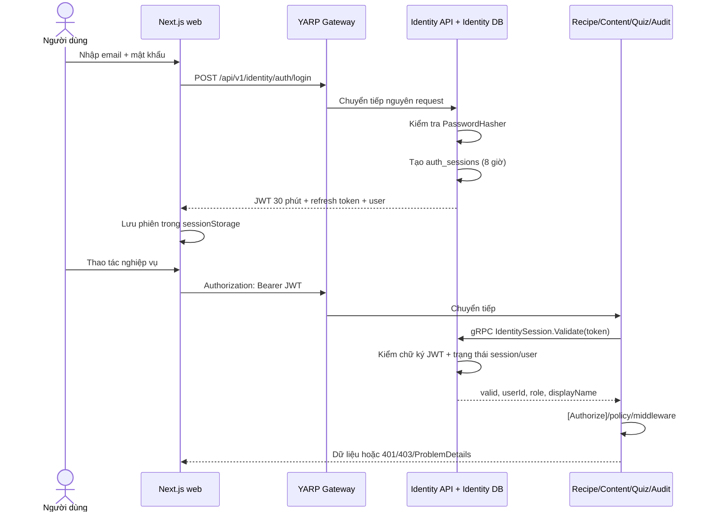

# 05. Bảo mật, xác thực và phân quyền

> Phạm vi: web RecipeHub, gồm backend .NET 8, Gateway YARP và frontend Next.js. Không phân tích mobile. Nội dung mô tả **code hiện tại**, không mô tả một kiến trúc lý tưởng chưa được triển khai.

## 1. Bức tranh tổng thể

Ba khái niệm cần phân biệt:

- **Xác thực (authentication)** trả lời “người gọi là ai?”. RecipeHub dùng access token JWT, nhưng mỗi request nghiệp vụ còn phải đối chiếu session sống trong Identity DB.
- **Phân quyền (authorization)** trả lời “người đó được làm gì?”. RecipeHub dùng ba role `admin`, `rnd`, `viewer`, kiểm tra ở backend bằng `[Authorize]`, role/policy và middleware; frontend guard chỉ hỗ trợ trải nghiệm, không phải hàng rào bảo mật cuối.
- **Session** là bản ghi phiên đăng nhập phía server. Nhờ session, logout/khóa tài khoản/đổi mật khẩu có thể vô hiệu hóa access token ngay, không phải chờ JWT hết hạn.

Luồng chính:

Contract gRPC chỉ nhận `access_token`, trả `valid`, `user_id`, `role`, `display_name`; field quyền công thức cũ đã được `reserved`, nên Identity trả danh tính/role chứ không trả ACL chi tiết ([`identity_session.proto:5-15`](../../../src/backend/Contracts/RecipeHub.GrpcContracts/Protos/identity_session.proto#L5)).

## 2. JWT và mật khẩu

### 2.1 JWT được ký thế nào?

JWT là chuỗi token có chữ ký để service phát hiện dữ liệu bị sửa. `TokenService` dùng khóa đối xứng `SymmetricSecurityKey` và thuật toán HMAC-SHA-256 (`HS256`) ([`TokenService.cs:15-28`](../../../src/backend/Services/Identity/RecipeHub.Identity.Infrastructure/Security/TokenService.cs#L15), [`TokenService.cs:31-37`](../../../src/backend/Services/Identity/RecipeHub.Identity.Infrastructure/Security/TokenService.cs#L31)). Vì là khóa đối xứng, cùng một secret dùng để ký và kiểm chữ ký; hiện chỉ Identity trực tiếp giữ logic này.

Khóa ký:

- Đọc từ cấu hình `Jwt:SigningKey`; bắt buộc ít nhất 32 byte ([`TokenService.cs:20-26`](../../../src/backend/Services/Identity/RecipeHub.Identity.Infrastructure/Security/TokenService.cs#L20)).
- Development thiếu khóa thì sinh ngẫu nhiên 48 byte cho vòng đời process; restart làm token cũ mất hiệu lực ([`TokenService.cs:22-25`](../../../src/backend/Services/Identity/RecipeHub.Identity.Infrastructure/Security/TokenService.cs#L22)).
- Ngoài Development, thiếu/yếu thì service fail-fast bằng `InvalidOperationException`, không chạy với khóa rỗng ([`TokenService.cs:24-25`](../../../src/backend/Services/Identity/RecipeHub.Identity.Infrastructure/Security/TokenService.cs#L24)).
- Compose truyền khóa qua environment variable `Jwt__SigningKey` ([`infra/compose.yaml:117-120`](../../../infra/compose.yaml#L117)); project cũng khai báo `UserSecretsId` để dùng .NET user-secrets khi phát triển ([`RecipeHub.Identity.Api.csproj:9-14`](../../../src/backend/Services/Identity/RecipeHub.Identity.Api/RecipeHub.Identity.Api.csproj#L9)).

JWT chứa đúng ba claim nghiệp vụ:

| Claim | Ý nghĩa | Nguồn |
|---|---|---|
| `sub` | UUID người dùng | `user.Id` |
| `jti` | UUID session, không chỉ là ID token ngẫu nhiên | `session.Id` |
| `role` | `admin`, `rnd` hoặc `viewer` | `user.Role.Code` |

Ba claim được tạo tại [`TokenService.cs:31-36`](../../../src/backend/Services/Identity/RecipeHub.Identity.Infrastructure/Security/TokenService.cs#L31). Tên đầy đủ/email không nằm trong JWT; downstream nhận `display_name` từ lần validate gRPC và dựng `ClaimsPrincipal` ([`IdentitySessionService.cs:9-19`](../../../src/backend/Services/Identity/RecipeHub.Identity.Api/IdentitySessionService.cs#L9), [`ContentAuthenticationHandler.cs:54-66`](../../../src/backend/Services/Content/RecipeHub.Content.Api/ContentAuthenticationHandler.cs#L54)).

Thời hạn access token là **30 phút**. Token có `notBefore = UtcNow`, `expires = UtcNow + 30 phút` ([`TokenService.cs:31-36`](../../../src/backend/Services/Identity/RecipeHub.Identity.Infrastructure/Security/TokenService.cs#L31)). Khi validate, Identity kiểm chữ ký, issuer, audience, lifetime, bắt buộc expiration, chỉ chấp nhận HS256 và đặt `ClockSkew = 0` ([`TokenService.cs:40-50`](../../../src/backend/Services/Identity/RecipeHub.Identity.Infrastructure/Security/TokenService.cs#L40)). Token dài hơn 8192 ký tự bị loại sớm ([`TokenService.cs:40-42`](../../../src/backend/Services/Identity/RecipeHub.Identity.Infrastructure/Security/TokenService.cs#L40)).

### 2.2 Mật khẩu hash bằng gì?

Code dùng `Microsoft.AspNetCore.Identity.PasswordHasher<IdentityUser>`, không tự viết thuật toán crypto ([`PasswordService.cs:1-13`](../../../src/backend/Services/Identity/RecipeHub.Identity.Infrastructure/Security/PasswordService.cs#L1)). Với .NET 8, đây là password hasher chuẩn ASP.NET Core Identity, dựa trên PBKDF2 và salt ngẫu nhiên; hash mang metadata phiên bản/tham số. Điểm cần trả lời chính xác: **project không hard-code iteration count hay PRF trong code RecipeHub**, nên không nên tuyên bố một con số cố định khi bảo vệ. `VerifyHashedPassword` đọc metadata trong hash để kiểm tra; hash sai định dạng trả thất bại thay vì làm sập login ([`PasswordService.cs:11-14`](../../../src/backend/Services/Identity/RecipeHub.Identity.Infrastructure/Security/PasswordService.cs#L11)).

Mật khẩu mới phải dài 8–128 ký tự, có chữ hoa, chữ thường và chữ số ([`UserService.cs:226-232`](../../../src/backend/Services/Identity/RecipeHub.Identity.Application/Services/UserService.cs#L226)). DB chỉ lưu `password_hash`, không lưu plaintext ([`RecipeHub.Identity.postgres:24-32`](../../database-schema/identity-db/RecipeHub.Identity.postgres#L24)). Login trả cùng thông báo “Email hoặc mật khẩu không chính xác” cho email không tồn tại và mật khẩu sai, giảm lộ thông tin tài khoản ([`AuthService.cs:13-21`](../../../src/backend/Services/Identity/RecipeHub.Identity.Application/Services/AuthService.cs#L13)).

## 3. Refresh token và session

### 3.1 Tạo và lưu

Mỗi lần login/tạo phiên:

1. Sinh 48 byte ngẫu nhiên bằng `RandomNumberGenerator.GetBytes(48)`, rồi Base64 ([`AuthService.cs:25-28`](../../../src/backend/Services/Identity/RecipeHub.Identity.Application/Services/AuthService.cs#L25)). Đây là token opaque: client không giải mã nội dung.
2. Server băm refresh token bằng SHA-256 và lưu chuỗi hex 64 ký tự; plaintext chỉ trả một lần cho client ([`AuthService.cs:27-36`](../../../src/backend/Services/Identity/RecipeHub.Identity.Application/Services/AuthService.cs#L27), [`AuthService.cs:69`](../../../src/backend/Services/Identity/RecipeHub.Identity.Application/Services/AuthService.cs#L69)).
3. Session server tồn tại **8 giờ** ([`AuthService.cs:28-32`](../../../src/backend/Services/Identity/RecipeHub.Identity.Application/Services/AuthService.cs#L28)). Bảng `auth_sessions` lưu `id`, `user_id`, `refresh_token_hash`, thời gian tạo/hết hạn/thu hồi; hash refresh có unique index ([`RecipeHub.Identity.postgres:39-53`](../../database-schema/identity-db/RecipeHub.Identity.postgres#L39)).
4. Frontend lưu **cả access token và refresh token** trong `window.sessionStorage` dưới key `recipehub_backend_session` ([`session.ts:3-8`](../../../src/frontend/src/lib/demo/session.ts#L3), [`session.ts:54-57`](../../../src/frontend/src/lib/demo/session.ts#L54)). `sessionStorage` sống theo tab, không tự chia sẻ như `localStorage`, nhưng JavaScript trong cùng origin đọc được.

### 3.2 Refresh rotation và thu hồi

Refresh nhận plaintext, kiểm độ dài tối đa 256, hash rồi tìm session ([`AuthService.cs:49-55`](../../../src/backend/Services/Identity/RecipeHub.Identity.Application/Services/AuthService.cs#L49)). Session phải chưa revoke, chưa hết 8 giờ, user còn active và session không cũ hơn lần cập nhật user. Token hợp lệ sẽ bị đánh dấu revoke và một session/token pair mới được tạo ([`AuthService.cs:53-59`](../../../src/backend/Services/Identity/RecipeHub.Identity.Application/Services/AuthService.cs#L53)). `RevokedAt` là EF concurrency token; hai refresh cạnh tranh sẽ gây concurrency conflict thay vì cùng âm thầm thành công ([`IdentityDbContext.cs:51-63`](../../../src/backend/Services/Identity/RecipeHub.Identity.Infrastructure/Data/IdentityDbContext.cs#L51), [`IdentityStore.cs:54-60`](../../../src/backend/Services/Identity/RecipeHub.Identity.Infrastructure/Repositories/IdentityStore.cs#L54)).

Logout lấy `session_id` đã dựng từ claim `jti`, đặt `RevokedAt` và trả 204 ([`AuthController.cs:30-37`](../../../src/backend/Services/Identity/RecipeHub.Identity.Api/Controllers/AuthController.cs#L30), [`AuthService.cs:61-67`](../../../src/backend/Services/Identity/RecipeHub.Identity.Application/Services/AuthService.cs#L61)). Khóa tài khoản hoặc đổi/reset mật khẩu revoke mọi session đang sống ([`UserService.cs:103-114`](../../../src/backend/Services/Identity/RecipeHub.Identity.Application/Services/UserService.cs#L103), [`UserService.cs:200-206`](../../../src/backend/Services/Identity/RecipeHub.Identity.Application/Services/UserService.cs#L200)).

Frontend còn có idle timeout cục bộ mặc định 30 phút và xóa phiên nếu access token hết hạn hoặc quá idle ([`session.ts:5-25`](../../../src/frontend/src/lib/demo/session.ts#L5)). Đây là kiểm tra UX; backend vẫn là nguồn quyết định.

## 4. Validate session qua gRPC

`IdentitySession.Validate` gọi `AuthService.ValidateAsync`. Quy trình server:

1. Kiểm JWT crypto và lấy `sub` + `jti` ([`AuthService.cs:39-43`](../../../src/backend/Services/Identity/RecipeHub.Identity.Application/Services/AuthService.cs#L39)).
2. Tìm session theo `jti`, đồng thời load user và role ([`IdentityStore.cs:24-28`](../../../src/backend/Services/Identity/RecipeHub.Identity.Infrastructure/Repositories/IdentityStore.cs#L24)).
3. So khớp `session.UserId == sub`.
4. Loại nếu session đã revoke/hết hạn, user bị khóa, hoặc session được tạo trước `user.UpdatedAt` ([`AuthService.cs:43-46`](../../../src/backend/Services/Identity/RecipeHub.Identity.Application/Services/AuthService.cs#L43)). Điều cuối giúp đổi tên/role cũng làm phiên cũ vô hiệu.
5. Chỉ khi đạt mới trả `valid=true`, user ID, role và display name ([`IdentitySessionService.cs:9-19`](../../../src/backend/Services/Identity/RecipeHub.Identity.Api/IdentitySessionService.cs#L9)).

Recipe, Content, Quiz, Audit dựng authentication handler riêng và gọi Identity gRPC với deadline 5 giây ([`RecipeAuthenticationHandler.cs:13-30`](../../../src/backend/Services/Recipe/RecipeHub.Recipe.Api/RecipeAuthenticationHandler.cs#L13), [`ContentAuthenticationHandler.cs:37-66`](../../../src/backend/Services/Content/RecipeHub.Content.Api/ContentAuthenticationHandler.cs#L37), [`AuditAuthenticationHandler.cs:48-77`](../../../src/backend/Services/Audit/RecipeHub.Audit.Api/AuditAuthenticationHandler.cs#L48), [`QuizAuthenticationHandler.cs:36-61`](../../../src/backend/Services/Quiz/RecipeHub.Quiz.Api/QuizAuthenticationHandler.cs#L36)). Vì vậy JWT ký đúng vẫn chưa đủ: session DB phải còn hợp lệ.

Khi Identity lỗi hạ tầng, Content và Audit fail-closed và map dependency error thành 503 ([`ContentAuthenticationHandler.cs:68-76`](../../../src/backend/Services/Content/RecipeHub.Content.Api/ContentAuthenticationHandler.cs#L68), [`Audit.Api/Program.cs:80-107`](../../../src/backend/Services/Audit/RecipeHub.Audit.Api/Program.cs#L80)). Recipe/Quiz hiện trả authentication failure, dễ biểu hiện thành 401 thay vì phân biệt 503; đây là điểm chưa nhất quán ([`RecipeAuthenticationHandler.cs:32-40`](../../../src/backend/Services/Recipe/RecipeHub.Recipe.Api/RecipeAuthenticationHandler.cs#L32), [`QuizAuthenticationHandler.cs:63-67`](../../../src/backend/Services/Quiz/RecipeHub.Quiz.Api/QuizAuthenticationHandler.cs#L63)).

## 5. Role và ma trận quyền thực tế

Ba role được seed chính thức trong Identity DB: `admin` (quản trị), `rnd` (chuyên viên R&D), `viewer` (Barista Viewer) ([`RecipeHub.Identity.postgres:18-22`](../../database-schema/identity-db/RecipeHub.Identity.postgres#L18)).

Ký hiệu: **Có** = backend cho phép; **Không** = backend từ chối; **Có điều kiện** = còn ràng buộc method/trạng thái/ownership; “frontend” chỉ là route guard.

| Chức năng web | `admin` | `rnd` | `viewer` | Bằng chứng backend |
|---|---:|---:|---:|---|
| Login, refresh | Có | Có | Có | Không gắn `[Authorize]`; có rate limit ([`AuthController.cs:17-28`](../../../src/backend/Services/Identity/RecipeHub.Identity.Api/Controllers/AuthController.cs#L17)) |
| Xem/sửa profile, đổi mật khẩu, logout | Có | Có | Có | Chỉ yêu cầu `[Authorize]` ([`AuthController.cs:30-57`](../../../src/backend/Services/Identity/RecipeHub.Identity.Api/Controllers/AuthController.cs#L30)) |
| CRUD/khóa/reset mật khẩu user | Có | Không | Không | Controller role `admin` ([`UsersController.cs:9-18`](../../../src/backend/Services/Identity/RecipeHub.Identity.Api/Controllers/UsersController.cs#L9)) |
| Đọc Recipe API | Không | Có | Có | Middleware cấm admin; GET không yêu cầu `rnd` ([`Recipe.Api/Program.cs:76-89`](../../../src/backend/Services/Recipe/RecipeHub.Recipe.Api/Program.cs#L76)) |
| Tạo/sửa/xóa Recipe, Ingredient, PDF management | Không | Có | Không | Non-GET Recipe yêu cầu `rnd`, trừ calculation ([`Recipe.Api/Program.cs:78-87`](../../../src/backend/Services/Recipe/RecipeHub.Recipe.Api/Program.cs#L78)) |
| Calculation/unit conversion | Không | Có | Có | Calculation được miễn kiểm `rnd`, nhưng toàn controller vẫn yêu cầu authenticated; admin bị cấm ([`Recipe.Api/Program.cs:79-94`](../../../src/backend/Services/Recipe/RecipeHub.Recipe.Api/Program.cs#L79)) |
| Content image drafts/AI image | Không | Có | Không | Policy `ContentEditors` chỉ `rnd` ([`Content.Api/Program.cs:69-78`](../../../src/backend/Services/Content/RecipeHub.Content.Api/Program.cs#L69), [`ImageDraftsController.cs:8-20`](../../../src/backend/Services/Content/RecipeHub.Content.Api/Controllers/ImageDraftsController.cs#L8)) |
| Media assets | Có | Có | Có | Controller chỉ `[Authorize]`, chưa áp `ContentReaders/Editors` theo method ([`MediaAssetsController.cs:8-20`](../../../src/backend/Services/Content/RecipeHub.Content.Api/Controllers/MediaAssetsController.cs#L8)) |
| Quiz quản lý, AI generation, xem kết quả quản lý | Không | Có | Không | Các controller role `rnd` ([`QuizManagementController.cs:9-12`](../../../src/backend/Services/Quiz/RecipeHub.Quiz.Api/Controllers/QuizManagementController.cs#L9), [`QuizAiGenerationController.cs:8-11`](../../../src/backend/Services/Quiz/RecipeHub.Quiz.Api/Controllers/QuizAiGenerationController.cs#L8), [`QuizResultsManagementController.cs:7-10`](../../../src/backend/Services/Quiz/RecipeHub.Quiz.Api/Controllers/QuizResultsManagementController.cs#L7)) |
| Quiz xem/làm/nộp bài/xem lịch sử cá nhân | Không | Không | Có | Viewer/attempt controller role `viewer` ([`QuizViewerController.cs:7-10`](../../../src/backend/Services/Quiz/RecipeHub.Quiz.Api/Controllers/QuizViewerController.cs#L7), [`QuizAttemptController.cs:8-11`](../../../src/backend/Services/Quiz/RecipeHub.Quiz.Api/Controllers/QuizAttemptController.cs#L8)) |
| Xem audit log | Có | Không | Không | Controller role `admin` ([`AuditLogsController.cs:8-11`](../../../src/backend/Services/Audit/RecipeHub.Audit.Api/Controllers/AuditLogsController.cs#L8)) |

Frontend khóa namespace route: `/rnd` chỉ `rnd`, `/viewer` chỉ `viewer`, `/admin` chỉ `admin`; `/platform` dùng chung ([`permissions.ts:16-45`](../../../src/frontend/src/lib/demo/permissions.ts#L16)). `WorkspaceShell` kiểm sau khi load session, redirect unauthorized và không render children trong lúc kiểm ([`workspace-shell.tsx:22-36`](../../../src/frontend/src/components/workspace/workspace-shell.tsx#L22)). Các helper UI còn giới hạn tạo/sửa/publish/PDF cho R&D và viewer chỉ xem recipe Published ([`permissions.ts:61-91`](../../../src/frontend/src/lib/demo/permissions.ts#L61)).

**Điểm phải nói rõ khi bảo vệ:** frontend guard có thể bị sửa trong DevTools. Bảo mật thật nằm ở backend. Hiện frontend và backend còn lệch ở Media Assets: backend cho mọi role authenticated, trong khi luồng UI chủ yếu dành cho R&D. Đây là lỗ hổng phân quyền cần siết.

## 6. Gateway, CORS, cookie và CSRF

### 6.1 Gateway có xác thực không?

**Không.** `Gateway/Program.cs` chỉ đăng ký YARP reverse proxy, health checks, ProblemDetails, metrics rồi `MapReverseProxy`; không có `AddAuthentication`, `UseAuthentication` hoặc authorization policy ([`Gateway/Program.cs:3-31`](../../../src/backend/Gateway/RecipeHub.Gateway/Program.cs#L3)). Route chỉ match năm prefix và chuyển tới service tương ứng ([`Gateway/appsettings.json:10-56`](../../../src/backend/Gateway/RecipeHub.Gateway/appsettings.json#L10)). Authorization header được chuyển tiếp, rồi destination service xác thực.

Ưu điểm: mỗi service vẫn tự bảo vệ, không phụ thuộc duy nhất Gateway. Nhược điểm: request rác đi sâu hơn; service bị publish trực tiếp vẫn phải tự bảo vệ; cấu hình endpoint nào quên `[Authorize]` có thể lộ.

### 6.2 CORS

Không có `AddCors`/`UseCors` trong backend hiện tại. Web tránh cross-origin ở browser bằng Next.js BFF proxy: browser gọi cùng origin `/api/backend/...`, route Next.js chỉ allow năm prefix, rồi server-side fetch đến Gateway nội bộ ([`route.ts:1-10`](../../../src/frontend/src/app/api/backend/[...path]/route.ts#L1), [`route.ts:16-41`](../../../src/frontend/src/app/api/backend/[...path]/route.ts#L16)). Client cũng gọi relative URL `/api/backend/...` ([`client.ts:40-45`](../../../src/frontend/src/lib/api/client.ts#L40)). Vì vậy cấu hình triển khai chuẩn không cần browser gọi thẳng Gateway.

### 6.3 Cookie và CSRF

Hệ thống **không dùng auth cookie**. Token nằm trong `sessionStorage` và client tự gắn `Authorization: Bearer` ([`session.ts:54-57`](../../../src/frontend/src/lib/demo/session.ts#L54), [`client.ts:21-26`](../../../src/frontend/src/lib/api/client.ts#L21)). Do browser không tự động đính kèm Bearer token cho site khác, rủi ro CSRF cổ điển thấp hơn cookie auth. Code hiện không có antiforgery token, `SameSite`, `HttpOnly` hay `Secure` cookie vì không có auth cookie.

Đổi lại, token trong `sessionStorage` **không có bảo vệ `HttpOnly`**: một XSS chạy trong origin có thể đọc cả access và refresh token. CSRF thấp hơn nhưng XSS impact cao hơn. BFF hiện chuyển tiếp hầu hết request headers sau khi bỏ `host` và `connection` ([`route.ts:26-40`](../../../src/frontend/src/app/api/backend/[...path]/route.ts#L26)); cần harden allowlist header khi nâng cấp.

## 7. Response, lỗi và validation

### 7.1 “Envelope” nào thực sự tồn tại?

`BuildingBlocks` có `EventEnvelope<T>` cho **message async**, không phải wrapper chung cho HTTP response. Nó chứa `EventId`, `EventType`, `OccurredAtUtc`, `CorrelationId`, `Source`, `SchemaVersion`, `Payload` ([`EventEnvelope.cs:5-18`](../../../src/backend/BuildingBlocks/RecipeHub.BuildingBlocks/Events/EventEnvelope.cs#L5)). Audit dùng envelope này để Kafka/Redis mang cùng metadata ([`AuditEnvelopeFactory.cs:5-21`](../../../src/backend/BuildingBlocks/RecipeHub.BuildingBlocks/Audit/AuditEnvelopeFactory.cs#L5)).

HTTP success hiện trả DTO/JSON trực tiếp hoặc 204, không bọc `{ success, data, ... }`; ví dụ login trả `LoginResponse` trực tiếp ([`AuthController.cs:17-28`](../../../src/backend/Services/Identity/RecipeHub.Identity.Api/Controllers/AuthController.cs#L17)). HTTP error chủ yếu theo RFC 7807 `ProblemDetails`: Identity map `IdentityException.StatusCode`, còn lỗi lạ thành 500 với detail tổng quát, không lộ stack trace ([`Identity.Api/Program.cs:58-64`](../../../src/backend/Services/Identity/RecipeHub.Identity.Api/Program.cs#L58)). Audit cũng trả typed ProblemDetails cho dependency 503 và generic 500 ([`Audit.Api/Program.cs:80-107`](../../../src/backend/Services/Audit/RecipeHub.Audit.Api/Program.cs#L80)). Frontend parser ưu tiên validation errors, rồi `detail`, `message`, `title` ([`client.ts:29-37`](../../../src/frontend/src/lib/api/client.ts#L29)).

Điểm chưa chuẩn hóa hoàn toàn: một số controller tự tạo `ProblemDetails`, một số exception handler dùng chung theo service; Next proxy lỗi kết nối trả JSON gần giống ProblemDetails nhưng không có `status/type/instance` ([`route.ts:42-50`](../../../src/frontend/src/app/api/backend/[...path]/route.ts#L42)). Không nên nói toàn hệ thống có một HTTP response envelope duy nhất.

### 7.2 Validation input

Validation nằm nhiều lớp:

- ASP.NET `[ApiController]` bind JSON/query/path và trả 400 cho model binding sai; các controller đều khai báo `[ApiController]`, ví dụ Identity users ([`UsersController.cs:9-18`](../../../src/backend/Services/Identity/RecipeHub.Identity.Api/Controllers/UsersController.cs#L9)).
- Application service kiểm rule cụ thể: login giới hạn email 254, password 128 ([`AuthService.cs:13-20`](../../../src/backend/Services/Identity/RecipeHub.Identity.Application/Services/AuthService.cs#L13)); user search giới hạn `pageSize` 1–100 ([`UserService.cs:19-26`](../../../src/backend/Services/Identity/RecipeHub.Identity.Application/Services/UserService.cs#L19)); email dùng `MailAddress.TryCreate`, role dùng allowlist ba giá trị ([`UserService.cs:29-42`](../../../src/backend/Services/Identity/RecipeHub.Identity.Application/Services/UserService.cs#L29), [`UserService.cs:212-232`](../../../src/backend/Services/Identity/RecipeHub.Identity.Application/Services/UserService.cs#L212)).
- Route constraint như `{id:guid}` loại ID sai format trước khi vào action ([`UsersController.cs:31-34`](../../../src/backend/Services/Identity/RecipeHub.Identity.Api/Controllers/UsersController.cs#L31)).
- DB có unique/check/FK như email unique case-insensitive, session expiry và FK session-user ([`RecipeHub.Identity.postgres:39-53`](../../database-schema/identity-db/RecipeHub.Identity.postgres#L39)).

Project không dùng một thư viện validator chung như FluentValidation. Validation phân tán giữa model binding, controller, application service và DB; coverage/format lỗi vì thế có thể lệch giữa service.

### 7.3 Rate limit

Có rate limit, nhưng chỉ ở Identity login và refresh. Fixed window theo remote IP: 20 request/phút, queue 0, vượt giới hạn trả 429 ([`Identity.Api/Program.cs:36-42`](../../../src/backend/Services/Identity/RecipeHub.Identity.Api/Program.cs#L36)); hai action cùng dùng policy `login` ([`AuthController.cs:17-28`](../../../src/backend/Services/Identity/RecipeHub.Identity.Api/Controllers/AuthController.cs#L17)). Gateway và API nghiệp vụ khác chưa có rate limiter.

## 8. DB least privilege và secrets

Bootstrap tách mỗi DB thành hai loại account:

- `<service>_migrator` sở hữu DB/schema, chạy DDL/seed, không dùng trong service runtime.
- `<service>_user` chỉ có CONNECT/USAGE/DML cần thiết ([`init-databases.sh:4-8`](../../../infra/postgres/init-databases.sh#L4), [`init-databases.sh:23-51`](../../../infra/postgres/init-databases.sh#L23)).

Identity runtime có SELECT/INSERT/UPDATE/DELETE trên bảng nghiệp vụ, trong khi Grafana chỉ đọc `roles` và các cột user không chứa `password_hash`; `auth_sessions` không cấp cho Grafana ([`init-databases.sh:64-74`](../../../infra/postgres/init-databases.sh#L64)). Audit chặt hơn: runtime chỉ SELECT/INSERT, bị revoke UPDATE/DELETE/TRUNCATE/REFERENCES/TRIGGER, hỗ trợ tính append-only ([`init-databases.sh:138-145`](../../../infra/postgres/init-databases.sh#L138)).

Service runtime lấy connection string/password và JWT key từ environment qua Compose, không dùng migrator credential ([`infra/compose.yaml:117-120`](../../../infra/compose.yaml#L117), [`infra/compose.yaml:147-148`](../../../infra/compose.yaml#L147), [`infra/compose.yaml:180-181`](../../../infra/compose.yaml#L180)). `.env.example` phân biệt rõ migrator/runtime và chỉ là template ([`.env.example:10-20`](../../../.env.example#L10)). Tuy nhiên Compose có default password/key mang tính development; production bắt buộc override, không được dùng default ([`infra/compose.yaml:14-17`](../../../infra/compose.yaml#L14), [`infra/compose.yaml:117-120`](../../../infra/compose.yaml#L117)).

## 9. Logging và audit: ai làm gì, lúc nào

Logging kỹ thuật dùng `ILogger` và structured placeholders, ví dụ auth Recipe ghi path, kết quả gRPC, user ID và role ([`RecipeAuthenticationHandler.cs:20-34`](../../../src/backend/Services/Recipe/RecipeHub.Recipe.Api/RecipeAuthenticationHandler.cs#L20)). Đây là operational log, không đồng nghĩa audit log nghiệp vụ.

Audit nghiệp vụ có payload:

- **Ai**: `ActorId`, `ActorName`, `ActorRole`.
- **Làm gì**: `Action`, `TargetType`, `TargetId`, `Summary`.
- **Khi nào/ở đâu**: `EventEnvelope.OccurredAtUtc`, `Source`, cùng `EventId` và `CorrelationId` ([`AuditActivityEvent.cs:3-16`](../../../src/backend/BuildingBlocks/RecipeHub.BuildingBlocks/Events/AuditActivityEvent.cs#L3), [`EventEnvelope.cs:5-13`](../../../src/backend/BuildingBlocks/RecipeHub.BuildingBlocks/Events/EventEnvelope.cs#L5)).

Identity phát audit cho tạo/cập nhật/đổi role/khóa user, cập nhật profile, reset password; actor lấy từ claims đã xác thực ([`UsersController.cs:20-24`](../../../src/backend/Services/Identity/RecipeHub.Identity.Api/Controllers/UsersController.cs#L20), [`UserService.cs:46-54`](../../../src/backend/Services/Identity/RecipeHub.Identity.Application/Services/UserService.cs#L46), [`UserService.cs:81-97`](../../../src/backend/Services/Identity/RecipeHub.Identity.Application/Services/UserService.cs#L81), [`UserService.cs:116-129`](../../../src/backend/Services/Identity/RecipeHub.Identity.Application/Services/UserService.cs#L116)). Recipe và Quiz cũng inject publisher tại application service; vị trí phát sự kiện hiện hữu được thể hiện ở [`RecipeService.cs:15-23`](../../../src/backend/Services/Recipe/RecipeHub.Recipe.Application/Services/RecipeService.cs#L15) và [`QuizService.cs:14-21`](../../../src/backend/Services/Quiz/RecipeHub.Quiz.Application/Services/QuizService.cs#L14).

Kafka producer bật `Acks.All` và idempotence ([`KafkaAuditActivityPublisher.cs:26-35`](../../../src/backend/BuildingBlocks/RecipeHub.BuildingBlocks/Audit/KafkaAuditActivityPublisher.cs#L26)). Consumer tắt auto commit, chỉ commit sau xử lý thành công; retry thất bại chuyển DLQ ([`AuditKafkaConsumer.cs:34-43`](../../../src/backend/Services/Audit/RecipeHub.Audit.Infrastructure/Messaging/AuditKafkaConsumer.cs#L34), [`AuditKafkaConsumer.cs:94-115`](../../../src/backend/Services/Audit/RecipeHub.Audit.Infrastructure/Messaging/AuditKafkaConsumer.cs#L94)). DB audit lưu actor/source/action/target/summary/time và constraint role/source ([`RecipeHub.Audit.postgres:3-22`](../../database-schema/audit-db/RecipeHub.Audit.postgres#L3)). Chỉ admin được query audit log ([`AuditLogsController.cs:8-26`](../../../src/backend/Services/Audit/RecipeHub.Audit.Api/Controllers/AuditLogsController.cs#L8)).

Giới hạn quan trọng: publisher audit được thiết kế **best-effort**; lỗi publish bị log rồi không rollback transaction nghiệp vụ ([`RedisAuditActivityPublisher.cs:28-50`](../../../src/backend/BuildingBlocks/RecipeHub.BuildingBlocks/Audit/RedisAuditActivityPublisher.cs#L28), [`UserService.cs:235-245`](../../../src/backend/Services/Identity/RecipeHub.Identity.Application/Services/UserService.cs#L235)). Vì vậy hệ thống ưu tiên nghiệp vụ sống, nhưng không bảo đảm tuyệt đối mọi thay đổi đều có audit. Schema cũng mô tả không theo dõi read/login/logout/autosave ([`RecipeHub.Audit.dbml:1-3`](../../database-schema/audit-db/RecipeHub.Audit.dbml#L1)).

## 10. Điểm mạnh và điểm yếu đã biết

### Điểm mạnh hiện có

1. JWT validate chặt issuer/audience/lifetime/algorithm, zero clock skew; khóa tối thiểu 32 byte ([`TokenService.cs:20-28`](../../../src/backend/Services/Identity/RecipeHub.Identity.Infrastructure/Security/TokenService.cs#L20), [`TokenService.cs:45-50`](../../../src/backend/Services/Identity/RecipeHub.Identity.Infrastructure/Security/TokenService.cs#L45)).
2. JWT không hoàn toàn stateless: mọi API nghiệp vụ kiểm session/user qua Identity, nên revoke có hiệu lực ngay ([`AuthService.cs:39-46`](../../../src/backend/Services/Identity/RecipeHub.Identity.Application/Services/AuthService.cs#L39)).
3. Refresh token entropy cao, DB chỉ lưu SHA-256 hash; rotation revoke token cũ ([`AuthService.cs:25-36`](../../../src/backend/Services/Identity/RecipeHub.Identity.Application/Services/AuthService.cs#L25), [`AuthService.cs:49-59`](../../../src/backend/Services/Identity/RecipeHub.Identity.Application/Services/AuthService.cs#L49)).
4. Password dùng API chuẩn ASP.NET Core Identity, không tự chế crypto ([`PasswordService.cs:7-14`](../../../src/backend/Services/Identity/RecipeHub.Identity.Infrastructure/Security/PasswordService.cs#L7)).
5. Backend RBAC tồn tại độc lập với frontend guard; DB migrator/runtime tách quyền ([`UsersController.cs:9-18`](../../../src/backend/Services/Identity/RecipeHub.Identity.Api/Controllers/UsersController.cs#L9), [`init-databases.sh:4-8`](../../../infra/postgres/init-databases.sh#L4)).

### Điểm yếu, tác động, hướng cải thiện

| Mức | Hiện trạng trung thực | Tác động | Cải thiện đề xuất |
|---|---|---|---|
| Cao | Access + refresh token ở `sessionStorage` ([`session.ts:54-57`](../../../src/frontend/src/lib/demo/session.ts#L54)) | XSS có thể đánh cắp cả hai | Chuyển refresh token sang cookie `HttpOnly; Secure; SameSite=Strict/Lax`, access token ngắn hạn trong memory; thêm CSRF token nếu cookie dùng cho mutation; triển khai CSP nghiêm |
| Cao | `MediaAssetsController` chỉ `[Authorize]` ([`MediaAssetsController.cs:8-20`](../../../src/backend/Services/Content/RecipeHub.Content.Api/Controllers/MediaAssetsController.cs#L8)) | Admin/viewer có thể upload/list/delete tùy action dù UI không cho | Gắn policy theo action: read `rnd/viewer`, mutation `rnd`; kiểm ownership/usage ở application layer |
| Cao | Gateway không auth/rate-limit; metrics/health/root có endpoint anonymous ở nhiều service ([`Gateway/Program.cs:13-31`](../../../src/backend/Gateway/RecipeHub.Gateway/Program.cs#L13), [`Identity.Api/Program.cs:57-85`](../../../src/backend/Services/Identity/RecipeHub.Identity.Api/Program.cs#L57)) | Tăng bề mặt dò quét/DoS, lộ telemetry nếu publish sai mạng | Chỉ expose Gateway, đặt service/gRPC/metrics trong private network; auth metrics; rate limit Gateway theo route/IP/user |
| Cao | Compose có default development credentials/signing key ([`infra/compose.yaml:14-17`](../../../infra/compose.yaml#L14), [`infra/compose.yaml:117-120`](../../../infra/compose.yaml#L117)) | Deploy nhầm default làm mất bảo mật | Production config fail-fast nếu còn default; secret manager/Docker secrets; rotation key có `kid` |
| Trung bình | Identity gRPC nội bộ dùng `http://` trong config mặc định ([`Content.Api/Program.cs:60-65`](../../../src/backend/Services/Content/RecipeHub.Content.Api/Program.cs#L60)) | Network bị chiếm có thể nghe/giả response | mTLS/TLS giữa service hoặc service mesh; network policy; authenticate service caller |
| Trung bình | Recipe/Quiz map Identity outage thành auth fail, Content/Audit thành 503 ([`RecipeAuthenticationHandler.cs:32-40`](../../../src/backend/Services/Recipe/RecipeHub.Recipe.Api/RecipeAuthenticationHandler.cs#L32), [`QuizAuthenticationHandler.cs:63-67`](../../../src/backend/Services/Quiz/RecipeHub.Quiz.Api/QuizAuthenticationHandler.cs#L63)) | Client hiểu sai outage là token sai; UX/monitoring lệch | Chuẩn hóa fail-closed dependency exception và 503 trên mọi service |
| Trung bình | Audit best-effort, lỗi publish không rollback ([`RedisAuditActivityPublisher.cs:47-50`](../../../src/backend/BuildingBlocks/RecipeHub.BuildingBlocks/Audit/RedisAuditActivityPublisher.cs#L47)) | Có thể thiếu dấu vết nghiệp vụ | Transactional outbox trong DB service, relay retry, alert DLQ; không nuốt exception không log ở application |
| Trung bình | Audit không ghi login/logout/read ([`RecipeHub.Audit.dbml:1-3`](../../database-schema/audit-db/RecipeHub.Audit.dbml#L1)) | Khó điều tra account misuse/data access | Thêm security audit riêng cho login success/fail, logout, refresh/reuse, admin read nhạy cảm; retention và chống PII dư thừa |
| Trung bình | Chỉ login/refresh có 20 req/phút/IP ([`Identity.Api/Program.cs:36-42`](../../../src/backend/Services/Identity/RecipeHub.Identity.Api/Program.cs#L36)) | Distributed brute force và API DoS vẫn có cửa | Rate limit theo IP + account, exponential backoff/temporary lock có kiểm soát; limit upload/AI/PDF |
| Trung bình | BFF chuyển tiếp gần như toàn bộ request header ([`route.ts:26-40`](../../../src/frontend/src/app/api/backend/[...path]/route.ts#L26)) | Header spoofing/metadata không cần thiết đi vào backend | Allowlist `Authorization`, `Content-Type`, tracing và header upload cần thiết; bỏ `X-User-Id` client-generated |
| Thấp | Frontend vẫn set `X-User-Id` nếu caller truyền actor ID ([`client.ts:21-26`](../../../src/frontend/src/lib/api/client.ts#L21)) | Dễ gây hiểu nhầm đây là danh tính tin cậy | Xóa header; backend chỉ lấy actor từ validated claims |
| Thấp | Validation/error chưa đồng nhất giữa service | Client xử lý phức tạp, tài liệu Swagger dễ lệch | Chuẩn hóa ProblemDetails factory, error code/correlation ID, validator strategy; vẫn trả DTO success trực tiếp nếu không cần envelope |

## 11. 15 câu hỏi giảng viên có thể hỏi

### 1. “JWT đã ký rồi, tại sao còn cần session DB?”

JWT chỉ chứng minh token do Identity ký và chưa hết 30 phút. Session DB cho phép logout, khóa tài khoản, đổi password/role vô hiệu hóa ngay. `ValidateAsync` kiểm cả `RevokedAt`, 8 giờ expiry, `IsActive` và `user.UpdatedAt` ([`AuthService.cs:39-46`](../../../src/backend/Services/Identity/RecipeHub.Identity.Application/Services/AuthService.cs#L39)).

### 2. “JWT chứa gì? Có chứa mật khẩu không?”

Chỉ `sub`, `jti`, `role`; không có mật khẩu, password hash, refresh token hay email ([`TokenService.cs:31-36`](../../../src/backend/Services/Identity/RecipeHub.Identity.Infrastructure/Security/TokenService.cs#L31)). JWT ký chứ không mặc định mã hóa, nên không đặt secret trong payload.

### 3. “Nếu lấy được access token rồi logout thì token còn dùng được không?”

Không qua API chuẩn. Logout set `RevokedAt`; request sau gRPC validate tra session và trả invalid ([`AuthService.cs:61-67`](../../../src/backend/Services/Identity/RecipeHub.Identity.Application/Services/AuthService.cs#L61), [`IdentitySessionService.cs:9-19`](../../../src/backend/Services/Identity/RecipeHub.Identity.Api/IdentitySessionService.cs#L9)).

### 4. “Refresh token bị lộ trong DB có dùng được ngay không?”

DB chỉ chứa SHA-256 hash, còn API cần plaintext token ([`AuthService.cs:53-69`](../../../src/backend/Services/Identity/RecipeHub.Identity.Application/Services/AuthService.cs#L53)). Tuy nhiên nếu attacker lấy token từ browser `sessionStorage`, họ có plaintext; đó là lý do storage hiện tại là điểm yếu.

### 5. “Password dùng SHA-256 đúng không?”

Không. SHA-256 chỉ băm refresh token ngẫu nhiên. Password dùng ASP.NET Core `PasswordHasher<IdentityUser>` dựa trên PBKDF2, salt/metadata ([`PasswordService.cs:7-14`](../../../src/backend/Services/Identity/RecipeHub.Identity.Infrastructure/Security/PasswordService.cs#L7), [`AuthService.cs:69`](../../../src/backend/Services/Identity/RecipeHub.Identity.Application/Services/AuthService.cs#L69)).

### 6. “Gateway có chặn user chưa login không?”

Không. Gateway chỉ route. Mỗi destination service gọi Identity hoặc tự validate session và chạy `[Authorize]` ([`Gateway/Program.cs:3-31`](../../../src/backend/Gateway/RecipeHub.Gateway/Program.cs#L3), [`Content.Api/Program.cs:66-79`](../../../src/backend/Services/Content/RecipeHub.Content.Api/Program.cs#L66)).

### 7. “Frontend guard có phải bảo mật không?”

Không. Nó ngăn render/redirect để UX đúng role ([`workspace-shell.tsx:22-36`](../../../src/frontend/src/components/workspace/workspace-shell.tsx#L22)). Người dùng có thể bỏ qua frontend và gọi API; backend `[Authorize]`/policy mới quyết định thật.

### 8. “401 và 403 khác nhau thế nào?”

401: chưa xác thực/token-session không hợp lệ. 403: đã xác thực nhưng role/policy không cho. Recipe middleware gọi `ChallengeAsync` khi thiếu identity và `ForbidAsync` khi sai role ([`Recipe.Api/Program.cs:82-87`](../../../src/backend/Services/Recipe/RecipeHub.Recipe.Api/Program.cs#L82)).

### 9. “Vì sao CSRF không phải rủi ro chính hiện tại?”

Auth dùng Bearer header do JavaScript gắn, browser không tự gửi như cookie ([`client.ts:21-26`](../../../src/frontend/src/lib/api/client.ts#L21)). Rủi ro chính là XSS đọc `sessionStorage`. Nếu chuyển refresh token sang cookie, phải thêm `SameSite`/CSRF protection.

### 10. “CORS được cấu hình ở đâu?”

Không có CORS middleware trong backend hiện tại. Browser gọi Next.js cùng origin `/api/backend`, rồi Next server gọi Gateway nội bộ ([`client.ts:40-45`](../../../src/frontend/src/lib/api/client.ts#L40), [`route.ts:16-41`](../../../src/frontend/src/app/api/backend/[...path]/route.ts#L16)). Nếu cho SPA gọi Gateway cross-origin sau này, phải cấu hình allowlist origin rõ ràng.

### 11. “Identity chết thì hệ thống có cho qua không?”

Không, handler fail-closed. Content/Audit trả dependency 503; Recipe/Quiz hiện fail authentication và cần chuẩn hóa status ([`ContentAuthenticationHandler.cs:68-76`](../../../src/backend/Services/Content/RecipeHub.Content.Api/ContentAuthenticationHandler.cs#L68), [`QuizAuthenticationHandler.cs:63-67`](../../../src/backend/Services/Quiz/RecipeHub.Quiz.Api/QuizAuthenticationHandler.cs#L63)).

### 12. “Audit có bảo đảm không mất sự kiện không?”

Chưa tuyệt đối. Kafka có acks-all/idempotent producer và consumer commit sau xử lý, nhưng publisher nghiệp vụ best-effort, có thể bỏ audit nếu transport lỗi ([`KafkaAuditActivityPublisher.cs:26-35`](../../../src/backend/BuildingBlocks/RecipeHub.BuildingBlocks/Audit/KafkaAuditActivityPublisher.cs#L26), [`RedisAuditActivityPublisher.cs:47-50`](../../../src/backend/BuildingBlocks/RecipeHub.BuildingBlocks/Audit/RedisAuditActivityPublisher.cs#L47)). Muốn mạnh hơn cần transactional outbox.

### 13. “Ai có thể sửa/xóa audit log?”

Ở DB permission, `audit_user` chỉ SELECT/INSERT và bị revoke UPDATE/DELETE/TRUNCATE ([`init-databases.sh:138-145`](../../../infra/postgres/init-databases.sh#L138)). API chỉ có endpoint GET cho admin ([`AuditLogsController.cs:8-31`](../../../src/backend/Services/Audit/RecipeHub.Audit.Api/Controllers/AuditLogsController.cs#L8)). DB owner/migrator vẫn có quyền cao, nên production phải kiểm soát account này riêng.

### 14. “Rate limit chống brute force ra sao?”

Login và refresh dùng fixed window 20 request/phút theo remote IP, không queue, trả 429 ([`Identity.Api/Program.cs:36-42`](../../../src/backend/Services/Identity/RecipeHub.Identity.Api/Program.cs#L36), [`AuthController.cs:17-28`](../../../src/backend/Services/Identity/RecipeHub.Identity.Api/Controllers/AuthController.cs#L17)). Đây là lớp cơ bản, chưa đủ chống botnet/distributed attack; cần thêm limit theo account và gateway/WAF.

### 15. “Điểm yếu nghiêm trọng nhất sẽ sửa gì trước?”

Ưu tiên: (1) không để refresh token trong JS-readable storage; (2) sửa `MediaAssetsController` thành policy theo action; (3) bỏ default secret production và bảo vệ network nội bộ/gRPC; (4) transactional outbox cho audit; (5) chuẩn hóa 503 khi Identity outage. Các kết luận dựa trực tiếp trên storage hiện tại ([`session.ts:54-57`](../../../src/frontend/src/lib/demo/session.ts#L54)), quyền Media hiện tại ([`MediaAssetsController.cs:8-20`](../../../src/backend/Services/Content/RecipeHub.Content.Api/Controllers/MediaAssetsController.cs#L8)) và audit best-effort ([`RedisAuditActivityPublisher.cs:47-50`](../../../src/backend/BuildingBlocks/RecipeHub.BuildingBlocks/Audit/RedisAuditActivityPublisher.cs#L47)).

## 12. Tóm tắt để trình bày trong 60 giây

RecipeHub dùng JWT HS256 30 phút nhưng không tin JWT đơn độc. Identity giữ session 8 giờ và refresh token hash; mọi service nghiệp vụ gọi gRPC `IdentitySession.Validate`, rồi áp RBAC `admin/rnd/viewer`. Frontend guard chỉ phục vụ UX; backend mới là hàng rào thật. Gateway không xác thực, web dùng Next.js same-origin proxy nên hiện không có CORS/auth cookie/CSRF middleware. Password dùng ASP.NET Core PasswordHasher; login/refresh có rate limit 20/phút/IP. Audit ghi actor-action-target-time qua Kafka/Redis vào DB append-only, nhưng publisher còn best-effort. Rủi ro ưu tiên là token trong `sessionStorage`, quyền Media quá rộng, default dev secrets, gRPC plaintext và audit chưa transactional.
