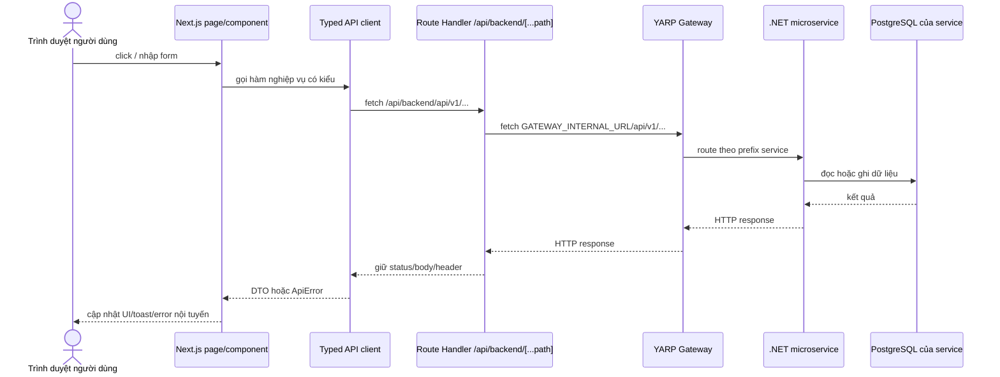
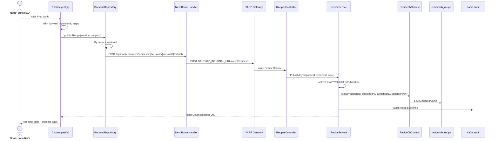

# 06. Frontend Web: Next.js 16 App Router

> Phạm vi: web frontend trong `src/frontend/`, backend .NET mà web gọi tới, không gồm Flutter mobile. Nội dung dưới đây mô tả code đang có, không mô tả một thiết kế giả định.

## 1. Bức tranh tổng thể

Frontend RecipeHub dùng Next.js 16.4.3, React 19.3, TypeScript 5, Tailwind CSS 3.4 và Lucide React. Phiên bản thực tế nằm trong `package.json`, không nên trả lời chung chung là “Next.js 16” nếu giảng viên hỏi phiên bản cụ thể (`src/frontend/package.json:12-30`).

Luồng mạng chuẩn:



Browser không biết địa chỉ container Gateway. Mọi client nghiệp vụ gọi đường dẫn cùng origin `/api/backend/...` (`src/frontend/src/lib/api/client.ts:40-45`). Route Handler chạy phía Next.js ghép đường dẫn đó với `GATEWAY_INTERNAL_URL`; mặc định local là `http://localhost:5262` (`src/frontend/src/app/api/backend/[...path]/route.ts:3-6,26-40`). Trong Docker Compose, biến này là `http://gateway:5000` (`infra/compose.yaml:334-347`).

## 2. Next.js App Router từ số 0

### 2.1 App Router là gì?

App Router là cơ chế định tuyến dựa trên cây thư mục `src/app`. Một file `page.tsx` tạo trang; `layout.tsx` tạo khung dùng chung; `loading.tsx` tạo trạng thái chờ cho segment; `route.ts` tạo HTTP endpoint phía server. RecipeHub đặt root layout tại `src/frontend/src/app/layout.tsx:9-21`, platform layout tại `src/frontend/src/app/(platform)/layout.tsx:8-20`, loading boundary tại `src/frontend/src/app/(platform)/loading.tsx`, và hai Route Handler tại `src/frontend/src/app/api/backend/[...path]/route.ts:63-67` cùng `src/frontend/src/app/api/health/route.ts:1-9`.

Tên thư mục động viết trong ngoặc vuông. Ví dụ `[id]` nhận một mã công thức, `[quizId]` nhận mã bộ đề, `[attemptId]` nhận mã lượt làm bài. Catch-all `[...path]` nhận nhiều segment, nên một handler có thể chuyển tiếp cả `api/v1/recipes/...`, `api/v1/content/...` và các service khác (`src/frontend/src/app/api/backend/[...path]/route.ts:12-21`).

### 2.2 Server Component và Client Component

**Server Component** là component mặc định khi file không có dòng `'use client'`. Nó render phía server, không trực tiếp dùng `useState`, `useEffect`, event handler hay browser API. Ví dụ landing page chỉ import `LandingPage` (`src/frontend/src/app/page.tsx:1-4`); `/platform` là trang trình bày link tĩnh, không có directive client (`src/frontend/src/app/(platform)/platform/page.tsx:1-3`). Các wrapper trang quiz cũng là Server Component: chúng nhận `params` rồi chuyển cho component tương tác, ví dụ `src/frontend/src/app/(platform)/rnd/quizzes/[quizId]/page.tsx:1-12`.

**Client Component** có dòng `'use client'` ở đầu file. Nó chạy được state, effect, click, form và browser storage. `PlatformLayout` phải là client vì bọc `DemoProvider`, `ToastProvider` và `WorkspaceShell` có state/effect (`src/frontend/src/app/(platform)/layout.tsx:1-18`). `WorkspaceShell` dùng `usePathname`, `useRouter`, `useEffect` để kiểm tra quyền và điều hướng (`src/frontend/src/components/workspace/workspace-shell.tsx:1-28`). Các trang CRUD như chi tiết công thức cũng là client vì tải dữ liệu và xử lý nút bấm (`src/frontend/src/app/(platform)/rnd/recipes/[id]/page.tsx:1-6,38-56`).

Ranh giới cần nhớ: một Server Component có thể render một Client Component. Vì vậy page quiz mỏng vẫn là server, còn `ManagementEditor` hoặc `ViewerTake` mới giữ tương tác. Đây không phải lỗi và cũng không có nghĩa toàn bộ cây luôn chạy server.

### 2.3 Route group

Thư mục có ngoặc tròn là **route group**: dùng để tổ chức code và áp layout nhưng không xuất hiện trong URL.

- `(auth)` tạo layout thẻ đăng nhập/cấm truy cập; URL vẫn là `/login`, `/forbidden`, không phải `/(auth)/login`. Layout bọc `DemoProvider` và `ToastProvider` (`src/frontend/src/app/(auth)/layout.tsx:1-14`).
- `(platform)` tạo shell chung cho vùng đã đăng nhập; URL là `/admin`, `/rnd`, `/viewer`, `/profile`... Layout bọc `WorkspaceShell` (`src/frontend/src/app/(platform)/layout.tsx:8-18`).

Root layout đặt metadata, `lang="vi"`, nền và font toàn ứng dụng (`src/frontend/src/app/layout.tsx:1-20`). Platform layout thêm session/toast/shell. Như vậy layout lồng nhau theo thứ tự root, route-group layout, page.

### 2.4 Middleware, proxy và Route Handler: ba khái niệm khác nhau

- **Next.js Middleware/Proxy convention** là file chạy trước request để rewrite/redirect. Checkout hiện tại **không có** `middleware.ts` hay `proxy.ts` trong `src/frontend/src`; không được nói dự án bảo vệ route bằng Next middleware.
- Code có hàm tên `proxyRequest`, nhưng đây là **Route Handler**, nằm trong `app/api/backend/[...path]/route.ts`, không phải file convention Proxy. Nó cho phép đúng năm prefix Identity, Recipes, Content, Quiz, Audit; prefix khác trả 404 (`src/frontend/src/app/api/backend/[...path]/route.ts:1-24`).
- Handler giữ method, query string, request headers và body; xóa hop-by-hop header `host`, `connection`; gọi Gateway với `cache: 'no-store'`; trả lại status/body/header sau khi bỏ các header encoding/length không còn đúng (`src/frontend/src/app/api/backend/[...path]/route.ts:26-60`). Nó export GET, POST, PUT, PATCH, DELETE cùng một hàm (`src/frontend/src/app/api/backend/[...path]/route.ts:63-67`).
- Nếu Gateway không kết nối được, handler trả HTTP 502 với thông báo rõ địa chỉ Gateway (`src/frontend/src/app/api/backend/[...path]/route.ts:42-50`).

Route guard hiện là client-side guard trong `WorkspaceShell`, không phải ranh giới bảo mật duy nhất. Sau khi session tải xong, shell gọi `isPathAllowedForUser`; sai role thì `router.replace('/forbidden')`, chưa đăng nhập thì về `/login?next=...` (`src/frontend/src/components/workspace/workspace-shell.tsx:22-35`; `src/frontend/src/lib/demo/permissions.ts:3-45`). Bảo mật dữ liệu thật vẫn phải do `[Authorize]`/policy phía .NET quyết định, vì người dùng có thể gọi API ngoài UI.

## 3. Cây thư mục `src/frontend`

```text
src/frontend/
├── Dockerfile                 # build nhiều stage, runtime standalone
├── next.config.mjs            # bật output standalone khi DOCKER_BUILD có giá trị
├── package.json               # script và dependency
├── tailwind.config.ts         # ánh xạ semantic token thành utility Tailwind
├── public/                    # font local, ảnh landing, frame cinematic
├── scripts/                   # script sinh frame landing
└── src/
    ├── app/                   # App Router: page/layout/loading/route handler
    │   ├── (auth)/            # login và forbidden, URL không có tên group
    │   ├── (platform)/        # workspace admin/rnd/viewer và trang dùng chung
    │   ├── api/backend/       # BFF proxy tới YARP Gateway
    │   ├── api/health/        # health check riêng của web
    │   ├── globals.css        # semantic CSS variables, font và base style
    │   ├── layout.tsx         # HTML root, metadata
    │   └── page.tsx           # landing `/`
    ├── components/
    │   ├── brand/             # logo thương hiệu
    │   ├── landing/           # landing và cinematic scroll story
    │   ├── quizzes/           # UI quản lý/làm quiz
    │   ├── recipes/           # stepper, editor, scaler, AI/media dialog
    │   ├── shared/            # đổi mật khẩu, quy đổi đơn vị
    │   └── workspace/         # shell, nav, field, dialog, table, PDF, media, toast
    └── lib/
        ├── api/               # HTTP client và repository có kiểu theo nghiệp vụ
        ├── demo/              # session, provider, permission, kiểu domain phía web
        ├── ai-draft-storage.ts
        ├── recipe-step-links.ts
        └── recipe-version-lookup.ts
```

Nguồn chuẩn cũng xác định `app` là App Router, `components` là UI tái sử dụng, `lib/api` là client backend và `lib/demo` là session/quyền (`docs/systemmd/frontend/01-architecture-and-folders.md:8-48`). Shared workspace dùng top navigation desktop, drawer dưới 768 px, footer và `data-role` (`src/frontend/src/components/workspace/workspace-shell.tsx:50-58`).

## 4. Danh sách mọi route trang

Quy ước role: **Public** không cần đăng nhập; **All authenticated** là cả `admin`, `rnd`, `viewer`; role riêng do client guard kiểm tra theo prefix (`src/frontend/src/lib/demo/permissions.ts:7-45`). API trong bảng là nhóm endpoint chính mà page/component con gọi, không phải endpoint mới của Next.

### 4.1 Public và auth

| Route | Chức năng | Role | API chính |
|---|---|---|---|
| `/` | Landing giới thiệu RecipeHub | Public | Không gọi API nghiệp vụ; render `LandingPage` (`src/frontend/src/app/page.tsx:1-4`) |
| `/login` | Form đăng nhập, hỗ trợ `next`, hiện/ẩn mật khẩu | Public | `POST api/v1/identity/auth/login`; sau đó provider refresh `GET .../auth/me` (`src/frontend/src/app/(auth)/login/page.tsx:13-25`; `src/frontend/src/lib/api/backend-repository.ts:289-305`) |
| `/forbidden` | Báo sai quyền, về dashboard đúng role hoặc logout | Public/authenticated | Logout khi người dùng chọn: `POST api/v1/identity/auth/logout` (`src/frontend/src/app/(auth)/forbidden/page.tsx:14-15`; `src/frontend/src/lib/api/backend-repository.ts:299-305`) |

### 4.2 Route dùng chung sau đăng nhập

| Route | Chức năng | Role | API chính |
|---|---|---|---|
| `/platform` | Hub giới thiệu ba workspace | All authenticated | Không gọi API (`src/frontend/src/app/(platform)/platform/page.tsx:1-3`) |
| `/profile` | Xem/sửa tên, role, email; mở đổi mật khẩu | All authenticated | `PUT api/v1/identity/auth/profile`, `PUT .../auth/password`, refresh `GET .../auth/me` (`src/frontend/src/app/(platform)/profile/page.tsx:14-19,57-58`; `src/frontend/src/lib/api/backend-repository.ts:360-374`) |
| `/settings` | Preference UI cục bộ: theme, thông báo, autosave | All authenticated | Không gọi API; state React trong trang (`src/frontend/src/app/(platform)/settings/page.tsx:12-16`) |
| `/help` | Hướng dẫn theo role | All authenticated | Không gọi API; chỉ đọc session để đổi nội dung (`src/frontend/src/app/(platform)/help/page.tsx:5-9,60`) |

### 4.3 Admin

| Route | Chức năng | Role | API chính |
|---|---|---|---|
| `/admin` | Dashboard số user, trạng thái audit, link vận hành | `admin` | `GET api/v1/identity/users`, `GET api/v1/audit/logs` (`src/frontend/src/app/(platform)/admin/page.tsx:17-40`) |
| `/admin/users` | Tìm/lọc/tạo/sửa/khóa user, đặt lại mật khẩu | `admin` | `GET/POST api/v1/identity/users`; `GET/PUT .../users/{id}`; `PUT .../{id}/status`; `PUT .../{id}/password` (`src/frontend/src/lib/api/backend-repository.ts:319-356`) |
| `/admin/system` | Probe năm microservice và DB, đo latency | `admin` | `GET api/v1/{identity,recipes,content,audit,quiz}/info` (`src/frontend/src/app/(platform)/admin/system/page.tsx:31-66,74-121`) |
| `/admin/logs` | Audit log, filter actor/action/target/date, phân trang, polling | `admin` | `GET api/v1/audit/logs?...` (`src/frontend/src/app/(platform)/admin/logs/page.tsx:14-31,43-103`; `src/frontend/src/lib/api/audit.ts:142-160`) |

### 4.4 R&D: dashboard, công thức, nguyên liệu, media, PDF

| Route | Chức năng | Role | API chính |
|---|---|---|---|
| `/rnd` | Dashboard đếm công thức/nguyên liệu/media, draft/published gần đây | `rnd` | `GET api/v1/recipes`, `GET .../ingredients`, `GET api/v1/content/media-assets` qua repository (`src/frontend/src/app/(platform)/rnd/page.tsx:12-27`) |
| `/rnd/recipes` | Danh sách, tìm/lọc, chọn công thức để xuất PDF | `rnd` | `GET api/v1/recipes?...`, `GET api/v1/content/media-assets?...` (`src/frontend/src/app/(platform)/rnd/recipes/page.tsx:17-48`; `src/frontend/src/lib/api/backend-repository.ts:769-789,1079-1120`) |
| `/rnd/recipes/new` | Stepper tạo draft: cơ bản, nguyên liệu, SOP | `rnd` | `POST .../recipes/generate-code`, `GET .../ingredients`, `GET .../units`, `POST api/v1/recipes` (`src/frontend/src/app/(platform)/rnd/recipes/new/page.tsx:20-59,159`; `src/frontend/src/lib/api/backend-repository.ts:947-979`) |
| `/rnd/recipes/[id]` | Chi tiết/phiên bản, scale, publish, archive/activate, copy | `rnd` | `GET .../recipes/{id}`, `GET .../{id}/versions`; `POST .../{id}/versions/{versionId}/publish`; `DELETE .../{id}`; `PATCH .../{id}/activate`; `POST .../{id}/copy`; calculate/convert và Content media (`src/frontend/src/app/(platform)/rnd/recipes/[id]/page.tsx:38-56,115-147`; `src/frontend/src/lib/api/backend-repository.ts:1015-1047`) |
| `/rnd/recipes/[id]/edit` | Sửa draft hoặc tạo draft version mới, gắn media/AI image | `rnd` | `GET recipe/ingredients/units/media/drafts`; `PUT api/v1/recipes/{id}`; Content image-draft create/status/accept/discard (`src/frontend/src/app/(platform)/rnd/recipes/[id]/edit/page.tsx:38-62`; `src/frontend/src/lib/api/backend-repository.ts:981-1012,1203-1302`) |
| `/rnd/recipes/[id]/document` | Adapter lấy version rồi chuyển sang màn tạo PDF | `rnd` | `GET api/v1/recipes/{id}` hoặc version (`src/frontend/src/app/(platform)/rnd/recipes/[id]/document/page.tsx:11-24`) |
| `/rnd/ingredients` | Danh sách nguyên liệu và tab loại nguyên liệu | `rnd` | `GET .../ingredients`, CRUD/activate `.../ingredient-categories` (`src/frontend/src/app/(platform)/rnd/ingredients/page.tsx:21-59`; `src/frontend/src/lib/api/backend-repository.ts:430-489,653-739`) |
| `/rnd/ingredients/new` | Tạo nguyên liệu, sinh mã, chọn loại/đơn vị/ảnh | `rnd` | `POST .../ingredients/generate-code`, `POST .../ingredients`; GET catalogue/media (`src/frontend/src/app/(platform)/rnd/ingredients/new/use-new-ingredient-form.ts:83-171`; `src/frontend/src/lib/api/backend-repository.ts:678-707`) |
| `/rnd/ingredients/[id]/edit` | Sửa nguyên liệu và active state | `rnd` | `GET/PUT .../ingredients/{id}`, `PATCH/DELETE` trạng thái; GET catalogue/media (`src/frontend/src/app/(platform)/rnd/ingredients/[id]/edit/use-edit-ingredient-form.ts:105-185`; `src/frontend/src/lib/api/backend-repository.ts:717-739`) |
| `/rnd/catalogue` | Quản lý đại lượng đo, đơn vị, quy đổi | `rnd` | CRUD/activate `api/v1/recipes/unit-categories`, `.../units`, `.../units/{id}/conversion` (`src/frontend/src/app/(platform)/rnd/catalogue/page.tsx:18-24`; `src/frontend/src/lib/api/backend-repository.ts:443-596`) |
| `/rnd/media` | Thư viện upload/xem media và draft ảnh AI | `rnd` | `GET/POST api/v1/content/media-assets`, usages; image drafts (`src/frontend/src/app/(platform)/rnd/media/page.tsx:1-9`; `src/frontend/src/lib/api/backend-repository.ts:1079-1264`) |
| `/rnd/documents` | Lịch sử, lọc, xem/tải PDF | `rnd` | `GET api/v1/recipes/documents`, `GET .../{id}`, `GET .../{id}/file` (`src/frontend/src/app/(platform)/rnd/documents/page.tsx:5-12`; `src/frontend/src/lib/api/pdf-documents.ts:59-127`) |
| `/rnd/documents/new` | Chọn công thức, preview A4, export draft/chính thức | `rnd` | `GET .../documents/capabilities`; `POST .../documents/preview`; `POST .../documents` (`src/frontend/src/app/(platform)/rnd/documents/new/page.tsx:5-17`; `src/frontend/src/lib/api/pdf-documents.ts:15-56`) |

### 4.5 R&D: quiz

Các page quiz chủ yếu là server wrapper mỏng; API nằm trong component `components/quizzes`. Toàn bộ management client dùng root `api/v1/quiz/management` (`src/frontend/src/lib/api/quiz-management.ts:32-60`).

| Route | Chức năng | Role | API chính |
|---|---|---|---|
| `/rnd/quizzes` | Danh mục đề, lọc state, AI jobs | `rnd` | `GET .../management/quizzes`, `GET .../quizzes/ai-jobs` |
| `/rnd/quizzes/new` | Tạo đề, chọn published recipe version, có AI generate | `rnd` | `GET api/v1/recipes`; `GET .../recipes/{id}/versions`; `POST .../management/quizzes`; `POST .../quizzes/ai-generate` |
| `/rnd/quizzes/[quizId]` | Sửa draft, publish/archive, clone/xóa, AI thêm câu | `rnd` | GET/PATCH/DELETE quiz/version; POST clone; POST AI-more/cancel |
| `/rnd/quizzes/results` | Danh sách kết quả theo quiz/user/version | `rnd` | `GET .../management/results?...` |
| `/rnd/quizzes/results/[attemptId]` | Chi tiết bài làm và đáp án | `rnd` | `GET .../management/results/{attemptId}` |

Method và path cụ thể được khai báo tập trung tại `src/frontend/src/lib/api/quiz-management.ts:41-60`; page wrapper tương ứng nằm tại `src/frontend/src/app/(platform)/rnd/quizzes/page.tsx:1-5`, `new/page.tsx:1-5`, `[quizId]/page.tsx:1-12`, `results/page.tsx:1-12`, `results/[attemptId]/page.tsx:1-8`.

### 4.6 Viewer/Barista

| Route | Chức năng | Role | API chính |
|---|---|---|---|
| `/viewer` | Catalogue công thức published, tìm kiếm | `viewer` | `GET api/v1/recipes` (backend ép active + published) (`src/frontend/src/app/(platform)/viewer/page.tsx:14-20`; `src/backend/Services/Recipe/RecipeHub.Recipe.Api/Controllers/RecipesController.cs:20-33`) |
| `/viewer/recipes` | Alias render lại đúng catalogue `/viewer` | `viewer` | Giống `/viewer`; page re-export (`src/frontend/src/app/(platform)/viewer/recipes/page.tsx:1`) |
| `/viewer/recipes/[id]` | Chi tiết published version, scale, media, PDF chính thức | `viewer` | `GET .../recipes/{id}/versions`, `GET .../versions/{versionId}`, ingredients/media, calculate, `GET .../{versionId}/published-document` (`src/frontend/src/app/(platform)/viewer/recipes/[id]/page.tsx:31-96`; `src/frontend/src/lib/api/pdf-documents.ts:130-146`) |
| `/viewer/quizzes` | Catalogue đề published | `viewer` | `GET api/v1/quiz/quizzes?page=...` |
| `/viewer/quizzes/[id]` | Preview đề, lịch sử của đề, bắt đầu/tiếp tục | `viewer` | GET quiz preview/history; `POST .../quizzes/{id}/attempts` |
| `/viewer/quizzes/attempts/[attemptId]` | Làm bài, autosave đáp án, nộp bài | `viewer` | `GET .../attempts/{id}`, `PUT .../answers`, `POST .../submit` |
| `/viewer/quizzes/attempts/[attemptId]/result` | Điểm và giải thích sau nộp | `viewer` | `GET .../attempts/{id}`, `GET .../result` |
| `/viewer/quizzes/history` | Lịch sử lượt làm cá nhân | `viewer` | `GET api/v1/quiz/me/attempts?...` |

Quiz Viewer client khai báo đầy đủ path/method tại `src/frontend/src/lib/api/quiz-viewer.ts:48-80`. Các page wrapper nằm tại `src/frontend/src/app/(platform)/viewer/quizzes/page.tsx:1-5`, `[id]/page.tsx:1-8`, `attempts/[attemptId]/page.tsx:1-8`, `attempts/[attemptId]/result/page.tsx:1-8`, `history/page.tsx:1-5`.

### 4.7 Route HTTP không phải trang

- `/api/backend/[...path]`: BFF proxy, chỉ cho năm prefix service, hỗ trợ GET/POST/PUT/PATCH/DELETE (`src/frontend/src/app/api/backend/[...path]/route.ts:1-24,63-67`).
- `/api/health`: trả JSON `{ service, status, timestampUtc }` cho container health check (`src/frontend/src/app/api/health/route.ts:1-9`; `infra/compose.yaml:348-352`).

## 5. API client, session và state

### 5.1 Ba tầng gọi dữ liệu

1. Page/component gọi hàm nghiệp vụ, ví dụ `repo.publishRecipe(...)`.
2. Repository biến dữ liệu UI thành request DTO rồi gọi `requestJson`, `requestBlob` hoặc `requestBinary`.
3. HTTP client thêm Bearer token, gọi `/api/backend/...`, parse lỗi và ném `ApiError` (`src/frontend/src/lib/api/client.ts:21-89`).

`requestJson` tự đặt `Content-Type: application/json` trừ `FormData`, xử lý 204 thành `null`. `requestBlob` dùng cho file; `requestBinary` còn giữ response headers để lấy filename hoặc snapshot hash (`src/frontend/src/lib/api/client.ts:54-89`). Response lỗi được đọc theo Problem Details: ưu tiên validation errors, `detail`, `message`, `title`; lỗi không bị nuốt (`src/frontend/src/lib/api/client.ts:29-50`).

Lưu ý khi bị hỏi bảo mật: client vẫn thêm `X-User-Id` nếu có actor, nhưng quyền thật dựa trên JWT `Authorization: Bearer ...`; token được lấy từ stored session (`src/frontend/src/lib/api/client.ts:21-26`). Backend không được tin actor header làm nguồn phân quyền.

### 5.2 Session/Auth Context

`DemoProvider` là React Context toàn app auth/platform. Nó giữ `session`, `currentUser`, `settings`, `loading`, `dataVersion`; cung cấp `login`, `logout`, `refresh`, `touch` (`src/frontend/src/lib/demo/provider.tsx:9-29,134-150`). Khi mount, provider đọc session đã lưu, gọi backend lấy user mới và xóa session khi 401/khóa tài khoản (`src/frontend/src/lib/demo/provider.tsx:31-79`). Mỗi 30 giây nó kiểm tra idle/session và đồng bộ user (`src/frontend/src/lib/demo/provider.tsx:87-110`).

State chia theo phạm vi:

- **Context state**: session/user/settings dùng chung qua `useDemo`.
- **Local component state**: form, filter, loading/error/dialog bằng `useState`; ví dụ trang user có state tìm kiếm, filter, phân trang và các dialog riêng (`src/frontend/src/app/(platform)/admin/users/page.tsx:14-48`).
- **Derived state**: `useMemo` cho dữ liệu lọc/nhóm, ví dụ catalogue (`src/frontend/src/app/(platform)/rnd/catalogue/page.tsx:18-24`).
- **Server data**: fetch qua repository trong `useEffect`; không dùng Redux, MobX hay React Query.
- **Polling**: `usePolling` cho system/audit/AI job; system chặn request chồng bằng `probingRef` (`src/frontend/src/app/(platform)/admin/system/page.tsx:70-121`).
- **In-memory cache**: repository xóa recipe cache sau create/save/publish (`src/frontend/src/lib/api/backend-repository.ts:972-979,997-1023`).

### 5.3 Form và validation

Dự án không cài React Hook Form hay Zod; dependency list xác nhận không có hai package này (`src/frontend/package.json:12-30`). Form dùng controlled inputs và validation viết bằng TypeScript trước request. Ví dụ publish recipe kiểm tra yield, đơn vị, ít nhất một nguyên liệu, một bước, title/instruction của từng bước rồi mới gọi API (`src/frontend/src/app/(platform)/rnd/recipes/[id]/page.tsx:115-133`).

Validation có hai lớp:

- Client cho phản hồi nhanh, đặt error dưới field/banner và disable nút khi chưa hợp lệ.
- Backend vẫn validate lại vì request có thể bỏ qua UI. Publish service chỉ nhận draft, kiểm tra điều kiện phát hành trước khi ghi (`src/backend/Services/Recipe/RecipeHub.Recipe.Application/Services/RecipeService.cs:197-215`).

Kết quả thao tác dùng toast; lỗi tải trang dùng Alert/error nội tuyến. Sau publish thành công, UI thay recipe state và toast “Đã phát hành công thức”; lỗi giữ nguyên trang và toast message (`src/frontend/src/app/(platform)/rnd/recipes/[id]/page.tsx:130-146`).

## 6. Design system và accessibility

### 6.1 Semantic token

Semantic token là tên theo **ý nghĩa** thay vì mã màu vật lý: `primary`, `destructive`, `success`, `info`, `background`, `card`, `border`, `muted`. Màu gốc và mục đích được định nghĩa ở `docs/DESIGN.md:7-26`; component dùng utility như `bg-card`, `text-foreground`, `border-border`, không rải hex. Cách này cho phép đổi theme/token tập trung và giữ trạng thái nhất quán.

Role skin do shell đặt `data-role={session?.role}` (`src/frontend/src/components/workspace/workspace-shell.tsx:53-58`). Chuẩn quy định R&D nền trắng/control 36 px, Admin nền phụ/control 40 px, Viewer nền primary-soft/control 44 px (`docs/DESIGN.md:28-37`). Đây là thay đổi mật độ/bề mặt, không thay đổi permission.

Typography: Outfit cho heading/display, Figtree cho nội dung/control, Google Sans local fallback glyph tiếng Việt (`docs/DESIGN.md:39-58`). Heading dùng class tập trung thay vì tự `font-bold`; spacing theo lưới 4 px; button radius 6 px, card/dialog 8 px (`docs/DESIGN.md:60-84`).

### 6.2 Responsive và motion

Workspace content tối đa 1360 px; desktop gutter 40 px, mobile 16 px. Code shell dùng `max-w-[1360px] px-4 md:px-10`, top nav và mobile drawer (`src/frontend/src/components/workspace/workspace-shell.tsx:53-57`).

`prefers-reduced-motion: reduce` là cài đặt hệ điều hành khi người dùng muốn giảm chuyển động. UI phải tắt animation không cần thiết. Loading shell dùng `animate-spin` nhưng kèm `motion-reduce:animate-none` (`src/frontend/src/components/workspace/workspace-shell.tsx:30-31`). Chuẩn yêu cầu motion tối thiểu, story chuyển thành tĩnh và mọi control có keyboard/focus rõ (`docs/DESIGN.md:99-103`).

Không thể chỉ dùng màu để báo trạng thái; phải có nhãn/icon. Không hiển thị UUID/hash/token thô; thiếu dữ liệu dùng “Không xác định”/“Chưa cập nhật” (`docs/DESIGN.md:17-25,99-103`). Điểm cần thừa nhận: chữ trắng 14 px trên primary `#ED4061` chỉ khoảng 3.81:1, thấp hơn 4.5:1; dự án giữ theo Figma đã duyệt và tài liệu ghi đây là sai lệch accessibility đã biết (`docs/DESIGN.md:103-105`).

## 7. Luồng end-to-end: bấm “Phát hành công thức” đến DB

### 7.1 Sửa cách gọi cho đúng code

Code hiện tại **không có workflow “Gửi duyệt” và không có role approver**. Nút thực tế là phát hành trực tiếp bởi R&D. Permission phía frontend chỉ cho role `rnd` publish draft đủ nguyên liệu/bước (`src/frontend/src/lib/demo/permissions.ts:71-77`). Nếu giảng viên hỏi “ai duyệt?”, câu đúng là: bản hiện tại không có bước duyệt riêng; R&D là người có quyền phát hành. Không được bịa thêm trạng thái `pending_approval`.

### 7.2 Từng bước



1. Route guard đã giới hạn `/rnd` cho session role `rnd` (`src/frontend/src/lib/demo/permissions.ts:16-22`). Backend authorization vẫn là lớp quyết định cuối.
2. `handlePublish` không gửi request nếu thiếu yield/unit, ingredient/step hoặc nội dung bước (`src/frontend/src/app/(platform)/rnd/recipes/[id]/page.tsx:115-128`).
3. UI gọi `repo.publishRecipe(session, recipe.id)` (`src/frontend/src/app/(platform)/rnd/recipes/[id]/page.tsx:130-136`).
4. Repository tải current version để lấy `versionId`, rồi POST `api/v1/recipes/{recipeId}/versions/{versionId}/publish`; sau response nó clear cache và map DTO (`src/frontend/src/lib/api/backend-repository.ts:1015-1023`).
5. HTTP client thêm Bearer access token và gọi same-origin `/api/backend/...` (`src/frontend/src/lib/api/client.ts:21-26,40-45`).
6. Next Route Handler kiểm tra allowlist, ghép query/path với `GATEWAY_INTERNAL_URL`, forward method/header/body tới YARP (`src/frontend/src/app/api/backend/[...path]/route.ts:16-40`).
7. YARP chuyển prefix `/api/v1/recipes/*` đến Recipe Service. Controller route gốc là `api/v1/recipes`; action publish là POST `{publicId}/versions/{versionId}/publish` (`src/backend/Services/Recipe/RecipeHub.Recipe.Api/Controllers/RecipesController.cs:8-10,132-141`).
8. `RecipeService.PublishAsync` tải đúng version, yêu cầu recipe active, yêu cầu status `draft`, rồi gọi validation (`src/backend/Services/Recipe/RecipeHub.Recipe.Application/Services/RecipeService.cs:197-205`).
9. Service gán `status = published`, `published_at`, `published_by_user_ref`, các trường update rồi `SaveChangesAsync` (`src/backend/Services/Recipe/RecipeHub.Recipe.Application/Services/RecipeService.cs:207-215`). Repository thực thi `_dbContext.SaveChangesAsync` (`src/backend/Services/Recipe/RecipeHub.Recipe.Infrastructure/Repositories/RecipeRepository.cs:136-140`).
10. Mapping EF trỏ entity vào bảng `recipe_db.recipe_version`; DB constraint chỉ cho `draft|published` và bắt buộc published có thời gian/người phát hành (`src/backend/Services/Recipe/RecipeHub.Recipe.Infrastructure/Data/RecipeDbContext.cs:299-315,342-351`).
11. Sau DB save, service phát audit event action `recipe.published` rồi trả detail (`src/backend/Services/Recipe/RecipeHub.Recipe.Application/Services/RecipeService.cs:217-227`). Lưu ý code dùng `SafePublishAuditAsync`; DB publish đã thành công trước bước audit.
12. Frontend nhận DTO, cập nhật state và toast. Nếu API ném lỗi, `ApiError` mang HTTP status/message; UI hiển thị toast lỗi và không giả thành công (`src/frontend/src/app/(platform)/rnd/recipes/[id]/page.tsx:130-146`; `src/frontend/src/lib/api/client.ts:46-50`).

## 8. Build standalone, Dockerfile và chạy local

### 8.1 Standalone là gì?

Next standalone tạo `.next/standalone` chứa server Node tối thiểu và dependency cần chạy, thay vì copy toàn bộ source/node_modules vào image runtime. Config chỉ bật khi có `DOCKER_BUILD`: `output: process.env.DOCKER_BUILD ? "standalone" : undefined` (`src/frontend/next.config.mjs:1-8`). Docker builder đặt `DOCKER_BUILD=1` trước `npm run build` (`src/frontend/Dockerfile:10-17`).

Dockerfile có ba stage:

1. `deps`: Node 20 Alpine, `npm ci` (`src/frontend/Dockerfile:1-8`).
2. `builder`: copy dependency/source, tắt telemetry, build standalone (`src/frontend/Dockerfile:10-17`).
3. `runner`: chỉ copy `public`, `.next/standalone`, `.next/static`; tạo user không phải root, expose 3000, chạy `node server.js` (`src/frontend/Dockerfile:19-38`).

### 8.2 Chạy development local

Điều kiện: Gateway local phải chạy tại URL phù hợp. Route Handler mặc định dùng `http://localhost:5262`; nếu Gateway dùng địa chỉ khác, đặt `GATEWAY_INTERNAL_URL` cho process frontend (`src/frontend/src/app/api/backend/[...path]/route.ts:3-5`). Không đưa secret vào biến public `NEXT_PUBLIC_*`.

```bash
cd src/frontend
npm ci
GATEWAY_INTERNAL_URL=http://localhost:5262 npm run dev
```

Mở `http://localhost:3000`. Script dev là `next dev --turbopack`; build là `next build --turbopack`; lint và typecheck có script riêng (`src/frontend/package.json:5-10`). Build production local:

```bash
cd src/frontend
npm ci
npm run build
npm run start -- --hostname 127.0.0.1 --port 3217
```

README xác nhận chuỗi lệnh build/start và route smoke `/`, `/login` (`src/frontend/README.md:10-22`).

## 9. Mười câu hỏi giảng viên dễ xoáy

### Câu 1. Vì sao cần Next Route Handler khi đã có YARP Gateway?

**Trả lời:** Hai lớp có trách nhiệm khác nhau. Route Handler là Backend-for-Frontend cùng origin: giấu DNS nội bộ, forward cookie/header/body, tránh browser gọi thẳng container và áp allowlist năm prefix. YARP là API Gateway của toàn backend: route `/api/v1/{service}` đến đúng microservice. Bằng chứng allowlist và target URL ở `src/frontend/src/app/api/backend/[...path]/route.ts:1-40`; Docker chỉ cấp địa chỉ `gateway:5000` cho container frontend ở `infra/compose.yaml:334-347`.

### Câu 2. Route group `(platform)` có tạo URL `/(platform)` không?

**Trả lời:** Không. Ngoặc tròn chỉ tổ chức code/chọn layout. `src/app/(platform)/admin/page.tsx` tạo `/admin`. Layout group bọc `DemoProvider`, toast và shell cho mọi page con (`src/frontend/src/app/(platform)/layout.tsx:8-18`).

### Câu 3. Dự án bảo vệ route bằng middleware phải không?

**Trả lời:** Không có `middleware.ts`/`proxy.ts`. Guard hiện chạy client trong `WorkspaceShell`, redirect dựa trên session (`src/frontend/src/components/workspace/workspace-shell.tsx:22-35`). Vì client guard có thể bị vượt, authorization .NET mới là bảo mật thật. Hàm `proxyRequest` là Route Handler API, không phải Next Proxy convention (`src/frontend/src/app/api/backend/[...path]/route.ts:16-19,63-67`).

### Câu 4. Vì sao không biến mọi page thành Client Component?

**Trả lời:** Page không cần browser state/event giữ mặc định Server Component để giảm JavaScript client và tạo ranh giới rõ. Page quiz chỉ nhận params và render component tương tác (`src/frontend/src/app/(platform)/rnd/quizzes/[quizId]/page.tsx:1-12`). CRUD page cần hook/event mới có `'use client'`, ví dụ recipe detail (`src/frontend/src/app/(platform)/rnd/recipes/[id]/page.tsx:1-6`).

### Câu 5. Token JWT đi thế nào? Có lộ `GATEWAY_INTERNAL_URL` không?

**Trả lời:** API client đọc access token từ stored session và thêm header `Authorization: Bearer` (`src/frontend/src/lib/api/client.ts:21-26`). Browser chỉ gọi `/api/backend/...`; `GATEWAY_INTERNAL_URL` được đọc trong Route Handler phía server (`src/frontend/src/app/api/backend/[...path]/route.ts:3-5`), không có prefix `NEXT_PUBLIC_`, nên không nhúng vào client bundle.

### Câu 6. Client validation có đủ bảo mật không?

**Trả lời:** Không. Nó chỉ giúp UX. Publish frontend kiểm tra yield/ingredients/steps (`src/frontend/src/app/(platform)/rnd/recipes/[id]/page.tsx:115-128`), nhưng backend vẫn yêu cầu draft và gọi `ValidateForPublication` trước update (`src/backend/Services/Recipe/RecipeHub.Recipe.Application/Services/RecipeService.cs:197-215`). Backend là nguồn quyết định.

### Câu 7. “Gửi duyệt” khác “phát hành” thế nào trong hệ thống hiện tại?

**Trả lời:** Hiện không có gửi duyệt/pending/approver. R&D phát hành trực tiếp: POST endpoint publish đổi `draft` thành `published` và ghi người/thời điểm (`src/backend/Services/Recipe/RecipeHub.Recipe.Application/Services/RecipeService.cs:203-215`). Muốn workflow duyệt phải thiết kế thêm trạng thái, quyền, API, DB constraint và UI; chưa được tuyên bố là tính năng đang có.

### Câu 8. Data fetching có dùng Redux hoặc React Query không? Tránh request trùng thế nào?

**Trả lời:** Không. Dependency không có Redux/React Query (`src/frontend/package.json:12-30`). Session dùng React Context; page dùng local state/effect; repository có cache/in-flight logic và clear cache sau mutation (`src/frontend/src/lib/api/backend-repository.ts:972-979,997-1023`). Polling system có ref ngăn request chồng (`src/frontend/src/app/(platform)/admin/system/page.tsx:70-81,110-121`).

### Câu 9. Tại sao PDF dùng `requestBinary`, không phải `requestJson`?

**Trả lời:** PDF là bytes `Blob`, đồng thời preview cần đọc `X-Pdf-Snapshot-Hash` và download cần `Content-Disposition`. `requestBinary` trả cả blob và headers (`src/frontend/src/lib/api/client.ts:78-89`); PDF client đọc snapshot hash tại `src/frontend/src/lib/api/pdf-documents.ts:26-43` và filename tại `src/frontend/src/lib/api/pdf-documents.ts:98-127`.

### Câu 10. Standalone image an toàn/gọn ở đâu?

**Trả lời:** Build stage có đầy đủ node_modules nhưng runtime chỉ copy `public`, `.next/standalone`, `.next/static`; chạy bằng user `nextjs` UID 1001, không phải root (`src/frontend/Dockerfile:19-38`). `DOCKER_BUILD=1` bật standalone đúng lúc build (`src/frontend/Dockerfile:15-17`; `src/frontend/next.config.mjs:1-4`).

## 10. Checklist nói miệng 60 giây

1. Next.js 16.4.3 App Router; route từ `src/app`, route group không vào URL (`src/frontend/package.json:17-20`).
2. Server Component là mặc định; `'use client'` chỉ nơi cần hook/event/browser API.
3. Root layout lo HTML/metadata; auth/platform layout lo provider và shell (`src/frontend/src/app/layout.tsx:4-20`; `src/frontend/src/app/(platform)/layout.tsx:8-18`).
4. Không có middleware/proxy convention; có client route guard và API Route Handler.
5. Browser gọi `/api/backend`; handler dùng `GATEWAY_INTERNAL_URL`; YARP route đến service (`src/frontend/src/lib/api/client.ts:40-45`; `src/frontend/src/app/api/backend/[...path]/route.ts:26-40`).
6. JWT nằm trong Authorization; backend quyết định quyền.
7. State: Context cho session, local state cho page/form, repository cho API/cache, polling cho màn realtime nhẹ.
8. Validation hai lớp: client cho UX, backend cho tính đúng/bảo mật.
9. Design system dùng semantic token, role skin, reduced motion và không lộ UUID kỹ thuật (`docs/DESIGN.md:7-37,99-105`).
10. Docker build standalone nhiều stage, runtime non-root (`src/frontend/Dockerfile:1-38`).

