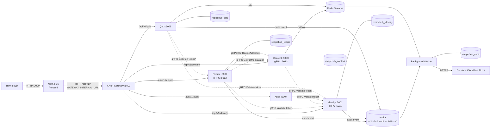

# 01. Tổng quan RecipeHub — bắt đầu từ số 0

> Đọc file này đầu tiên. Nó giải thích **bài toán**, **từ vựng kỹ thuật** và **bức tranh toàn hệ thống** trước khi đi sâu vào từng phần.

## 1. Bài toán

Một chuỗi đồ uống (cà phê, trà sữa…) có phòng **R&D** (nghiên cứu & phát triển) chuyên sáng tạo công thức. Vấn đề thực tế:

- Công thức nằm rải rác trong Excel/Zalo, không biết **bản nào là bản chuẩn**.
- Barista ở cửa hàng cần **đọc đúng công thức đã phát hành**, không được thấy bản nháp.
- Cần biết **ai sửa gì, lúc nào** (truy vết).
- Cần **đào tạo/kiểm tra** barista đã thuộc công thức chưa.
- Cần **ảnh minh họa** cho món mà không phải chụp thật.

**RecipeHub** giải quyết bằng một web app gồm:

| Vai trò (role) | Mã trong code | Làm được gì |
|---|---|---|
| Quản trị hệ thống | `admin` | Quản lý tài khoản, xem nhật ký hoạt động, giám sát hệ thống |
| Chuyên viên R&D | `rnd` | CRUD nguyên liệu, đơn vị; soạn/phát hành công thức theo phiên bản; tạo ảnh AI; xuất PDF; tạo bộ đề quiz (kể cả bằng AI) |
| Barista (người xem) | `viewer` | Xem công thức đã phát hành, làm quiz, xem lịch sử |

Tài khoản demo (được seed khi chạy môi trường Development, xem `src/backend/Services/Identity/RecipeHub.Identity.Api/Program.cs:73`):

| Email | Mật khẩu | Role |
|---|---|---|
| `admin@recipehub.demo` | `Demo@1234` | admin |
| `rd@recipehub.demo` | `Demo@1234` | rnd |
| `viewer@recipehub.demo` | `Demo@1234` | viewer |

## 2. Từ điển thuật ngữ (đọc 1 lần là đủ để nắm toàn hệ thống)

| Thuật ngữ | Giải thích dễ hiểu | Trong RecipeHub |
|---|---|---|
| **Monolith** | Toàn bộ app là 1 khối, 1 process, 1 DB | Không dùng |
| **Microservices** | Chia app thành nhiều service nhỏ, mỗi service 1 nghiệp vụ, chạy độc lập, có DB riêng | 5 service: Identity, Recipe, Content, Audit, Quiz + 1 Worker |
| **API Gateway** | "Cổng vào" duy nhất của backend. Trình duyệt gọi Next.js Route Handler cùng origin; Next.js gọi gateway, gateway chuyển tiếp tới đúng service | YARP, cổng `5000`, route `/api/v1/{service}/...` |
| **Reverse proxy** | Máy chủ nhận request thay cho máy khác rồi chuyển tiếp | YARP (Yet Another Reverse Proxy) của Microsoft |
| **REST / HTTP JSON** | Gọi API bằng HTTP, dữ liệu dạng JSON | Trình duyệt ↔ Gateway ↔ Service |
| **gRPC** | Gọi hàm từ xa (RPC) giữa các service, nhanh, dữ liệu nhị phân (Protobuf), chạy trên HTTP/2, có "hợp đồng" `.proto` | Service ↔ Service (đồng bộ) |
| **Protobuf / .proto** | Ngôn ngữ mô tả hợp đồng gRPC, sinh ra code C# client/server | `src/backend/Contracts/RecipeHub.GrpcContracts/Protos/*.proto` |
| **Message broker** | "Bưu điện" trung gian: bên gửi bỏ thư vào, bên nhận lấy ra sau. Hai bên không cần chờ nhau | Kafka và Redis Streams |
| **Kafka** | Broker dạng **log bền vững**, chia topic/partition, nhiều consumer group đọc độc lập, đọc lại được | Sự kiện **audit** (ai làm gì) |
| **Redis Streams** | Cấu trúc "stream" trong Redis, có consumer group + ACK, nhẹ, nhanh | **Hàng đợi job AI** (tạo ảnh, tạo quiz) |
| **Topic / Partition / Offset** | Topic = kênh; partition = ngăn chia nhỏ của topic để song song; offset = số thứ tự message trong partition | `recipehub.audit.activities.v1`, 3 partition |
| **Consumer group** | Nhóm consumer cùng chia nhau đọc; mỗi message chỉ 1 thành viên xử lý | Kafka `recipehub-audit`; Redis `content-draft-workers`, `quiz-ai-workers` |
| **ACK / Commit** | Xác nhận "tôi đã xử lý xong message này" | Redis `XACK`; Kafka `Commit(offset)` |
| **DLQ (Dead Letter Queue)** | Nơi chứa message lỗi không xử lý được, để không chặn hàng đợi | `recipehub.audit.activities.v1.dlq` |
| **Outbox pattern** | Ghi "thư cần gửi" vào **cùng DB transaction** với dữ liệu nghiệp vụ, rồi tiến trình nền thử gửi lại; tránh khoảng trống "đã ghi DB nhưng chưa đưa job vào Redis" | Bảng `content_db.outbox_message` |
| **Clean Architecture** | Chia code thành tầng: Domain (lõi nghiệp vụ) ← Application (use case) ← Infrastructure (DB, Redis, gRPC…) ← Api (controller) | Mọi service |
| **DB First** | Thiết kế DB bằng SQL trước, code C# map theo DB (không để EF tự sinh bảng) | `docs/database-schema/*` |
| **Database-per-service** | Mỗi service sở hữu DB riêng, không service nào đọc trực tiếp DB của service khác | 5 database trong 1 PostgreSQL |
| **JWT** | Chuỗi token có chữ ký, chứa `sub` (user id), `role`, `exp` (hết hạn) | Identity phát hành, mọi service kiểm tra |
| **Docker / container** | Đóng gói app + môi trường chạy vào "container" để chạy giống nhau ở mọi máy | Mỗi service 1 image |
| **Docker Compose** | File YAML mô tả cả cụm container, khởi động bằng 1 lệnh | `infra/compose.yaml` (21 container) |
| **Healthcheck** | Lệnh Docker gọi định kỳ để biết container "khỏe" chưa | `/health/live`, `pg_isready`, `redis-cli ping`… |
| **Swagger / OpenAPI** | Trang web tự sinh liệt kê và thử API | Mỗi service có `/swagger` khi Development |
| **Observability** | Quan sát hệ thống: metrics, dashboard | Prometheus + Grafana + exporters |

## 3. Bức tranh toàn hệ thống



Đọc sơ đồ:

1. **Nét liền** = HTTP REST. Trình duyệt **chỉ** nói chuyện với frontend (cổng 3000); frontend gọi gateway; gateway chuyển tới service.
2. **Nét đứt** = gRPC nội bộ (service gọi service, đồng bộ, chờ kết quả).
3. **Kafka** = luồng audit tách khỏi DB nghiệp vụ. Code hiện `await` producer trong thời hạn ngắn, nhưng lỗi publish chỉ được log nên không rollback nghiệp vụ; audit là best-effort ở phía producer.
4. **Redis Streams** = hàng đợi job AI tốn thời gian (5–30 giây), Worker xử lý nền.
5. Mỗi service có **database riêng** (cùng 1 server PostgreSQL nhưng 5 database + 5 tài khoản riêng).

## 4. Vì sao chọn từng công nghệ (câu GV chắc chắn hỏi)

| Câu hỏi | Trả lời ngắn gọn |
|---|---|
| Vì sao microservices? | Mỗi nghiệp vụ (tài khoản, công thức, media/AI, audit, quiz) thay đổi độc lập; lỗi AI (Content) không làm sập Recipe; scale riêng phần tốn tài nguyên (Worker AI). Đồng thời là yêu cầu môn PRN232. |
| Vì sao có Gateway? | 1 địa chỉ duy nhất cho frontend, giấu cấu trúc nội bộ, tập trung CORS/route; service bên trong không mở port ra ngoài (xem `docker ps`: chỉ 3000 và 5000 public). |
| Vì sao gRPC giữa service mà không gọi REST? | Hợp đồng `.proto` chặt (sai kiểu là lỗi compile), nhị phân nhỏ, HTTP/2 multiplexing nhanh; phù hợp gọi nội bộ tần suất cao như kiểm tra token mỗi request. |
| Vì sao Kafka cho audit? | Audit là log **chỉ thêm, không sửa**, cần **bền vững và đọc lại được** (replay), nhiều consumer có thể cùng đọc (sau này: analytics, cảnh báo). Kafka giữ message theo thời gian lưu trữ, không xóa khi đọc. |
| Vì sao Redis Streams cho job AI mà không dùng Kafka? | Job AI là **hàng đợi công việc** ngắn hạn, cần ACK từng job, ít message; Redis đã có sẵn (cache/session), nhẹ hơn nhiều. Đúng công cụ cho đúng việc. |
| Vì sao audit không ghi thẳng DB? | Tách DB và ownership Audit khỏi service nghiệp vụ. Producer vẫn có thể tăng latency đến timeout, nhưng publisher bắt exception (`src/backend/BuildingBlocks/RecipeHub.BuildingBlocks/Audit/KafkaAuditActivityPublisher.cs:62-66`), nên lỗi transport không rollback nghiệp vụ; đổi lại có thể thiếu audit vì chưa có outbox audit. |
| Vì sao database-per-service? | Service tự chủ schema; không ai "đọc trộm" bảng của nhau; đổi DB một service không ảnh hưởng service khác. Dữ liệu chéo lấy qua gRPC. |
| Vì sao DB First? | Quy định nhóm (AGENTS.md): SQL là nguồn sự thật, kiểm soát được constraint/index/quyền chi tiết, tránh EF tự đổi schema trên DB có dữ liệu. |

## 5. Cấu trúc thư mục (chỉ phần web)

```text
RecipeHub/
├── src/backend/
│   ├── RecipeHub.sln                 # Solution .NET 8
│   ├── BuildingBlocks/               # Code dùng chung: EventEnvelope, Audit publisher (Kafka/Redis), Options
│   ├── Contracts/RecipeHub.GrpcContracts/Protos/   # 5 file .proto = hợp đồng gRPC
│   ├── Gateway/RecipeHub.Gateway/    # YARP, appsettings.json chứa route
│   ├── Services/<Tên>/               # Mỗi service 4 project: Domain, Application, Infrastructure, Api
│   └── Workers/RecipeHub.BackgroundWorker/   # Tiến trình nền: Redis Streams + Kafka consumer
├── src/frontend/                     # Next.js 16 App Router
├── infra/
│   ├── compose.yaml                  # 21 container
│   ├── postgres/init-databases.sh    # tạo 5 DB + role + chạy DDL/seed
│   ├── kafka/create-topics.sh        # tạo topic audit + DLQ
│   ├── prometheus/, grafana/, pgadmin/
├── docs/database-schema/<svc>-db/    # DDL .postgres, .dbml, migrations/ (DB First)
├── tests/smoke/smoke-test.sh         # Kiểm tra toàn hệ thống 7 bước
└── tests/smoke/e2e-demo.sh       # Kịch bản demo end-to-end
```

## 6. Thứ tự đọc bộ tài liệu

| File | Nội dung |
|---|---|
| `01-tong-quan.md` | (file này) Bài toán, thuật ngữ, kiến trúc tổng |
| `02-cach-chay.md` | Chạy từ số 0 bằng Docker, kiểm tra, xử lý sự cố |
| `03-database.md` | 5 database, ERD, từng bảng/cột, DB First, quyền |
| `04-luong-code.md` | Clean Architecture, từng service, luồng code chi tiết từng use case |
| `05-bao-mat-phan-quyen.md` | JWT, session, gRPC Validate, ma trận quyền, điểm yếu |
| `06-frontend.md` | Next.js App Router, mọi trang, cách gọi API |
| `07-ha-tang-docker-redis-kafka-grpc.md` | Docker Compose, Redis Streams, Kafka, gRPC chi tiết + lệnh kiểm chứng |
| `08-bang-chung.md` | Mục lục bằng chứng chạy thật (log, ảnh chụp) |
| `09-kich-ban-demo-va-hoi-dap.md` | Kịch bản trình bày + ngân hàng câu hỏi GV |
