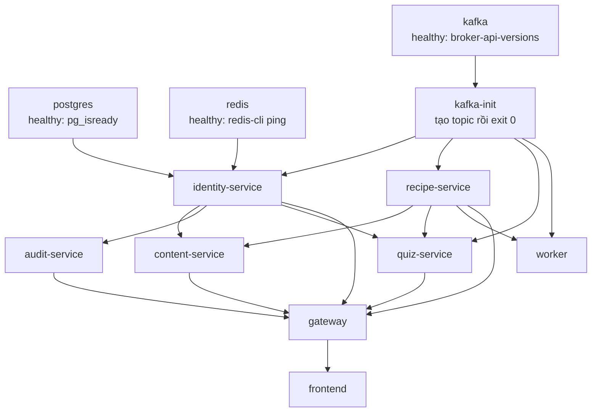

# 02. Cách chạy RecipeHub từ số 0 (Docker)

> Các lệnh dưới đây đã chạy thật trên máy dev ngày 16/11/2026 (Linux, Docker Engine + Compose v2). Kết quả nằm trong `evidence/`.

## 1. Cần cài gì

| Công cụ | Để làm gì | Kiểm tra |
|---|---|---|
| Docker Engine / Docker Desktop | Chạy container | `docker --version` |
| Docker Compose v2 | Chạy cả cụm bằng 1 lệnh | `docker compose version` |
| Git | Lấy code | `git --version` |
| (tùy chọn) .NET 8 SDK, Node 20 | Chỉ cần nếu chạy ngoài Docker | `dotnet --version`, `node -v` |

RAM khuyến nghị ≥ 8 GB (21 container, Kafka giới hạn heap 512 MB).

## 2. Lấy code và tạo file `.env`

```bash
git clone <repo-url> RecipeHub && cd RecipeHub
git checkout dev && git pull
cp .env.example .env      # rồi điền giá trị thật
```

`.env` nằm ở **thư mục gốc repo** và **đã có trong `.gitignore`**, nên không bao giờ bị commit. Các nhóm biến:

| Nhóm | Biến | Ý nghĩa |
|---|---|---|
| Superuser Postgres | `POSTGRES_USER/PASSWORD/DB` | Chỉ dùng lúc khởi tạo cluster, service **không** dùng |
| Mỗi service ×5 | `<SVC>_MIGRATOR_USER/PASSWORD` | Role sở hữu DB, chạy DDL + seed (chỉ lúc init) |
| | `<SVC>_DB_USER/PASSWORD/NAME` | Role runtime của service: chỉ CONNECT + DML |
| Giám sát | `GRAFANA_DB_USER/PASSWORD` | Role chỉ đọc cho Grafana/postgres-exporter |
| Cổng | `GATEWAY_PORT=5000`, `FRONTEND_PORT=3000`, `KAFKA_EXTERNAL_PORT=9094`, `KAFKA_UI_PORT=8085`, `PGADMIN_PORT=5050`, `GRAFANA_PORT=3001` | |
| Bảo mật | `JWT_SIGNING_KEY` (≥ 32 byte) | Khóa ký JWT HS256 |
| Messaging | `AUDIT_TRANSPORT=Kafka` | Kênh audit: `Kafka`, `Redis` hoặc `Dual` |
| AI | `GEMINI_API_KEYS` (nhiều key, phân cách dấu phẩy), `GEMINI_MODEL`, `CLOUDFLARE_ACCOUNT_ID`, `CLOUDFLARE_API_TOKEN`, `CLOUDFLARE_MODEL` | Dịch prompt (Gemini) + sinh ảnh (FLUX Schnell) |
| Lưu trữ | `CLOUDINARY_*` | Lưu ảnh đã duyệt và file PDF lâu dài |

> **Không** đưa giá trị thật của các key lên slide hay tài liệu. Khi GV hỏi thì mở `.env.example` để trình bày.

## 3. Khởi động toàn bộ hệ thống (1 lệnh)

```bash
docker compose -p recipehub --env-file .env -f infra/compose.yaml up -d --build
```

Giải thích từng phần:

- `-p recipehub`: đặt tên project, nên volume sẽ là `recipehub_pgdata`, `recipehub_kafka-data`…
- `--env-file .env`: đọc biến từ `.env` ở thư mục gốc. Compose nằm trong `infra/` nên phải chỉ rõ đường dẫn.
- `-f infra/compose.yaml`: file mô tả 21 container.
- `up -d --build`: build image từ Dockerfile rồi chạy nền.

Lần đầu mất khoảng 5–10 phút (tải image .NET SDK và Node, `dotnet restore`, `npm ci`). Các lần sau dùng cache.

### Thứ tự khởi động do `depends_on` + `healthcheck` quyết định



- `condition: service_healthy`: chỉ khởi động khi service phụ thuộc **đã khỏe**, không chỉ "đã start".
- `condition: service_completed_successfully`: `kafka-init` phải tạo topic xong và thoát với mã 0. Lý do: Kafka bị tắt tự tạo topic (`KAFKA_AUTO_CREATE_TOPICS_ENABLE: "false"`), nên publish trước khi có topic sẽ lỗi.
- Lần đầu volume `pgdata` còn trống: Postgres tự chạy `/docker-entrypoint-initdb.d/init-databases.sh`, tạo 5 DB, các role, rồi chạy DDL `docs/database-schema/*/RecipeHub.*.postgres` và seed (xem `03-database.md`).

## 4. Kiểm tra đã chạy chưa

```bash
docker compose -p recipehub -f infra/compose.yaml ps
```

Kết quả mong đợi: các service ứng dụng đều `(healthy)`, `kafka-init` là `Exited (0)` (bình thường: nó là job một lần). Xem bản thật trong `evidence/02-docker-ps.txt`.

Chạy smoke test 7 bước:

```bash
bash tests/smoke/smoke-test.sh
```

| Bước | Kiểm tra gì |
|---|---|
| 1 | Gateway `/health/ready` |
| 2 | Đăng nhập qua gateway, gọi `/api/v1/{service}/info` cho cả 5 service |
| 3 | gRPC: Content gọi Recipe `ServiceProbe.Ping` |
| 4 | Redis Streams: publish heartbeat, rồi chờ Worker ACK (`XPENDING = 0`) |
| 5 | Kafka: broker khỏe, có topic audit + DLQ, có consumer group `recipehub-audit` |
| 6 | Grafana + pgAdmin |
| 7 | Frontend `/api/health` |

Kết quả thật: `evidence/01-smoke-test.txt`, dòng cuối là `All Foundation Architecture Checks Passed! [SUCCESS]`.

Chạy kịch bản demo nghiệp vụ end-to-end (tạo dữ liệu thật, đi qua Kafka, Redis, gRPC và AI):

```bash
bash tests/smoke/e2e-demo.sh            # đầy đủ, có gọi AI thật (~30 giây)
SKIP_AI=1 bash tests/smoke/e2e-demo.sh  # bỏ bước AI nếu mạng yếu hoặc hết quota
```

## 5. Các địa chỉ truy cập

| Địa chỉ | Là gì | Đăng nhập |
|---|---|---|
| http://localhost:3000 | **Web RecipeHub** | `rd@recipehub.demo` / `Demo@1234` (hoặc admin, viewer) |
| http://localhost:5000/health/ready | Gateway health | – |
| http://localhost:5000/api/v1/... | REST API qua gateway | Bearer JWT |
| http://localhost:8085 | **Kafka UI**: xem topic, message, consumer group | – |
| http://localhost:3001 | **Grafana**: dashboard giám sát | admin / (GRAFANA_PASSWORD) |
| http://localhost:9090 | Prometheus | – |
| http://localhost:5050 | **pgAdmin**: xem DB bằng giao diện | (PGADMIN_EMAIL / PGADMIN_PASSWORD) |
| `localhost:5433` | PostgreSQL (chỉ bind 127.0.0.1) | user trong `.env` |
| `localhost:6380` | Redis (chỉ bind 127.0.0.1) | – |
| `localhost:9094` | Kafka broker từ máy host | – |

**Swagger.** Các service không public port nên Swagger UI không mở trực tiếp từ host được. Có 2 cách xem:

```bash
# Cách 1: mở thêm port Swagger bằng file override
docker compose -p recipehub --env-file .env -f infra/compose.yaml -f infra/compose.swagger.yaml up -d
# Cách 2: lấy JSON OpenAPI từ bên trong container
docker exec recipehub-recipe curl -s localhost:5002/swagger/v1/swagger.json | head
```

## 6. Lệnh hay dùng khi demo

```bash
# Log realtime của một service
docker logs -f recipehub-worker
docker logs -f recipehub-recipe

# Vào PostgreSQL
docker exec -it recipehub-postgres psql -U recipehub_admin -d recipehub_recipe
#   \dt recipe_db.*     -- liệt kê bảng
#   \d recipe_db.recipe -- cấu trúc bảng

# Redis
docker exec -it recipehub-redis redis-cli
#   XINFO GROUPS content.image-drafts.v1
#   XREVRANGE content.image-drafts.v1 + - COUNT 1
#   XPENDING content.image-drafts.v1 content-draft-workers

# Kafka
docker exec recipehub-kafka /opt/kafka/bin/kafka-topics.sh --bootstrap-server localhost:9092 --list
docker exec recipehub-kafka /opt/kafka/bin/kafka-console-consumer.sh --bootstrap-server localhost:9092 \
  --topic recipehub.audit.activities.v1 --from-beginning --property print.key=true --timeout-ms 5000
docker exec recipehub-kafka /opt/kafka/bin/kafka-consumer-groups.sh --bootstrap-server localhost:9092 \
  --describe --group recipehub-audit

# Khởi động lại 1 service sau khi sửa code
docker compose -p recipehub --env-file .env -f infra/compose.yaml up -d --build recipe-service
```

## 7. Dừng và xóa

```bash
docker compose -p recipehub -f infra/compose.yaml stop      # tạm dừng, giữ nguyên container
docker compose -p recipehub -f infra/compose.yaml down      # xóa container, GIỮ dữ liệu (volume)
docker compose -p recipehub -f infra/compose.yaml down -v   # xóa luôn volume = MẤT toàn bộ dữ liệu, lần sau init lại từ đầu
```

## 8. Xử lý sự cố thường gặp

| Triệu chứng | Nguyên nhân | Cách xử lý |
|---|---|---|
| `port is already allocated` (3000/5000/5433…) | Một app khác hoặc stack cũ đang giữ cổng | `docker ps` để tìm, rồi dừng stack cũ: `docker compose -p <tên-cũ> -f infra/compose.yaml down` |
| Service báo `password authentication failed` | Volume `pgdata` được tạo bằng `.env` **cũ**. Script init chỉ chạy khi volume trống | Dùng lại `.env` cũ, hoặc tạo stack mới với project name khác (`-p`), hoặc `down -v` nếu chấp nhận mất dữ liệu |
| `kafka-init` thoát với mã ≠ 0, các service không lên | Kafka chưa sẵn sàng hoặc script lỗi | `docker logs recipehub-kafka-init`, rồi chạy lại `up -d` |
| Tạo ảnh AI bị `failed` | Thiếu key, hoặc Gemini trả 429 (hết quota) | Xem `docker logs recipehub-worker`. Worker tự **xoay sang key Gemini khác** khi gặp 429 (đã thấy trong log thật) |
| Đăng nhập báo 401 dù đúng mật khẩu | Gửi sai field: API nhận `username`, không phải `email` | `{"username":"rd@recipehub.demo","password":"Demo@1234"}` |
| Tạo ảnh AI trả 409 | Phiên bản đã **published** là bất biến, không được tạo thêm nội dung AI | Tạo ảnh trên bản **draft** |

## 9. Ghi chú về môi trường kiểm thử

- Đã dựng một stack **mới hoàn toàn** với project `recipehub`. Volume `recipehub_pgdata` được init từ `.env` hiện tại; volume cũ `infra_pgdata` vẫn còn nguyên, không bị xóa.
- `.env` được lấy từ cấu hình nhóm, có bổ sung `KAFKA_EXTERNAL_PORT`, `KAFKA_UI_PORT`, `AUDIT_TRANSPORT=Kafka`. Biến `REDIS_PORT` có trong `.env` nhưng compose cố định cổng Redis host là `6380`.
- **Không sửa logic code** nào để chạy được. Stack lên healthy ngay lần build đầu.
