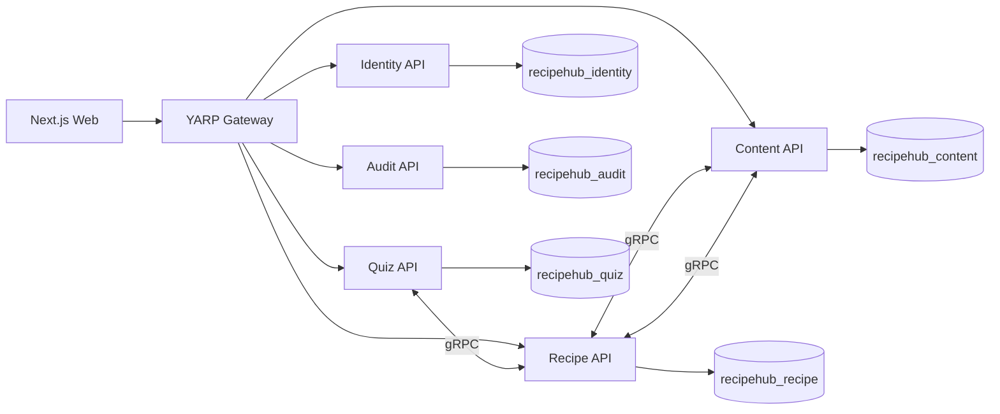
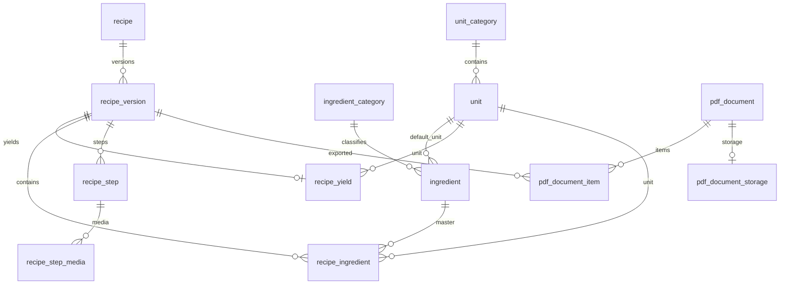
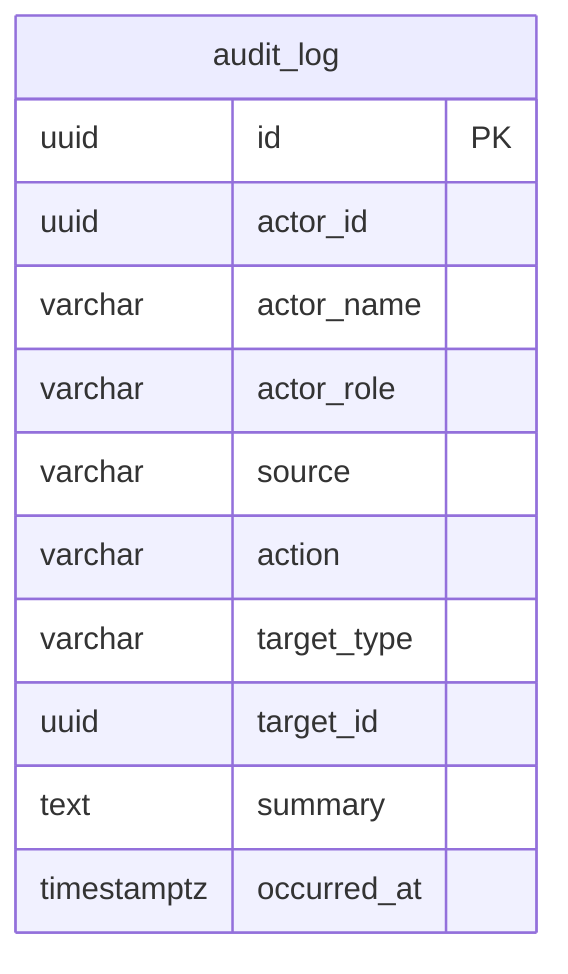
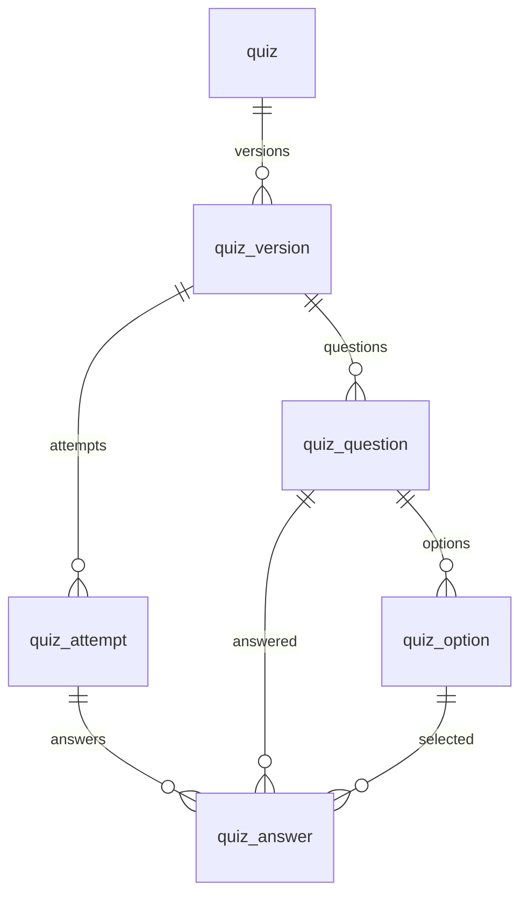

# 03. Cơ sở dữ liệu

> Phạm vi: web RecipeHub, gồm backend .NET và frontend Next.js; không bàn mobile. Mọi mô tả dưới đây đối chiếu trực tiếp với SQL và code tại thời điểm tài liệu được viết.

## 1. Bức tranh tổng thể

### 1.1. DB First là gì?

**DB First** nghĩa là cấu trúc PostgreSQL được quyết định trước bằng SQL có version trong repository. C# Entity Framework Core (EF Core — thư viện ánh xạ dữ liệu quan hệ sang đối tượng C#) chỉ ánh xạ lại cấu trúc đó; ứng dụng không dùng EF migration để tự tạo hoặc tự đổi schema. Quy định dự án nêu SQL là nguồn triển khai có thể tái hiện, cấm `Database.Migrate`, `EnsureCreated` và `dotnet ef database update` (`AGENTS.md:72-86`).

Lý do chọn cách này:

1. Ràng buộc dữ liệu nằm ở PostgreSQL, nên mọi client đều phải tuân thủ cùng PK, FK, `UNIQUE`, `CHECK`, index và trigger.
2. Script SQL có thể review, chạy bằng tài khoản DDL riêng, backup/restore và kiểm tra trước khi nâng cấp DB có dữ liệu.
3. Schema không phụ thuộc vòng đời process .NET; API runtime không cần quyền tạo/xóa bảng.
4. Phù hợp microservice: mỗi service sở hữu schema và lịch sử migration riêng (`AGENTS.md:72-91`).

### 1.2. Database-per-service

**Database-per-service** nghĩa là mỗi microservice sở hữu một database logic riêng: `recipehub_identity`, `recipehub_recipe`, `recipehub_content`, `recipehub_audit`, `recipehub_quiz`. Script bootstrap tạo đúng năm DB và năm cặp migrator/runtime role (`infra/postgres/init-databases.sh:23-51`).



Không tạo FK xuyên database vì PostgreSQL FK chỉ bảo đảm quan hệ trong cùng database, và FK xuyên service sẽ ghép chặt deployment, quyền sở hữu, availability và vòng đời dữ liệu. Thay vào đó, bảng giữ **public UUID reference** (`*_ref`), rồi service chủ dữ liệu xác minh/đọc bằng gRPC. Ví dụ Content ghi `recipe_version_ref`, Recipe ghi `media_asset_ref`, Quiz ghi `recipe_version_ref`; chính comment SQL gọi rõ đây là tham chiếu không FK xuyên DB (`docs/database-schema/content-db/RecipeHub.Content.postgres:89-91`, `docs/database-schema/recipe-db/RecipeHub.Recipe.postgres:246-265`, `docs/database-schema/quiz-db/RecipeHub.Quiz.postgres:96-103`).

## 2. Khởi tạo năm database và mô hình quyền

PostgreSQL chạy `infra/postgres/init-databases.sh` với `set -e`; mọi lệnh SQL dùng `ON_ERROR_STOP=1`, nên lỗi làm bootstrap dừng ngay (`infra/postgres/init-databases.sh:1-2`, `infra/postgres/init-databases.sh:18`). Luồng tạo mới:

1. Tạo `grafana_reader`, cấp role hệ thống `pg_monitor` (`infra/postgres/init-databases.sh:18-21`).
2. Với mỗi service, tạo `<service>_migrator`, `<service>_user`, database do migrator sở hữu, rồi cấp `CONNECT` cho runtime user và Grafana (`infra/postgres/init-databases.sh:23-51`).
3. Chạy DDL đầy đủ `docs/database-schema/*/RecipeHub.*.postgres` bằng migrator (`infra/postgres/init-databases.sh:54-62`, `76-87`, `101-104`, `117-120`, `133-136`).
4. Recipe chạy thêm seed catalog và seed hệ số base-unit (`infra/postgres/init-databases.sh:76-88`). Identity tự seed ba role ngay trong DDL (`docs/database-schema/identity-db/RecipeHub.Identity.postgres:18-22`).
5. Sau DDL, runtime role chỉ nhận `USAGE` schema, DML trên bảng, quyền sequence cần thiết; default privileges áp dụng cả bảng tạo sau này (`infra/postgres/init-databases.sh:64-74`, `90-99`, `106-115`, `122-131`). Audit đặc biệt chỉ có `SELECT, INSERT`; script thu hồi `UPDATE, DELETE, TRUNCATE, REFERENCES, TRIGGER` để log có tính append-only (`infra/postgres/init-databases.sh:138-145`).

**DDL** là lệnh định nghĩa cấu trúc như `CREATE/ALTER`; **DML** là thao tác dữ liệu như `SELECT/INSERT/UPDATE/DELETE`. Tách migrator khỏi runtime là nguyên tắc least privilege: nếu API bị khai thác, tài khoản của API không thể tùy ý đổi schema. `grafana_reader` chỉ đọc; riêng Identity chỉ được xem `roles` và các cột user không chứa `password_hash`, hoàn toàn không được xem `auth_sessions` (`infra/postgres/init-databases.sh:64-74`).

## 3. Identity database

### 3.1. ERD

```mermaid
erDiagram
  roles ||--o{ users : "role_id"
  users ||--o{ auth_sessions : "user_id"
  roles { smallint id PK; varchar code UK; text name; text description; timestamptz created_at }
  users { uuid id PK; text email UK; text full_name; text password_hash; smallint role_id FK; boolean is_active; timestamptz created_at; timestamptz updated_at }
  auth_sessions { uuid id PK; uuid user_id FK; varchar refresh_token_hash UK; timestamptz created_at; timestamptz expires_at; timestamptz revoked_at }
```

### 3.2. Bảng, cột, ràng buộc

- `roles`: `id smallint` là PK, không tự tăng; `code varchar(20)` bắt buộc và unique; `name` bắt buộc; `description` nullable; `created_at` mặc định `now()` (`docs/database-schema/identity-db/RecipeHub.Identity.postgres:8-16`). Seed cố định: `1/admin`, `2/rnd`, `3/viewer`; `ON CONFLICT (id) DO NOTHING` làm seed chạy lặp an toàn (`docs/database-schema/identity-db/RecipeHub.Identity.postgres:18-22`).
- `users`: UUID PK; `email`, `full_name`, `password_hash`, `role_id` bắt buộc; `is_active=true`; hai timestamp mặc định `now()`; FK `role_id -> roles.id` dùng `RESTRICT`; email phải dài hơn 3 ký tự sau trim, tên không rỗng (`docs/database-schema/identity-db/RecipeHub.Identity.postgres:24-37`). Unique email dùng biểu thức `lower(btrim(email))`, nên chống trùng không phân biệt hoa/thường và khoảng trắng; index `(role_id,is_active)` phục vụ lọc theo vai trò/trạng thái (`docs/database-schema/identity-db/RecipeHub.Identity.postgres:51-54`).
- `auth_sessions`: UUID PK; `user_id` FK bắt buộc; chỉ lưu SHA/hash refresh token dài tối đa 64, không lưu token thô; `revoked_at` nullable; `expires_at > created_at`; xóa user bị `RESTRICT` (`docs/database-schema/identity-db/RecipeHub.Identity.postgres:39-49`). Có index theo user và unique index cho `refresh_token_hash` (`docs/database-schema/identity-db/RecipeHub.Identity.postgres:51-52`).

### 3.3. Ánh xạ EF Core

`IdentityDbContext` khai báo ba `DbSet`: `Role`, `IdentityUser`, `AuthSession` (`src/backend/Services/Identity/RecipeHub.Identity.Infrastructure/Data/IdentityDbContext.cs:6-10`). Mapping chỉ rõ schema/table, column, default, check, index và quan hệ: role tại dòng 14-24; user tại dòng 26-49; session tại dòng 51-64. Entity nằm ở `src/backend/Services/Identity/RecipeHub.Identity.Domain/Entities/Role.cs`, `IdentityUser.cs`, `AuthSession.cs`; mapping nằm tập trung trong `IdentityDbContext`, không có bộ persistence model song song.

## 4. Recipe database

### 4.1. ERD



### 4.2. Catalog đơn vị và nguyên liệu

- `unit_category`: identity PK bigint; public UUID unique; code/name cùng bản normalized unique; description nullable; trạng thái `active|inactive`; actor UUID và timestamps bắt buộc, `now()` mặc định (`docs/database-schema/recipe-db/RecipeHub.Recipe.postgres:3-17`). Index state tại dòng 170.
- `unit`: identity PK, public UUID; code normalized unique; FK `category_id`; `is_base=false`; `factor_to_base numeric(18,8)=1`, `offset_to_base=0`; `decimal_places=2`; state `active|inactive`. Factor phải dương, base unit phải có factor 1 và offset 0, số lẻ 0..6 (`docs/database-schema/recipe-db/RecipeHub.Recipe.postgres:19-39`). Partial unique index bảo đảm tối đa một base unit mỗi category; FK xóa `RESTRICT` (`docs/database-schema/recipe-db/RecipeHub.Recipe.postgres:172-174`, `291`).
- `ingredient_category`: cùng mẫu public ID, normalized code/name unique, actor/timestamp và state như unit category (`docs/database-schema/recipe-db/RecipeHub.Recipe.postgres:41-55`).
- `ingredient`: identity PK, public UUID, normalized code unique; category và default unit bắt buộc; mô tả/warning/note/image nullable; state `active|inactive`; actor/timestamp bắt buộc (`docs/database-schema/recipe-db/RecipeHub.Recipe.postgres:57-76`). `category_id` và `default_unit_id` là FK nội bộ `RESTRICT`; `image_asset_ref` chỉ là UUID logic sang Content (`docs/database-schema/recipe-db/RecipeHub.Recipe.postgres:178-184`, `293-295`).

Seed recipe tạo category đơn vị `mass/volume/count`, đơn vị `mg,g,kg,ml,cl,dl,l,serving`, và category nguyên liệu `TEA,COFFEE,DAIRY,SWEETENER,TOPPING,OTHER`; các `WHERE NOT EXISTS` tránh nhân bản (`docs/database-schema/recipe-db/migrations/20261028_seed_catalog.sql:15-29`). Seed base-unit chọn `g`, `ml`, `serving`; hệ số lần lượt `mg=.001`, `kg=1000`, `cl=10`, `dl=100`, `l=1000`; chỉ cập nhật dữ liệu còn nguyên default và category chưa có base (`docs/database-schema/recipe-db/migrations/20261107_seed_catalog_base_units.sql:24-51`).

### 4.3. Công thức và phiên bản

- `recipe`: identity PK, public UUID unique; business `code` và `normalized_code` unique; actor/timestamp bắt buộc; `archived_at` nullable để archive thay hard-delete (`docs/database-schema/recipe-db/RecipeHub.Recipe.postgres:78-88`, `244-254`). Index archive và creator tại dòng 186-188.
- `recipe_version`: identity PK, public UUID; FK `recipe_id`; version dương; `status=draft|published`; tên/normalized name; mô tả và ảnh đại diện nullable; actor/timestamps; publish time/actor nullable theo trạng thái. `draft` bắt buộc chưa publish, `published` bắt buộc đủ hai trường publish (`docs/database-schema/recipe-db/RecipeHub.Recipe.postgres:90-109`). Unique `(recipe_id,version_number)` và partial unique một draft/recipe (`docs/database-schema/recipe-db/RecipeHub.Recipe.postgres:191-202`, `315`); FK recipe `RESTRICT` tại dòng 297.
- `recipe_yield`: tối đa một row mỗi version nhờ `recipe_version_id UNIQUE`; quantity `numeric(18,6)>0`; unit FK; note nullable; xóa version cascade nhưng xóa unit restrict (`docs/database-schema/recipe-db/RecipeHub.Recipe.postgres:111-120`, `299-301`).
- `recipe_ingredient`: định lượng từng nguyên liệu trong version; quantity dương, sort order dương; stage/note/warning snapshot nullable, code/name snapshot bắt buộc. Snapshot giữ nội dung lịch sử ngay cả khi master ingredient đổi (`docs/database-schema/recipe-db/RecipeHub.Recipe.postgres:122-138`). FK version cascade, ingredient/unit restrict; index thứ tự và lookup tại dòng 206-210, 303-307.
- `recipe_step`: public UUID; FK version; thứ tự dương; title/description bắt buộc; duration nullable nhưng không âm; nhiệt độ, thiết bị, an toàn, tiêu chí hoàn tất nullable (`docs/database-schema/recipe-db/RecipeHub.Recipe.postgres:140-156`). FK version cascade và index `(recipe_version_id,sort_order)` tại dòng 212, 309.
- `recipe_step_media`: public UUID; FK step; `media_asset_ref` là UUID logic sang Content; sort mặc định 1 và dương; primary mặc định false; caption nullable (`docs/database-schema/recipe-db/RecipeHub.Recipe.postgres:158-168`). Unique `(step,asset)`, partial unique một primary/step; FK step cascade (`docs/database-schema/recipe-db/RecipeHub.Recipe.postgres:214-218`, `311-314`).

### 4.4. Tài liệu PDF

- `pdf_document`: public UUID unique; title không rỗng; `document_type=draft|published`; `export_scope=single|collection`; `state=processing|ready|failed`; actor/time; completion/lease/error nullable theo state. Check bảo đảm processing có lease, ready không lỗi, failed có lỗi, terminal không còn lease (`docs/database-schema/recipe-db/RecipeHub.Recipe.postgres:317-338`).
- `pdf_document_item`: nối document với recipe version, sort order dương; unique `(document,sort_order)` và `(document,recipe_version)`; cả hai FK `RESTRICT` (`docs/database-schema/recipe-db/RecipeHub.Recipe.postgres:340-351`).
- `pdf_document_storage`: PK cũng là FK `document_id`, nên quan hệ 1-0..1; provider mặc định Cloudinary; public storage ID unique; metadata có thể nullable khi đang xử lý; byte size nếu có phải dương, SHA-256 nếu có phải đúng 64 ký tự hex; `cleanup_required=false` (`docs/database-schema/recipe-db/RecipeHub.Recipe.postgres:353-370`).
- Index lịch sử, lease, item và cleanup nằm tại `docs/database-schema/recipe-db/RecipeHub.Recipe.postgres:372-377`. Deferred constraint trigger kiểm tra `single` đúng 1 item, `collection` ít nhất 2 và sort liên tục (`docs/database-schema/recipe-db/RecipeHub.Recipe.postgres:380-424`, `546-558`). Các trigger tiếp theo làm document `ready` bất biến và buộc storage metadata đầy đủ (`docs/database-schema/recipe-db/RecipeHub.Recipe.postgres:426-544`, `560-590`).

### 4.5. Ánh xạ EF Core

`RecipeDbContext` có 13 `DbSet`, phủ toàn bộ bảng catalog, recipe và PDF (`src/backend/Services/Recipe/RecipeHub.Recipe.Infrastructure/Data/RecipeDbContext.cs:9-40`). Mapping catalog/recipe nằm trong `RecipeDbContext.cs`; ví dụ Ingredient map table, index, default, reference Content và quan hệ tại dòng 44-90. Các ràng buộc bổ sung nằm trong `RecipeDbContext.Constraints.cs`. PDF tách ba configuration: `PdfDocumentConfiguration.cs:11-41`, `PdfDocumentItemConfiguration.cs:11-35`, `PdfDocumentStorageConfiguration.cs:11-34`. Entity tương ứng nằm trong `src/backend/Services/Recipe/RecipeHub.Recipe.Domain/Entities/`.

## 5. Content database

### 5.1. ERD

```mermaid
erDiagram
  ai_image_draft ||--o| ai_image_draft_file : temporary_file
  ai_image_draft ||--o| media_asset : accepted_as
  ai_image_draft { bigint id PK; uuid public_id UK; uuid recipe_version_ref; uuid recipe_step_ref; text target_kind; jsonb input_snapshot; text state; uuid created_by_user_ref }
  ai_image_draft_file { bigint draft_id PK_FK; text temporary_image_path; text mime_type; bigint byte_size; int width; int height }
  media_asset { bigint id PK; uuid public_id UK; bigint ai_image_draft_id FK_UK; text storage_provider; text provider_public_id; text delivery_url; text source_type; text state }
  outbox_message { uuid id PK; text event_type; jsonb payload; timestamptz created_at; timestamptz processed_at; int retry_count; text error }
```

### 5.2. Bảng và trạng thái

- `ai_image_draft`: identity PK, public UUID unique; recipe version bắt buộc, step nullable theo target; brief nullable; input JSON bắt buộc, prompt nullable; provider/model/native geometry có default; state mặc định `queued`; lỗi/lease/timestamps quyết định nullable; creator bắt buộc (`docs/database-schema/content-db/RecipeHub.Content.postgres:3-26`). `target_kind=final_product|step_instruction`; state gồm `queued, processing, generated, failed, accepting, accepted, discarded, expired`; checks buộc step chỉ cho step target, expiry hợp lệ, generated đủ prompt/time và quyết định đủ actor/time (`docs/database-schema/content-db/RecipeHub.Content.postgres:27-33`). Index phục vụ lookup recipe, step, cleanup, creator và worker lease (`docs/database-schema/content-db/RecipeHub.Content.postgres:69-77`).
- `media_asset`: identity PK, public UUID unique; AI draft nullable nhưng unique; storage provider mặc định Cloudinary; provider ID, URL, MIME, kích thước bắt buộc; `source_type=real|ai_illustration`; state chỉ `active`; creator/time bắt buộc. Byte size và dimensions phải dương; ảnh real không có draft, AI bắt buộc có draft (`docs/database-schema/content-db/RecipeHub.Content.postgres:36-57`). FK tới draft `RESTRICT`; unique `(storage_provider,provider_public_id)` và index thư viện/creator (`docs/database-schema/content-db/RecipeHub.Content.postgres:79-83`, `139`).
- `outbox_message`: UUID PK, event type và JSON payload bắt buộc, `created_at=now()`, processed nullable, retry mặc định 0, error nullable (`docs/database-schema/content-db/RecipeHub.Content.postgres:59-67`). Outbox cho phép commit event cùng transaction với dữ liệu; relay tìm row pending qua index `(processed_at,created_at)` (`docs/database-schema/content-db/RecipeHub.Content.postgres:85`, `129-137`).
- `ai_image_draft_file`: PK/FK `draft_id`, nên một draft tối đa một file; path/MIME/kích thước bắt buộc, size/dimensions dương và text không rỗng. FK `RESTRICT`, deferred (`docs/database-schema/content-db/RecipeHub.Content.postgres:141-168`). Không có seed Content.

### 5.3. Ánh xạ EF Core

`ContentDbContext` đặt default schema `content_db`, có bốn `DbSet`, rồi nạp configuration từ assembly (`src/backend/Services/Content/RecipeHub.Content.Infrastructure/Data/ContentDbContext.cs:6-23`). Mapping riêng nằm tại `Infrastructure/Data/Configurations/`: `AiImageDraftConfiguration.cs:12-158`, `AiImageDraftFileConfiguration.cs:12-56`, `MediaAssetConfiguration.cs:12-108`, `OutboxMessageConfiguration.cs:12-45`; mỗi file ánh xạ table, property, index, relation và check tương ứng. Entity nằm tại `RecipeHub.Content.Domain/*.cs`.

## 6. Audit database

### 6.1. ERD và bảng



Chỉ có `audit_log`. Tất cả cột đều NOT NULL: UUID PK; actor ID/name/role; source; action; target type/ID; summary; thời điểm. UUID không được rỗng, text nghiệp vụ không được trắng; role chỉ `admin|rnd|viewer`, source chỉ `identity|recipe|content|quiz` (`docs/database-schema/audit-db/RecipeHub.Audit.postgres:3-23`). Ba index hỗ trợ timeline chung, timeline theo actor và theo target, đều sắp thời gian/id giảm dần (`docs/database-schema/audit-db/RecipeHub.Audit.postgres:25-28`). Không có FK vì log phải giữ được snapshot actor/target ngay cả khi nguồn đổi hoặc mất; không có seed.

`AuditDbContext` có một `DbSet`, default schema và auto-load configuration (`src/backend/Services/Audit/RecipeHub.Audit.Infrastructure/Data/AuditDbContext.cs:6-19`). `AuditLogConfiguration` ánh xạ đủ property và ba index (`src/backend/Services/Audit/RecipeHub.Audit.Infrastructure/Data/Configurations/AuditLogConfiguration.cs:11-69`). Entity: `src/backend/Services/Audit/RecipeHub.Audit.Domain/Entities/AuditLog.cs`.

## 7. Quiz database

### 7.1. ERD



### 7.2. Bảng, cột, trạng thái

- `quiz`: identity PK; public UUID và code unique; title bắt buộc; description nullable; creator UUID; `next_version_number=1`; timestamps `now()`; code/title không rỗng, next version dương (`docs/database-schema/quiz-db/RecipeHub.Quiz.postgres:3-16`).
- `quiz_version`: identity PK, public UUID; FK quiz; version mặc định 1; `recipe_version_ref` UUID logic; passing score mặc định 80.00 và trong `(0,100]`; state `draft|published|archived`; publish time phải null cho draft, có giá trị cho published/archived (`docs/database-schema/quiz-db/RecipeHub.Quiz.postgres:18-34`). Unique `(quiz_id,version_number)`, index recipe ref và state (`docs/database-schema/quiz-db/RecipeHub.Quiz.postgres:82-84`).
- `quiz_question`: identity PK; FK version; sort mặc định 1, dương; content bắt buộc không rỗng; explanation nullable (`docs/database-schema/quiz-db/RecipeHub.Quiz.postgres:36-44`).
- `quiz_option`: identity PK; FK question; sort mặc định 1, dương; content không rỗng; `is_correct=false` (`docs/database-schema/quiz-db/RecipeHub.Quiz.postgres:46-54`).
- `quiz_attempt`: identity PK, public UUID; FK version; user UUID logic; state `in_progress|submitted`; score/pass/submitted nullable khi đang làm và bắt buộc khi nộp; score 0..100; submitted không trước started (`docs/database-schema/quiz-db/RecipeHub.Quiz.postgres:56-72`). Partial unique index chỉ cho một attempt đang làm trên mỗi `(user,version)` (`docs/database-schema/quiz-db/RecipeHub.Quiz.postgres:89-91`).
- `quiz_answer`: identity PK; FK attempt/question; selected option nullable; unique một answer cho mỗi `(attempt,question)` và index selected option (`docs/database-schema/quiz-db/RecipeHub.Quiz.postgres:74-79`, `93-94`).

Tất cả FK nội bộ dùng `ON DELETE RESTRICT`, nên phải xử lý quan hệ có chủ đích thay vì cascade xóa dữ liệu kiểm tra (`docs/database-schema/quiz-db/RecipeHub.Quiz.postgres:96-103`). Quiz không có seed trong DDL hiện tại.

`QuizDbContext` có sáu `DbSet` và nạp configuration từ assembly (`src/backend/Services/Quiz/RecipeHub.Quiz.Infrastructure/Data/QuizDbContext.cs:6-24`). Sáu mapping nằm tại `Infrastructure/Data/Configurations/Quiz*Configuration.cs`; ví dụ `QuizVersionConfiguration.cs:11-78` ánh xạ checks, unique/index và FK; `QuizAttemptConfiguration.cs:11-68` ánh xạ state invariant và partial unique index. Entity nằm tại `RecipeHub.Quiz.Domain/Entities/`.

## 8. Tham chiếu logic xuyên service và gRPC

**gRPC** là cơ chế gọi hàm từ xa dùng contract Protobuf có kiểu dữ liệu rõ. RecipeHub không join trực tiếp DB của service khác:

- Content cần context công thức: gọi `RecipeAiContextQuery.GetRecipeAiContext`; contract còn có `GetMediaAssetUsages` (`src/backend/Contracts/RecipeHub.GrpcContracts/Protos/recipe_ai_context.proto:8-10`). Client gửi public UUID, bearer token, deadline 5 giây và chuyển lỗi RPC thành dependency error (`src/backend/Services/Content/RecipeHub.Content.Infrastructure/Clients/RecipeGrpcContextClient.cs:30-62`, `110-140`).
- Quiz cần xác minh/đọc RecipeVersion: contract cung cấp batch metadata và nội dung (`src/backend/Contracts/RecipeHub.GrpcContracts/Protos/quiz_recipe_query.proto:8-10`). Client giới hạn batch 100 ID, gửi authorization, deadline 5 giây và map response về model Quiz (`src/backend/Services/Quiz/RecipeHub.Quiz.Infrastructure/Clients/QuizRecipeClient.cs:16-80`, `83-115`).
- Recipe cần ảnh khi render PDF: `ContentPdfMediaQuery.GetPdfMediaBatch` nhận danh sách asset ID (`src/backend/Contracts/RecipeHub.GrpcContracts/Protos/content_pdf_media.proto:8-16`). Resolver gom UUID, gọi Content gRPC và fail rõ khi service không khả dụng (`src/backend/Services/Recipe/RecipeHub.Recipe.Infrastructure/Documents/ContentPdfMediaResolver.cs:35-100`).
- Xác thực session tập trung tại Identity qua `IdentitySession.Validate` (`src/backend/Contracts/RecipeHub.GrpcContracts/Protos/identity_session.proto:5-9`). Vì vậy các `created_by_user_ref`, `user_ref`, `actor_id` chỉ lưu UUID snapshot/reference; tính hợp lệ danh tính thuộc Identity, không phải FK vật lý ở DB khác.

Hệ quả cần lưu ý: transaction PostgreSQL chỉ atomic trong một DB. Tính nhất quán xuyên service đạt bằng validate trước qua gRPC, public ID ổn định, lỗi rõ ràng và asynchronous messaging/outbox ở nơi cần; không giả vờ có distributed FK.

## 9. Migration tăng dần

DDL đầy đủ `RecipeHub.*.postgres` chỉ dùng dựng database trống. Database đã có dữ liệu phải chạy các file theo thời gian trong `docs/database-schema/<service>-db/migrations/`; quy tắc này được ghi tại `AGENTS.md:76-80`.

- Identity có chuỗi migration từ initial/import legacy, upgrade, role cleanup đến grant select; xem `docs/database-schema/identity-db/migrations/`.
- Recipe có chuỗi public ID/media, bỏ row version, đơn giản domain, archive legacy, catalog seed, PDF, unit conversion và base-unit seed; xem `docs/database-schema/recipe-db/migrations/`.
- Content có `20261104_create_ai_image_draft_file.sql`; Audit có create log và transfer ownership; Quiz có `20261031120000_quiz_integrity.sql`.

Migration phải chạy bằng migrator với `psql -X -v ON_ERROR_STOP=1`, sau backup/restore test khi DB có dữ liệu; không chạy lại full DDL, không DROP/TRUNCATE để né lỗi, không dùng runtime user. Base-unit migration tự kiểm tra đủ ba cột rồi mới cập nhật, và chỉ đổi row còn default nên idempotent (`docs/database-schema/recipe-db/migrations/20261107_seed_catalog_base_units.sql:5-22`, `35-51`).

## 10. Lệnh `psql` demo an toàn

Các lệnh sau đọc `POSTGRES_USER` từ biến môi trường bên trong container; không ghi mật khẩu. `-X` bỏ qua cấu hình psql cá nhân, `ON_ERROR_STOP=1` dừng khi lỗi.

```bash
# Liệt kê 5 database
docker exec recipehub-postgres sh -lc 'psql -X -v ON_ERROR_STOP=1 -U "$POSTGRES_USER" -d "$POSTGRES_DB" -c "\\l recipehub_*"'

# Liệt kê bảng từng schema
docker exec recipehub-postgres sh -lc 'psql -X -v ON_ERROR_STOP=1 -U "$POSTGRES_USER" -d recipehub_identity -c "\\dt identity_db.*"'
docker exec recipehub-postgres sh -lc 'psql -X -v ON_ERROR_STOP=1 -U "$POSTGRES_USER" -d recipehub_recipe  -c "\\dt recipe_db.*"'
docker exec recipehub-postgres sh -lc 'psql -X -v ON_ERROR_STOP=1 -U "$POSTGRES_USER" -d recipehub_content -c "\\dt content_db.*"'
docker exec recipehub-postgres sh -lc 'psql -X -v ON_ERROR_STOP=1 -U "$POSTGRES_USER" -d recipehub_audit   -c "\\dt audit_db.*"'
docker exec recipehub-postgres sh -lc 'psql -X -v ON_ERROR_STOP=1 -U "$POSTGRES_USER" -d recipehub_quiz    -c "\\dt quiz_db.*"'

# Xem seed an toàn, tuyệt đối không chọn password_hash/token hash
docker exec recipehub-postgres sh -lc 'psql -X -v ON_ERROR_STOP=1 -U "$POSTGRES_USER" -d recipehub_identity -c "SELECT id,code,name FROM identity_db.roles ORDER BY id;"'
docker exec recipehub-postgres sh -lc 'psql -X -v ON_ERROR_STOP=1 -U "$POSTGRES_USER" -d recipehub_recipe -c "SELECT c.code,u.code,u.is_base,u.factor_to_base FROM recipe_db.unit u JOIN recipe_db.unit_category c ON c.id=u.category_id ORDER BY c.code,u.code;"'

# Xem số row, không làm thay đổi dữ liệu
docker exec recipehub-postgres sh -lc 'psql -X -v ON_ERROR_STOP=1 -U "$POSTGRES_USER" -d recipehub_content -c "SELECT state,count(*) FROM content_db.ai_image_draft GROUP BY state ORDER BY state;"'
docker exec recipehub-postgres sh -lc 'psql -X -v ON_ERROR_STOP=1 -U "$POSTGRES_USER" -d recipehub_audit -c "SELECT source,count(*) FROM audit_db.audit_log GROUP BY source ORDER BY source;"'
docker exec recipehub-postgres sh -lc 'psql -X -v ON_ERROR_STOP=1 -U "$POSTGRES_USER" -d recipehub_quiz -c "SELECT state,count(*) FROM quiz_db.quiz_version GROUP BY state ORDER BY state;"'
```

Tên container phù hợp compose hiện tại; mô hình bootstrap lấy superuser từ `POSTGRES_USER` và DB gốc từ `POSTGRES_DB` (`infra/postgres/init-databases.sh:18`). Không demo `SELECT *` trên `identity_db.users` hoặc `auth_sessions` vì có credential hash.

## 11. Mười câu hỏi giảng viên hay hỏi

### 1. “DB First khác Code First thế nào?”

DB First: SQL versioned là authority, code map theo DB. Code First: model/migration của ORM quyết định schema. RecipeHub chọn DB First; EF `DbContext` chỉ map table, constraint và index đã có (`AGENTS.md:72-86`; `src/backend/Services/Identity/RecipeHub.Identity.Infrastructure/Data/IdentityDbContext.cs:12-64`).

### 2. “Tại sao năm database mà không một database chung?”

Mỗi service tự sở hữu dữ liệu, credential và lịch sử nâng cấp; sự cố/quyền của service này không mặc nhiên mở toàn bộ dữ liệu service khác. Bootstrap thể hiện năm owner/runtime pair độc lập (`infra/postgres/init-databases.sh:23-51`). Đổi lại, không join xuyên service; dùng gRPC.

### 3. “Không có FK xuyên DB thì chống ID rác thế nào?”

Service gọi owner qua gRPC trước/đúng lúc nghiệp vụ, dùng public UUID và fail rõ khi dependency không trả dữ liệu. Quiz client gọi Recipe với deadline và error handling (`src/backend/Services/Quiz/RecipeHub.Quiz.Infrastructure/Clients/QuizRecipeClient.cs:31-80`). Đây là consistency ở tầng service, không phải constraint vật lý.

### 4. “Tại sao có cả bigint ID và UUID public_id?”

Bigint identity gọn và nhanh cho join/index nội bộ; UUID public không lộ thứ tự row và ổn định để truyền xuyên service. Content thể hiện rõ cặp này trên draft/asset (`docs/database-schema/content-db/RecipeHub.Content.postgres:3-6`, `36-39`).

### 5. “Ai được phép đổi schema?”

Chỉ `<service>_migrator`, là owner database/schema. API dùng `<service>_user` chỉ DML; Audit còn bị giới hạn append/read (`infra/postgres/init-databases.sh:4-8`, `138-145`).

### 6. “Grafana có đọc được mật khẩu/token không?”

Không. Identity chỉ grant Grafana `roles` và danh sách cột user không chứa `password_hash`; không grant `auth_sessions` (`infra/postgres/init-databases.sh:64-74`). Các DB nghiệp vụ khác cấp SELECT để dashboard thống kê (`infra/postgres/init-databases.sh:90-99`, `106-115`, `122-145`).

### 7. “Làm sao bảo đảm chỉ có một draft recipe?”

Partial unique index `(recipe_id) WHERE status='draft'`, nên PostgreSQL chặn draft thứ hai bất kể code nào ghi (`docs/database-schema/recipe-db/RecipeHub.Recipe.postgres:313-315`). Version number cũng unique theo recipe tại dòng 191.

### 8. “Làm sao bảo đảm trạng thái hợp lệ?”

`CHECK` đặt tại DB. Ví dụ Quiz attempt đang làm phải chưa có score/submission/pass; submitted phải có đủ và thời gian hợp lệ (`docs/database-schema/quiz-db/RecipeHub.Quiz.postgres:56-71`). Content draft cũng buộc state và timestamp/decision đồng bộ (`docs/database-schema/content-db/RecipeHub.Content.postgres:27-33`).

### 9. “Vì sao Audit không cho update/delete?”

Audit là lịch sử chứng cứ. Runtime chỉ `SELECT, INSERT`, đồng thời bị revoke update/delete/truncate và quyền trigger/reference (`infra/postgres/init-databases.sh:138-145`). Snapshot actor/target nằm trực tiếp trong row, nên nguồn thay đổi không sửa lịch sử (`docs/database-schema/audit-db/RecipeHub.Audit.postgres:3-22`).

### 10. “Nâng cấp production database ra sao?”

Backup và thử restore; đối chiếu schema thực; chạy đúng migration tăng dần bằng migrator với fail-fast; kiểm tra constraint/index/sequence và đường chạy; không chạy lại full DDL, không EF migrate, không DROP/TRUNCATE. Đây là workflow bắt buộc (`AGENTS.md:76-91`); seed base-unit là ví dụ migration có precondition và idempotency (`docs/database-schema/recipe-db/migrations/20261107_seed_catalog_base_units.sql:5-22`, `35-51`).

## 12. Câu chốt khi trình bày

RecipeHub không chỉ “có PostgreSQL”. Hệ thống chia ownership thành năm database, dùng SQL versioned làm nguồn sự thật, ép invariant bằng constraint/index/trigger, tách DDL khỏi runtime DML, che credential khỏi Grafana, và thay FK xuyên service bằng public UUID cộng gRPC có contract. Code EF ánh xạ đúng schema; nó không sở hữu schema.
