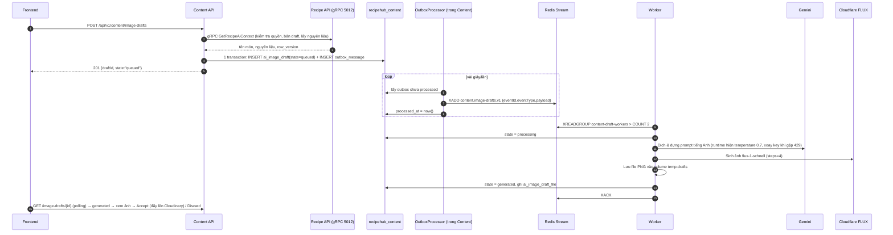
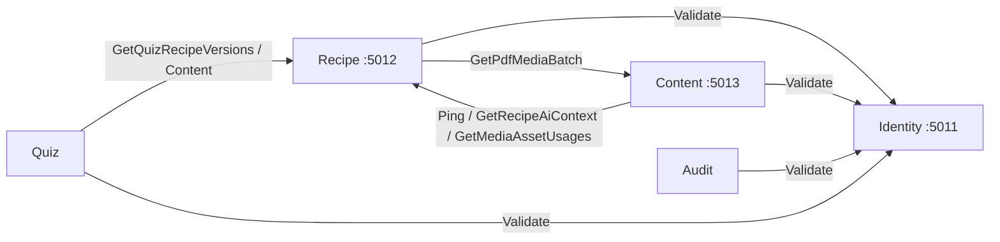

# 07. Hạ tầng: Docker, Redis Streams, Kafka, gRPC

> Phần GV dễ "xoáy" nhất. Mỗi mục có 3 lớp: **khái niệm → code thật (file:dòng) → lệnh chứng minh đang chạy**. Đường dẫn code tính từ `src/backend/` nếu không ghi khác.

---

## A. Docker & Docker Compose

### A1. Khái niệm
- **Image** = bản đóng gói (code đã build + runtime). **Container** = một image đang chạy.
- **Dockerfile** = công thức build image. **Compose** = mô tả nhiều container + mạng + volume.
- **Volume** = ổ dữ liệu nằm ngoài container, nên xóa container không mất dữ liệu.
- **Network**: Compose tạo mạng `recipehub_default`. Các container gọi nhau **bằng tên service** (`postgres`, `kafka`, `identity-service`…) nhờ DNS nội bộ của Docker.

### A2. Dockerfile multi-stage (.NET), ví dụ Recipe
`Services/Recipe/RecipeHub.Recipe.Api/Dockerfile`:

```dockerfile
FROM mcr.microsoft.com/dotnet/sdk:8.0 AS build      # stage 1: có SDK để build
COPY Directory.Build.props, BuildingBlocks/, Contracts/, Services/Recipe/
RUN dotnet restore ... && dotnet publish -c Release -o /app/publish
FROM mcr.microsoft.com/dotnet/aspnet:8.0 AS final   # stage 2: chỉ runtime, nhỏ hơn
COPY --from=build /app/publish .
ENV ASPNETCORE_URLS=http://+:5002
ENTRYPOINT ["dotnet", "RecipeHub.Recipe.Api.dll"]
```

**Vì sao multi-stage:** image cuối không chứa SDK hay mã nguồn, nên nhỏ hơn và an toàn hơn. Build context là `src/backend`, và mỗi service chỉ COPY phần mình cần (BuildingBlocks + Contracts + chính nó), nên đúng tinh thần độc lập.

Frontend (`src/frontend/Dockerfile`) có 3 stage: `deps` (npm ci) → `builder` (npm run build, output **standalone**) → `runner` (chỉ `server.js` + static, chạy bằng user không phải root `nextjs` uid 1001).

### A3. 21 container trong `infra/compose.yaml`

| Nhóm | Container | Cổng nội bộ | Public ra host |
|---|---|---|---|
| Dữ liệu | `recipehub-postgres` (postgres:16-alpine) | 5432 | 127.0.0.1:5433 |
| | `recipehub-redis` (redis:7-alpine) | 6379 | 127.0.0.1:6380 |
| | `recipehub-kafka` (apache/kafka:3.9.0, KRaft) | 9092 / 9093 / 9094 | 127.0.0.1:9094 |
| | `recipehub-kafka-init` | – | – (job tạo topic, chạy xong thì thoát) |
| Ứng dụng | `recipehub-identity` | REST 5001, gRPC 5011 | không |
| | `recipehub-recipe` | REST 5002, gRPC 5012 | không |
| | `recipehub-content` | REST 5003, gRPC 5013 | không |
| | `recipehub-audit` | REST 5004 | không |
| | `recipehub-quiz` | REST 5005 | không |
| | `recipehub-worker` | – | không |
| | `recipehub-gateway` (YARP) | 5000 | **0.0.0.0:5000** |
| | `recipehub-frontend` (Next.js) | 3000 | **0.0.0.0:3000** |
| Quản trị/giám sát | `pgadmin`, `grafana`, `prometheus`, `kafka-ui`, `cadvisor`, `postgres-exporter`, `redis-exporter`, `kafka-exporter`, `blackbox-exporter` | | UI bind 127.0.0.1; exporter/cAdvisor không publish host |

**Điểm bảo mật cần nói:** frontend và gateway bind `0.0.0.0`; năm service backend **không publish port**, nên host không gọi thẳng chúng. DB, Redis, Kafka external listener và công cụ quản trị bind `127.0.0.1`; các exporter/cAdvisor chỉ có cổng nội bộ Docker.

### A4. Cấu hình service qua biến môi trường
ASP.NET Core đọc biến môi trường dạng `Section__Key` thành cấu hình `Section:Key`. Ví dụ trong compose:

```yaml
- ConnectionStrings__Database=Host=postgres;...;Username=${RECIPE_DB_USER};Password=${RECIPE_DB_PASSWORD}
- Grpc__IdentityServiceUrl=http://identity-service:5011
- Kafka__BootstrapServers=kafka:9092
- Messaging__AuditTransport=${AUDIT_TRANSPORT:-Kafka}
```

Gateway: file `appsettings.Development.json` trỏ `localhost` (để chạy bằng IDE). Trong Docker thì compose **ghi đè** bằng `ReverseProxy__Clusters__recipe-cluster__Destinations__destination1__Address=http://recipe-service:5002`.

### A5. Healthcheck
Mỗi service .NET expose `/health/live` (process còn sống) và `/health/ready` (đã kết nối được DB…). Compose dùng bash `/dev/tcp` để gọi `/health/live`, vì image aspnet không phải lúc nào cũng có curl. Gateway chỉ start khi cả 5 service `healthy`, frontend chỉ start khi gateway `healthy`.

**Chứng minh:** `evidence/02-docker-ps.txt`, `evidence/03-docker-network.txt` (IP từng container trong mạng `recipehub_default`), ảnh `evidence/web/33-grafana.png` (tất cả service ở trạng thái "Sẵn sàng").

---

## B. Redis Streams: hàng đợi job AI

### B1. Khái niệm (từ số 0)
Redis Stream là một danh sách **chỉ thêm vào cuối**. Mỗi phần tử có ID dạng `<millis>-<seq>` và gồm các cặp field/value.

| Lệnh | Ý nghĩa |
|---|---|
| `XADD stream * k v` | Thêm message |
| `XGROUP CREATE stream group $ MKSTREAM` | Tạo consumer group (tạo luôn stream nếu chưa có) |
| `XREADGROUP GROUP g consumer COUNT n STREAMS s >` | Lấy message **mới chưa giao cho ai**. Message chuyển vào **PEL** (Pending Entries List) |
| `XACK stream group id` | Báo xử lý xong, xóa khỏi PEL |
| `XPENDING` | Xem message đã giao nhưng chưa ACK (consumer chết giữa chừng) |
| `XAUTOCLAIM` | Giành lại message treo quá lâu của consumer khác |

Đảm bảo **at-least-once**: message chỉ biến mất khỏi PEL khi đã ACK, nên worker chết thì job vẫn còn.

### B2. Ba stream trong hệ thống

| Stream | Producer | Consumer group | Consumer (trong Worker) |
|---|---|---|---|
| `content.image-drafts.v1` | Content API (`OutboxProcessorHostedService`) | `content-draft-workers` | `ContentDraftProcessingWorker` |
| `quiz.ai-generation.v1` | Quiz API (`RedisQuizAiJobQueue`) | `quiz-ai-workers` | `QuizAiGenerationWorker` |
| `platform.heartbeat.v1` | Smoke test | `recipehub-workers` | `StreamConsumerWorker` |

### B3. Luồng tạo ảnh AI (đã chạy thật, xem `evidence/05-e2e-demo-run.txt` bước 9)



Code:
- Tạo draft + outbox **trong cùng transaction**: `Services/Content/RecipeHub.Content.Application/Services/ImageDraftService.cs:52` (gọi gRPC), `:98` (tạo `OutboxMessage`).
- Relay outbox sang Redis: `Services/Content/RecipeHub.Content.Infrastructure/Outbox/OutboxProcessorHostedService.cs:53-90` (`StreamAddAsync` ở dòng 83; lỗi thì tăng `RetryCount` + ghi `Error`).
- Worker: `Workers/RecipeHub.BackgroundWorker/ContentDraftProcessingWorker.cs`
  - tạo group + MKSTREAM: dòng 64
  - `StreamReadGroupAsync(..., ">", count: 2)`: dòng 86, xử lý song song 2 job
  - dịch prompt, sinh ảnh, lưu tạm: các dòng ~192–200
  - **mọi nhánh kết thúc đều `StreamAcknowledgeAsync`**, kể cả payload hỏng hay draft không tồn tại. Lý do: tránh "poison message" bị đọc lại mãi.
- Quiz worker dùng thêm **`XAUTOCLAIM`** (`QuizAiGenerationWorker.cs:38`) để giành lại job bị treo quá `QuizAiJobRules.StaleAfter`.

**Vì sao dùng Outbox mà không XADD thẳng?** Nếu ghi DB thành công mà XADD lỗi (Redis tạm sập) thì job mất; ngược lại, XADD thành công mà commit DB lỗi thì có job "ma". Outbox ghi job vào DB **cùng transaction**, nên hoặc cả hai cùng có, hoặc cả hai cùng không. Bộ relay thử lại đến khi gửi được.

**Cảnh báo FLUX/Gemini:** guide yêu cầu positive framing, chỉ giữ visual elements, quy đổi món Việt sang thuộc tính vật lý, prompt 300–600 ký tự, Gemini `temperature: 0.2`, FLUX `steps: 4` (`docs/flux-schnell-prompt-engineering-guide.md:24-35,74-77,107-178`). Runtime hiện chỉ đúng `steps: 4`; `GeminiPromptTranslator` vẫn dùng câu `Do NOT`, `temperature = 0.7`, giới hạn 1.800 ký tự (`src/backend/Services/Content/RecipeHub.Content.Infrastructure/Ai/GeminiPromptTranslator.cs:72-96`). Thiếu Cloudflare credential còn sinh PNG mô phỏng (`src/backend/Services/Content/RecipeHub.Content.Infrastructure/Ai/CloudflareFluxGenerator.cs:31-38`). Đây là sai lệch thật, không được nói runtime đã tuân thủ đầy đủ guide hoặc lấy fallback làm bằng chứng FLUX thật.

### B4. Chứng minh
```bash
docker exec recipehub-redis redis-cli XINFO GROUPS content.image-drafts.v1   # consumers=1, pending=0, lag=0
docker exec recipehub-redis redis-cli XREVRANGE content.image-drafts.v1 + - COUNT 1
docker exec recipehub-redis redis-cli XPENDING content.image-drafts.v1 content-draft-workers   # 0 = đã ACK
docker logs recipehub-worker | grep -A1 ContentDraftProcessingWorker
```
Log thật (`evidence/05-e2e-demo-run.txt`):
```
Processing image draft job b74f284f-... from Redis message 1794777258191-0
Calling AI prompt translator for draft b74f284f-...
Gemini key index 0 encountered 429 Too Many Requests. Rotating to next key.
Calling image generator for draft b74f284f-...
Draft b74f284f-... successfully generated and saved to b74f284f....png
```
Ảnh sinh ra: `evidence/08-ai-generated-image.png`. Bảng `outbox_message` có `processed_at` sau `created_at` khoảng 1,2 giây.

---

## C. Kafka: luồng audit (ai làm gì, lúc nào)

### C1. Khái niệm
- **Broker**: máy chủ Kafka. Ở đây có 1 broker chạy chế độ **KRaft** (không cần ZooKeeper): `KAFKA_PROCESS_ROLES: broker,controller`.
- **Topic** `recipehub.audit.activities.v1`: **3 partition**, lưu giữ 7 ngày (`retention.ms=604800000`). DLQ `…v1.dlq`: 1 partition, lưu 14 ngày (`infra/kafka/create-topics.sh`).
- **Key** quyết định partition: cùng key thì cùng partition, nên **giữ đúng thứ tự** các sự kiện của cùng một đối tượng.
- **Consumer group** `recipehub-audit`: Kafka lưu **offset đã commit** của group. Consumer khởi động lại thì đọc tiếp từ đó.
- **Listeners**: `INTERNAL://kafka:9092` (container nói chuyện với nhau), `EXTERNAL://localhost:9094` (từ máy host), `CONTROLLER://:9093` (KRaft).

### C2. Producer: `BuildingBlocks/RecipeHub.BuildingBlocks/Audit/KafkaAuditActivityPublisher.cs`
- Cấu hình (dòng 26–35): `Acks = All` (đợi broker ghi xong), `EnableIdempotence = true` (retry không tạo bản trùng), `LingerMs = 5` (gom batch), `CompressionType = Snappy`, `MessageTimeoutMs` ≤ 3 giây (không để request người dùng chờ lâu).
- Message (dòng 37–48): **Key = `TargetId`** (id phiên bản công thức), Value = JSON `EventEnvelope<AuditActivityEvent>`, kèm header `event-id`, `event-type`, `source`, `schema-version`.
- Lỗi publish bị **bắt và log warning** (dòng 62–66). Nhờ vậy audit hỏng thì nghiệp vụ chính vẫn chạy.
- Chọn transport bằng cấu hình (`Audit/DependencyInjection.cs:15-34`): `Kafka` | `Redis` | `Dual` (gửi cả hai, phục vụ chuyển đổi dần từ Redis sang Kafka). Đây là **Strategy pattern** qua DI.
- Service publish: Identity (`Program.cs:29`), Recipe (`Program.cs:53`), Quiz (`Program.cs:65`), Worker (`Program.cs:15`).

`EventEnvelope<T>` (`BuildingBlocks/RecipeHub.BuildingBlocks/Events/EventEnvelope.cs`) là "phong bì" chung cho mọi sự kiện: `EventId`, `EventType`, `OccurredAtUtc`, `CorrelationId`, `Source`, `SchemaVersion`, `Payload`. Có `SchemaVersion` để sau này đổi cấu trúc payload mà consumer cũ vẫn nhận biết được.

### C3. Consumer: `Services/Audit/RecipeHub.Audit.Infrastructure/Messaging/AuditKafkaConsumer.cs` (chạy trong **Worker**, đăng ký ở `Workers/.../Program.cs:12`)
- `EnableAutoCommit = false`, `EnableAutoOffsetStore = false` (dòng 39–40): **chỉ commit sau khi đã ghi DB thành công**, nên đảm bảo at-least-once.
- `AutoOffsetReset = Earliest`: group mới sẽ đọc từ đầu topic.
- Vòng lặp chạy trên thread riêng (`TaskCreationOptions.LongRunning`, dòng 31) vì `Consume()` là lời gọi blocking.
- Xử lý + retry (`AuditKafkaRetryPolicy.cs`): tối đa `MaxDeliveryAttempts = 3`, backoff 1s → 2s. Hết số lần thì gửi **DLQ** với reason `processing-failed`. Message không parse được (poison) thì gửi DLQ ngay.
- DLQ message giữ nguyên key/value, thêm header `dlq-reason`, `dlq-attempts`, `dlq-original-topic/partition/offset` (dòng 117–131) để điều tra sau.
- **Idempotent**: `AuditLogWriter` dùng `EventId` làm **khóa chính** của `audit_log`. Message bị giao lại sẽ gặp `UniqueViolation`, kết quả trả về là `Duplicate`, rồi vẫn commit. Không bao giờ có bản ghi trùng.
- Gửi DLQ thất bại thì **không commit** và tạo lại consumer, nên không thể "nhảy qua" một message lỗi (comment ở dòng 79–80).

```mermaid
sequenceDiagram
  autonumber
  participant U as R&D (web)
  participant RC as Recipe API
  participant K as Kafka topic (3 partitions)
  participant W as Worker: AuditKafkaConsumer
  participant DB as recipehub_audit.audit_log
  participant AD as Admin (web /admin/logs)
  U->>RC: POST /api/v1/recipes (tạo công thức)
  RC->>RC: Lưu recipe (recipehub_recipe)
  RC-)K: Produce key=versionId, value=EventEnvelope{action:"recipe.created"}
  RC->>K: await producer (tối đa timeout ngắn; lỗi chỉ log)
  RC-->>U: 201 Created sau bước publish best-effort
  W->>K: Consume (group recipehub-audit)
  W->>DB: INSERT audit_log(id=EventId)
  W->>K: Commit offset
  AD->>RC: (qua gateway) GET /api/v1/audit/logs → Audit API đọc DB
```

### C4. Chứng minh (đã chạy thật)
```bash
docker exec recipehub-kafka /opt/kafka/bin/kafka-topics.sh --bootstrap-server localhost:9092 --describe
docker exec recipehub-kafka /opt/kafka/bin/kafka-consumer-groups.sh --bootstrap-server localhost:9092 --describe --group recipehub-audit
```
Kết quả (`evidence/05-e2e-demo-run.txt`):
```
GROUP           TOPIC                         PARTITION  CURRENT-OFFSET  LOG-END-OFFSET  LAG
recipehub-audit recipehub.audit.activities.v1 1          2               2               0
recipehub-audit recipehub.audit.activities.v1 2          2               2               0
[KAFKA-ACK] topic=recipehub.audit.activities.v1 partition=1 offset=1 eventId=cca735c5... action=recipe.published
```
- `LAG = 0` nghĩa là consumer đã xử lý hết.
- 2 sự kiện của cùng một công thức (`recipe.created`, `recipe.published`) **cùng partition**, vì cùng key.
- Bản ghi tương ứng có trong `audit_db.audit_log` và hiển thị trên trang admin: `evidence/web/19-admin-admin-logs.png`.
- Kafka UI: `evidence/web/30-kafka-ui-topics.png`, `31-kafka-ui-messages.png`, `32-kafka-ui-consumers.png`.

### C5. Vì sao Kafka cho audit, Redis cho job (so sánh)

| Tiêu chí | Kafka (audit) | Redis Streams (job AI) |
|---|---|---|
| Bản chất dữ liệu | Log sự kiện lịch sử, có thể cần đọc lại | Việc cần làm, xong là thôi |
| Lưu trữ | Trên đĩa, giữ 7 ngày kể cả khi đã đọc | Bộ nhớ Redis; compose hiện không gắn volume/AOF riêng |
| Nhiều hệ thống cùng đọc | Mỗi group có offset riêng | Có, nhưng ít dùng |
| Thứ tự | Theo partition/key | Theo stream |
| Vận hành | Nặng hơn (JVM) | Nhẹ, đã có sẵn |

---

## D. gRPC: giao tiếp đồng bộ nội bộ

### D1. Khái niệm
- Định nghĩa hợp đồng trong `.proto`. Package `Grpc.Tools` **sinh code C#** cho cả server (base class) và client (stub). Xem `Contracts/RecipeHub.GrpcContracts/RecipeHub.GrpcContracts.csproj`: `<Protobuf Include="Protos\*.proto" GrpcServices="Both" />`.
- Chạy trên **HTTP/2**. Mỗi service mở **2 cổng Kestrel**: HTTP/1.1 cho REST, HTTP/2 cho gRPC. Ví dụ `Services/Recipe/RecipeHub.Recipe.Api/Program.cs:21-24`: `ListenAnyIP(5002, Http1)` và `ListenAnyIP(5012, Http2)`. Tách cổng vì gRPC không TLS (h2c) cần cổng chỉ chạy HTTP/2.
- Payload là Protobuf nhị phân, nhỏ và nhanh hơn JSON. Có `deadline` (timeout) cho từng lời gọi.

### D2. Toàn bộ hợp đồng gRPC

| File .proto | Service / RPC | Server (cổng) | Client gọi | Dùng để |
|---|---|---|---|---|
| `identity_session.proto` | `IdentitySession.Validate` | Identity (5011) `Program.cs:81` | Recipe, Content, Audit, Quiz (AuthenticationHandler) | **Mỗi request** có Bearer token: kiểm tra token + session còn hiệu lực, trả `user_id`, `role`, `display_name` |
| `probe.proto` | `ServiceProbe.Ping` | Recipe (5012) `Program.cs:91` | Content `/api/v1/content/probe-recipe` | Kiểm tra kênh gRPC (smoke test) |
| `recipe_ai_context.proto` | `RecipeAiContextQuery.GetRecipeAiContext`, `GetMediaAssetUsages` | Recipe (5012) `Program.cs:92` | Content (`RecipeGrpcContextClient.cs:58,162`) | Lấy ngữ cảnh công thức trước khi tạo job ảnh AI; kiểm tra ảnh đang được công thức nào dùng |
| `quiz_recipe_query.proto` | `QuizRecipeQuery.GetQuizRecipeVersions`, `GetQuizRecipeContent` | Recipe (5012) `Program.cs:93` | Quiz, Content | Quiz lấy danh sách/nội dung phiên bản đã phát hành để tạo đề |
| `content_pdf_media.proto` | `ContentPdfMediaQuery.GetPdfMediaBatch` | Content (5013) `Program.cs:115` | Recipe (`ContentPdfMediaResolver.cs:89`) | Khi xuất PDF, Recipe lấy URL ảnh từ Content |



### D3. Luồng xác thực bằng gRPC (quan trọng, GV hay hỏi)
`Services/Recipe/RecipeHub.Recipe.Api/RecipeAuthenticationHandler.cs`:
1. Request tới `/api/v1/recipes/...` với header `Authorization: Bearer <JWT>`.
2. Handler gọi `identity.ValidateAsync(new ValidateSessionRequest{AccessToken=...}, deadline: now+5s)`.
3. Identity (`IdentitySessionService.cs:9` → `AuthService.ValidateAsync`, `Services/Identity/RecipeHub.Identity.Application/Services/AuthService.cs:39-47`) kiểm tra chữ ký JWT, rồi tra **session trong DB** (`identity_db.auth_sessions`). Token bị từ chối nếu session không tồn tại, `revoked_at` khác null (đã logout), đã hết hạn, user bị khóa (`!IsActive`), hoặc session tạo trước lần cập nhật user gần nhất (đổi mật khẩu/role thì mọi phiên cũ mất hiệu lực).
4. Nếu `valid` thì tạo `ClaimsPrincipal` với `NameIdentifier = user_id`, `Role = role`, `Name = display_name`, rồi `[Authorize(Roles=...)]` hoạt động như bình thường.
5. Lỗi mạng gRPC (`RpcException`) thì `AuthenticateResult.Fail`, trả 401. Không bao giờ "cho qua" khi không xác thực được (fail-closed).

**Vì sao không để từng service tự verify JWT?** Tự verify thì nhanh hơn, nhưng **không thu hồi được** token khi logout hoặc khóa tài khoản. Hỏi Identity thì có kiểm soát session tập trung. Đánh đổi: thêm 1 lời gọi gRPC mỗi request (vài ms trong mạng nội bộ, HTTP/2 tái sử dụng kết nối).

### D4. Truyền danh tính qua gRPC
Ở `recipe_ai_context.proto`, danh tính người gọi được truyền qua **metadata header** (`Authorization` / `X-Authenticated-Actor`), không tin vào trường do client tự khai. Phía Recipe xác thực lại token đó qua Identity (ví dụ `QuizRecipeQueryServiceImpl.cs:181`). Nhờ vậy Content không thể "giả danh" người khác để đọc công thức không có quyền.

### D5. Chứng minh
- Smoke bước 3: `gRPC Response: {"success":true,"targetService":"RecipeHub.Recipe.Api",...,"status":"Healthy"}`.
- Demo bước 7 (`curl /api/v1/content/probe-recipe`): kết quả tương tự.
- Demo bước 9: tạo draft thành công, chứng tỏ Content đã gọi `GetRecipeAiContext` sang Recipe. Nếu bản đã publish, Recipe trả lỗi và Content trả **409 "Published recipe version is immutable"** (đã gặp thật khi chạy).
- Log xác thực: `docker logs recipehub-recipe | grep RecipeAuth` cho thấy `Identity gRPC response: Valid=True, UserId=..., Role=rnd`.

---

## E. Gateway YARP

`Gateway/RecipeHub.Gateway/appsettings.json`: 5 route, mỗi route gắn với 1 cluster.

| Route | Cluster (Docker) |
|---|---|
| `/api/v1/identity/{**catch-all}` | `http://identity-service:5001` |
| `/api/v1/recipes/{**catch-all}` | `http://recipe-service:5002` |
| `/api/v1/content/{**catch-all}` | `http://content-service:5003` |
| `/api/v1/audit/{**catch-all}` | `http://audit-service:5004` |
| `/api/v1/quiz/{**catch-all}` | `http://quiz-service:5005` |

Gateway **không tự xác thực**, chỉ chuyển nguyên header `Authorization`. Mỗi service tự xác thực qua gRPC Validate (mục D3). Chứng minh: gọi `/api/v1/recipes` không kèm token trả **HTTP 401** (demo bước 3).

---

## F. Giám sát (observability)

- **Prometheus** (`infra/prometheus/prometheus.yml`) thu thập `/metrics` của các service và các exporter (postgres, redis, kafka, cadvisor). **Blackbox exporter** gọi `/health/ready` để đo độ sẵn sàng.
- **Grafana** được provision sẵn datasource và dashboard `recipehub-monitoring.json`. Ảnh `evidence/web/33-grafana.png` cho thấy cả 8 web/API đều "Sẵn sàng" và PostgreSQL/Redis "Sẵn sàng".
- **pgAdmin** có sẵn `servers.json` trỏ tới Postgres.
