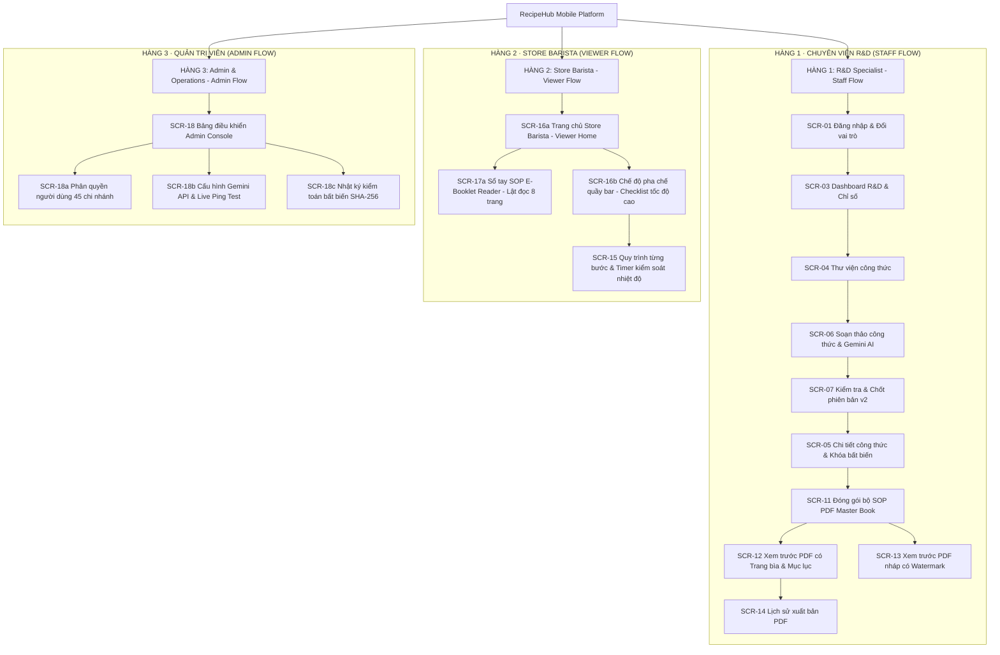

# RecipeHub Mobile — Kiến Trúc Thông Tin & User Flows (3-Row Architecture)

> **Figma Design Link**: [RecipeHub Mobile Design](https://www.figma.com/design/FycUpbP0PtH6Q4sg6IvZr6/RecipeHub?node-id=0-1&p=f&t=CCMYGJ1nhqFSWdS1-0)  
> **Figma File Key**: `FycUpbP0PtH6Q4sg6IvZr6`  
> **Phiên bản chuẩn hóa**: 2.0 (Đồng bộ 100% Mobile Flutter, 3 Luồng nghiệp vụ theo hàng, Sổ tay SOP E-Booklet Reader & Phân hệ Admin)

---

## 1. Kiến Trúc Thông Tin (Information Architecture - IA)

Hệ thống được tổ chức khoa học theo 3 hàng / luồng trải nghiệm (3-Row Swimlanes Architecture) đáp ứng đầy đủ chu trình vòng đời công thức từ R&D đến Vận hành cửa hàng:



---

## 2. Chi Tiết 3 Luồng Trải Nghiệm Theo Hàng (3-Row Architecture Flows)

### Hàng 1: Luồng Chuyên Viên R&D (Staff Flow — R&D Lead)
* **Bối cảnh**: Chuyên viên làm việc tại bếp thử nghiệm trung tâm, sáng tạo và tinh chỉnh định lượng công thức đồ uống mới.
* **Hành trình**:
  1. **Đăng nhập (SCR-01)**: Đăng nhập bằng email công việc hoặc chọn lối tắt vai trò `Hàng 1: Nhân viên R&D`.
  2. **Dashboard R&D (SCR-03)**: Nắm bắt tổng số công thức, số bản nháp đang nghiên cứu và lối tắt tạo món mới.
  3. **Thư viện công thức (SCR-04)** & **Quản lý nguyên liệu (SCR-08)**: Tra cứu danh mục, kiểm tra nguyên liệu còn hoạt động hoặc đã ngừng dùng.
  4. **Soạn thảo công thức & Gọi AI (SCR-06)**: Nhập định lượng chuẩn (gram/ml), gọi trợ lý Gemini 1.5 Pro hỗ trợ hoàn thiện lời văn quy trình (Human-in-the-loop: Chuyên viên toàn quyền Chấp nhận hoặc Từ chối).
  5. **Xem lại & Chốt phiên bản (SCR-07)**: Kiểm tra bảng checklist, bấm nút khóa để biến công thức thành bất biến (**Approved**).
  6. **Chi tiết công thức đã khóa (SCR-05)**: Hiển thị banner khóa bất biến màu xanh, muốn sửa đổi bắt buộc phải nhân bản tạo bản sửa đổi (v2, v3).
  7. **Đóng gói PDF Master Book (SCR-11 -> SCR-12 -> SCR-14)**: Gom nhiều món vào 1 file PDF duy nhất có trang bìa và mục lục, tự động đóng watermark nếu có bản nháp chưa chốt.

### Hàng 2: Luồng Store Barista (Viewer Flow — Quầy Pha Chế 45 Chi Nhánh)
* **Bối cảnh**: Barista tại chi nhánh (ví dụ: Landmark 81, Cầu Giấy) cần tra cứu nhanh công thức đã chốt và thực hiện pha chế trong giờ cao điểm.
* **Hành trình**:
  1. **Trang chủ Store Barista (SCR-16a - Viewer Home)**:
     - Header mang logo hạt cà phê squircle thương hiệu NomadKit.
     - Banner định danh chi nhánh: *"Chi nhánh Landmark 81 · Ca sáng"*.
     - Ô tìm kiếm đồ uống nhanh và bộ lọc danh mục món (Cà phê & Cold Brew, Trà sữa & Kem mây, Topping).
     - Banner lớn: **"Lật đọc Sổ tay SOP điện tử (E-Booklet Reader)"**.
  2. **Sổ tay SOP E-Booklet Reader (SCR-17a - Trải nghiệm đọc sách điện tử 3D)**:
     - Lật trang ngang mượt mà mô phỏng sách giấy thật với hiệu ứng đổ bóng gáy sách (Spine shadow).
     - 8 trang nội dung chuẩn mực: Bìa sách, Tiêu chuẩn an toàn quầy bar, SOP Cold Brew Cam Quế v2, Kỹ thuật ủ lạnh 16h, SOP Ô Long Sen Vàng v1, Kỹ thuật đánh kem Macchiato sánh mịn, SOP Matcha Latte Mây v3 (nháp có watermark), Bảng dung sai và Hotline R&D.
     - Thanh điều hướng: Trượt trang (scrubber), chuyển trang trước/sau, mở Drawer Mục lục (TOC) nhảy đến trang bất kỳ.
  3. **Chế độ Barista Viewer Checklist (SCR-16b)**:
     - Giao diện tối giản chỉ đọc, chữ to rõ ràng từ xa (16–26sp).
     - Checklist định lượng nhanh từng thành phần, đánh dấu hoàn tất từng bước.
  4. **Quy trình từng bước có bấm giờ Timer (SCR-15)**:
     - Hỗ trợ đồng hồ đếm ngược 45s, 80s và cảnh báo kiểm soát nhiệt độ nước 75°C.

### Hàng 3: Luồng Quản Trị Viên (Admin Flow — Operations & IT Director)
* **Bối cảnh**: Quản lý vận hành chuỗi và Trưởng bộ phận IT giám sát phân quyền, cấu hình AI và lưu vết bảo mật.
* **Hành trình**:
  1. **Bảng điều khiển Admin Console (SCR-18)**:
     - Thống kê thời gian thực: 45 Chi nhánh, 48 Tài khoản nhân sự, 98.5% Tuân thủ SOP, Gemini API Active.
     - 3 ô gạch phân hệ tương tác trực tiếp (`onTap` mở màn hình con chuyên biệt).
  2. **Phân quyền tài khoản (SCR-18a - AdminUserManagementPage)**:
     - Lọc theo nhóm vai trò: Tất cả (48) | R&D Specialists (6) | Baristas (38) | Quản trị viên (4).
     - Danh sách thẻ người dùng hiển thị họ tên, email công việc, chi nhánh phụ trách, chip quyền hạn (Tạo mới, Chốt v2, Xuất PDF, Chỉ đọc).
     - Công tắc (Switch) kích hoạt / tạm khóa tài khoản nhanh chóng.
     - Nút tạo tài khoản và gửi email mời phân quyền chi nhánh mới.
  3. **Cấu hình Gemini API & AI Engine (SCR-18b - AdminAiConfigPage)**:
     - Chọn mô hình AI: Google Gemini 1.5 Pro (Độ chính xác R&D) hoặc Gemini 1.5 Flash (Tốc độ cao).
     - Ô nhập API Key bảo mật với icon ẩn/hiện mắt.
     - Thanh trượt Temperature (khuyến nghị 0.2 cho chuẩn F&B chặt chẽ).
     - Khung thiết lập System Prompt & Brand Guidelines.
     - Thanh tiến độ đo lường hạn ngạch Token trong tháng.
     - **Nút "Kiểm tra kết nối (Ping Test Live)"**: Nhấn để mô phỏng gửi gói tin kiểm tra, hiển thị kết quả thời gian thực: `Latency: 138ms · HTTP 200 OK · Gemini 1.5 Pro Active`.
  4. **Nhật ký kiểm toán (SCR-18c - AdminAuditLogsPage)**:
     - Lưu vết bất biến (Immutable Audit Trail) toàn chuỗi: Ai đã tạo, sửa, chốt công thức hoặc xuất PDF vào thời điểm nào.
     - Mỗi bản ghi có mã băm toàn vẹn **SHA-256**, địa chỉ IP và thiết bị thực thi (ví dụ: `Pixel 5 Mobile · 192.168.1.42`).
     - Bộ lọc loại sự kiện và nút xuất báo cáo `Audit_Report_Oct2026.csv`.

---

## 3. Danh Mục Màn Hình & Trạng Thái Ứng Dụng (23 Màn hình / Phân hệ)

| Mã | Tên màn hình / Phân hệ | Cấp bậc | Luồng (Row) | Flutter Widget tương ứng |
| :--- | :--- | :--- | :--- | :--- |
| **SCR-01** | Đăng nhập & Chọn vai trò 3 luồng | Cấp 1 | Chung | `LoginFigmaPage` |
| **SCR-02** | Đăng ký tài khoản chuyên viên mới | Cấp 1 | Row 1 | `RegisterFigmaPage` |
| **SCR-03** | Bảng điều khiển Dashboard R&D | Cấp 1 (Tab 1) | Row 1 | `DashboardFigmaPage` |
| **SCR-04** | Thư viện & Tìm kiếm công thức | Cấp 1 (Tab 2) | Row 1 | `LibraryFigmaPage` |
| **SCR-05** | Chi tiết công thức & Khóa bất biến | Cấp 2 | Row 1 | `RecipeDetailFigmaPage` |
| **SCR-06** | Soạn thảo công thức & Gemini AI | Cấp 2 | Row 1 | `RecipeEditorPage` |
| **SCR-07** | Xem lại & Phê duyệt chốt phiên bản | Cấp 3 | Row 1 | `RecipeReviewPage` |
| **SCR-08** | Danh mục nguyên liệu chuẩn chuỗi | Cấp 1 (Tab 3) | Row 1 | `IngredientsFigmaPage` |
| **SCR-09** | Thêm nguyên liệu mới vào kho R&D | Cấp 2 | Row 1 | `IngredientFormPage` |
| **SCR-10** | Cập nhật nguyên liệu & Ngừng dùng | Cấp 2 | Row 1 | `EditIngredientDialog` |
| **SCR-11** | Chọn nhiều công thức gom PDF Master | Cấp 2 | Row 1 | `BatchExportPage` |
| **SCR-12** | Xem trước PDF Master có Trang bìa & Mục lục | Cấp 3 | Row 1 | `PdfCoverPreviewPage` |
| **SCR-13** | Xem trước PDF nháp có Watermark | Cấp 3 | Row 1 | `PdfDraftWatermarkPreviewPage` |
| **SCR-14** | Kho lưu trữ & Lịch sử xuất bản PDF | Cấp 1 (Tab 4) | Row 1 | `ExportHistoryPage` |
| **SCR-15** | Hướng dẫn pha chế từng bước & Timer | Cấp 2 | Row 2 | `StepByStepCookingPage` |
| **SCR-16a** | **Trang chủ Store Barista (Viewer Home)** | Cấp 1 | Row 2 | `ViewerHomePage` |
| **SCR-16b** | **Chế độ Barista Viewer (Checklist)** | Cấp 2 | Row 2 | `BaristaViewerPage` |
| **SCR-17a** | **Sổ tay SOP E-Booklet Reader (8 Trang)** | Cấp 2 | Row 2 | `BookletReaderPage` |
| **SCR-17b** | Hồ sơ tài khoản & Lối tắt hệ thống | Cấp 1 (Tab 5) | Chung | `AccountFigmaPage` |
| **SCR-18** | **Bảng điều khiển Admin Console** | Cấp 1 | Row 3 | `AdminConsolePage` |
| **SCR-18a** | **Phân quyền tài khoản 45 chi nhánh** | Cấp 2 | Row 3 | `AdminUserManagementPage` |
| **SCR-18b** | **Cấu hình Gemini API & Live Ping Test** | Cấp 2 | Row 3 | `AdminAiConfigPage` |
| **SCR-18c** | **Nhật ký kiểm toán SHA-256** | Cấp 2 | Row 3 | `AdminAuditLogsPage` |
| **SCR-19** | Trạng thái Loading chuyển cảnh | Overlay | Chung | `LoadingTransitionPage` |
| **SCR-20** | Trạng thái Sự cố mạng & Bảo toàn nháp | Overlay | Chung | `ErrorRecoveryPage` |

---

## 4. Giải Pháp Chuyển Giao Giao Diện Lên Figma Prototype & Demo Mobile

### 4.1. Giải Pháp Trích Xuất Giao Diện & Nút Bấm Lên Figma Làm Prototype
1. **Chụp màn hình Pixel-Perfect trực tiếp từ Android Native**:
   - Sử dụng lệnh ADB chụp ảnh trực tiếp từ màn hình thiết bị Android (Pixel 5, độ phân giải 360 x 800 dp hoặc 412 x 915 dp):
     ```powershell
     adb exec-out screencap -p > scr_filename.png
     ```
   - Ảnh chụp có đầy đủ logo hạt cà phê squircle NomadKit, typography Inter, nút bấm cao chuẩn 50–52dp bo góc 16dp.
2. **Tổ chức Figma Frame & Hotspot Overlays**:
   - Trong file Figma `FycUpbP0PtH6Q4sg6IvZr6`, tạo các Mobile Frame chuẩn (360x800).
   - Đặt ảnh chụp UI vào frame làm nền trực quan.
   - Vẽ các lớp **Hotspot Layer** trong suốt phủ lên đúng vị trí nút bấm (ví dụ: Nút "Đăng nhập", 3 ô gạch Admin, nút "Lật đọc sách", nút "Pha chế").
3. **Cấu hình Prototype Interactions**:
   - Gán tương tác `On click / On tap` -> `Navigate to` màn hình đích tương ứng.
   - Thiết lập hiệu ứng chuyển cảnh `Smart Animate` (cho modal/dialog) hoặc `Slide In` / `Push Left` (cho chuyển trang danh mục).

### 4.2. Demo Giao Diện Hoàn Toàn Bằng Mobile — KHÔNG DÙNG TRÌNH DUYỆT WEB
* **Phương án 1 (Figma Mirror Native App)**:
  - Cài đặt ứng dụng **Figma Mirror** (hoặc Figma Mobile App) trên máy ảo Android Pixel 5 hoặc điện thoại thật.
  - Chọn file Figma `FycUpbP0PtH6Q4sg6IvZr6`, ứng dụng sẽ phản chiếu trực tiếp giao diện mobile 100% tỷ lệ thật, hỗ trợ cảm ứng ngón tay, vuốt lật trang tự nhiên mà không thông qua trình duyệt web.
* **Phương án 2 (Ứng dụng Flutter Mobile Chạy Native 60 FPS)**:
  - Chạy trực tiếp mã nguồn ứng dụng trên máy ảo Android Pixel 5 (`emulator-5554`):
    ```powershell
    flutter run -d emulator-5554
    ```
  - Trải nghiệm toàn bộ tương tác thực: Thử nghiệm Ping Test API Gemini có phản hồi thời gian thực, lật trang sách SOP mượt mà 60fps, bấm giờ Timer pha chế và chuyển đổi qua lại giữa 3 vai trò.
