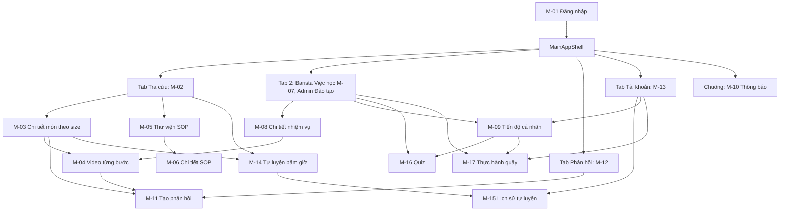

# RecipeHub Mobile — Kiến trúc thông tin và luồng (2 vai trò)

Figma: https://www.figma.com/design/FycUpbP0PtH6Q4sg6IvZr6/RecipeHub (key `FycUpbP0PtH6Q4sg6IvZr6`).
Đồng bộ với code `lib/features/**` và `requirements-draft.md`. Điều hướng: `MainAppShell` với 4 tab, chuông thông báo ở thanh trên.

## 1. Sơ đồ

## 2. Luồng Barista (Viewer)
1. Đăng nhập (M-01), vào tab Tra cứu.
2. Tìm món, lọc danh mục, mở chi tiết (M-03), đổi size S/M/L, định lượng đổi theo.
3. Mở video theo bước (M-04); gặp lỗi hoặc thắc mắc thì gửi phản hồi (M-11).
4. Việc học (M-07, M-08, M-09): đọc/xem đủ 100%, làm quiz (M-16), xem kết quả thực hành quầy (M-17); M-09, M-15, M-17 cũng mở được từ tab Tài khoản.
5. Tự luyện có bấm giờ (M-14) mở từ Tra cứu hoặc chi tiết món, xem lại lịch sử (M-15).
6. Thông báo (M-10): việc học mới, công thức đổi phiên bản, phản hồi được trả lời.

## 3. Luồng Admin (quản lý cửa hàng)
1. Đăng nhập chọn vai trò Admin; vẫn dùng được tab Tra cứu và SOP.
2. Tab Đào tạo (`AdminStoreTrainingPage`): tiến độ nhân viên chi nhánh, quá hạn, cần học lại.
3. Chấm thực hành bằng checklist trong `PracticalEvaluationPage` (M-17, chế độ Admin), mở từ tab Đào tạo.
4. Xem và trả lời phản hồi ở tab Phản hồi.

## 4. Danh mục màn hình

| Mã | Màn hình | Widget | Vai trò |
| :--- | :--- | :--- | :--- |
| M-01 | Đăng nhập, chọn vai trò | `LoginPage` | Chung |
| M-02 | Tra cứu tại quầy (Tab 1) | `CounterRecipeLookupPage` | Chung |
| M-03 | Chi tiết món theo size | `RecipeDetailSizePage` | Chung |
| M-04 | Video chuẩn từng bước | `StepVideoGuidePage` | Chung |
| M-05 | Thư viện SOP | `SopCatalogPage` | Chung |
| M-06 | Chi tiết SOP | `SopDetailPage` | Chung |
| M-07 | Việc học của tôi (Tab 2) | `MyLearningPage` | Barista |
| M-08 | Chi tiết nhiệm vụ học | `LearningTaskDetailPage` | Barista |
| M-09 | Tiến độ cá nhân 3 tầng | `PersonalProgressPage` | Barista |
| M-10 | Thông báo | `NotificationsPage` | Chung |
| M-11 | Tạo phản hồi | `CreateFeedbackPage` | Chung |
| M-12 | Phản hồi của tôi (Tab 3) | `MyFeedbackListPage` | Chung |
| M-13 | Tài khoản (Tab 4) | `AccountProfilePage` | Chung |
| M-14 | Tự luyện và bấm giờ | `SelfPracticeTimerPage` | Barista |
| M-15 | Lịch sử tự luyện | `PracticeHistoryPage` | Barista |
| M-16 | Quiz | `QuizExamPage` | Barista |
| M-17 | Đánh giá thực hành quầy | `PracticalEvaluationPage` | Barista xem, Admin chấm |
| A-01 | Đào tạo chi nhánh (Tab 2 Admin) | `AdminStoreTrainingPage` | Admin |
| SYS | Loading chuyển cảnh (chỉ mở từ máy chủ automation) | `LoadingTransitionPage` | Chung |
| SYS | Mất kết nối, khôi phục (chỉ mở từ máy chủ automation) | `ErrorRecoveryPage` | Chung |

## 5. Chuyển giao lên Figma
Plugin tự động nối prototype nằm ở `tools/figma-prototype-plugin/` (ngoài thư mục repo mobile), xem README của plugin. Ảnh chụp màn hình lấy từ emulator qua máy chủ automation cổng 8888 trong `lib/main.dart` (`?name=m01_login`, `m02_counter_lookup`, ...).
